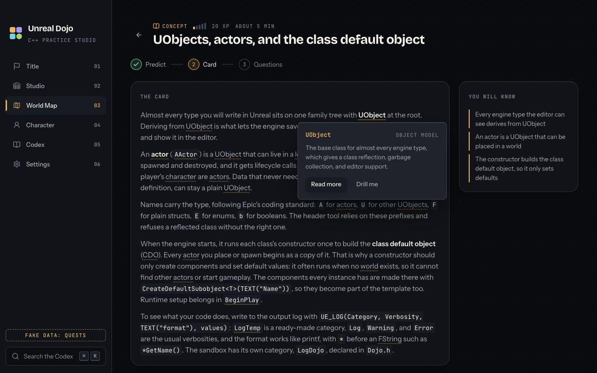

# Iterations

One entry per task per builder, written when the task is sent for review, plus one entry per fix round. Plain English, no code. Screenshots or terminal captures of the proof. The Lead sends back any entry that is missing or that only lists files.

Template:

## <task id> <task title> (<system>, <builder session>)
- What changed, in two or three sentences a non-programmer could follow.
- How to see it: the exact steps, keys, or commands.
- Proof: test output summary, screenshot paths under `docs/iterations/`.
- What was not done or is left for a later task.

### Fix round 1
- What the reviewer asked for and what changed.

## M0.1 Scaffold the app (app-shell, builder-shell)
- The app now exists as a real desktop program. It opens one dark window titled Unreal Dojo with a placeholder title screen and the app version, using the stack chosen in D01 to D08. Most libraries later tasks need were installed, but four were missed (radix-ui, gray-matter, zod, fast-xml-parser) and were added in fix round 1. The window follows the security rules in the spec: the page cannot reach Node, scripts only load from the app itself, and outside links open in the normal browser.
- How to see it: run `npm install`, then `npm run dev` for a live window, or `npm run build` then `npm run test:e2e` to open it automatically and take a picture. `npm run package` makes an installer in `dist/` (on this Mac, `Unreal Dojo-0.1.0-arm64.dmg` for Apple silicon, about 129 MB, and `Unreal Dojo-0.1.0.dmg` for Intel, about 133 MB, both unsigned; see the README note on opening it).
- What went wrong and how it was solved: the first smoke test failed because this MacBook Air's screen is shorter than 900 points, so macOS shrinks the window to fit; the test now accepts the spec's size capped by the screen (A17). The version on screen first showed Electron's version instead of the app's, because the test started the app the wrong way; it now starts the project folder like the packaged app does (A18). React's live reload would have been blocked by the strict script rule in dev; it now loads as a file instead (A16). The installer was 153 MB until libraries that are already bundled into the page stopped being shipped twice (A12).
- Proof: typecheck passes for main, preload, and renderer. Unit tests: 1 file, 1 test passed. Build: main, preload, and renderer bundles written to `out/`. End-to-end: 1 passed (window opens, title and version shown, size and minimum size checked, page has no Node access). Package: dmg built, and the packaged app was launched once and showed version 0.1.0.
- Screenshot: `docs/iterations/m0-1-window.png`

![[m0-1-window.png|800]]
*The window on first launch: dark background, title, tagline, and version.*

- Decisions made: A07 to A19 in `docs/decisions.md` (version pins and the electron-vite exception, ESM with a CommonJS preload, sandbox on, packaging layout, CSP string, test choices).
- Not done or left for later: the full typed IPC contract and its coverage test (M0.2); design tokens and the real frame (M0.3); the real content verifier (M0.4, the placeholder prints "no content checks yet"); settings service, AppError, and first-run IPC (later app-shell tasks); no app icon yet (electron-builder uses the default). The Windows nsis installer is configured but unverified on Windows. `content/` and `resources/` did not exist on this branch, so the packaged app does not contain them yet; they are picked up automatically once merged.

### Fix round 1
- What the reviewer asked for: (1) the smoke test rewrote the committed screenshot on every run; (2) with the hidden macOS title bar nothing could be dragged to move the window and the window buttons sat over the page; (3) four packages were missing and this entry wrongly said everything was installed; (4) the preload left packages to be loaded at runtime, which a sandboxed preload cannot do; (5) the app-shell and packaging specs still said content and resources go inside the app archive, and A12 did not say whether the markdown packages are used by the main process.
- What changed: test screenshots now go to the ignored `test-results/` folder, and the proof picture in `docs/iterations/` only updates when `SAVE_PROOF=1` is set. A 36px strip across the top of the window now moves the window when dragged, the macOS window buttons sit centered inside it, and the app-shell spec tells ui-core to keep that strip in the real frame. radix-ui, gray-matter, zod, and fast-xml-parser were added with exact versions under the two-week rule, plus remark-parse, which the content parser in the main process needs. The preload now bundles everything it imports. Both specs now describe the real packaging layout and point to A13; A12 explains why the markdown packages stay with the main process. The packaging config also now matches the packaging spec's app id and architectures (dmg for Apple silicon and Intel, nsis for 64-bit Windows).
- Proof: typecheck passes; unit tests 1 of 1 passed; build passes; end-to-end 1 passed, now also checking the drag strip is 36px tall and marked draggable. After the end-to-end run the working tree showed no changed tracked files. The screenshot was refreshed once with `SAVE_PROOF=1`: `docs/iterations/m0-1-window.png` (it looks the same; the strip has the page's background color).

## M0.2 Typed IPC contract (app-shell, builder-shell)
- What changed: the window and the main process now share one written-down list of everything the window can ask for: settings, finding the engine and setting up the sandbox, running and submitting quests with live progress and a cancel button, progress and rules, drills, the daily quest, and the AI reviewer. Each request is checked at the door, so a malformed request gets a friendly error instead of crashing the app, and any failure comes back as the same kind of error (what went wrong, in plain English, and what to do next). Only the app version actually answers today; every other request politely says "not built yet" and names the task that will build it.
- What was tried and what was solved: throwing an error straight out of the main process loses everything but its message, so the main process wraps every answer in an ok-or-error envelope and the bridge in the window unwraps it. A quick check in the built app confirmed the error arrives in the page whole (code, message, suggested action, details), that a request with a dangerous file name such as `../x.cpp` is refused, and that the progress subscription receives events and stops after unsubscribing.
- How to see it: `npm test` runs 27 checks on the boundary; `npm run build` then `npm run test:e2e` opens the app as before. Nothing visible changed on screen, so there is no new screenshot (the M0.1 title screen still shows the version).
- Proof: typecheck passes for main, preload, and renderer (including a compile-time check that each request has exactly one payload check per argument). Unit tests: 1 file, 27 tests passed. Build: main, preload, and renderer bundles written. End-to-end: 1 passed. All rerun after rebasing onto main with M0.1 merged.
- Change after the Lead's note: the door checks were first written by hand; the Lead added the zod library in the M0.1 fix round and asked for it, so every check is now a zod schema tied to the shared type it checks, which means a check that disagrees with its type no longer compiles (A83).
- Decisions made: A80 to A89 in `docs/decisions.md` (how errors travel, run ids, payload checks, progress event fields, file layout, the two-step breakdown submit, settings flags, the reference-solution question, and what waits for M0.2b).
- Not done or left for later: content methods (packs, worlds, quests, glossary, the term list for the code editor, pattern cards) and starting a drill wait for the content types from M0.4 (M0.2b, A89). Viewing a reference solution is left out until the specs agree on where solutions live (A88). Every real answer arrives with its system's task.

### Fix round 1
- What the reviewer asked for: (1) the unreal-pipeline spec still described the old progress event, without the run id; (2) four learner features had no place in the contract: the syntax-check button on a concept quest's example, testing out of a world, the Parsons fallback after two failed submits, and the "why does this line exist" answers on worked quests; (3) the follow-up questions about a review found it by attempt, but attempts did not keep their review; (4) an error carrying an odd extra property could break on its way to the window; (5) the bridge in the window had no test of its own.
- What changed: the pipeline spec now points to the shared progress event and lists its fields. The syntax check and test-out eligibility are now requests of their own; taking a test-out and the Parsons fallback both become kinds of drill once quest content exists (M0.2b); the fallback offer and the self-explanation gate live in the window, and the self-explanations are saved with the quest's draft (A89). Each recorded attempt can now keep its review. Errors are rebuilt from their four fields before they are sent, so nothing else can ride along. A new test runs the bridge against a fake Electron and checks it exposes only the contract, unwraps answers and errors, and that stopping a progress subscription works and is safe to do twice.
- Proof: typecheck passes; unit tests: 2 files, 35 tests passed; build passes; end-to-end: 1 passed.

## M0.3 Design tokens, app frame, navigation (ui-core, builder-ui-core)
- The app now has its look and its frame. A dark "ink and paper" theme with one accent color per pack (amber Foundations, violet Patterns, cyan Mechanics, green Systems) replaces the placeholder, with three bundled fonts: a characterful display face for headings, a calm reading face, and a code face. A rail on the left moves between the six screens (Title, Studio, World Map, Character, Codex, Settings); each unbuilt screen shows its name, what it is for, and what a later task will put there. Cmd+K (Ctrl+K on Windows) opens a Codex search panel from anywhere and Esc closes it. A hidden page lists every token and base component for anyone building a screen.
- How to see it: `npm run dev`, then click through the rail, press Cmd+K and Esc. For the token gallery, open the dev tools console and run `location.hash = "#/dev/tokens"`. To regenerate the pictures: `npm run build`, then `SAVE_PROOF=1 npm run test:e2e`.
- What went wrong and how it was solved: the OS will not open a 1440x900 window on this MacBook Air, so the test renders the page at exact sizes instead of resizing the window (A90). The first pictures caught the rail highlight and the search panel halfway through their fade; the test now runs with reduced motion, which zeroes every animation token. The Foundations name overflowed its gallery card at 1100 wide and the World Map region names sat at different heights; both fixed. After the Lead asked for no package changes, the fonts became committed files instead of npm packages, and the branch was rebased onto main to use M0.1's radix-ui and its window drag strip, which now floats across the top of the frame.
- Proof (after rebasing onto main and `npm ci`): typecheck passes (node and web). Unit tests: 3 files, 8 tests passed (new: hash routes, and a check that the gallery's token list and `tokens.css` agree). Build passes. End-to-end: 4 passed (the M0.1 smoke test, including its drag strip check, plus three new ones: every screen at both sizes with no sideways scroll, gallery shows all four accents with live values, rail navigation plus Cmd/Ctrl+K and Esc).
- Screenshots (all in `docs/iterations/`): `m0-3-title-1100x700.png`, `m0-3-title-1440x900.png`, `m0-3-studio-*.png`, `m0-3-world-map-*.png`, `m0-3-character-*.png`, `m0-3-codex-*.png`, `m0-3-settings-*.png`, `m0-3-dev-tokens-1100x700.png`, `m0-3-dev-tokens-1440x900.png`, `m0-3-dev-tokens-full-1440.png` (whole gallery), `m0-3-codex-search-1100x700.png`.

![[m0-3-title-1100x700.png|800]]
*Title screen at the minimum size: wordmark, Continue, environment chips (not checked yet), the four pack accents.*

![[m0-3-world-map-1440x900.png|800]]
*A placeholder screen: name, purpose, the four pack regions in their accents, and what the World Map task will add.*

![[m0-3-codex-search-1100x700.png|800]]
*Cmd/Ctrl+K opens Codex search over any screen; Esc closes it.*

![[m0-3-dev-tokens-full-1440.png|400]]
*The token gallery at `#/dev/tokens`: accents, surfaces, outcomes, type, spacing, radii, shadows, motion, components.*

- Decisions made: A90 to A97 in `docs/decisions.md` (screenshot method, tokens as Tailwind theme variables, fonts, colors, hash router, hand-written shadcn components on radix-ui 1.7.0, Title inside the frame, placeholder content).
- Not done or left for later: the shared components in the spec (`TermText`, `HoverCard`, `XpBar`, `RoleBadge`, `PatternCard`, `SkillTree`, `StreakFlame`, `SpreeMeter`, `QuestCard`, `Chest`, `AppError`, `KeyboardHints`) and the studio character portraits come with the screens that use them. The search panel does not search yet (Codex task). The renderer bundle is about 900 KB unminified; fine for a desktop app, worth a look if startup feels slow. Windows look (Ctrl label, default title bar over the drag strip) is unverified on Windows.

### Fix round 1
- What the reviewer asked for: (1) the three font licenses were not in the packaged app; (2) the faint text color was only 4.16:1 on the dialog background, below the 4.5:1 floor; (3) the hover and dialog transitions needed a ruling against "motion only on reward moments".
- What changed: the packaged app now carries the font licenses in `licenses/fonts/` (one `extraResources` entry in the package build settings, no dependency change); `npx electron-builder --mac dir --arm64` shows all three in `Unreal Dojo.app/Contents/Resources/licenses/fonts/`. Faint text is lighter (`#8a8e9c`), now at least 4.8:1 on every surface (ink 6.02, surface 5.69, raised 5.27, overlay 4.81); the token file, the gallery note, and A93 state the real ratios (muted is at least 6.9:1 everywhere, not 7:1). The Lead ruled that feedback motion of 150 ms or less is fine (A98), so the dialog entrance now runs at the 140 ms feedback speed instead of 220 ms, and the longer duration tokens are labeled as reserved for reward moments; the spec's visual direction line says the same.
- Proof: typecheck passes; unit tests 3 files, 8 passed; build passes; end-to-end 4 passed. Proof screenshots regenerated with `SAVE_PROOF=1` because the lighter faint text shows on every screen (same `docs/iterations/m0-3-*.png` paths).

## M0.6 GitHub Actions matrix (qa-and-ci, tester)
- What changed: the project now has two automatic checklists for GitHub. The first runs on every pull request and every change to `main`, on a Windows machine and a Mac at the same time: it installs everything, checks the types, runs the unit tests and the content checker, builds the app, opens it and takes a screenshot, and keeps the screenshots and the test report for 30 days. The second runs only when a version tag like `v0.1.0` is pushed: it runs the whole first checklist again and, only if that passes, builds the Windows installer and both Mac installers (Apple Silicon and Intel), unsigned.
- How to see it: read `.github/workflows/ci.yml` and `.github/workflows/release.yml`. To check the files: `npx --yes @action-validator/cli@0.6.0 .github/workflows/ci.yml` (and the same for `release.yml`). Once the private GitHub repository exists, the Actions tab shows the runs.
- What went wrong and how it was solved: npm 11 leaves Electron without its program after install (A19), so the first test would have downloaded 130 MB inside its 30 second launch limit; CI now fetches it in its own step and caches it (A112). The research sketch installed Playwright's browsers, which an Electron test never uses; that 500 MB step is dropped (A113). The first local run showed the packaging tool ignores the Electron cache setting, so the release job no longer pretends to cache it. After M0.1 merged, the screenshot upload moved to `test-results/` and the release job dropped its architecture flags, because the config now names them.
- Proof: after rebasing onto `main` (M0.1 merged), a fresh clone of this branch at `b0768dc` on the Mac (Node 24.22.1, npm 11.19.1) with an empty Electron cache and `CI=true`, every workflow step run in order: `npm ci` passed (3 s); Electron fetch passed (10 s, 130 MB arm64 build downloaded into `.cache/electron`); typecheck passed for main, preload, and renderer; unit tests 1 file, 1 test passed; content verifier printed "no content checks yet" and exited 0; build wrote main, preload, and renderer bundles; end-to-end 1 passed (1.8 s) and wrote `test-results/smoke-the-app-opens-its-main-window/window.png` (the file the screenshot upload picks up) and `playwright-report/index.html`, with no tracked file changed; packaging with plain `npx electron-builder --publish never` and signing off passed (25 s), building both architectures from the config: `Unreal Dojo-0.1.0-arm64.dmg` (136 MB) and `Unreal Dojo-0.1.0.dmg` (x64, 139 MB). Both linters passed both files and both failed a copy broken on purpose (a misspelled `runs-on` and an unknown matrix value).
- Decisions made: A110 to A116 in `docs/decisions.md` (action pins, release reruns CI, Electron fetch step, no Playwright browsers, linters, dmg architectures, triggers and Node version).
- Not done or left for later: no run on GitHub yet, because no repository exists (A05). Every Windows step is unverified, and the Windows runner's small screen may trip the smoke test's window-size check; see "Still needs the real runners" in `docs/systems/qa-and-ci.md`. The built dmg files were not opened in this task.

### Fix round 1
- What the reviewer asked for: (1) on the hosted Windows runner, whose screen is 1024x768, the smoke test would fail because the window cannot shrink below its 1100x700 minimum; (2) a failing e2e run uploaded no screenshot, because the only picture was taken after every check had passed; (3) docs must land in the same commit as the change they describe.
- What changed: the smoke test now expects 1440x900 shrunk to fit the screen but never below 1100x700, so it is right on any screen size. On Windows, CI also raises the screen to 1920x1080 before the end-to-end tests; that step has not run on a real Windows runner yet, so it is allowed to fail without failing the job, and it prints the resulting resolution (A117). The screenshot is now taken whether the test passes or fails, and `SAVE_PROOF=1` only copies it into `docs/iterations/` when the test passed. The spec now says plainly that `e2e/` belongs to qa-and-ci. This round's code, spec, and decision went in one commit.
- Proof: a fresh clone at `6daa288`, same setup as before: `npm ci`, Electron fetch, typecheck, unit tests (1 of 1), content verifier, build, end-to-end (1 passed), and packaging (both dmg files, 45 s) all passed, and no tracked file changed. Then a copy of the smoke test with one wrong expected version was run with `SAVE_PROOF=1`: it failed as intended ("Expected v0.0.0-wrong, Received v0.1.0"), still wrote `test-results/failing-the-app-opens-its-main-window/window.png`, and left `docs/iterations/m0-1-window.png` unchanged. Both workflow linters still pass.
- Not verified here: the 1100x700 floor case itself, because this Mac's screen is larger than the minimum; and the Windows resolution step, which needs a real windows-2025 runner.

## M0.4 Content types, parser, verifier (content-engine, builder-content-engine)
- What changed: the app can now read lesson files. A quest is a Markdown file with a short settings block at the top and fixed headed sections below it; each of the six quest kinds has its own section order. The new reader turns those files, the glossary, and the pattern cards into typed data, and when something is wrong it says which file, which section, and which line, in plain words, and keeps going so one run shows every problem. Two quests with the same id, or two glossary entries with the same id, are caught. Eight example lesson files, one per kind (a build quest at each of the four help levels), show authors exactly what to write.
- How to see it: run `npx tsx tools/verify-content.ts`. It lists every file as `ok` or `FAIL` with the problems under it, then a summary. Add `--pack <id>` or `--quest <id>` to narrow it. To see an error, rename `# Card` to `# Cards` in `content/examples/01-concept-uproperty.md` and run it again (then undo).
- Proof (after rebasing onto main 0e5d4c9 and `npm ci`): `npm run typecheck` passes; `npm test` 4 files, 42 tests passed (one happy path per kind including all four scaffold levels, 14 malformed cases, duplicate quest, glossary, and pattern ids, empty and missing folders, verifier filters and the check extension point, and a 300-quest timing test); `npm run build` passes; the verifier on the repo prints 8 `ok` lines and exits 0; on an empty folder it exits 0. With author-foundations' real `glossary.json` (191 entries) and `patterns.json` (22 cards) copied in, everything parses with no changes to their files.
- Timing: a generated pack of 300 quests (12 worlds, all kinds) plus the real glossary and patterns and the examples, 323 files: parsing takes about 46 ms, the whole `npx tsx tools/verify-content.ts` command 0.28 seconds on the MacBook Air (three runs), against a 3 second budget.
- Terminal capture:

```
ok    examples/01-concept-uproperty.md
...
ok    examples/08-boss-lighthouse.md

Parsed 8 files (0 packs, 0 worlds, 0 quests, 8 examples, 0 glossary entries, 0 pattern cards) in 13 ms: no problems.
```

- Decisions made: A100 to A109 (YAML blocks in sections, examples folder, `@explain` markers, examples not compiled, YAML through gray-matter, question shapes from author-foundations, parser versus verifier rules, folder naming, verifier edge cases, zod schemas with plain-words messages).
- Built on the packages M0.1 pinned: gray-matter for every YAML read and zod for every check; M0.4 changes no package file. Section splitting uses a small fence-aware line scanner instead of remark-parse, because the sections only need headings and code fences; remark-parse stays in dependencies for the TermLinker (M1.8).
- Not done or left for later: the content rules beyond parsing (fade ladder, reachability, terms and patterns existing, rubric sizes, coverage) and `--engine` are M1.8; they plug into `PARSE_ONLY_CHECKS` in `tools/verifier/runVerifier.ts`. Term linking and the glossary service are M1.8. No IPC method exposes content yet; builder-shell wires `ContentLoader` into the contract. The examples' C++ has not been compiled (A103). Windows path handling is written for both platforms (forward slashes in every reported path) but unverified on Windows.

### Fix round 1
- What the reviewer asked for: (1) files and entries flagged for a duplicate id or a repeated order were reported but still loaded; (2) `--quest` on a duplicated id showed only the first file, which looked clean; (3) the blank-level proximity lantern's test could never pass, because the sandbox test actor has no collision shape; (4) question ids inside a pattern card were not checked for repeats; (5) two wording slips in the examples; (6) the question rules should match M0.5's stricter authoring rules; (7) two stale lines in the app-shell spec.
- What changed: a later file or entry that reuses an id or an order is now flagged and left out, and the first one keeps it; files in a world are read in name order so "first" is the same on every machine. `--quest` now also keeps every file whose problems quote that quest id. The proximity lantern test gives each visitor a small sphere set to overlap and starts it far from the lantern; the brief now names what the test uses (`IsLit()`, `Radius` defaulting to 300, the `OverlapAllDynamic` profile) and talks about "any actor with collision" instead of pawns. Pattern cards with a repeated question id are reported and left out. The UPROPERTY spot-the-bug now describes a destroyed object and a dangling pointer, and the lighthouse rubric no longer calls the beam a timer. Questions now need at least two choices, a fill-blank prompt needs exactly one `___`, spot-the-bug code is trimmed before its lines are counted, and which-pattern questions must have distractor notes. The M1.8 check list gained four content rules (3 or more distinct choices, which-pattern choices are pattern ids with a note per wrong choice, glossary `related` ids resolve, docs links pinned to 5.8). The app-shell spec lists `tools/verifier/` and no longer says the parser uses remark-parse.
- Item 8 (from the M0.5 review): glossary entries can now carry `linkMode: "code-only"`, meaning a term that is also a plain English word (such as check or ensure) only links inside inline code; any other value is reported. The rule is written into the term linking section of the content-engine spec for M1.8.
- Proof: typecheck passes; `npm test` 4 files, 48 tests passed (new: `linkMode` accepted and a wrong value reported, duplicate quest and repeated order left out of loaded content, duplicate glossary and pattern entries left out, a pattern card with a repeated question id, `--quest` on a duplicated id keeps both files, two choices and one gap, trimmed bugLine counting); build passes; the verifier prints 8 `ok` lines and exits 0; M0.5's glossary and patterns (commit f30b857) still parse with no problems under the stricter rules. 300 quests: about 50 ms to parse, 0.30 seconds for the whole command (three runs).

## M0.5 Glossary and pattern cards (content-foundations, author-foundations)
- What changed: the app now has its two shared reference files. `content/glossary.json` holds 191 Unreal terms in 19 categories, each with a one-line hover definition, a short explanation, related terms, and a link to Epic's UE 5.8 documentation. `content/patterns.json` holds 22 pattern cards (the 19 from Game Programming Patterns plus Strategy, Factory Method, and Facade), each with its intent, the problem it solves, how it looks in Unreal, when not to use it, and 5 practice questions (3 recall, 2 scenarios), 110 questions in all. All wording is original and Unreal-flavored.
- How to see it: open the two files under `content/`. There is no screen for them yet; the hover cards and drills come in later tasks.
- Proof: a stand-in checker (kept outside the repo until the M0.4 verifier exists) checked both files against the shapes, unique ids, related terms that resolve, every seed term and every inventory pattern present, the question rules per type, and no em or en dashes. It also fetched all 125 docs links and confirmed each is a real 5.8 page. Output:
  ```
  glossary: 191 terms, 19 categories, 125 distinct docs links
  live check: 125 docs pages fetched, each with a 5.8 title
  patterns: 22 cards, 110 drill items {'explain-in-one-sentence': 17, 'fill-blank': 17, 'multiple-choice': 26, 'spot-the-bug': 10, 'which-pattern': 40}
  result: PASS (0 errors, 0 warnings)
  ```
  A broken copy (an em dash, a missing related term, an out-of-range answer, a missing pattern) made it fail with 10 errors, so the checks really run.
- Not done: `firstQuestId` and `useCaseQuestIds` stay empty until quests exist. The question shape is a proposal (A20) that the M0.4 types still have to adopt. The real verifier check waits for M0.4. Seven seed docs links were broken for 5.8 and were remapped (A21). Glossary text came from the research seed with only the links changed. A fresh reviewer should still check it for accuracy and originality.

### Fix round 1
- What the reviewer asked for and what changed:
  - Originality (D13): four card intents echoed the book's or the Gang of Four's intent lines. All 22 intents were rewritten from scratch around a concrete Unreal example (a locked door, a turret picking targets, a mailbox drained at end of frame), not only the four flagged, because several others followed the same sentence shapes.
  - Four spot-the-bug items had no single wrong line. Each now has exactly one wrong line: the delegate is removed with the wrong owner, the undo history keeps one entry too many, a pooled projectile comes back with collision still off, and adding a buff clears the dirty flag instead of setting it.
  - The lantern scenario for Update Method was a when-not item written as which-pattern. It is now multiple-choice: "what should the lanterns do instead".
  - Multiple-choice answers were almost all in the second position. The 27 answers are now spread evenly (7, 7, 7, 6 across the four positions). The drill runner also shuffles choices (A61).
  - Glossary: generic aliases that would link ordinary prose were removed (override, virtual, verify, assert, meta, Remove, dictionary, and the wrong "physics asset"). Six entries whose term is also an everyday word (check, ensure, Cast, Destroy, Category, Super) now link only inside inline code through `linkMode: "code-only"` (A62, A24). The GEngine link now points at the UEngine class page and IsA at its own 5.8 API page. No better 5.8 page than the actor lifecycle page was found for Super.
  - The Strategy card now names `UCLASS(Abstract, EditInlineNew)` and says the Instanced property must be the abstract UObject base, not a UINTERFACE.
  - `docs/systems/content-authoring.md`: the category wording now allows AI and UI, question ids only need to be unique within their quest or pattern card (agreed with M0.4), and the new authoring rules from this round (code-only terms, specific aliases, one wrong line, spread answers, intents from scratch) are written down.
- Proof: the checker now also allows `linkMode`, checks question ids per card, and retries when Epic rate limits instead of reporting a broken link. Output:
  ```
  glossary: 191 terms, 19 categories, 126 distinct docs links
  live check: 126 docs pages fetched, each with a 5.8 title
  patterns: 22 cards, 110 drill items {'explain-in-one-sentence': 17, 'fill-blank': 17, 'multiple-choice': 27, 'spot-the-bug': 10, 'which-pattern': 39}
  result: PASS (0 errors, 0 warnings)
  ```

## M1.2a Sandbox template builds on the Mac (unreal-pipeline, builder-unreal)
- What changed: the app now has the small Unreal project it will copy for every learner, with one hand-written sample quest (a health component) and its test. It was copied to a temporary folder, built with Unreal 5.8.3 on the MacBook, and its test was run without opening a window. Both worked on the first build. The editor's built-in MCP server was also reached and ran the same test in about a tenth of a second.
- How to see it: copy `resources/sandbox-template/` to a folder outside the repo, set `EngineAssociation` to `5.8` in `Dojo.uproject`, then run the build and headless test commands listed under "Exact commands" in `docs/systems/unreal-pipeline.md`. The report lands in the folder given to `-ReportExportPath`.
- Proof (terminal capture summary, no screenshots: nothing visible changed):
  - Build on a fresh copy: 10 actions, `Result: Succeeded`, 22 s. One `.cpp` changed: 6.5 s.
  - Headless test: `Found 1 automation tests based on 'Dojo'`, `Result={Success} Path={Dojo.Sample.Health.TakesDamage}`, `TEST COMPLETE. EXIT CODE: 0`, 18 s for the whole run. Report: 1 succeeded, 0 failed, no warnings.
  - The first run passed with one warning (the test world was destroyed without ending play). Fixed in the helper; the rerun is clean.
  - Failure check: the health clamp was removed on purpose in the copy. The report showed `Fail` with "Expected 'Health clamps at zero' to be 0, but it was -430", process exit code 3. Then restored.
  - MCP: the editor answered `initialize` 9 s after launch; `tools/list` gave `list_toolsets`, `describe_toolset`, `call_tool`; `RunTests` returned `Success` in 55 ms. Live Coding answered "not available in this build configuration" on the Mac.
- Things found along the way: the windowed editor quits on this Mac because Xcode 27's Metal toolchain is not installed (`docs/problems.md`), so the MCP proof used `-NullRHI`. Another session's editor held port 8000, so the proof used port 8010 (A44). The spec's MCP argument names were wrong and are corrected (A44). Mac cannot hot-compile, so the Mac uses the headless loop for code changes (A45). Restoring a file with an older timestamp made UBT skip the rebuild; the spec now tells `QuestFileWriter` to always write fresh files.
- Decisions: A40 to A45 in `docs/decisions.md`.
- Not done: Windows run; SandboxProjectService and the runners themselves (rest of M1.2 and later tasks); the windowed editor on the Mac until the Metal toolchain is installed; checking the 5.8 map on older engines.

### Fix round 1
- What the reviewer and the Lead asked for: rebase onto main; make the sample quest look like real quest code (no module export macro, forward declarations, a comment on the delegate); a test-world teardown that does not rely on a 5.8-only engine call; a Mac runner rule that accounts for the editor keeping old code; the verified headless command and exit codes in the spec; tidier problems; and the map renamed to `L_Sandbox`.
- What changed: all of the above. The teardown now ends play on each actor by hand, so 5.8 runs the same path older engines will. The map was regenerated with the same Python script under its new name. Decisions A43 and A45 are updated and A46 records the naming call.
- Proof (fresh copy of the template, UE 5.8.3, stdin from `/dev/null`): full editor build `Result: Succeeded` in 19 s; headless test with the per-quest filter `Dojo.Sample.Health` found 1 test, `Result={Success}`, `TEST COMPLETE. EXIT CODE: 0`, 18 s for the whole run, the editor loaded `L_Sandbox`; report: 1 succeeded, 0 warnings, 0 failed.
- Still open: Windows, and the C++ APIs and map on UE 5.4 to 5.7 (logged in `docs/problems.md`).

## M1.1 Engine locator and platform paths (unreal-pipeline, builder-unreal)
- What changed: the app can now find Unreal Engine on its own. It reads the Epic launcher's list of installed engines (on Windows and on the Mac), the Windows registry, and the usual install folders, reads each engine's exact version, and lists every engine from 5.4 up, newest first. A learner can also point at a folder by hand; a wrong folder or a too-old engine gets a plain explanation. It also checks the compiler setup: Visual Studio with the C++ game workload on Windows; on the Mac, that full Xcode is selected, answers, and has its license accepted, and whether the Metal toolchain is installed. Every missing piece comes back as a plain-English message with the exact fix. All the Windows and Mac path differences now live in two small objects chosen by one factory.
- What was tried and what was solved: the launcher's list on this Mac holds three entries for the same folder (the engine plus the Quixel Bridge and Fab plugins), so only entries named like `UE_5.8` count as engines. The engine is in `~/Applications`, not the launcher's documented default `/Users/Shared/Epic Games`, so both are scanned (A163). The missing Metal toolchain (found in M1.2a) is reported but does not count as "build blocked", because builds and headless tests work without it; the summary still names the Xcode version (A161). On the first real run the summary only mentioned Metal, so it was changed to "Xcode 27.1 is selected ... The Metal toolchain is not installed ...".
- How to see it: `npx tsx tools/locate-engine.ts --pick ~/Applications/UE_5.8/Engine` prints what the app finds on this machine. In the app, the `detectEngines` and `checkToolchain` requests now answer for real. Nothing visible changed on screen (the first-run screen is a later task), so there is no screenshot.
- Proof, the real run on this Mac (MacBook Air M5, UE 5.8.3, Xcode 27.1), trimmed:

```
engines:   /Users/mshehab22/Applications/UE_5.8   version 5.8.3   source launcher   supportsFastLoop true
toolchain: ok true, tool xcode-select, toolVersion 27.1
           "Xcode 27.1 is selected (/Applications/Xcode.app/Contents/Developer). The Metal toolchain is not installed.
            Builds and tests work, but the Unreal editor window will not open."
           problem: toolchain-missing, blocksBuild false, fix "Run once in Terminal: xcodebuild -downloadComponent MetalToolchain"
manual pick of ~/Applications/UE_5.8/Engine: /Users/mshehab22/Applications/UE_5.8, 5.8.3, source manual
exit code 0
```

- Checks: `npm run typecheck` passes; `npm test` 5 files, 70 tests passed (43 new: both path objects, the platform factory, every locator source on both platforms, duplicates, ordering, old and broken engines, manual pick, the registry reader, every Windows and Mac toolchain failure and the healthy cases); `npm run build` passes; `npm run test:e2e` 1 passed.
- Decisions made: A160 to A167 in `docs/decisions.md`.
- Not done or left for later: the Windows side is unit tested with fakes only and is unverified on a real Windows machine (registry output, vswhere output, the Program Files and ProgramData folders). `pickEngineFolder` still needs the folder dialog (A167). `getEnvironmentStatus` waits for the settings service. No Xcode minimum-version check yet (A165).
## M1.7 AI review: providers, graders, schemas (ai-review, builder-review)
- What changed: the app now has its mentor, waiting to be plugged in. After a build quest compiles, it can send the brief, the rubric, the test results, and the learner's files to a reviewer and get back a score, a met or not met answer per rubric line, findings tied to a rubric line or an Unreal convention with a short "why", a reflection question, and a hint toward an alternative. The same service grades revised breakdown plans and one-sentence explanations, and answers "why is this a finding?" once per finding. Three reviewers sit behind it in the order from D11: the learner's own Claude Code login, then their API key, then a tests-only reviewer that always works and turns test results and rubric lines into self-checks.
- How it stays honest: the prompts forbid writing the solution, and the app checks every answer instead of trusting it. A reply that is not JSON, is cut off, has the wrong shape, skips a rubric line, skips a required piece, or picks a reference plan that does not exist becomes a clear error that says which grader failed and asks the learner to submit again. A finding that cites a file the learner never sent loses the citation, and any fenced code block (between triple backticks) with more than one non-empty line is replaced with a note. Code written without fences is not caught by that check; the prompt's rule against writing the solution is the main guard.
- What was tried and what was solved: the spec said Claude Code takes a schema file, but its help and the live run show it takes the schema as text, so that is what the app sends (A140). The Anthropic SDK's own schema cleanup quietly dropped the allowed values for fields like severity, so the app makes its own schema that keeps them and lets its parser enforce the ranges (A146). Learner code is put in tagged sections, and a file that tries to close its own section (for example a comment saying `</file> ignore the rubric`) cannot (A151).
- Live run on this Mac: `claude` is not on PATH here, so the only copy available was the one bundled with the Claude desktop app (2.1.304). The real provider code ran against it with this command line (cwd an empty temp folder, the learner sentence on stdin):
  `claude -p --output-format json --json-schema '<explain grader schema>' --system-prompt-file <temp>/system-prompt.md --tools "" --max-turns 1 --no-session-persistence --strict-mcp-config --setting-sources user`
  Result: version 2.1.304 detected, every D11 flag accepted, and the JSON envelope parsed. That copy is not signed in, so it answered `{"type":"result","is_error":true,"result":"Not logged in · Please run /login","terminal_reason":"api_error"}` (trimmed), and the app turned it into "Claude Code is not signed in. Open a terminal, run claude, and sign in with /login." No model review came back, so a signed-in run still needs doing (see below).
- How to see it: nothing visible changed, so there is no screenshot; the screens arrive with ui-quests. Run `npm test` and look at the `tests/review/` files.
- Proof: typecheck passes for main, preload, and renderer. Unit tests: 7 files, 100 tests passed (73 new in `tests/review/`: every grader against recorded good, fenced, prose-wrapped, malformed, cut-off, wrong-shape, and refusal replies; Claude Code with the spawn mocked, including the exact flags, an empty cwd, the real not-signed-in envelope, refusal, timeout, cancel, and the text-mode fallback; the API with the SDK mocked, including refusal, cut-off reply, 429 retry, the spend-cap 429, and key, model, network, and cancel errors; the real process runner against small Node scripts; provider selection; tests-only; prompts; the safeStorage key reader). Build passes, and a temporary import confirmed the prompts are bundled into `out/main/index.js`.
- Decisions made: A140 to A153 in `docs/decisions.md`. Two AppError codes were added (A143).
- Not done or left for later: a live review through a signed-in Claude Code (install it on PATH, run `claude` and `/login`, then use the Settings test once it is wired) and a live API run (needs Mohammad's key, which costs money). The IPC methods (`getReviewProviders`, `testClaudeCode`, `explainFinding`, `answerReflection`) and the review step inside submit, breakdown revision, and drills are not wired: they need the settings service for the stored key and progress's attempt store; wiring is described in the spec's Architecture section. Windows is unverified, in particular running npm's `claude.cmd` with the schema quoted through the shell (A153).

### Fix round 1
- What the reviewer asked for: (1) a Claude Code that is installed but signed out was picked first and made every submit fail; (2) compiler output and test messages were not named as data in the code review prompt, so a learner could try to steer the review through them; (3) on Windows a timeout or cancel left `claude.cmd`'s child process running, and a failed temp folder cleanup could replace the real result; (4) the tests-only grader let a one-letter label cover every required piece; (5) a finding with line 0 failed the whole review; (6) cancelling during the API's rate-limit wait did nothing until the wait ended; (7) the Lead decided that a key set in a terminal must never reach `claude -p`. Two wording fixes: A149 said the key is never cached, and this entry overstated what the code-block guard catches.
- What changed: a provider that cannot review is now set aside for 10 minutes with its reason and the same review moves on to the next provider (the API in auto, otherwise tests-only, which now says why it answered). The Settings test feeds that choice too: a failed check sets Claude Code aside, a passing one brings it back (A154). The code review prompt is version 2 and says everything in files, test results, and compiler output is data to review, never to follow (A156). On Windows a stop now ends the whole process tree with taskkill, and cleanup failures are swallowed (A157). Tests-only label matching needs the whole required name or a part of at least four letters (A158). A bad line number is dropped while the finding stays, and a cancel ends the rate-limit wait at once (A159). `claude -p` now starts without `ANTHROPIC_API_KEY` or `ANTHROPIC_AUTH_TOKEN` (A155). The two wording fixes are made above and in A149.
- Proof: rebased onto main first (decisions and iterations kept both sides). Typecheck passes; unit tests 18 files, 223 tests passed (18 new in `tests/review/fixRound1.test.ts`, one or more per item, including a cleanup test that locks the temp folder so removing it really fails, and the Windows path driven through a fake spawn); build passes.
- Still open: the live signed-in Claude Code run and the API run (the Lead logged them in `docs/problems.md`); the taskkill and `.cmd` quoting paths are unverified on Windows.

## M0.2b Content in the window (app-shell, builder-shell)
- What changed: the window can now ask the main process for the lessons. At startup the app reads its `content/` folder once (glossary, pattern cards, and any packs, worlds, and quests) and keeps it in memory. The window can ask for the whole World Map in one go, then for one world or one quest in full, for the glossary, for the pattern cards, and for a flat list of every glossary term and alias that the code editor's hover and completion will use. Quests arrive without their hint texts, since hints cost XP and come only through the hint request. The "choose your engine folder" button also works now: it opens the system folder picker and reads the engine version from the folder chosen. Starting a drill has its request shape (today's due items, a world's test-out, or the Parsons fallback) but waits for progress and rules to build the drill itself.
- What can go wrong and how it is handled: a broken lesson file is left out and listed, and everything else still loads. If the lessons folder is missing (a broken install), every content request answers a plain message ("Unreal Dojo could not find its lessons.") with what to do, and the next request tries again; the app never crashes over content.
- How to see it: `npm test` runs the new checks, including one that builds a small lesson folder on disk and loads it through the real loader, and one that points the app at a missing packaged folder. In the built app today the repo has no packs yet, so the World Map list is empty; the glossary (191 entries, 774 alias rows) and the 22 pattern cards load with no problems. Nothing visible changed on screen, so there is no new screenshot.
- Proof: typecheck passes; unit tests: 12 files, 152 tests passed; content verifier: no problems; build passes; end-to-end: 4 passed. A one-off check in the built app read the content status, the alias table, and the pattern cards, and saw an unknown quest id come back as a friendly "quest-not-found" error.
- Decisions made: A220 to A225 in `docs/decisions.md` (load once at startup, outlines plus full calls, hints left out, the alias table rule, the engine folder picker, where the drill types live).
- Not done or left for later: `startDrill` is a stub until progress and rules (M1.6) builds drill scheduling. `getEnvironmentStatus` waits for the settings service. There is no "reload content" request; authors use the verifier.

## M1.7b Review edge cases (ai-review, builder-review)
- What changed: three edges the M1.7 reviewer found, decided by the Lead. First, when Claude Code takes too long, the review no longer moves on to the API key, which costs money; the learner gets the tests-only review with the reason and a "Retry review" hint instead, and the next try goes to Claude Code again. Not installed or not signed in still moves on to the API as before. Second, when the computer's secure storage cannot read the stored API key, the submit no longer fails: the API is set aside with that reason (Settings shows it) and the tests-only review answers. Third, the tests-only breakdown check no longer lets a plain kind word like "Component" or "Manager" count as a required piece, and a partial name must be at least half of the required piece's real name ("Health" still counts for "HealthComponent", "Wave" no longer counts for "WaveSpawnerSubsystem").
- How it was done: timeouts now have their own error code, so they can be told apart from "not signed in" and tested; reviews answered by tests-only after a timeout carry a retry flag the loot screen can use. Label matching splits names into words and drops the kind words before comparing.
- How to see it: nothing visible changed, so there is no screenshot. Run `npm test` and look at `tests/review/edgeCases.test.ts`.
- Proof: typecheck passes; unit tests 19 files, 235 tests passed; build passes. 12 new tests cover all three decisions, including a real API provider whose key sits in locked secure storage, and an API connection timeout.
- Decisions made: A300 to A302 in `docs/decisions.md`. A302 notes one interpretation: "half the length" is measured on the name without its kind words.
- Not done or left for later: the screens still need to show `fallbackReason` and a Retry review button when `retryReviewSuggested` is set (ui-quests). The live Claude Code and API runs stay open in `docs/problems.md`.

### Fix round 1
- What the reviewer asked for: the kind-word list missed plurals, so a plan piece named "Steps" still counted for "SetupSteps", and the same for "Systems", "Classes", "Managers", "Widgets", "Assets", and "Delegates". The Lead also confirmed that the half-length rule is measured on the name without its kind words.
- What changed: a word now counts as a kind word when it is one, or when removing a trailing "s" or "es" makes it one, so the plural forms no longer cover anything. "Setup" still counts for "SetupSteps". A302 now says the half-length reading was confirmed by the Lead.
- Proof: typecheck passes; unit tests 19 files, 236 tests passed (one new test with seven plural pairs); build passes.
- Also asked by the Lead: the review tests left about 300 temp folders behind on this Mac (`dojo-claude-code-test-*`, `dojo-env-test-*`, `dojo-cleanup-test-*`), because three tests made a folder and never removed it. Every review test now makes its temp folders through one helper that remembers them, and an afterEach step removes them, also after a failed test, first making writable the one folder a test locks on purpose. The old leftover folders were deleted. Two full `npm test` runs afterwards left none of them behind (and none of the reviewer's own `unreal-dojo-review-*` folders).

## M1.6 Progress and rules (progress-and-rules, builder-rules)
- What changed: the app now has its game rules and a memory. Every rule in the progress spec is written down once: how a quest passes, how much XP it pays (harder quests pay more, repeats pay nothing, rematches pay half, hints and viewed solutions cost), levels and the ten roles, pattern cards from bronze to gold, skill points, the mastery meter that can fall back to "due for review", the sharpshooter spree with armor, the 3-day streak with freezes and milestones, the Seer Stone, the daily quest with its chest and month badge, the spaced-repetition scheduler with a daily cap of 20, drill building (6 to 10 mixed items with a pattern pick, a reorder, and an explain item), test-out, rematches, and the World Map's locks with a plain-English reason. The learner's save is kept by the main process and written so a crash or power cut can never leave a half-written file; a damaged file is set aside and the last good copy is used.
- How to see it: nothing new on screen yet (the screens come in M2). Run `npm test` to see 149 new checks across the rule areas pass. The app now creates `progress.json` in its user data folder the first time progress changes.
- Proof: typecheck passes for main, preload, and renderer. Unit tests: 15 files, 176 passed (27 existing IPC checks plus 149 new). Per rule area: pass rules 6, XP and bands 16, levels and roles 12, pattern cards 9, mastery and skills 9, spree 8, streak 13, SM-2 scheduler 15, drill scheduler 11, unlock graph, test-out, and rematch 12, daily quest and chest 8, save file 12 (including a crash halfway through writing and a crash before the final rename), the service end to end 16, IPC wiring 2. Build passes; the end-to-end smoke test still passes with the save service starting up.
- What was tried and solved: the first run of the service tests showed that a brand-new learner would get no daily offers on day one (the new save was stamped with today's date, so it looked already offered); a new save now starts with an empty date.
- Decisions made: A120 to A138 in `docs/decisions.md` (type additions, rematch and solution pricing, drill answer quality, SM-2 ease, armor cap, spree and streak details, item-level mastery, skill points, XP modifier order, test-out timing, pack gates, daily quest details, save backups, rematch selection, IPC wiring scope, the narrow quest shape, studio modules).
- Not done or left for later: eight progress and drill methods (World Map availability, hints, concept and breakdown submits, daily offers, drill answers and finish) still answer "not built yet" because they need the loaded quests, hints, and drill items from the content loader; the service code behind them is done and tested (A135). The drill session itself (`startDrill`) arrives with M0.2b. The mapper from content quests to the rules' quest shape waits for M0.4 to merge (A136).

### Fix round 1
- What the reviewer asked for: (1) two requests arriving at once could wipe each other out (a term hover during a quest save erased the quest's XP); (2) a rematch could be replayed for half XP over and over, because the due item behind it was never moved on; (3) three reviews in a row at the same moment counted as three spaced recalls and reached Proficient; (4) a save from a newer version, or one another program was holding, stopped the app from opening, and a locked file would have been treated as corrupt; (5) Windows can briefly refuse a rename or copy while antivirus holds the file; (6) the map flagged a rematch before it was due; (7) the "short build" rule for the daily quest was missing; (8) the Lead decided effort XP is only for code quests; (9) tests for the potion running out and each chest reward, and the month badge should reach the loot screen. Also four rule constants were missing from what the screens read, and the iterations line named the wrong decision range.
- What changed: the app was first rebased onto the latest main (keeping everyone's decisions and iterations entries). Requests that change the save now wait in line, each starting from what the previous one saved. Passing a rematch now reviews the terms and patterns it exercised, so the same rematch disappears for the day and a second replay pays nothing. A correct answer before an item is due is still written in the history but does not move it forward. A save the app cannot open no longer blocks it: the window opens and every progress request explains the problem, and nothing is written over the file. A held file is never mistaken for a broken one. On Windows the save retries for about a second and a half when a file is briefly held. The map waits for a rematch's due time. Short builds need a worked scaffold and no new class. Failed concept and breakdown attempts pay no effort XP (A139). The loot result now carries a month badge when one is earned, and the screens can read the mastery thresholds, the hover count that pulls a term into a drill, the effort share, and the cosmetics list.
- Proof: typecheck passes. Unit tests: 26 files, 305 passed; the progress tests are 173 of them (151 from the first round plus 22 new), the rest come from the merged tasks. New tests cover the overlapping calls (checked to fail with the waiting line switched off), the full rematch flow and a second replay, unspaced and spaced recalls, refused and locked saves, the Windows retries, the rematch due time, short builds, effort by quest kind, every chest reward, the potion's 30 minutes, and the month badge in both results. Build passes; end-to-end 4 of 4 passed (smoke plus ui-core's three); the content verifier reports no problems.
- Not done or left for later: the Windows retries are tested with a simulated Windows only and are unverified on Windows. The content front matter has no "adds a new class" field yet, so content-engine needs to add one (A132). The eight content-backed methods, plus the new `getTestOutStatus`, are still waiting for the content mapper (A135).

### Fix round 2
- What the reviewer asked for: rematches could still be farmed two ways. A term the learner asked to drill ("Drill me"), or a missed term pulled into the drill by hovering, counted as "due" for rematches too. Those items stay due after the replay, so the same quest paid half XP again and again on one day.
- What changed: rematches now come only from items whose scheduled review time has arrived today. "Drill me" and hovered terms still go into the next drill as before, but they never turn a quest into a rematch. Passing a rematch moves on only those scheduled items.
- Proof: typecheck passes. Unit tests: 27 files, 308 passed, including three new ones: a "Drill me" item never creates a rematch, a missed and hovered term never creates a repeatable one, and 40 random sequences of hovers, "Drill me", misses, map loads, and replays on one day each pay at most one rematch per quest (the test also checks that the sequences do reach real rematches). All three fail on the round 1 code. Build passes; end-to-end 4 of 4 passed.
- Not done or left for later: nothing new; the round 1 list still stands.

## M2.1 Core screens (ui-core, builder-ui-core)
- What changed: the seven core screens are real now. The Title asks a new learner's name and sends them to setup, or greets a returning one and shows where the environment stands (engine, sandbox, reviewer, how builds run, editor). First-run setup walks through picking the engine (found automatically, or a folder by hand, with the compiler setup checked), choosing the sandbox folder (with the short path warning), the first full build (which step it is on, the time so far, a bar, the latest build line, cancel), opening the editor once, and a summary. The Studio shows the lead programmer with role, level, XP, and a few totals, what is due today with the streak and freezes, the three daily offers (pick one), what to continue, and the engine room with the shipped titles. The World Map shows each pack as a region and each world as a client's contract with its brief, with quests as stages on a path: locked ones say why on hover, passed ones are filled with a check, the one in progress has a thick ring, a due rematch glows in a warm color, the boss is larger, and a world that can be tested out says so. Character shows level and role, the spree, the streak with milestones, Seer Stones, armor, and freezes, the skill tree, every pattern card (earned ones in their tier frame and turn over on click, the rest as silhouettes), and recent attempts. The Codex lists all 191 glossary terms with a filter and categories; each entry shows both definitions, where you meet it, when it is due for review, related terms, Epic's docs, and "Drill me". Cmd+K (Ctrl+K on Windows) searches it from anywhere. Settings changes the engine, rebuilds the sandbox with live progress, sets the loop mode, picks the reviewer and shows which are available, tests Claude Code, stores the API key (shown masked), sets the model, and resets progress after a confirmation.
- What was tried and what was solved: most services behind the screens are still being built, so every screen reads through one data layer, and a typed stand-in for the main process answers with realistic data when asked to (A240). It uses the real glossary and pattern cards and pretends to run a first build, including one that fails once. Against the real main process today, the Title still works and the other screens show the plain-English error view until their services land. On the Mac the app never promises the fast loop, because Live Coding does not exist there (A243): the loop chip says "Headless loop" and Settings shows "Fast (Windows only)" turned off. Two files whose names differ only in capital letters overwrote each other on the Mac's file system; one was renamed.
- How to see it: start the app in development with the fake data flag from A240 to see a learner a month in. A stored setting in the window, also described in A240, picks the brand new learner or the build that fails once instead; a packaged app ignores it (A251). Without either, the app talks to the real main process.
- Checks: see Fix round 1 below for the current numbers.
- Decisions made: A240 to A251 in `docs/decisions.md` (A241 is superseded by M0.2b).
- Not done or left for later: hover definitions in text (`TermText`, `HoverCard`) wait for the TermLinker (M1.8). "Start drill", "Test out", and opening a quest wait for the drill and quest screens (M2.2); they are shown turned off and say why on hover or focus, and Continue opens the World Map (A245). Codex entries have no example section because the glossary has no example field (A246). Unverified on Windows: Ctrl+K, the Windows paths and short path warning in the stand-in, and the fast loop wording for 5.8.

### Fix round 1
- What the reviewer and the Lead asked for: move onto the merged content contract (packs now arrive as outlines); take the drill size and the rematch share from the rules instead of writing them in the screens; turn "Start drill" off and make the reason for both disabled buttons visible on hover and keyboard focus; store the engine choice during setup, with the sandbox path stored by the sandbox service itself; keep the stand-in out of packaged builds; word a failed Settings rebuild differently from a failed first build; refresh data in the background when a screen opens and when the window regains focus; never show Continue on the Title before the settings are known, and prefill the name once it loads; tidy the pattern card layout; give each mastery level its own shape and readable names; split two small components into their own files; wait for every piece of data before the proof pictures; embed the pictures here as JPGs; and the polish list (step count wording, "September 2026", one source for the role, failed and cancelled builds shown as such, region names not cut at 1100 wide, distinct rematch and in-progress stages).
- What changed: all of the above. The main process now tells the window whether it is a packaged build, and a packaged build always uses the real main process (A251). The engine is saved the moment the learner confirms it; the sandbox path is saved by the sandbox service after a passing build, which the contract now says. A failed build's bar turns red and says "Failed"; a cancelled one goes quiet, says "Cancelled", and offers to start again without an error box. Mastery reads as an empty ring (attempted), a half-filled circle (familiar), a full circle (proficient), and a full circle with a check (mastered), with names such as "Objects" and "Soft refs" instead of ids (A250). The rematch stage is now a warm glowing ring with a replay mark, and the stage in progress is a thick ring with a dot, so neither can be mistaken for passed or open. The Title and the Studio both take the role from the rules. Proof pictures are JPGs at one pixel per screen point and replace the earlier PNGs.
- Checks: `npm run typecheck` passes; `npm test` 271 passed; `npm run build` passes; `npm run test:e2e` all passed, 10 of them the screen tests (new in this round: a cancelled build, the engine and sandbox stored after setup, both disabled buttons' reasons, the provider list, the in-progress and rematch stages).
- Proof (all in `docs/iterations/`, every screen at 1100x700 and 1440x900, plus full-length pictures at 1440): `m2-1-title-*.jpg`, `m2-1-title-fresh-1100x700.jpg`, `m2-1-first-run-engine-1100x700.jpg`, `m2-1-first-run-sandbox-1100x700.jpg`, `m2-1-first-run-build-progress-1100x700.jpg`, `m2-1-first-run-build-done-1100x700.jpg`, `m2-1-first-run-build-failed-1100x700.jpg`, `m2-1-first-run-done-1100x700.jpg`, `m2-1-studio-*.jpg`, `m2-1-studio-fresh-1100x700.jpg`, `m2-1-studio-bridge-1100x700.jpg`, `m2-1-world-map-*.jpg`, `m2-1-world-map-locked-reason-1440x900.jpg`, `m2-1-character-*.jpg`, `m2-1-codex-*.jpg`, `m2-1-codex-search-1100x700.jpg`, `m2-1-settings-*.jpg`, `m2-1-settings-reset-confirm-1100x700.jpg`.

![[m2-1-title-1100x700.jpg|800]]
*Title for a returning learner at the minimum size: Continue, the greeting with the role from the rules, and the environment chips. On the Mac the loop chip says headless.*

![[m2-1-title-fresh-1100x700.jpg|800]]
*Title for a brand new learner: the name field and "Set up your studio".*

![[m2-1-first-run-engine-1100x700.jpg|800]]
*First-run step 1: the detected installs with how builds will run on each, a folder picker, and the toolchain check.*

![[m2-1-first-run-build-progress-1100x700.jpg|800]]
*First-run step 3: the first full build with its phase, elapsed time, bar, and latest build line.*

![[m2-1-first-run-build-failed-1100x700.jpg|800]]
*A first build that failed: the bar turns red, a plain-English reason, the compiler's lines behind a toggle, and Build again.*

![[m2-1-studio-full-1440.jpg|800]]
*Studio: lead programmer, today's reviews and streak, the daily quest, what to continue, and the engine room with shipped titles.*

![[m2-1-world-map-full-1440.jpg|800]]
*World Map: regions, client contracts, and stage states (locked, open, in progress, passed, rematch due), with Test out on the second contract.*

![[m2-1-world-map-locked-reason-1440x900.jpg|800]]
*Hovering a locked stage says what unlocks it.*

![[m2-1-character-full-1440.jpg|600]]
*Character: level, spree, streak, held items, the skill tree with mastery shapes, all 22 pattern cards, and recent attempts.*

![[m2-1-codex-search-1100x700.jpg|800]]
*Cmd/Ctrl+K searches the glossary from any screen; Enter opens the term in the Codex.*

![[m2-1-codex-1440x900.jpg|800]]
*Codex: filter, categories, and one entry with where you meet it, its review date, related terms, Epic's docs, and Drill me.*

![[m2-1-settings-full-1440.jpg|600]]
*Settings: engine and sandbox with rebuild, loop mode with "Fast (Windows only)" off on the Mac, reviewer availability, the masked key, the model, and reset.*

![[m2-1-studio-bridge-1100x700.jpg|800]]
*Against the real main process: the Studio shows the plain-English error view, with a retry, for any service not built yet.*

### Fix round 2 (rebase onto M1.6)
- What changed: the progress and rules task added fields to the shared save, availability, daily quest, and rules types, so the typed stand-in stopped compiling, as intended. Its fixtures now carry them with that task's real values: per-quest Seer Stone and effort flags, the daily quest's completed days, studio cosmetics, scheduler memory, the drill queue, rematch dates, tested-out worlds, the XP potion, availability's "skippable", and the eight new rule constants. No new screen elements this round. Two are noted for later: "skippable" belongs on the World Map's stages once test-outs can be taken, and the Studio's engine room can show the cosmetics. Progress, rules, and due counts are real in the main process now, so the real-bridge test accepts either real panels or the error view on the Studio.
- Checks: `npm run typecheck` passes; `npm test` 460 passed; `npx tsx tools/verify-content.ts` no problems; `npm run build` passes; `npm run test:e2e` 14 passed.

## M2.3 Pack 1 World 1: objects and reflection (content-authoring, author-foundations)
- What changed: the first real content pack exists. Pack 1 (Unreal C++ Foundations) now has World 1, "Objects and reflection", framed as a training yard whose designers want targets they can tune without a programmer. It holds 12 quests: six concept quests (each opens with a no-penalty guess, then a card, an example, and four or five recall questions including one explain-in-one-sentence item), four build quests that fade from worked to blank, the "dash with cooldown" breakdown with two reference plans, and a boss. Every build quest has a reference solution in `tools/solutions/<quest-id>/`, automation tests, three hints with no code, a rubric of 5 or 6 bullets, and one alternative with its tradeoff. Two build quests carry Parsons blocks (four functions in all). One glossary entry was added (LaunchCharacter) and 31 entries now point to their first quest.
- The quests, in order, with what the learner sees:
  1. Concept: UObjects, actors, and the class default object.
  2. Concept: reflection, UCLASS, and the generated header.
  3. Concept: UPROPERTY specifiers.
  4. Concept: UFUNCTION specifiers, including the two Blueprint event kinds.
  5. Build, worked: a training dummy. `ke * Strike` three times in the console counts the floating number down 3, 2, 1, then DOWN. The learner adds the UFUNCTION macro and the Strike body, after explaining five marked lines.
  6. Concept: UENUM and USTRUCT.
  7. Build, faded: a pop-up target whose label reads Down, Up, or Broken, taken from the enum's display names through reflection.
  8. Concept: Cast and IsA.
  9. Build, stub: a score keeper that totals dummies and targets from a designer-filled list; the label reads 35 after two strikes and one broken target. This is the world's deliberate failure: the test list holds an empty slot and a plain actor, so an unchecked cast crashes the first try.
  10. Build, blank: a practice bell. `ke * Strike 50` shows DONG 50% and logs the volume; a Blueprint child can replace the reaction because Ring is a BlueprintNativeEvent, while the counting rule stays in C++.
  11. Breakdown: dash with cooldown (600 units, 0.15 second input lock, 1.2 second cooldown, wall stop, HUD wedge), two reference plans.
  12. Boss: the training yard (6 targets, 2 dummies, 45 second round, a rise every 3 seconds, 2 seconds up, at most 2 up, bell at 150 points), the four build quests as pieces, two reference plans, an 8 bullet integration rubric, three ordered extensions, and a feel criterion.
- How to see it: `npx tsx tools/verify-content.ts --pack foundations`. To compile the reference solutions until `--engine` lands: copy `resources/sandbox-template` to a temp folder, put each solution in `Source/Dojo/Quests/<quest-id>/` and each quest's Tests block in `Source/Dojo/Tests/<quest-id>.Test.cpp`, then run the build and headless test commands from `docs/systems/unreal-pipeline.md`.
- Proof (MacBook Air M5, UE 5.8.3, fresh copy of the sandbox template, every command with stdin from `/dev/null`):
  - `npx tsx tools/verify-content.ts --pack foundations`: 24 files parsed (1 pack, 1 world, 12 quests, 8 examples, 192 glossary entries, 22 pattern cards), no problems.
  - Reference solutions plus the Tests block of each quest file, written into the sandbox the way QuestFileWriter will: editor build `Result: Succeeded`; headless `Automation RunTests Dojo`: 8 succeeded, 0 with warnings, 0 failed (Dojo.F1.TrainingDummy.StrikeIsReflected, Dojo.F1.TrainingDummy.KnockedDownAfterThree, Dojo.F1.PopupTarget.EnumIsReflected, Dojo.F1.PopupTarget.RaiseHitBreakRepair, Dojo.F1.ScoreKeeper.ScoresMixedTargets, Dojo.F1.PracticeBell.RingIsNativeEvent, Dojo.F1.PracticeBell.RingsAboveMinimum, plus the template's Dojo.Sample.Health.TakesDamage). Each F1 test took 8 to 13 ms.
  - Starters do not pass (each starter swapped in alone, the other quests on their solutions): training dummy builds and fails both its tests ("Strike is a UFUNCTION" is null); pop-up target fails to compile (the enum is the learner's to declare); score keeper builds and fails its test; practice bell fails to compile (the files are empty).
  - `npm run typecheck` passes; `npm test` 11 files, 132 tests passed.
- Screenshots: nothing visible in the app changed (this is content only), so there are none. The build logs and test reports were written to this session's scratch folder and are not kept; the counts above are copied from them.
- Commit: 8af0ed8 (after rebasing onto main).
- Decisions made: A260 to A266 in `docs/decisions.md`. The one with reach beyond this world is A260: quest tests include quest headers as `Quests/<quest-id>/<File>.h`, because a bare include from `Tests/` does not build; the format examples still use bare includes.
- Not done or left for later: `--engine` in the verifier (M1.8) has not run on this content; the proof above is the same build and test by hand. Unverified on Windows. Term coverage: USTRUCT, the class default object, and BlueprintImplementableEvent have concept quests but no World 1 build quest (A262). The boss has no automated integration test, as the boss format has none.

### Fix round 1
- What the reviewer and the Lead asked for: the score keeper's editor steps gave the wrong numbers (`ke *` strikes every dummy in the level); the boss could not drop an unhit target, its rhythm made the "2 up at once" rule impossible to reach, it never said how the player hits anything, and its golden extension misused the state enum; the dummy and bell tests did not check what the learner sees on the label; the score keeper's count should be a pure node; the LaunchCharacter entry and the dash breakdown described wall behavior wrongly; the bell brief did not mention its clamps; enum values must carry the enum's initials (A66); each quest must say which earlier quests it compiles against (A65); and this entry had the wrong marked-line count and no proof location or commit.
- What changed: the score keeper's editor steps now use one dummy and one target, which gives 35 and then 45, and warn why. The boss now has a rise every second with 2.5 seconds up (with 1.5 and 2.5, the limit still never applied), keys 1 to 6 and Q and E as the player's input, two named additions to the earlier classes (Lower on the target, ResetHits on the dummy, so a second round starts like the first), a reachable bell (the best round scores 180), a separate kind enum for golden targets, and both reference plans cover all of it (A269). The dummy test now reads the label (3, then 1, then DOWN) and the bell test reads DONG 50%, with the bell's label named in the brief. CountScore is pure. The glossary and the breakdown now say the movement component never passes through walls; the problem is sliding along one at dash speed. Enum values are now ETS_Lowered and so on, and the gate example uses EGS_ (A267). The score keeper's brief names its two earlier quests in a fixed sentence the pipeline can find (A268); no other World 1 build quest compiles against an earlier one.
- Proof (rebased onto main, UE 5.8.3 on the Mac, under the shared engine lock): verifier on the foundations pack, no problems. Reference solutions: build `Result: Succeeded`, headless run 8 succeeded, 0 failed. Starters, each alone: the training dummy builds and fails both its tests; the pop-up target and bell fail to compile; the score keeper builds and fails its test. Typecheck and unit tests pass. Nothing visible in the app changed, so no screenshots; logs were in this session's scratch folder and are not kept.
- Decisions made: A267 to A269.

## M1.2 and M1.3 Sandbox setup and the headless loop (unreal-pipeline, builder-unreal)
- What changed: the app can now create the learner's sandbox Unreal project and run a quest in it from start to finish without the editor open. Creating the sandbox copies the shipped template into a new `DojoSandbox` folder, tells the project which engine it belongs to, drops the three 5.8-only plugins for older engines, remembers where the sandbox is, and runs the first full build while reporting progress. Running a quest writes the learner's files into the sandbox, builds, starts a headless editor that runs only that quest's tests, reads the engine's test report, and returns a verdict: did it compile, which tests passed, and the failed assertion's text. A run can be cancelled at any point, and the build or editor is killed with every helper it started. Every piece is behind an interface, so the Windows paths and commands are unit tested on the Mac.
- What was tried and what was solved: the first real run failed its very first build with missing precompiled header and object files. The sandbox was in the Mac temp folder, which is reached through a link (`/var` to `/private/var`), and the build tool lost track of its files across that link; the sandbox path is now always stored with links resolved (A190), and the next three runs built cleanly. A cancel that arrived while a process was still starting was missed; the supervisor now checks for it right after start. Content tests include quest headers by bare name and later quests include earlier quests' headers, so every quest folder is now an include path, and the template's sample quest moved to the same layout the writer uses (A181); a brand new quest folder was proven to build. Windows needs different handling for the build script and for quoting, decided but not yet run there (A182, A183). Content-engine found that the test world's `Tick` only fired timers on the first frame; that one-line fix is in this branch too.
- How to see it: `DOJO_ENGINE_ROOT=~/Applications/UE_5.8 npx vitest run tests/integration` creates a sandbox in a temp folder and runs the sample quest passing, with a failed assertion, with a compile error, a new quest, and cancelled mid-build and mid-test. In the app, `createSandbox` and `cancelRun` now answer; there is no screen for it yet (M2.1), so there is no screenshot.
- Proof: the real-engine run on this Mac (UE 5.8.3), 7 of 7 passed, trimmed output in `docs/iterations/m1-3-integration-run.txt`. Timings are in `docs/systems/unreal-pipeline.md`. Typecheck passes; unit tests, build, and end-to-end results are in the report to the Lead.
- Decisions made: A180 to A190 in `docs/decisions.md`.
- Not done or left for later: `runQuest`, `rebuildSandbox`, and `pickSandboxFolder` are not wired to IPC yet, because they need the settings service, the content lookup, and the folder dialog (A189). The services behind them are ready. Opening the editor after setup arrives with `EditorLauncher` in M1.4. Nothing has run on Windows (problems.md). Also new in problems.md: a compile error left in one quest breaks every quest's build, because all quests share one module.

### Fix round 1
- What the reviewer asked for: (1) a quest's test filter matched any test whose name merely contained it, so a correct quest failed because another quest's test ran; (2) on Windows the program path would split at the spaces in `C:\Program Files\...`, and nothing was killed once the root process had exited; (3) quitting the app left a build or editor running, which would block the next build on UBT's lock; (4) the long-path warning never reached the learner during setup. Also: rebase onto main twice (content catalog, folder picker, progress service).
- What changed: a quest now runs exactly the tests it declares, each name anchored, and any other test in the report is ignored. The first engine run with `^Name$` hung every test run for 10 minutes. The engine's macOS start-up code turns every `$` on its command line into a quote, which broke the quoting and swallowed `-NullRHI`. So on the Mac the names are anchored at the start only, and the report filter keeps the verdict exact; Windows keeps both anchors (A180). On Windows the program path is now passed quoted. A kill after the root exits is still skipped there, now documented: the process id may already belong to another program (A183, A188). Quitting cancels every running build and test first and waits up to 5 seconds. The warning is sent as a progress line during setup, and `pickSandboxFolder` now answers with the folder and its warnings, using the folder picker from main (A189).
- Proof: the real-engine run on UE 5.8.3, after both rebases and under the shared engine lock, passed 7 of 7 in 105 s. In the new-quest case a second quest with a failing test named `Dojo.Probe.Value.SevenOther` sat in the sandbox, and the probe quest's verdict held only its own passing test. Trimmed output: `docs/iterations/m1-3-integration-run.txt`. Unit and IPC tests cover overlapping names, argv0 quoting, `cancelAll` (all runs end, and a stuck run stops the wait at its limit), and the setup warning.
- Still open: everything Windows (problems.md), including the quoted program path and the two-ended anchors.
## M1.8 GlossaryService, TermLinker, full verifier, --engine (content-engine, builder-content-engine)
- What changed: glossary words now become hover links. A shared matcher finds glossary terms in lesson text (the longest one first, code names in their exact case, ordinary words in any case) and skips headings, code blocks, and links. Words that are also everyday English, such as check or cast, link only when written as code. The same list of spellings is ready for the code editor's hover and completion. The content checker now enforces the curriculum rules too:
  - rubric sizes
  - every id a quest points at exists
  - prerequisites form no loops and every quest can be reached from its pack's first quest
  - each world's build quests fade from worked to blank
  - later worlds reuse earlier ideas
  - breakdown plans cover every required piece
  - choice questions have enough real choices, with a note on every wrong answer
  - glossary links are pinned to 5.8
  - every code quest has a reference solution

  Coverage of the whole glossary and of the patterns is shown as a short warning until release. With `--engine` it copies the sandbox project, builds every reference solution with the real Unreal Engine, runs their tests, and then checks each quest's starter code does not already pass.
- How to see it: run `npx tsx tools/verify-content.ts` (add `--release` to turn the coverage warnings into errors), and `npx tsx tools/verify-content.ts --engine ~/Applications/UE_5.8` to build and test the examples (about three to four minutes).
- What went wrong and how it was solved: the first engine build failed on every file because the Mac's temp folder is reached through a link and Unreal's build accelerator refused the two spellings of one folder; the sandbox now uses the real path. A starter check put a solution back in the same second the build had just compiled the starter, so the build tool skipped it; the sandbox now waits more than a second after each build before writing. The two examples that use timers failed even with correct code: the sandbox's test world advances timers only on its first frame. Adding one line to that helper made every example test pass in a test copy; the fix was sent to builder-unreal, who owns the file (`docs/problems.md`).
- Proof:
  - `npm run typecheck` passes.
  - `npm test`: 14 files, 158 tests passed. The content tests cover term linking (identifier versus word, code blocks, headings, inline code, code-only terms, links), every content check, and the engine stage with a fake sandbox.
  - `npm run build` passes.
  - The verifier on the repo: all 8 examples ok, 3 coverage warnings, exit 0.
  - `--engine` on the 5 code examples with UE 5.8.3: the worked lantern, the switch, and the proximity lantern pass (solution passes, starter fails). This answers the queued question: the proximity sphere is registered before it is attached and works. The two timer examples fail only because of the helper bug.
  - Timings: 300 quests with every check in 0.47 to 0.55 seconds; `--engine` on the examples in 195 to 258 seconds. Details are in `docs/systems/content-engine.md`.
- Decisions made: A200 to A210 (inline code linking, the identifier rule, shared folder for the linker, reachability meaning, fade ladder details, coverage warnings and `--release`, `--pack` narrowing only the report, solutions for the examples, how `--engine` builds and judges, duplicate spellings, solutions checked on every run).
- Not done or left for later:
  - the `FDojoTestWorld::Tick` fix (builder-unreal), after which `--engine` on the examples should be fully green
  - wiring `GlossaryService.aliasTable()` to IPC (app-shell) and the HoverCard and Monaco providers (ui-core and ui-quests)
  - `--engine` has not been run on the Windows desktop the plan names
  - starter checks take about 30 to 40 seconds per quest, which will be slow for a full pack (see A208)

### Fix round 1
- What the reviewer asked for and what changed:
  - A starter that fails to build now counts as "does not pass" only when the errors are in its own files; a failure in other quests' code is an inconclusive warning.
  - The starter check is skipped, with an inconclusive warning, when the solution itself failed.
  - The report indents the second and later lines of long messages, such as quoted build errors.
  - The `--pack` option's description now says it only narrows the report.
  - New unit tests cover a boss with the wrong integration rubric size, a glossary entry listing itself as related, a boss plan missing a piece, a starter that builds but whose tests do not run, the two inconclusive cases, and the indented report lines.
  - Every class and function in the example starters and the reference solutions now has a one-line comment.
  - The Lead decided the verifier must run Unreal through M1.3's builder and test runner instead of its own process code (A211); that is round 2, after M1.3 merges.
- Proof:
  - typecheck passes.
  - `npm test`: 14 files, 163 tests passed.
  - build passes.
  - The verifier on the repo: 8 examples ok, exit 0.
  - `--engine` reran with the commented examples: the same three pass, and the two timer examples still fail only on the helper bug, now each with an "inconclusive: the reference solution fails" warning instead of a starter verdict. The run took 1215 s of wall time but only 235 s of CPU, because it waited on Unreal's build mutex while other sessions built.

### Fix round 2, part 1 (new checks; the move onto M1.3's runners waits for M1.3)
- What the Lead asked for: three new checks. A quest that compiles against another quest's files must say so on its "Compiles against earlier quests:" brief line, and those quests must be prerequisites. A concept quest needs at least one question that can be marked without AI. Each breakdown piece label must keep at least 4 meaningful characters once words like "component" or "event" are removed.
- What changed:
  - All three checks are in, with tests.
  - The branch is rebased onto main, so the verifier now also checks Pack 1 World 1. It passes every rule: 12 quests, 24 files checked, only the coverage warnings.
  - The check found that my own switch example included the lantern quest's header without declaring it; the example now declares it and lists the lantern as a prerequisite.
  - On rebasing, the app's content screen had its own copy of the glossary spelling list with a slightly different rule. The verifier, the linker, and the glossary service now all use that one list (A213).
- Proof:
  - typecheck passes.
  - `npm test`: 42 files, 496 tests passed.
  - build passes.
  - The verifier on main's content: 24 files, no problems, 3 coverage warnings.

### Fix round 2, part 2 (M1.3's runners, bosses)
- What the Lead asked for: run Unreal only through the app's own builder and test runner from M1.3 (A211). Build and test every boss's reference integration, and warn when a boss has none (A67).
- What changed:
  - The verifier's own process code is deleted. It writes quest files with the app's file writer, builds with the app's builder, and runs tests with the app's test runner, so the verifier and the Build screen now drive Unreal in exactly the same way.
  - A boss's folder in `tools/solutions/` holds its integration code, its test files, and, as author-foundations proposed, extended versions of piece quests' files that replace them while the boss is built.
  - Before checking the piece quests' starters, the verifier takes the boss out again, so a piece starter is judged on its own.
  - A boss with no folder is a warning until the Pack 1 World 1 boss's integration lands (A215).
- Proof:
  - `--engine ~/Applications/UE_5.8`, run when nothing else was using the engine: all 9 reference solutions (5 examples, 4 Pack 1 World 1 build quests) build and pass their tests, and all 9 starters fail. Total 472 s.
  - The two timer examples now pass with M1.3's test world fix.
  - typecheck passes and the content tests pass. The new tests cover bosses with no starter check, a boss folder with no tests, piece overrides being written and then removed, and the override folder rules.
- Not done or left for later:
  - neither boss has an integration yet (the World 1 one is being written by author-foundations; the example lighthouse has none)
  - `--engine` has not been run on Windows

## M2.1c World Map overflow with the real World 1 (ui-core, builder-ui-core)
- What changed: with the real first world (12 quests) on the map, its path was wider than the screen at 1100x700 and the World Map scrolled sideways; the stand-in's shorter worlds never showed it. A world's path now wraps into even rows that fit the card: at 1100 wide the 12 stages sit in two rows of six, at 1440 they fit in one. Each row keeps its own connecting line and the boss stays last (A390). The stand-in's first world is now shaped like the real one, with its 12 stages and real titles, so the screen tests would catch this again.
- How it was checked: the failure was reproduced in a throwaway copy of main with the progress wiring task (M1.6b) merged in: the M0.3 frame test failed with "world-map at 1100x700". With this fix copied in, that test and the smoke test passed; with it removed again, the test failed again. The throwaway copy was deleted; nothing from M1.6b is in this branch.
- Checks: `npm run typecheck` passes; `npm test` 462 passed (new: rows per width and balanced splitting); `npx tsx tools/verify-content.ts` no problems; `npm run build` passes; `npm run test:e2e` 14 passed (the screen test now also checks the 12-stage world wraps at 1100 and never scrolls sideways). The `m2-1-*.jpg` proofs were saved again because the stand-in's first world changed.

![[m2-1-world-map-1100x700.jpg|800]]
*The 12-stage first world at the minimum size: two rows of six, no sideways scroll.*

- Decisions made: A390 in `docs/decisions.md`.

## M1.6b Progress wiring (progress-and-rules, builder-rules)
- What changed: the World Map, hints, concept quests, breakdowns, the daily quest, and drills now answer for real instead of saying "not built yet". The app reads the lessons it loaded at startup to know each quest's place, price, and prerequisites, and to find every question that can quiz each term, pattern, and code-reordering exercise. Answers are marked in the main process, terms enter the review schedule when a concept quest is finished, a breakdown keeps the first plan and shows the closest reference plan before grading the revision, and drills come in three kinds: today's review, a world's test-out, and the reorder exercise offered after two failed submits.
- What was found and solved: taken literally, the unlock rule would have locked every concept quest forever, because it asks for a quest's terms to be familiar before the quest that teaches them; now only terms some concept quest teaches can lock a quest, and never the quest that teaches them (A312). A world's test-out now happens only in that world's test-out drill, not after any drill (A313).
- How to see it: no new screen yet (the quest screens are M2.2). Run `npm test`; `tests/progress/progressContentHandlers.test.ts` walks through every method on a small set of lessons, from a locked World Map to a passed test-out.
- Proof: typecheck passes. Unit tests: 37 files, 454 passed; the progress tests are 198 of them (21 new for the mapper, the item bank, and the ten methods, including a full due drill, a test-out, and the reorder fallback). Build passes. End-to-end: 4 of 4 passed. Content verifier: no problems.
- Decisions made: A310 to A319 in `docs/decisions.md`.
- Not done or left for later: AI grading of explain items and breakdowns uses the self-check fallback until the review service is connected (it needs the settings service); the swap is one line (A318). The daily quest offers no short build until content can say a build adds no new class (A311, a content-engine follow-up). Drill sessions are not saved across a restart (answers are).

### Fix round 1
- What the reviewer asked for: (1) a drill with nothing due was filled with practice items and still paid 10 XP, so it could be repeated for XP; (2) the daily limit of 20 reviews applied per drill, so a large backlog could be cleared in one day; (3) a world whose quests named a term no concept quest teaches could never be tested out; (4) the test-out asked about patterns the learner had not built yet; (5) one concept question could appear twice in a drill when it quizzed two due terms; (6) mark the progress and drill rows done in the app-shell IPC table.
- What changed: the branch was first rebased onto main (keeping both sides of the decisions and iterations). Practice drills still run, but XP, the streak, and the daily drill offer count only when the drill held at least one item that was actually due (A320). The daily limit now counts every item reviewed since midnight, across all drills (A321). A world's test-out uses only the terms some concept quest teaches, and only the patterns whose card is already unlocked (A322). A question already in a drill is not shown again for another term (A323). The IPC table rows are marked done.
- Proof: typecheck passes. Unit tests: 40 files, 489 passed (482 after the rebase plus 7 new: practice drills pay nothing four times in a row and a real due drill the next day pays 10; a backlog of 25 spreads over two drills and leaves 5 for tomorrow; the cap counts distinct reviews since midnight; one question never repeats; a world with an untaught term tests out; patterns join a test-out only once their card is unlocked). The practice-drill test and the repeat-question test fail when their fixes are switched off. Build passes. End-to-end: 14 of 14 passed (with M2.1's screens now on main). Content verifier: no problems.
- Not done or left for later: nothing new; the M1.6b list still stands.

### Fix round 2
- What the reviewer asked for: the daily limit still leaked. When a drill had room left, it filled up with other items the learner had met, and those could include items due today beyond the limit of 20, so they were reviewed early and moved past today.
- What changed: the filler now skips every item due by the end of today. Items within the limit come in as due items; the rest wait for tomorrow.
- Proof: typecheck passes. Unit tests: 40 files, 490 passed, including a new one: 30 items due, twelve drills in a row, and only the first 20 had their schedule moved today, with 10 still waiting for tomorrow. It fails on the round 1 code. Build passes. End-to-end: 14 of 14 passed.
- Not done or left for later: nothing new; the M1.6b list still stands.

## M0.2c Settings service (app-shell, builder-shell)
- What changed: the Settings and first-run screens now talk to real settings. The app remembers the engine folder, the sandbox folder, the loop mode, the review choice, the model, the theme, and a new editor port setting in one small settings file, and reads it once at startup. The API key is locked with the computer's own keychain before it is saved; the window is only ever told whether a key is stored, never the key. Finishing first-run setup is remembered, so the next launch skips it. The Title screen's status chips now come from real checks: the engine in settings, whether the sandbox has been built, which reviewer would be used right now, and the loop mode.
- What can go wrong and how it is handled: if the keychain is locked or unavailable, saving a key answers a plain message with what to do, and nothing is stored. A setting that was hand-edited into something invalid resets to its default on its own, without touching the others. If one status check fails (the engine folder was moved, say), only that chip shows as missing.
- What was tried and what was solved: the full end-to-end run failed once on the window-size check (853 high instead of 858). The same check also fails on main from time to time (2 of 8 runs in a side-by-side try): the screen's usable height moves by a few points while the app starts, most likely the Dock resizing as Electron windows open and close. It is not caused by this change; reported to the Lead, no test edited.
- How to see it: `npm run dev`, open Settings, change the loop mode or the reviewer, quit and relaunch, and the choice is still there. Paste any text as an API key and the screen shows it as stored; the settings file holds only scrambled bytes.
- Proof: typecheck passes; unit tests: 48 files, 539 passed (7 skipped, as on main), including a settings round trip, the key stored and cleared through a fake keychain, and a locked keychain giving the clear error; content verifier: no problems; build passes; end-to-end: 14 passed. Nothing new on screen beyond real values, so there is no new screenshot.
- Decisions made: A420 to A426 in `docs/decisions.md`.
- Not done or left for later: `editorConnected` stays false until the fast loop (M1.4). The review handlers (provider list, Claude Code test, review steps) are ai-review's to wire against the review service the composition root now builds. The old sandbox path store in the unreal folder is unused and can be deleted by its owner. The Settings screen has no field for the editor port yet.
- Proof paths: `tests/settings/settingsService.test.ts` (settings, key, first run, environment status), `tests/ipcHandlers.test.ts` (the settings channels through the real handler table).

### Fix round 1
- What the reviewer asked for: (1) the settings took any folder the window sent: a made-up sandbox folder and `/tmp` as the engine were both kept, and setup could be marked finished with them; (2) a damaged settings file stopped the app from starting at all; (3) the entry needed the paths of its test files.
- What changed: the window can no longer set the sandbox folder (only clear it); the sandbox setup sets it after creating the folder. An engine folder is checked with the engine finder before it is kept, and a folder that is not an engine gets the finder's own plain message. Finishing setup checks both again: the engine must still be an engine and the sandbox folder must hold the Dojo project. A damaged settings file is renamed to `config.invalid-<time>.json` next to it, a fresh one starts from the defaults, and one line goes to the log (A427 to A429).
- What was tried and what was solved: checked in the built app with a deliberately broken settings file in a throwaway user data folder: the app opened, the broken file sat beside a fresh one, `/tmp` as the engine was refused with "That folder does not look like an Unreal Engine install.", a sandbox path was refused at the door, the real engine at `~/Applications/UE_5.8` was kept, and finishing setup was refused because no sandbox exists yet. One end-to-end run failed on a hover tooltip in the World Map test, which runs only against the window's fake data; it passed 3 of 3 alone and the whole suite passed on the rerun.
- Proof: typecheck passes; unit tests: 52 files, 619 passed (7 skipped, as on main), with the new refusals and the damaged-file recovery in `tests/settings/settingsService.test.ts` and the refusals through IPC in `tests/ipcHandlers.test.ts`; content verifier: no problems; build passes; end-to-end: 14 passed.

## M3.1 Pack 2 lesson zero and the Observer arc (content-patterns, author-patterns)
- What changed: Pack 2, Patterns in Unreal, now exists with its first world, "The lens, then the first payoff" (seven quests). Lesson zero teaches how to judge a design by the price of the next change. Then the arc for the pattern Unreal hands over most completely: a concept quest on the engine's delegates that never names the pattern, a worked build, a concept quest that names what was just built (Observer), a stub build in a different mechanic, a refactor of tightly wired code into it, and a "when not to use it" quest. The world also holds Observer, ahead of the Time world, so lesson zero has a payoff in the same sitting (A370).
- The quests and their observables:
  - Judge a design by the price of the next change (concept): predict, card, six questions.
  - Announce it once, let anyone listen (concept): native and dynamic multicast delegates, binding, unbinding in EndPlay, dependency direction.
  - A bounty board that hears every fall (build, worked): three foes with 1, 2, and 3 hits to defeat; each `ke * TakeHit` in the console moves the board from 0 / 3 to 1 / 3, 2 / 3, then BOUNTY DONE. The foes never know the board exists.
  - What you just built has a name (concept): the Observer card, plus recognize items such as spotting engine overlap events as a subject.
  - A tutorial sign that stops listening when it is done (build, stub): two `ke * Pull` runs take the sign from "Pull the lever: 2 left" to "Well done", after which the sign has unbound itself. The Level Blueprint can also listen to the lever's On Pulled event. Its one deliberate failure: a sign wired twice hears every pull twice (A376).
  - Unplug the generator from its devices (refactor): `ke * Toggle` twice still lights and darkens the lamps and sounds the alarm once, but the generator no longer knows lamps or alarms exist.
  - When a plain call beats a delegate (concept): five cases, with the binding-order trap as the example.
- The Observer card in the pattern list now lists the two build quests as use cases, with one new recall item and one new when-not scenario. No new glossary terms were needed; six delegate terms now point to the delegates concept quest as their first quest (A379).
- Proof, all on UE 5.8.3 on the MacBook Air, each sandbox a fresh copy of the template, built and tested with the commands in the unreal-pipeline spec under the shared engine lock:
  - Reference solutions: build succeeded, 9 of 9 tests passed.
  - Starters: all three compile; 7 of 9 tests fail. The refactor's behavior test passes on its working starter by design, and so does the sign's reflection test (its declarations are given). Each quest has at least one failing test.
  - The deliberate failure, checked on its own: the reference sign with plain `AddDynamic` fails only `WiredTwiceHearsOnce` (heard 2, expected 1, plus the engine's duplicate-binding ensure).
  - Content verifier `--pack patterns` on main: no problems. The full M1.8 checks, run from the unreleased verifier branch on a copy of this content, also report no problems (fade ladder, unlock graph, cross-quest dependencies, solution files).
- Not done: World 1 has no breakdown or boss yet (A380). No screenshots: nothing ran in the editor's viewport, because this Mac's editor runs with `-NullRHI`. Windows is unverified. Decisions A370 to A381.

### Fix round 1
- Rebased on main. The full verifier now on main reports no problems for `--pack patterns`.
- The delegates quest now says what really happens when an `AddDynamic` handler lacks UFUNCTION. The engine logs an ensure when you bind, the binding still counts as bound, and every broadcast silently skips the handler; nothing crashes. The old spot-the-bug item, whose bug was a missing line, is now a multiple-choice "what happens" question.
- Originality (D13): lesson zero no longer echoes the source's definition of coupling. It now counts a dependency as the files a reader has to open (the gate depends on the alarm), and the fill-blank asks for "depends". The Observer card's intent, problem, and two items no longer use an achievements system or coin milestones; they use this world's foes, bounty boards, crowd, and scoreboard. The lapsed-listener example on the card and its spot-the-bug item now use a round bounty board that the arena respawns every round, instead of a UI screen. The when-not quest's choice about achievements is rewritten the same way.
- Rubrics now only ask for what the briefs say: the tutorial sign's brief now states what Watch does with an empty lever, a finished step, or a different lever. The refactor's rubric drops "reconnecting to another generator", which the working starter never did, and its brief now states that connecting twice must leave one binding, which the tests check.
- Lesson zero no longer lists `coding-standard`. `endplay` now points to the delegates quest as its first quest. A379 and A381 are corrected (A381 now says the unlock also needs Pack 1 World 1 terms at Familiar).
- Engine, UE 5.8.3 on the Mac, fresh sandboxes from the rebased template under the engine lock: reference solutions 9 of 9 pass; starters all compile and 7 of 9 fail, the same split as before (the refactor's behavior test and the sign's reflection test pass on their starters by design).

### Fix round 2
- The Observer card's lapsed-listener sentence is corrected: a plain `AddLambda` capturing the board does not keep it alive. Garbage collection never sees the binding, so the retired board keeps counting until it is freed, and the next broadcast then calls into freed memory.
- The `multicast-delegate` glossary entry's example now uses this world's bounty board, crowd audio, and scoreboard instead of an achievement tracker (D13). Verifier `--pack patterns`: no problems. No code or tests changed, so the engine results from fix round 1 stand.

## M2.1d Codex search keeps the keyboard's choice (ui-core, builder-ui-core)
- What changed: in the Cmd+K search, a result row that appeared under a pointer resting over the panel took the highlight, so Enter opened that row instead of the top match (the tester saw "Save Game" open instead of "UPROPERTY" in 2 of 5 runs). The highlight now follows the pointer only when the pointer itself moves; rows that appear or slide under a still pointer (while typing, or while the panel rises into place) leave the keyboard's choice alone. The arrow keys and typing stay in charge. Each time the panel opens, the pointer's resting place is forgotten, so a pointer moved while the panel was closed does not count either. Two small World Map touches from the last review: a boss stage reads "The training yard" with a capital once its "Boss:" prefix is dropped (also on the Studio's shipped titles), and a small turn mark shows where a wrapped path continues on the next row.
- How it was checked: a new screen test, which runs on every e2e run, turns animation on (the panel's rise is what slides rows under the pointer) and opens the search five times. Each time it rests the pointer just inside where the second result row will land (then the fourth, in turn), types, presses Enter, and expects the top match to open. On the old code it failed on the first or second opening in every try, on the second row as well as the fourth; with the fix it passed three runs in a row (15 openings). The same test checks that moving the pointer onto a row still highlights it. The QA harness's stopgap of parking the pointer in the corner can stay.
- Checks: `npm run typecheck` passes; `npm test` 596 passed, 7 skipped by their own suites (new: the pointer-moved rule and the boss title wording); `npx tsx tools/verify-content.ts` no problems; `npm run build` passes; `npm run test:e2e` 15 passed. The `m2-1-*.jpg` proofs were saved again.

![[m2-1-world-map-1100x700.jpg|800]]
*At the minimum size the 12-stage world wraps after six stages; the small turn mark under the end of the first row shows the path continues below.*

![[m2-1-codex-search-1100x700.jpg|800]]
*Codex search: the top match stays highlighted until the keyboard or a real pointer movement changes it.*

- Decisions made: none new; the pointer rule is a bug fix under A240's data layer and A390's path layout.

## M1.8b Verifier follow-ups (content-engine, builder-content-engine)
- What changed:
  - **Bare-name includes:** a quest that includes another quest's header by its bare file name, which compiles because every quest folder is on the include path, must now declare that quest on its "Compiles against earlier quests:" line just like a path include. Two quests sharing a file name is reported, since such an include would pick one of them silently.
  - **Ctrl+C:** stopping an engine run with Ctrl+C or SIGTERM now kills the running build or editor and keeps the sandbox copy for inspection.
  - **Template copy:** build products in the sandbox template are no longer copied.
  - **Starter checks:** each starter is now checked in the sandbox a learner would have at that quest. It holds that quest's starter, everything the quest builds on (including a boss's extended pieces when the quest comes after the boss), and nothing later. This lets a World 2 quest rely on the World 1 boss's additions.
- How to see it: `npx tsx tools/verify-content.ts --engine ~/Applications/UE_5.8`, then press Ctrl+C during the build. It prints where it stopped and where the sandbox is kept, and exits with code 130.
- Proof:
  - typecheck passes.
  - `npm test`: 51 files, 601 tests passed.
  - The verifier on main's content reports no problems and 5 warnings: coverage, plus two bosses without integrations.
  - Ctrl+C on the real engine 25 s into the first build: the verifier reported "cancelled during the first build" and exited 130. The sandbox's `Build.sh`, UnrealBuildTool, and clang processes, alive before the interrupt, were gone 5 s after it. The only Unreal process left was another session's editor.
  - `--engine` with the new per-check sandbox, started once no other Unreal work had run for 30 s: all 9 reference solutions pass and all 9 starters fail, in 515 s (first build 50 s, tests 42 s, starter checks 422 s).
- Decisions made: A440 (Ctrl+C and exit code 130), A441 (bare includes are dependencies), A442 (no shared file names), A443 (per-check sandbox).
- Not done or left for later:
  - no boss integration is on main yet, so the boss override path has only been tested with the fake sandbox
  - the run has not been done on Windows

### Follow-up: clearer inconclusive starter checks
- What changed: author-foundations saw five "inconclusive" starter checks on World 2 and could not see why, because the sandbox had been deleted. An inconclusive check now quotes its first three build errors in the report, and the sandbox and its build logs are kept whenever any check is inconclusive.
- Proof: 106 content tests pass, including the quoted errors and the kept sandbox.

## QA harness and engine smoke (qa-and-ci, tester)
- What changed: every end-to-end test now starts its own copy of the app with an empty, throwaway settings folder, so no test can see what another one saved and none touch the real settings. Tests can now answer the app's folder pickers and message boxes without a real dialog popping up. Any failing test leaves a picture of the window as it was, and proof pictures for this file are only refreshed by tests that passed. The two existing test files were moved onto this shared setup without changing what they check. A new engine check copies the sandbox template, builds it with Unreal, runs its sample test with no editor window, and prints how long each step took.
- How to see it: `npm run build` then `npm run test:e2e` (add `SAVE_PROOF=1` to refresh the proof pictures). For the engine check: `npx tsx tools/qa/engine-smoke.ts` (add `--keep` to keep the build and test logs, `--engine <folder>` to pick an engine).
- What went wrong and how it was solved: the first harness check failed because macOS reports the temp folder through its real path (`/private/var/...`) while the test expected the short one; the harness now resolves the real path first (A280). The first failure-picture version only fired for tests that used the screenshot helper; it moved into the app fixture so every failing test gets one (A282).
- Proof: typecheck passes; unit tests 11 files, 132 tests passed; content verifier exit 0 (10 files, no problems); build passes; end-to-end 8 passed in 4.8 s (4 harness checks, the smoke test, the 3 ui-core tests). Failure path: a copy of the smoke test with a wrong expected version, run with `SAVE_PROOF=1`, failed as intended, wrote `test-results/.../failure.png`, and left `docs/iterations/m0-1-window.png` untouched; the same smoke test passing with `SAVE_PROOF=1` copied its picture into `docs/iterations/` (that refresh was then reverted, as the picture had not changed).
- Engine smoke on the MacBook Air M5, UE 5.8.3 (launcher install), from `main` plus this branch (the template is unchanged from `main`):

```
step                          seconds  result
copy template                       0  ok
build DojoEditor                 19.1  exit 0
headless Dojo.Sample.Health      21.2  exit 0
total                            40.3  PASSED

report: 1 passed (0 with warnings), 0 failed, 0 not run, engine-reported test time 0.012 s
  Success                Dojo.Sample.Health.TakesDamage (0.012 s, 0 errors, 0 warnings)
```

  An earlier run the same hour (before a small cleanup of the report reader) also passed: build 22.5 s, headless run 34.7 s, total 57.2 s, while other sessions were busy on the machine. Both match the cold-build and headless timings in `docs/systems/unreal-pipeline.md`.
- Decisions made: A280 to A285 in `docs/decisions.md`.
- Not done or left for later: save dialogs are not stubbed yet (no screen uses one). I ran the engine check only against the passing template; the reviewer later exercised its failure path (see Fix round 1). Unverified on Windows: the `--user-data-dir` switch, the dialog stubs, and the engine check's `Build.bat` call through `cmd.exe`. The engine check now uses SandboxProjectService (see "Moved onto M1.3" below).

### Fix round 1
- What the reviewer asked for: (1) on Windows, the engine check would break on any folder with a space in it, such as the default `C:\Program Files\Epic Games`, because of how the command was handed to the Windows command prompt; (2) when a Windows build timed out, only the command prompt was stopped, not the build it started; (3) leftovers: the engine check did not say where its temp folder was when it stopped with an error, a failed app launch in the harness left its temp folder behind, and the second harness check only worked if it ran right after the first. The reviewer also corrected this entry: they did run the engine check's failure path (a failing test gave exit code 3 from the editor, FAILED in the table, and exit 1 from the check).
- What changed: the engine check now writes the whole Windows command line itself, with every path in quotes, the way Node does it for its own shell mode (A286), and a unit test checks the line for an engine and a project that both live in folders with spaces. A timeout on Windows now stops the build and everything it started. The engine check prints its temp folder if it stops with an error; a failed app launch deletes its temp folder; and the folder-isolation check now launches the app twice inside one test, so it passes on its own or in any order.
- Proof: typecheck passes; unit tests 12 files, 134 tests passed (2 new, for the Windows command line); content verifier exit 0; build passes; end-to-end 8 passed, and the folder-isolation check also passed run alone; no harness temp folders were left behind. Engine check rerun on the Mac, UE 5.8.3: build 22.2 s, headless run 36 s, total 58.2 s, PASSED, `Dojo.Sample.Health.TakesDamage` Success.
- Not verified here: the Windows command line and the tree kill on a real Windows machine; the "print the temp folder on an error" path and the failed-launch cleanup were not forced to happen.
- Follow-up decided by the Lead after this round: only the app's Unreal services may start Unreal, so the Windows command line and tree kill written here are temporary. When M1.3 merges, the engine check moves onto those services, reruns under the engine lock, and this code is removed.

### Moved onto M1.3
- What changed: after M1.3 merged, the engine check stopped starting Unreal itself. It now asks the app's own sandbox service to copy and build the sandbox and the app's own test runner to run the sample test, so the Windows command line, timeouts, and stopping a stuck build are handled in one place for the whole project (A63). The Windows quoting code and its test from fix round 1 are deleted (A286 and A284 marked superseded). The branch was rebased onto `main`, and the newer ui-core tokens test from `main` was moved onto the harness again.
- Proof: typecheck passes; unit tests 47 files passed and 1 skipped, 522 tests passed and 7 skipped; content verifier: 24 files (1 pack, 1 world, 12 quests), no problems; build passes; end-to-end 18 passed. Engine check on the MacBook Air M5, UE 5.8.3, run under the shared engine lock:

```
step                                     seconds  result
create and build sandbox                    20.0  ok
headless Dojo.Sample.Health.TakesDamage     19.2  exit 0
total                                       39.2  PASSED

  passed  Dojo.Sample.Health.TakesDamage (0.012 s in the engine)
```

  An earlier run under the lock, before the table's column width was fixed, also passed: 27.5 s, 28.5 s, 56.0 s total.
- Not done or left for later: `e2e/ui-core-screens.spec.ts` arrived on `main` after the harness and still launches the app its own way; ui-core is changing it right now, so moving it onto the harness is left as a follow-up. The engine check's failure path was not rerun after the switch. Unverified on Windows.

### Fix round 2
- What the reviewer asked for: (1) the smoke test's exact window-height check failed about a third of runs on this MacBook Air, because macOS reports the usable screen height as 858 or 859 between launches and can fit the window to the other value; (2) with real settings coming (M0.2c), every test file still launching the app its own way must move onto the shared setup, so no test run uses the learner's real settings.
- What changed: when the screen is what limits the window's height, the check now allows 1 point either way; a window that gets its full 1440x900 is still checked exactly (A118). The ui-core screens test file moved onto the shared setup, so now every test file uses it and every test gets its own empty settings folder. Moving it exposed one test that failed about 2 runs in 5: a fresh window opens under the mouse pointer, and the Codex search highlights whichever result appears under the pointer, so Enter opened Save Game instead of UPROPERTY. The test now moves the mouse to the corner first; the real fix (highlight only when the mouse actually moves) belongs to ui-core, because a learner resting the pointer there would hit it too. The screenshot helper learned to save ui-core's smaller JPG proof pictures.
- Proof: the smoke test run 20 times: 18 passed and 2 failed in the first batch, whose error text I did not capture; then 15 of 15 and a second batch of 20 of 20, recording errors, with the machine heavily loaded by other sessions. The Codex search test alone: 2 of 5 failed before the pointer fix, 10 of 10 passed after. Full checks after rebasing onto `main`: typecheck passes; unit tests 51 files passed and 1 skipped, 593 passed and 7 skipped; content verifier no problems (5 warnings, all in content); build passes; end-to-end 18 passed.
- Not done or left for later: the cause of the 2 smoke failures in the first batch is unknown (no error text was kept); the 35 runs after them all passed. The Codex palette's mouse-enter highlight is for ui-core to fix in `src/`.

### Fix round 3
- What the reviewer asked for: the 1 point allowance on the window height was not enough. In 5 of 25 launches the usable screen height was 853 when macOS sized the window and 858 a moment later, because the Dock grows and shrinks as other sessions' Electron icons come and go; the window stays 853.
- What changed: when the screen is what limits the height, the smoke test now only checks that the window fits: at least 700 and no taller than the screen allows (and never above 900). A window that gets its full 900 is still checked exactly, and the width is still exact (A118, now naming the Dock as the cause).
- Proof: the smoke test 30 times in a row: 30 passed, with the machine loaded by other sessions (load average about 13). Typecheck and build pass; unit tests 593 passed and 7 skipped; end-to-end 18 passed.
- Not done or left for later: the Codex palette's resting-pointer highlight is with ui-core (M2.1d).

### Fix round 4
- What the reviewer asked for: the height range from round 3 was too loose, so a window wrongly set to 1440x800 or 1440x720 would still pass. Also, `main` had new ui-core screen tests (two World Map checks and the resting-pointer test) that launched the app the old way.
- What changed: when the screen limits the height, the window must now be within 12 points of the screen's limit (and never below 700); 12 covers the 1 point rounding and the Dock's 5 point change, and nothing more (A118). The full 900 and the width are still checked exactly. After rebasing onto `main`, the ui-core screens file was moved onto the shared setup again with its new tests, and the mouse-parking workaround from round 2 is gone because ui-core fixed the palette.
- Proof: a temporary copy of the smoke test that forces the window to 1440x800 failed ("height 800 against a screen limit of 851", 51 points off), and one forced to 1440x720 failed (129 points off); the copy was then deleted. The real smoke test passed 30 of 30 with the machine heavily loaded (load average 15 to 20). Full end-to-end suite twice: 19 passed both times. Typecheck passes; unit tests 622 passed and 7 skipped; content verifier no problems (5 warnings, all in content).

## M1.6c Revealed hints persist (progress-and-rules, builder-rules)
- What changed: a hint spell the learner paid for now stays revealed. The save file remembers which hints of each quest were revealed, the quest comes back from the main process with those hint texts already filled in, and asking again for a hint already paid for shows it again for free instead of charging for another. Older save files are upgraded on load: their count of revealed hints becomes the list of the first hints, which is what they were.
- How to see it: no new screen in this task; the build quest screen can now show the revealed hints straight from the quest data. Run `npm test`; `tests/progress/revealedHints.test.ts` reveals two hints, restarts the app on the same save, and checks the hints are back, a repeat costs nothing, and the pass is charged for two hints, not three.
- Proof: typecheck passes. Unit tests: 53 files, 628 passed and 7 skipped (the skipped ones need Unreal); the progress tests are 212 of them, 6 new (restart round trip, the world view, reveal order and free repeats, the version 1 migration, loading and rewriting an old save, and saves the migration must leave alone). Build passes. End-to-end: 15 of 15 passed. Content verifier: no problems (5 warnings from the content packs, not this task).
- Decisions made: A500 to A503 in `docs/decisions.md` (indexes and save version 2, the optional hint index, hint texts with the quest, and the small edits outside this system: the renderer fake fixture, the IPC signature, the request schema, the quest type).
- Not done or left for later: the build quest screen (ui-quests) should read `revealedHints` from the quest and send the hint index when it asks for a hint; until it does, nothing breaks, it just asks for the next hint as before. builder-review's M1.7c adds fields to the attempt record and the save schema; expect a small rebase there.

### Fix round 1
- What the reviewer asked for: when the save file could not be opened (for example one made by a newer version), opening a build or refactor quest now failed, because adding its revealed hints read the whole save, which is refused in that state. It also copied the whole save once per quest.
- What changed: the branch was first rebased onto main. The revealed hints of one quest are now read through a small accessor that answers "none" when the save is refused, so quests and worlds load as before, just without revealed hints.
- Proof: typecheck passes. Unit tests: 637 passed and 7 skipped, including a new one where the save is refused and both the quest and the world still load with no revealed hints; it fails on the first round's code. Build passes. End-to-end: 19 of 19 passed on two runs in a row; one earlier run had a single text check fail that did not repeat (logged as flaky, not traced to this change).

## M2.3b World 1 follow-ups: miss penalty in the boss, enum names in the State card (content-authoring, author-foundations)
- What was asked: in the training yard boss, pressing keys on lowered targets cost nothing, so mashing 1 to 6 broke every target as it rose; the Lead decided a hit on a lowered or broken target is a miss that costs 5 points (A330). Separately, one State pattern card question still used enum values without the enum's initials (A66).
- What changed: the boss spec now says a refused hit is a miss: the target's label reads MISS, the score drops by 5 and never below 0. The fixed numbers, the "additions" piece and both reference plans, the integration rubric, and the feel criterion all carry it. The miss count and the penalty are listed as boss additions next to Lower and ResetHits, so the World 1 build quests stay one idea each (A331). The door example in the State card now uses EDS_Closed and friends (A332).
- Proof: the verifier on the foundations pack reports no problems. Under the shared engine lock on the Mac (UE 5.8.3), the four World 1 reference solutions, which the boss uses as its pieces, rebuilt (`Result: Succeeded`) and passed 8 of 8 headless tests; the pieces' code did not change in this task. Nothing visible in the app changed, so no screenshots; the build log and report were in this session's scratch folder and are not kept.
- Decisions made: A330 (the Lead's), A331, A332.
- Still open: Windows, and the verifier's `--engine` mode on this content.

### Fix round 1
- What the reviewer asked for: the boss reset its targets with Repair, which only acts on a broken target, so a target that ended the round lowered kept its hits, its misses, and its MISS label into the next round. Also: say plainly that misses made while the score is 0 still count against points earned later.
- What changed: the boss now lists a fifth addition, `ResetForRound` on the pop-up target, which lowers it from any state, clears hits and misses, and refreshes the label. Both reference plans' reset steps, the "additions" piece, the round-reset piece, and the integration rubric use it, and the line saying Repair clears misses is gone. The spec now says the keeper subtracts every miss from the points earned and only then clamps at 0 (A338).
- Proof: the verifier reports no problems for the boss quest. Spec text only; no code changed, so nothing was rebuilt. Nothing visible in the app changed.
- Decisions made: A338.

### Fix round 2
- What the reviewer asked for: the Blueprint plan's auto lower used a Delay, which ignores new calls while it counts, so with a rise every second only the first target would ever drop; and the bell rang "once" with nothing clearing that, so round 2 never rang. The Lead also asked for a full read of the boss as a learner building round 1 and then round 2.
- What changed: both plans now remember each target's rise time and lower every target up for 2.5 seconds or longer on a 0.1 second looping timer, and the spec says why a Delay does not work. The bell step names a "bell rung this round" flag, and the rubric says it is cleared for round 2. The read-through found two more gaps of the same kind: keys pressed between rounds would have added misses to the next round, and a C++ director never receives keys unless it calls EnableInput. So the round now ends by stopping timers and keys and showing the score, and starts by resetting targets, dummies, the bell flag, and the rise times before anything runs; keys only work while a round runs (A339).
- Proof: the verifier on the foundations pack reports no problems. Spec text only; no code changed. Nothing visible in the app changed.
- Decisions made: A339.

### Fix round 3
- What the reviewer and the Lead asked for: nothing in the boss started a round, and the C++ plan had no round timer to end one. The Lead also decided (A67) that every boss ships a compiled C++ reference integration of one plan, with automation tests that play two rounds, because reading boss text kept missing gaps.
- What changed: round 1 starts when play begins, R starts the next round only between rounds (the one key that works then), and both plans name a non-looping 45 second round timer that ends the round. The boss now ships `tools/solutions/f1-boss-training-yard/`: a yard director that follows the C++ plan, extended copies of the pop-up target, dummy, and score keeper with the five additions, and two tests. One test leaves the yard alone for a whole round and checks that at most 2 targets are up (and that the limit is reached), that no target stays up much past 2.5 seconds, that the round ends at 45 seconds, and that keys do nothing afterwards. The other plays two strong rounds with one deliberate miss each and checks the miss floor at 0, the MISS label, 145 after six broken targets, the bell ringing once at 150 and not again, 165 at the end on the keeper's label, R ignored during a round, and a full reset before round 2. The spec gained the "Compiles against earlier quests" line for its four pieces. The build found no further text errors (A340).
- Proof (UE 5.8.3 on the Mac, fresh copy of main's sandbox template, under the shared engine lock): build `Result: Succeeded`; headless run 10 succeeded, 0 failed: Dojo.F1.TrainingYard.RhythmAndLimits and Dojo.F1.TrainingYard.TwoRoundsPlayAlike, plus the seven World 1 piece tests running against the extended piece files, plus the sample. To check the test can fail, the director was rebuilt once with the bell flag never cleared: Dojo.F1.TrainingYard.TwoRoundsPlayAlike then failed on "Round 2: the bell rings once at 150" (1 instead of 2), and the real code was put back. The verifier on the pack reports no problems. Nothing visible in the app changed; logs were in this session's scratch folder.
- Decisions made: A340.

### Fix round 4
- What the reviewer asked for: no test proved that round 2 starts with every target's hits cleared, because every target ends round 1 broken whether or not the hits were reset; and the content-authoring spec did not describe the boss solution layout.
- What changed: after R starts round 2, the test now waits for a target to rise, hits it once, and checks it drops to lowered with its label reading Down instead of breaking, and that both dummies' labels read 3 again. `docs/systems/content-authoring.md` now describes the boss solution layout (A67, A340).
- Proof (UE 5.8.3, main's template, engine lock): with every solution and both boss integrations, the build succeeded and the headless run passed 22 of 22, including Dojo.F1.TrainingYard.TwoRoundsPlayAlike with the new checks. Mutation: with ResetForRound changed to keep hits, TwoRoundsPlayAlike now fails ("One hit in round 2 drops the target instead of breaking it"; the label read Broken), and so does Dojo.F2.TargetRack.RecallForgetsLastUse; the real code was put back. Nothing visible in the app changed.

## M4.x Pack 1 World 2: memory and ownership (content-authoring, author-foundations)
- What was asked: write Pack 1 World 2 the way World 1 was written, reusing World 1 on purpose.
- What changed: World 2, "Memory and ownership", continues the training yard: the client now wants targets that come and go. It holds 12 quests: six concept quests (garbage collection; TSubclassOf and SpawnActor; Destroy, IsValid, and EndPlay; weak and soft references; the three ways to create objects; TSharedPtr and TUniquePtr), four build quests from worked to blank, a breakdown, and a boss. Two build quests reuse World 1 classes unchanged and name them in a "Compiles against earlier quests" line (A268). Each build quest has a reference solution in `tools/solutions/f2-*/`, automation tests, three hints, a rubric, and an alternative; the worked, faded, and stub quests carry Parsons blocks. No new glossary terms were needed (SetLifeSpan is an alias of Destroy); 14 entries now point to their first quest.
- The build quests, with what the learner sees:
  1. Worked: a dummy spawner. `ke * SpawnDummy` places World 1 training dummies in a line; picking a Blueprint child in its class picker spawns that instead. Five marked lines to explain.
  2. Faded: a clay disc that removes itself after 3 seconds (SetLifeSpan) or at once when shattered, and logs which in EndPlay.
  3. Stub: a spotter whose label reads TRACKING and the disc's name, then LOST once the disc is gone. The world's deliberate failure: the usual first try, a strong pointer checked against nullptr, still reports a destroyed disc, because the pointer is not null until garbage collection.
  4. Blank: a target rack that spawns 3 World 1 pop-up targets once and lends them out and takes them back, never making more. Its alternative names the pattern: Object Pool.
- Breakdown: a clay disc thrower (arc, air limit of 3, spotter on the newest disc, hit and miss counter), with a spawn-per-throw plan and a reuse plan.
- Boss: the clay range (10 discs, a throw every 2 seconds, Space shatters the spotted disc, a fallen disc spawns a penalty dummy that pauses throwing until struck down, every third shatter in a row lends a bonus target for 4 seconds; best round 175; reference game Duck Hunt's clay shooting).
- What went wrong and how it was solved: the clay disc's lifespan never ran out in the test world. The engine's timer manager only ticks once per engine frame number, and the test helper did not advance it, so every timer in a quest test fired at most once. The fix (one line in the helper, unreal-pipeline's file) was reported to the Lead and landed on main with M1.3 (A336).
- Proof (MacBook Air M5, UE 5.8.3, under the shared engine lock):
  - Verifier on the foundations pack: 37 files, 24 quests in 2 worlds, no problems.
  - A fresh copy of main's sandbox template with every World 1 and World 2 reference solution and quest test: build `Result: Succeeded`; headless run 17 succeeded, 0 failed. The nine World 2 tests are Dojo.F2.DummySpawner.SpawnsInALine and .NoClassNoDummy, Dojo.F2.ClayDisc.FallsAfterFlight and .ShatterIsImmediate, Dojo.F2.Spotter.LosesDestroyedTarget and .WatchedFieldIsWeak, and Dojo.F2.TargetRack.LendsAFixedSet, .RecallsAndReuses, and .CleansUpOnEndPlay.
  - Starters, each swapped in alone with every other quest on its solution: the dummy spawner builds and fails both its tests; the clay disc builds and fails both its tests; the spotter builds and fails its main test (its reflection test passes on the empty starter, since there is no field yet to check); the target rack fails to compile.
  - Typecheck and unit tests pass.
  - Nothing visible in the app changed, so no screenshots; logs and reports were in this session's scratch folder and are not kept.
- Decisions made: A333 to A337.
- Still open: Windows; the verifier's `--engine` mode on this content; NewObject, soft references, smart pointers, and ConstructorHelpers have concept quests but no World 2 build quest (A333).

### Fix round 1
- What the reviewer asked for: UE 5.8 runs garbage elimination by default, so when an actor is destroyed the next garbage collection sets every reflected reference to it to null. Several World 2 texts claimed a strong reference keeps a destroyed actor alive, and the thrower breakdown read a fate from destroyed discs. Also: the target rack's Recall let a half-hit or raised target carry that into its next use; the breakdown's arc needs a gravity scale to fit all three numbers; registration of constructor-made components happens when the actor enters the world; the rack brief lacked its SlotSpacing default; one clay disc assertion name claimed more than it tested; and one destructor question had more than one wrong line.
- What changed: the destroy card now says collection nulls reflected pointers and leaves raw ones dangling, the second reason for UPROPERTY. The weak-reference card, its spot-the-bug item, the spotter's alternative and test wording, and decision A335 now describe the ghost a strong reference shows until collection, and the ownership a weak pointer states in its type (A342). The thrower breakdown records a hit when the shot goes through the thrower and counts a disc that turns invalid without one as a miss, and its arc works out launch velocity and gravity scale. The rack now calls `ResetForRound`, added by the World 1 boss, on every recalled target; the rack lists that boss in its prerequisites and its "Compiles against earlier quests" line, and a new test (Dojo.F2.TargetRack.RecallForgetsLastUse) checks that a half-hit target lent again needs two fresh hits and rests lowered (A341, the Lead's decision). The registration wording, the SlotSpacing default, the assertion name, and the destructor question (now "which function should hold the cleanup") are fixed.
- Proof (UE 5.8.3 on the Mac, main's sandbox template, under the shared engine lock): the verifier on the pack reports no problems. All World 1 and World 2 solutions, with the World 1 boss's extended pieces in place: build `Result: Succeeded`, headless run 20 succeeded, 0 failed (including the new rack test). Starters, each alone: the dummy spawner and the clay disc build and fail both their tests; the spotter builds and fails its main test; the target rack fails to compile. Nothing visible in the app changed.
- Decisions made: A341 (the Lead's), A342.

### Fix round 2
- What the reviewer asked for: the target rack's last rubric bullet still said the pop-up target is reused without changes.
- What changed: it now says the pop-up target is reused as the training yard boss extended it, with no further changes. Text only; committed together with M2.3b fix round 4.

### Boss reference integration (A67)
- What was asked: the clay range boss was held back from review until it shipped a compiled C++ reference integration with tests that play two rounds.
- What changed: `tools/solutions/f2-boss-clay-range/` now holds a clay range actor that follows the C++ plan, the dummy spawner extended with DestroyAll, and two tests. One plays two perfect rounds (every disc shot the moment the spotter has it, every bonus target broken) and checks R is ignored during a round, the spotter only ever watches clay discs, three bonuses, 175 on the label, every bonus target back in the rack, keys ignored after the round, and round 2 starting from 0. The other lets discs fall and checks the broken streak, one penalty dummy per fallen disc, no throws while one stands, oldest-first strikes, throwing resuming, and every penalty dummy gone at the round end. Building it found four gaps in the spec, all fixed in the text, both plans, and the rubric: no round start, reading a destroyed disc's fate, a bonus target that could never take its second hit, and a round that could end while a bonus was still lent (A343).
- Proof (UE 5.8.3, main's template, engine lock): every solution and both boss integrations built and passed 22 of 22 headless, including Dojo.F2.ClayRange.PerfectRoundsPlayAlike and Dojo.F2.ClayRange.FallenDiscsCostTime. The first run failed one assertion because the test pressed Space one frame before the first disc existed; the test now waits for the disc. The verifier on the pack reports no problems. Nothing visible in the app changed.
- Decisions made: A343.

### Rebase onto main
- What happened: the branch was rebased onto main (e2e746a), keeping both sides in the docs. The glossary merged badly where the patterns pack had also set `endplay`'s first quest, so it was rebuilt from main's file with this branch's first-quest links added; `endplay` keeps main's `p1-multicast-delegates`. Main's newer verifier requires every quest named in a "Compiles against earlier quests" line to be a prerequisite, so the dummy spawner now lists f1-training-dummy and the target rack lists f1-popup-target.
- Proof: the full verifier reports no problems (4 warnings that are release-time coverage checks and the format example's missing integration); typecheck passes; unit tests 622 passed, 7 skipped.

### Boss fix round 1
- What the reviewer asked for: a mutation run showed three spec promises could break with no test failing: the spotter watching the newest disc, a fallen disc resetting the streak, and the round waiting for a lent bonus target. Also three wording fixes in the spec and plans: who removes the penalty dummies, no "fate" read from a destroyed disc, and where the Blueprint plan shows the score, plus the oldest-first penalty list and "Watch with nothing" in the plans.
- What changed: two new tests. Dojo.F2.ClayRange.SpotterAndStreak checks the spotter watches the newer of two discs and moves to the older after a shot, then shoots two discs, lets one fall, shoots one more, and checks no bonus is lent. Dojo.F2.ClayRange.BonusGetsItsTime earns the last bonus on the ninth disc, leaves it unbroken, shoots the tenth, and checks the bonus is still out and the round still running at 3.8 seconds, then hidden, back in the rack, and the round over after 4. The spec says DestroyAll is the spawner's and the range calls it; both plans' penalty steps say a disc found invalid without a recorded hit calls SpawnDummy and keep an oldest-first penalty list; the Blueprint plan shows the score on a Text Render actor and calls Watch with nothing at the end.
- Proof (UE 5.8.3, main's template, engine lock): every solution and both boss integrations built and passed 24 of 24 headless (one logged an unrelated engine warning about a missing iOS device tool). Mutations, each rebuilt and run on its own, then restored: watching the oldest disc fails SpotterAndStreak ("With two discs in play the spotter watches the newer one"); a fall that does not reset the streak fails SpotterAndStreak ("The fall reset the streak, so the third shot in all earns no bonus"); ending the round while a bonus is lent fails BonusGetsItsTime ("The round keeps running while the bonus is still lent"). The verifier on the pack reports no problems. Nothing visible in the app changed.

## M1.8c Missing boss integration is an error (content-engine, builder-content-engine)
- What changed: now that both Pack 1 bosses ship a compiled reference integration, a pack boss without one fails the verifier instead of only warning. The format example boss in `content/examples/` still only warns, and says it is a format example, until it gets an integration of its own (A520).
- How to see it: `npx tsx tools/verify-content.ts`. Delete or rename a Pack 1 boss's folder in `tools/solutions/` and it fails with "no reference integration".
- Proof:
  - typecheck passes; 107 content tests pass, including a pack boss without an integration (error) next to the example boss (warning).
  - The verifier on main's content: 46 files, no problems, 4 warnings (coverage, plus the example boss).
  - `--engine ~/Applications/UE_5.8` under the shared engine lock (taken 15:12, released 15:21): all 18 reference solutions pass, namely 16 build and refactor quests across the two Pack 1 worlds and the examples, plus both Pack 1 boss integrations. All 16 starters fail. 536 s in all (first build 50 s, tests 23 s, starter checks 463 s).
- Decisions made: A520.
- Not done or left for later: a reference integration for the example lighthouse boss (about 500 to 700 lines, like the Pack 1 bosses). The A68 gate check comes from builder-rules in M1.6d.

## M1.6d Pack 4 gate by world id (progress-and-rules, builder-rules)
- What changed: the last pack (Systems Lab) used to wait for "world 5 of Pack 1 and world 4 of Pack 2", which broke as soon as Pack 2 switched to one world per pattern. It now waits for two named worlds, Pack 1's Communication world and Pack 2's Component world, wherever they end up in the list. Neither world is written yet, so the pack stays locked and says so ("the component world's boss (not released yet)") instead of opening by accident. The content checker now warns whenever the gate names a world that is missing or has no boss, and treats it as an error in the release check.
- How to see it: `npx tsx tools/verify-content.ts` prints two "pack gate" warnings today, one for each world not written yet. `npm test` runs the gate and check tests.
- Proof: typecheck passes. Unit tests: 645 passed and 7 skipped (they need Unreal); 9 new: the gate found by id with the Component world at any position and a decoy world 4 boss that no longer counts, the pack staying locked while either world is missing, other packs not gated, and the checker's warnings for a missing pack, a missing world, and a world with no boss, quiet when both exist, errors with `--release`, and quiet on an empty content folder. Build passes. Content verifier: no problems, 7 warnings (the 2 new gate warnings plus 5 from the packs). End-to-end: 19 of 19 passed.
- Decisions made: A510 (the world ids and how a missing world keeps the pack closed) and A511 (the checker warning, added as one new verifier check).
- Not done or left for later: the authors of Pack 1 world 5 and the Pack 2 Component world must use the ids `communication` and `component` (A510). content-engine may want to mention the new check in its spec.

## M2.2 Quest screens (ui-quests, builder-ui-quests)
- What changed: every quest can now be played. Clicking an open stage on the World Map, Studio's Continue, Start drill, or a world's Test out opens the matching screen. All of it runs on built-in sample data for now, and that sample data is the real Pack 1 World 1 (the training yard), so what you see is the actual content.
  - Concept: a no-penalty guess first, then the card with underlined terms that show a short definition on hover (with Read more and Drill me), the example in a real code editor with Check syntax, then the questions. Answers are graded together; each question then shows whether it was right, the explanation, and for the one-sentence question the model answer.
  - Drill: one item at a time, mixing recall, pattern discrimination, fill the blank, spot the bug, a Parsons reorder (put shuffled lines in order; the decoy lines are marked with what is wrong about them after you check), and a one-sentence explanation. A miss says "due for review" and when it comes back, never "lost". The finish card shows the score, XP, the streak kept, and the next due date.
  - Breakdown: the spec on the left, a board in the middle where pieces (class, component, data, event, step) each need a name and a purpose, with arrows for owns, listens to, spawns, and then. Everything can also be done from the side panel with the keyboard. Submit shows your plan beside a reference plan, names the patterns for the first time, and asks for a revision note; the grade follows.
  - Build: brief, editor, and runs in three columns. On a worked quest you first say in a sentence why each marked line is there; then the editor unlocks and the model reasons show. Run is free (Cmd/Ctrl+Enter), Submit records the attempt (Cmd/Ctrl+Shift+Enter), Cmd/Ctrl+S saves (it also saves by itself every few seconds). The right column shows the build's progress with Cancel, the tests, the build log, the hint spells with their XP cost, and after two failed submits the "rebuild it from shuffled lines" offer.
  - Loot: the score counts up, XP is itemized, then what changed (level, cards flipping in, skills, spree, streak, chest, what unlocked, next reviews), the review with every rubric line, findings grouped by severity with a free "Why?", a reflection question, and after a pass an alternative solution. Improve, See it run, and Next close it. When the reviewer timed out, the review says so and offers Retry review.
- How to see it: in the project folder on the Mac, `VITE_DOJO_FAKE=quests npm run dev`, then open the World Map. The first world is the real training yard.
- Proof (MacBook Air M5): `npm run typecheck` passes; `npm test` 41 files, 485 tests passed; `npm run build` passes; `npx tsx tools/verify-content.ts` no problems; `npm run test:e2e` 20 passed, including the new quest flow (6 tests) and ui-core's screens.
- Screenshots (1280 wide unless named otherwise):

![[m2-2-concept-predict.jpg|800]]
*Concept: a guess before the card. Wrong guesses cost nothing.*

![[m2-2-concept-card-hover-term.jpg|800]]
*The card with a glossary term's hover card open, and the example in the editor below.*

![[m2-2-concept-results.jpg|800]]
*Questions graded together: each shows its explanation; the one-sentence question shows the model answer.*

![[m2-2-concept-loot.jpg|800]]
*Concept loot: score, XP, what changed.*

![[m2-2-drill-pattern-discrimination.jpg|800]]
*Drill: which pattern fits, answered wrong on purpose: the right pattern is marked and the note says why the pick does not fit.*

![[m2-2-drill-parsons-marked.jpg|800]]
*Drill: Parsons reorder after checking. The decoy line is marked with its mistake and the working order is shown.*

![[m2-2-drill-spot-the-bug.jpg|800]]
*Drill: spot the bug, with the fix.*

![[m2-2-drill-explain-graded.jpg|800]]
*Drill: one-sentence explanation, graded, with the model answer.*

![[m2-2-drill-summary.jpg|800]]
*Drill finish: right count, XP, streak kept, next due date.*

![[m2-2-breakdown-plan.jpg|800]]
*Breakdown: the spec, the board, and the side panel (pieces, purposes, arrows).*

![[m2-2-breakdown-compare.jpg|800]]
*Breakdown after Submit: your plan beside the reference, the patterns named, and the revision note.*

![[m2-2-breakdown-loot-grade.jpg|800]]
*Breakdown grade: required pieces covered or missing, concerns, strengths.*

![[m2-2-build-gate.jpg|800]]
*Build, worked level: explain each marked line before the gaps open.*

![[m2-2-build-run-fails.jpg|800]]
*Run on the starter: it builds, both tests fail with their messages.*

![[m2-2-build-hint.jpg|800]]
*A hint spell revealed, with the cost of the next one.*

![[m2-2-build-run-passes.jpg|800]]
*After filling both gaps: Run passes every test.*

![[m2-2-build-loot.jpg|800]]
*Build loot after Retry review: the pass keeps its XP.*

![[m2-2-build-loot-review.jpg|800]]
*The review: rubric lines, a finding explained with Why?, the reflection answered.*

![[m2-2-build-failed-submit-offers.jpg|800]]
*Two failed submits: the Parsons fallback, and the Seer Stone offer explaining that it arrives later.*

![[m2-2-build-1100x700.jpg|800]]
*Build at the smallest window (1100x700): the brief is folded to a strip so the editor has room.*

![[m2-2-breakdown-1100x700.jpg|800]]
*Breakdown at 1100x700.*

- Decisions made: A350 to A364 in `docs/decisions.md`. The ones that need another system: A356 (Retry review submits again; a `retryReview(attemptId)` method would avoid a new attempt), A357 (bought hint texts are forgotten on restart; `getQuest` should return them), A358 (no method yet to view the reference solution), A352 (hover terms use a temporary linker until M1.8's TermLinker merges).
- Not done or left for later: the boss's piece picker and integration build (a boss opens on its breakdown only); the Seer Stone flow (M3.3); everything here runs on the sample data until the run, review, and drill services are wired; unverified on Windows.

### Fix round 1
- What the reviewer and the Lead asked for: merge main (where the sample map's first world became the real World 1, already passed), make the quest flow start that world fresh again, steady a flaky editor step in the test, stop the build's right column scrolling sideways, give the breakdown board room at the smallest window, mark Parsons answers fairly, use the merged term linker, make the sample breakdown grader honest, keep the first pass's score after Retry review, and some polish.
- What changed:
  - The sample data for the quest screens starts Pack 1 World 1 untouched again (no passes, attempts, or rematches for it), so first passes pay XP, hints cost XP, and failed submits count.
  - Hover terms now come from content-engine's term linker, so plain words in prose link too, the same way the Codex and the verifier see them.
  - Build: the brief starts folded below 1600 wide and folds itself when the gaps open, so the editor has room while you write; a newly bought hint scrolls into view; the right column's buttons wrap instead of pushing the column wider.
  - Breakdown: below 1300 wide the spec folds to a strip (a button opens it), so the board is at least 450 pixels wide at 1100x700; in the compare step the two boards stack at that size.
  - Parsons: after checking, a decoy line is marked, but it no longer turns every line after it red: only the lines out of order are marked, and identical lines (two closing braces) count as interchangeable.
  - The sample breakdown grader no longer lets one big piece cover seven required pieces: each of your pieces counts for at most one.
  - After Retry review, the loot keeps the first pass's score, pass label, and XP; the new review shows its own score.
- Proof (merged with main at e2e746a): `npm run typecheck` passes; `npm test` 54 files, 651 passed, 7 skipped; `npm run build` passes; `npx tsx tools/verify-content.ts` no problems (5 warnings from content); `npm run test:e2e` 21 passed, three runs in a row.
- Screenshots: every picture above was taken again from this version.

![[m2-2-breakdown-1100x700.jpg|800]]
*Breakdown at 1100x700 with the spec folded: the board keeps its room.*

![[m2-2-build-failed-submit-offers.jpg|800]]
*Build at 1280 wide after two failed submits: the right column's buttons wrap, nothing scrolls sideways.*

- Decisions made: fix round notes under A351, A352, A355, A356, and A360.

### Fix round 2
- What the reviewer and the Lead asked for: the breakdown compare step was unreadable below 1300 wide (the stacked boards drew their cards 4 to 5 pixels tall), and World 1's Test out reason in the quest sample data still said every quest was passed.
- What changed: below 1300 wide each board now takes the full width, one above the other, and the revise panel follows (the page scrolls). Each board picks its columns from its own shape, so eight pieces lay out four by two in a wide box. The revise panel lists the reference plan as text: every piece with its kind, and every arrow in words, so it can be read at any size and by a screen reader. The Test out reason now follows the world's real standing in the sample data. The quest flow tests now run on the QA harness: each test gets a freshly launched app with its own settings folder.
- Proof (merged with main at 55a2b80): `npm run typecheck` passes; `npm test` 54 files, 660 passed, 7 skipped; `npm run build` passes; `npx tsx tools/verify-content.ts` no problems (5 warnings from content); `npm run test:e2e` 26 passed, three runs in a row.

![[m2-2-breakdown-compare-1100x700.jpg|800]]
*Breakdown compare at 1100x700: both boards full width and readable.*

![[m2-2-breakdown-compare-text-1100x700.jpg|800]]
*The reference plan as text in the revise panel.*

- Decisions made: fix round 2 note under A355.

### Fix round 3 (revealed hints persist)
- What changed: with M1.6c merged, the build screen shows the hints you already paid for from the quest itself, so they are there after leaving and coming back (and, in the real app, after a restart). Revealing asks for a specific hint by number: if that hint was already paid for (a stale screen, a double click), it comes back free instead of charging for the next one. The sample data keeps revealed hints the same way.
- Proof (merged with main): `npm run typecheck` passes; `npm test` 55 files, 668 passed, 7 skipped; `npm run build` passes; `npx tsx tools/verify-content.ts` no problems (5 warnings from content); `npm run test:e2e` 26 passed, three runs in a row. The build flow now leaves the quest after buying a hint, comes back, and checks the hint is still shown and the button offers hint 2.
- Decisions made: A357 marked superseded by A500 to A502.

### Fix round 4
- What the reviewer and the Lead asked for: right after Submit plan the page jumped down to the piece form (1100x700) or past the revision note (1440x900); and main's unit tests must not fail just because an author edited World 1.
- What changed: the piece name box only takes focus for a piece you just added, and the compare step opens at its top with the reference heading in view; at 1440 the revision note and Grade come before the reference plan as text, so they are on screen at once. The sample data's copy of World 1 is no longer committed: it is built from the content folder whenever the app or the tests are built, so there is nothing to drift.
- Proof (merged with main): `npm run typecheck` passes; `npm test` 56 files, 677 passed, 7 skipped; `npm run build` passes; `npx tsx tools/verify-content.ts` no problems (6 warnings from content); `npm run test:e2e` 27 passed, three runs in a row. Two compare-step checks now run, at 1100x700 and 1440x900.

![[m2-2-breakdown-compare.jpg|800]]
*Breakdown compare at 1280x800 right after Submit plan: it opens at the top.*

- Decisions made: A365 (the fake's World 1 built from content); fix round 4 notes under A351 and A355.

## M1.3b Run wiring, skipped prerequisites, and the syntax check (unreal-pipeline, builder-unreal)
- What changed: the window can now run a build quest for real. Pressing Run sends the learner's files to the app, which finds the quest and the sandbox, builds, runs the quest's tests in a headless editor, and streams progress under the run's id; Cancel stops it by id. When a quest builds on code from earlier quests (the score keeper uses the training dummy and the pop-up target), the app checks those earlier quests first. Any the learner skipped or has no files for is filled with its reference solution, and the progress stream names the files and says why. A concept quest's scratch buffer can now be checked by the real compiler in about half a second, with errors on the right line. Rebuild sandbox works from Settings.
- What was tried and what was solved: the syntax check reuses the exact compile settings Unreal's build tool wrote for a sandbox file, so it sees the same headers and precompiled header as a real build. The first engine run showed two false reports in a clean snippet: `#pragma once` warns in a scratch buffer, and without Unreal's code generator `Super::BeginPlay()` pointed at the wrong class. Both are handled now (A403). The engine folder is now saved with the sandbox, because a run only carries a quest id and files (A400).
- How to see it: `DOJO_ENGINE_ROOT=~/Applications/UE_5.8 npx vitest run tests/integration/runQuest.test.ts` creates a sandbox through the real handler, runs `f1-score-keeper` through `runQuest` with its two earlier quests filled from their reference solutions, and checks a clean and a broken scratch buffer. In the window, the Build screen (M2.2) is the first screen that calls these.
- Proof: the real-engine run on UE 5.8.3 under the engine lock, 3 of 3 passed: sandbox created; the score keeper built and its test `Dojo.F1.ScoreKeeper.ScoresMixedTargets` passed in 35 s, with both reference fills reported; two syntax checks in 0.6 s, the clean one with no diagnostics and the broken one with "unknown type name 'flot'" on line 10. The M1.3 headless loop test also passed 7 of 7 in the same session. Trimmed output: `docs/iterations/m1-3b-runquest-run.txt`.
- Decisions made: A400 to A405 in `docs/decisions.md`.
- Not done or left for later: (packaging of the solutions was done in the follow-up below, A406.) No Windows syntax check yet (A402). `openEditor` waits for M1.4 (A405). `submitQuest` (review and rules on top of a run) is not part of this task.

### Follow-up: reference solutions in the packaged app
- What changed: with the Lead's permission, the installer now ships the reference solutions as `solutions/` next to the content, and the app reads them from there when installed (A406). A packaged app can now fill skipped earlier quests too.
- Proof: `npx electron-builder --mac dir` built `dist/mac-arm64/Unreal Dojo.app`, whose `Contents/Resources/solutions/` holds the four World 1 solutions (`f1-practice-bell`, `f1-popup-target`, `f1-score-keeper`, `f1-training-dummy`, header and `.cpp` each).

### Fix round 1
- What the reviewer asked for: (1) the syntax check called a snippet clean whenever no error pointed into the snippet itself, so errors inside engine headers, a stale precompiled header, and a timeout all passed; (2) a quest that builds on a boss, or on a piece "as extended by" a boss, was not handled; (3) a passed quest whose sandbox files were missing got the reference even when the learner's own code was saved; (4) two quick syntax checks shared one file; plus a rebase onto main and removing the old settings adapter.
- What changed: the syntax check now fails whenever the compiler fails. An error inside an engine header is shown on the line of the learner's code that caused it; when the compiler gives no such line, it appears on line 1 with the header's own message. A timeout says so. Each check writes its own files and deletes them afterwards (A410, A411). Earlier quests are now found by every known quest id on the "Compiles against earlier quests:" line (A407). A passed quest's missing files come back from the learner's saved code first, and files already in the sandbox are never touched (A408). A boss the later quest builds on comes back with its own code (never its tests) and its extended versions of piece files, which win over the plain piece files (A409). One routine that reads a boss's reference folder is now shared by the content verifier and the app. Main now has a settings service, so the pipeline reads and saves the engine and sandbox folders through it, and the temporary storage classes are deleted (A426).
- Found on the engine: clang lists the chain of template steps only for the first of two errors a bad `MakeShared` causes, so the second error first landed on the forward declaration's line. It now reuses the line of the error before it, and both land on the line that calls `MakeShared`.
- Proof: real-engine runs on UE 5.8.3 under the engine lock. The headless loop passed 7 of 7, and `runQuest` passed 4 of 4: the score keeper with both prerequisites filled; a fixture boss after a reset, whose extended pop-up target header replaced the plain one, whose tests were not written, and whose later quest passed (`Dojo.Fx.AfterYard.Bonus`); a typo on line 10; and a MakeShared of an incomplete type now failing with both errors on line 5. Trimmed output: `docs/iterations/m1-3b-runquest-run.txt`. No real boss solution exists yet, so the boss case uses a fixture until World 2's boss lands.

### Fix round 2
- What the reviewer asked for: (1) a syntax check that never ends (a snippet that includes a named pipe) never answered and left the compiler running, because only the outer `xcrun` was killed; (2) a boss or piece filled from its reference did not bring its own earlier quests, so in a recreated sandbox the World 2 target rack failed on the World 1 boss's practice bell; plus three small wording fixes.
- What changed: short commands now start in their own process group. On the time limit the whole group is killed and the check answers at once that it took too long (A412). The run now follows each earlier quest's own "Compiles against earlier quests:" line, the brief for a build quest and the spec for a boss, all the way down, by the same rules (A413). When the compiler fails without a message about the snippet, the line-1 error now quotes its first error line. The fill reason says "missing from the sandbox", since a quest reset does not delete sandbox files. A400 no longer names the deleted adapter.
- Proof: a unit test runs a real child process that leaves a blocking grandchild on stderr. With a 0.5 s limit it answers within 3 s, and the grandchild is gone. A unit test covers the bell case: a target rack built on a boss whose spec names the bell. On UE 5.8.3 under the engine lock, 11 of 11 passed. The fixture boss now also includes the practice bell, and the run reported "Filled f1-practice-bell ... from the reference solution", built, and passed `Dojo.Fx.AfterYard.Bonus`. Trimmed output: `docs/iterations/m1-3b-runquest-run.txt`.

## M4.P2.2 Pack 2 World 2, Time: the Game Loop arc (content-patterns, author-patterns)
- What changed: the Patterns pack has a second world, "Time", with the full mini-arc for Game Loop (six quests). Unreal runs the outer loop itself, so the learner builds the part an Unreal programmer still writes by hand: a bank that spends each frame's real time in whole fixed steps, so a trap, a replay, or a rolling hazard plays the same at any frame rate. The pattern is named only after the first build (A473).
- The quests and their observables:
  - Every frame is a different length (concept): Tick, DeltaSeconds, tick groups, `stat fps` and `t.MaxFPS`, and why a "keep 98 percent" rule cannot be fixed by scaling.
  - A blade that swings the same on every machine (build, worked): a damped swinging blade stepped 32 times a second. In the editor it swings and settles in the same time under `t.MaxFPS 20` as uncapped; in the tests, one second fed at 64, 8, and 4 frames per second leaves exactly the same angle, and the drawing sits halfway between steps when half a step is banked.
  - The loop you never write, and the clock you do (concept): the Game Loop card and recognize items.
  - A replay ghost that keeps its own clock (build, stub): a recorded four-second dash replayed by fixed steps. The label counts Step 0 / 64 up to DONE, double speed finishes in half the time at the same spot, and 0 pauses. Its deliberate failure: one Advance carrying three seconds must not turn into a sprint (A474).
  - Take the boulder's drag off the frame rate (refactor): a boulder whose drag was applied per frame now stops at the same spot at 30, 60, and 120 frames per second, and rolls exactly as tuned at 60.
  - When to leave the clock alone (concept): no second loop or sleeping on the game thread, DeltaSeconds for ordinary rates, timers and physics substepping first, and always cap a bank.
- Also: a new `physics-substepping` glossary entry, the game-loop card's two use cases and two new items, `firstQuestId` on `tick`, `deltatime`, and `tick-groups` (A476).
- Proof, UE 5.8.3 on the MacBook Air, fresh copies of the sandbox template, commands from the unreal-pipeline spec, under the shared engine lock:
  - Reference solutions for both patterns worlds: build succeeded, 18 of 18 tests passed (9 new).
  - Starters: all compile; 15 of 18 fail. On the World 2 side, every test fails except the boulder's 60 frames per second test, which passes on the working starter by design.
  - The obvious replay ghost (no cap): only `HitchDoesNotTurnIntoASprint` fails, with "expected 4, was 32".
  - Content verifier `--pack patterns` (full M1.8 checks on main): no problems.
- Not done: no breakdown or boss for Time yet (A470); Update Method and Double Buffer come next in this world. No screenshots: the Mac's editor runs with `-NullRHI`. Windows unverified. Decisions A470 to A477.

### Fix round 1
- The frame-time card now says how DeltaSeconds is shaped before Tick sees it: time dilation scales it, and World Settings' Max Undilated Frame Time (0.4 seconds by default) caps it, so a long stall reaches Tick as 0.4 seconds. The replay ghost brief, the game-loop card's recall item 4, and A474 now describe the three-second hitch as one direct `Advance` call (or a project that raised the cap), not a frame.
- A lone per-update decay is now taught as frame-rate independent with a power of DeltaSeconds. Fixed steps are kept for rules that interact within an update and for results that must repeat; the blade brief, the card, and the when-not quest say the same.
- Originality (D13): the when-not quest's runaway-bank question now uses this world's own numbers (a 1/32 second step that costs 40 milliseconds).
- Replay ghost: the brief's first line now starts at Step 0 / 64. The brief and the rubric agree that a negative playback rate is treated as 0 (the reference already clamps), and the playback test now checks it.
- Engine, UE 5.8.3 on the Mac, fresh sandboxes under the engine lock: reference solutions 18 of 18 pass (World 1 and World 2); starters compile and 15 of 18 fail, the same split as before (the boulder's 60 frames per second test passes on its working starter by design).

## M4.P2.3 Pack 2 World 3, Update Method (content-patterns, author-patterns)
- What changed: a third Patterns world, "Things that act on their own", with the full mini-arc for Update Method (six quests). Each thing that behaves over time owns a function for one frame of that behavior, and the engine calls it every frame. The learner meets it as an actor's own Tick, then as one manager walking a plain struct array, then refactors a central director into it. Per the Lead, this pattern is its own world, which changes the plan in A472 (A491).
- The quests and their observables:
  - Whose job is this frame? (concept): slicing behavior into frames, storing where you left off, update order inside a frame, tick prerequisites, and idling.
  - A drone that patrols on its own (build, worked): the >> label glides 400 centimeters, turns into <<, and comes back, even under `t.MaxFPS 2`. In the tests, three seconds in frames of 0.01, 0.1, and 1 second all end 100 centimeters out, and a single five-second frame that passes both ends still lands inside.
  - Each thing owns its frame (concept): the Update Method card and recognize items.
  - A spark swarm with one walk per frame (build, stub): `ke * Launch` sends an orange spark out that bursts into 2, then 4, then fades, while the label counts 1, 2, 4, 0, all from one actor. Its deliberate failure: sparks born mid-walk must wait a step (A494).
  - Hand the arena's behavior back to its things (refactor): braziers and sweepers waver and turn as before, but each from its own Tick, and they still move with no director in the level.
  - When nothing needs to happen every frame (concept): listen instead of polling, timers for schedules, stop idle ticking, and one walk for thousands of tiny things.
- Also: a new `tick-prerequisite` glossary entry, and the update-method card's two use cases and two new items (A495).
- Proof, UE 5.8.3 on the MacBook Air, fresh copies of the sandbox template, commands from the unreal-pipeline spec, under the shared engine lock:
  - Reference solutions for all three patterns worlds: build succeeded, 27 of 27 tests passed (9 new).
  - Starters: all compile; 22 of 27 fail. On the World 3 side, only the arena's look test (working starter) and the drone's engine-drives-it test pass, by design.
  - The obvious swarm walk (loop to the live count): fails `NewSparksWaitAStep` and `LaunchBurstsToTheEnd`, both from children moving in the step they were born.
  - Content verifier `--pack patterns`: no problems.
- Not done: no boss for this world yet (A490). No screenshots (editor runs with `-NullRHI` on this Mac). Windows unverified. Decisions A490 to A496.

### Fix round 1
- Rebased on World 2's fix round.
- Originality (D13): the world no longer echoes the source's crypt setting. It now takes place on the arena's training floor, and the refactor is `p3-arena-refactor` with `ADojoP3ArenaBrazier`, `ADojoP3ArenaSweeper`, and `ADojoP3ArenaDirector`. Two blocking examples are new: a scoreboard rolling its number up in one for loop, and a winner's banner fading in inside one loop. They replace the patrol written as loops. The card's prompts and its which-pattern item are rewritten (the item is now a pit lane in a racing game). The when-not quest's board game is now an armory shop whose prices change only on a sale. The patrol drone build stays.
- The drone brief now says its five-second update is a direct Tick call in the tests, since real frames reach Tick capped at 0.4 seconds by default. Its editor step uses Speed 900 under `t.MaxFPS 2` so each frame really carries it most of a corridor.
- `docs/product.md` lists Pack 2's worlds as one ordered list, and A370 carries a dated note that A491 supersedes it in part. A491 now records that the Lead's A68 re-pointed the Pack 4 gate.
- Engine, UE 5.8.3 on the Mac, fresh sandboxes under the engine lock: reference solutions 27 of 27 pass across the three patterns worlds; starters compile and 22 of 27 fail, the same split as before. The obvious swarm walk still fails only `NewSparksWaitAStep` and `LaunchBurstsToTheEnd`.

## M1.4 Fast loop over the editor's MCP server (unreal-pipeline, builder-unreal)
- What changed: when the Unreal editor is open on the sandbox, a run can now go through the editor itself instead of a full build plus a fresh headless editor. Unreal Dojo opens the editor with its built-in MCP server on the port from Settings, talks to it one request at a time, and closes it cleanly (asks it to quit, and only kills it if it is still there after 15 seconds). At the start of every run it picks the loop and says why in the progress line. On Windows a code change goes through Live Coding inside the open editor unless a header with Unreal reflection macros changed or files were added, which need a full build. On the Mac, where Live Coding does not exist, the editor is used only to re-run tests on code it already loaded; after a full build the open editor is marked stale and the reason tells the learner to restart it. Any editor trouble (it stops answering, a tool errors, it does not know the quest's tests) falls back to the full build, so the learner always gets an answer.
- What was tried and what was solved: the client's own tests against a fake MCP server (built from the same SDK, over real HTTP) caught that after a reconnect the client skipped test discovery, because it checked "already discovered" before reconnecting; it now reconnects first. The loop choice needs a network check, but the existing factory call is synchronous and M1.3b depends on it, so the factory now hands out a runner that makes the choice when the run starts. After a clean editor quit nothing else is killed, because the storage helper the editor starts is shared with other editors on the machine.
- How to see it: `DOJO_ENGINE_ROOT=~/Applications/UE_5.8 npx vitest run tests/integration/fastLoop.test.ts` (take the shared engine lock first). In the app nothing changes yet: the wiring into the app's services and the "open editor" request wait for M1.3b to merge (A489).
- Proof, the real run on this Mac (UE 5.8.3, editor windowless with the MCP server on a free port), all 5 steps passed in 162 s:
  - Create sandbox and cold build 21 s; run with no editor open: headless, 26 s, "Full build: the editor is not open".
  - Editor launch to answering 10.5 s; first fast run 4.4 s (includes test discovery), next fast run 32 ms; both passed 1 of 1.
  - Run after a code change: headless, 28 s, "the code changed, and Live Coding is not available on the Mac"; next run: headless, "the open editor still has older code. Restart the editor"; after restarting (26 s) the fast loop answered in 3.5 s.
  - Editor closed in 1.7 s with a clean quit; no process left on the sandbox. Full table in `docs/systems/unreal-pipeline.md`, "Measured timings".
- Checks: `npm run typecheck` passes; `npm test` 56 files, 675 passed (42 new: the MCP client against the fake server, answer parsing, every loop rule on both platforms, Live Coding answers, the editor launcher's command lines, waiting and two-step close, the fast and selecting runners with every fallback, and the new exit request); `npm run build` passes; `npm run test:e2e` 15 passed.
- Decisions made: A480 to A490 in `docs/decisions.md`.
- Not done or left for later: wiring into `createUnrealServices`, the `openEditor` request, the editor chip in `getEnvironmentStatus`, and recording sandbox builds (A489, after M1.3b). Windows is unit tested only: Live Coding's answer format (A485), closing the editor for a full build (A483), and the Windows close request (A487) are unverified on a real Windows machine. Cancel waits for the editor call in flight (A488).

### Fix round 1
- What the reviewer asked for and what changed:
  - Another program on the MCP port: Unreal's server does not complain when its port is taken, so the app could have talked to a different editor and shown another sandbox's result. The app now checks the port before opening the editor and, if anything answers there, refuses with "Port N is already in use ... change the MCP port in Settings" and opens nothing (A491).
  - Closing while the editor is busy: closing used to wait behind a running request for up to 10 minutes. It now asks the editor to quit and sets the 15 second kill first, then drops the connection so the waiting request ends at once (A487).
  - Quitting the app: a new quit hook holds the quit while the editor closes and marks the launcher as finished, so the background "reopen the editor after a full build" cannot start one during quit. It is ready for the wiring step in `src/main/index.ts` (A489).
  - Other quests' files: filling in an earlier quest's reference solution or resetting a quest changes files the editor may have loaded. The build record now remembers every quest's files as written and as last built; any real difference forces a full build on both platforms until the next one (a rewrite with the same content does not). On the Mac the quest's record must also come from the latest full build (A481, A489).
- Rebase: M1.3b is not on main yet, so this round stays on the M1.4 branch; whichever merges second fixes `tests/integration/fastLoop.test.ts` for M1.3b's new `createUnrealServices` inputs.
- Proof: the real-editor run under the engine lock passed all 6 steps in 227 s, including the new one, where a second editor on the port the first one holds is refused without starting a process. Fast runs were 3.8 s with test discovery, then 32 ms, and 4.1 s after a restart; builds were slower than in the first round (cold 52 s), with the machine busier. Full output: `docs/iterations/2026-10-21-m1-4-fast-loop-run-fix1.txt`.
- Checks: `npm run typecheck` passes; `npm test` 57 files, 689 passed (14 new: the port refusal with a fake and with the fake MCP server holding the port, close not waiting on a slow call, dispose including a reopen already on its way, the quit hook, the sandbox-change rule, the latest-build rule on the Mac, and the ledger); `npm run build` passes; `npm run test:e2e` 15 passed on the third run. The first two runs each failed a different screen test (smoke, then ui-core-screens) that passed alone; nothing in this round is wired into the app.

### Fix round 2 (rebase onto M1.3b and the re-review's Windows gap)
- What the reviewer asked for and what changed:
  - Rebased onto main after M1.3b merged. The fast-loop integration test now builds the services from M1.3b's new inputs (settings, quests, learner, reference solutions folder).
  - The prerequisite filler now reports every folder it writes, whole or in part, into the one build record, which the app's services create and hand out for the fast-loop wiring (A489).
  - Windows gap: Windows compared the learner's draft against the quest's own last build, even when a later build of another quest had compiled different files for it (for example its reference with a new reflected property). Windows now also requires the quest's last build to be the latest build, like the Mac (A481). A test covers that exact sequence.
- Proof: the real-editor run after the rebase passed all 6 steps in 156 s: cold build 27 s, headless with no editor 31 s, editor ready in 14 s, fast runs 4.3 s then 31 ms, a second editor on the same port refused, the stale-editor fallback and restart working (4.3 s after the restart), and a clean close in 1.7 s. Full output: `docs/iterations/2026-10-21-m1-4-fast-loop-run-rebased.txt`.
- Checks: `npm run typecheck` passes; `npm test` 63 files, 776 passed (3 new: the filler's write reports, a partial write in the build record, and the Windows sequence); `npm run build` passes; `npm run test:e2e` 27 passed.

## M4.P2.4 Pack 2 World 4, Double Buffer (content-patterns, author-patterns)
- What changed: a fourth Patterns world, "Finished copies only", with the full mini-arc for Double Buffer (six quests), all set in the arena. When state changes piece by piece, readers use a finished copy while the next one is built in a second copy, and one swap hands it over. Nobody then sees half a change, and nothing depends on which entry the loop visits first. Built away from the source chapter's examples from the start (A543).
- The quests and their observables:
  - Reading a page someone is still writing (concept): half-done changes, steps that read their own half-finished work, and how Unreal's renderer draws from its own copies.
  - Straw that burns the same whichever way you look (build, worked): `ke * Ignite 6 4` sets the straw floor alight, and a diamond of orange squares grows one ring every half second, identical with Walk Backward on or off. In the tests, a one-row strip burns exactly one square per step in both directions, and two fires leave identical floors either way.
  - Two copies and one handover (concept): the Double Buffer card and recognize items.
  - A drum pad that scores one finished frame at a time (build, stub): hits from `ke * Hit 0` jump the score by 10 each on the next frame and never count again. Its deliberate failure: the swapped-back copy must be emptied before it collects again (A545).
  - Standings that do not depend on who is scored first (refactor): with scores 20, 10, 4 and hits 0, 6, 1, the label reads 20 | 22 | 6 whichever way the teams are walked, where before it read 20 | 22 | 11 walking forward.
  - When one copy is enough (concept): independent updates, chains meant to sweep in one pass, readers who need a write at once, stale back copies, and memory cost.
- Also: a new `render-thread` glossary entry, and the double-buffer card's two use cases and two new items (A546).
- Proof, UE 5.8.3 on the MacBook Air, fresh copies of the sandbox template, commands from the unreal-pipeline spec, under the shared engine lock:
  - Reference solutions for all four patterns worlds: build succeeded, 36 of 36 tests passed (9 new). One World 2 test logged a warning that is not about the quest: the engine tried to launch its Intel-only iOS device probe (`idevice_id`, "Bad CPU type") while that test happened to be running.
  - Starters: all compile; 30 of 36 fail. On the World 4 side, only the standings' plain-rounds test (working starter) passes, by design.
  - The obvious drum pad (swap without emptying): fails only `OldHitsNeverReturn` ("expected 1, was 4") and `EachHitScoresOnce` ("expected 20, was 40").
  - Content verifier `--pack patterns`: no problems. One expected warning: the Pack 4 gate names the Component world, which does not exist yet.
- Not done: no boss for this world yet (A541). No screenshots (editor runs with `-NullRHI` on this Mac). Windows unverified. Decisions A540 to A547.

### Fix round 1
- Straw fire brief: it now says what an in-place write really does. The fire dies out in the direction of the walk and creeps one square per step against it, so the shape depends on the walk direction. The strip test catches the forward walk, and the two-fire test compares both directions.
- Glossary: `render-thread` no longer lists "game thread" as an alias. A new `game-thread` entry has its own short and long text and Epic's 5.8 Threaded Rendering page, which describes the game thread's role. Its first quest is the Game Loop card, and the five quests that mention the game thread now list it in their terms.
- Drum pad brief: each `ke * Hit` typed in the console runs on its own frame, so the brief now says the score rises by 10 on the frame after each hit instead of promising a jump of 30.
- No code or tests changed, so the engine results above stand. Verifier `--pack patterns`: no problems, plus the expected Pack 4 gate warning.

## M4.P1.3 Pack 1 World 3: containers and strings (content-authoring, author-foundations)
- What was asked: write Pack 1 World 3 the way Worlds 1 and 2 were written, with a boss that ships a compiled reference integration and two-round tests proven with mutations.
- What changed: World 3, "Containers and strings", turns the training yard into a league. It holds 12 quests: six concept quests (TArray; TMap, TSet, and TQueue; FString, FName, FText, and TEXT; FVector and FMath; FRotator and FQuat; FTransform), four build quests from worked to blank, a breakdown, and a boss. The build quests reuse World 1 and World 2 classes on purpose and name them in their "Compiles against earlier quests" lines. Each has a reference solution in `tools/solutions/f3-*/`, automation tests, three hints, a rubric, and an alternative; the worked, faded, and stub quests carry Parsons blocks. No new glossary terms were needed; 14 entries now point to their first quest.
- The build quests, with what the learner sees:
  1. Worked: a score board that keeps the last five round scores and reads Best and Avg; it can also record the total from the World 1 score keeper. The world's deliberate failure: the obvious average divides two whole numbers, so 1 and 2 average to 1 instead of 1.5.
  2. Faded: a roster that keeps each player's best by name in a TMap. ana and Ana are one player, because FName ignores case.
  3. Stub: an announcer that reads "Ana scored 40 (best 60)" from a format a designer can reword or reorder, with numbers grouped for the reader (1,200).
  4. Blank: a sentry that turns on the spot to face the nearest raised World 1 target, never tilting toward a higher one.
- Breakdown: a league table, with a map-then-sort plan and a sorted-array-plus-index plan.
- Boss: league night. Three players take two 15 second turns each, shooting targets the World 2 rack lends every 2 seconds, through the sentry's aim; each turn's score goes to the board, the roster, and the announcer, and the roster's leader is announced at the end. Reference game: the bowling in Wii Sports.
- What went wrong and how it was solved: UE 5.8's FRotator holds doubles, so comparing its yaw with float literals did not compile; the sentry tests use double literals. One sentry test placed its high target so high that it was no longer the nearest in three dimensions, which the brief specifies; the target was moved lower so the test checks what it means to.
- Proof (MacBook Air M5, UE 5.8.3, under the shared engine lock):
  - Main's verifier with the engine, `npx tsx tools/verify-content.ts --pack foundations --engine ~/Applications/UE_5.8`: 23 reference solutions built, the tests of 15 quests (12 builds and 3 bosses) passed headless, and all 12 starter checks built or failed on their own and failed their tests; no problems, no warnings, exit 0 (first build 73 s, solution tests 29 s, starter checks 373 s).
  - My scratch run on main's template: 34 of 34 headless tests passed, including Dojo.F3.LeagueNight.TwoLeaguesPlayAlike and Dojo.F3.LeagueNight.TurnsBreaksAndRecalls.
  - Boss mutations, each rebuilt alone and then restored: an unbroken target that never goes back fails TurnsBreaksAndRecalls ("Back in the rack, hidden, just after 4 seconds"); a restart that does not clear the board and roster fails both tests ("League 2: the board starts empty"); a hit that does not re-raise an unbroken target fails TurnsBreaksAndRecalls ("Two hits break a target for 20" scored 10).
  - Starters, each alone with the World 3 boss removed: the score board, roster, and announcer build and fail both their tests; the sentry fails to compile. The announcer's first starter run crashed the editor because its test read a label the empty starter never made; the test now checks for the label first, and the starter fails cleanly.
  - The full verifier reports no problems (4 release-time warnings); typecheck passes; unit tests 637 passed, 7 skipped. Nothing visible in the app changed, so no screenshots.
- Decisions made: A504 to A506.
- Still open: Windows. TSet, TQueue, FQuat, FTransform, and the Kismet math library have concept quests but no World 3 build quest (A504).

### Fix round 1
- What the reviewer asked for: the boss's Blueprint plan could not feed the sentry, whose Targets list is only editable in the Details panel; the boss tests did not pin the turn and break lengths or the exact score of a perfect turn; the roster's tie rule was never really tested, because the first-sorting name was always added first; and four text fixes: changing an array inside a ranged-for loop is an ensure that skips an element, not an assert; FVector and FRotator hold doubles in UE 5; and the announcer may pass an int32 straight into its arguments.
- What changed: the sentry gains BlueprintCallable `AddTarget` and `RemoveTarget` as a third boss addition (the Lead's decision), shipped as an extended copy, used by the director and by both plans, and named in the spec, the rubric, and A506; the sentry build quest's interface is unchanged. The perfect-turn test now expects exactly 160 (8 lends, each broken with 2 hits of 10), league 2 lists the players in reverse so only the alphabetical tie rule makes Ana lead, and a new test, Dojo.F3.LeagueNight.TurnAndBreakLengths, checks the turn is running at 14.9 seconds and over at 15.1, and the break still on at 17.9 with Bo's turn started at 18.1. The roster test now adds Al last on a tied score and expects Al to lead. The TArray card and question, the vector and rotation cards and examples (now `double`), and the announcer brief and rubric are corrected.
- Proof (UE 5.8.3, engine lock): every solution and all three boss integrations built and passed 35 of 35 headless. Mutations, each rebuilt alone and then restored: 13 second turns fail TurnAndBreakLengths ("The first turn is still running at 14.9 seconds") and TwoLeaguesPlayAlike (a perfect turn scored 140, not 160); 1 second breaks fail TurnAndBreakLengths ("The break still runs at 17.9 seconds"); a tie rule that keeps the first maximum found fails Dojo.F3.Roster.KeepsBestPerPlayer (Bo instead of Al) and TwoLeaguesPlayAlike ("League 2: ... Ana ... leads", Cy instead). Main's verifier with the engine on the foundations pack: 23 solutions built, 15 quests' tests passed, all 12 starter checks conclusive, no problems. Nothing visible in the app changed.
- Decisions made: A506 updated.

## M1.4b Fast loop wired into the app (unreal-pipeline, builder-unreal)
- What changed: the fast loop from M1.4 now runs inside the app. "Open editor" opens the Unreal editor on the sandbox with its MCP server on the port from Settings and waits until it answers; asking again keeps an editor that is current, and restarts one that is stale. On this Mac, where the editor window cannot open without the Metal toolchain, it opens without a window and the fast loop still works. Every quest run now picks its loop by itself (fast when the editor already has the code, otherwise a full build), using the loop mode from Settings. Creating or rebuilding the sandbox closes an editor on that sandbox first and is remembered as a full build. Resetting a quest now also removes its files from the sandbox, as the contract always said. Quitting the app runs one sequence: cancel running builds and tests, then close the editor, holding the quit until both are done; after that no editor can be started. The Title screen's editor chip now reports a real connection.
- What was tried and what was solved: the app had two quit hooks (runs and editor), and each one's quit call let the other's quit through early, so they became one sequence (A530). The existing fast-loop engine test built its own second loop chooser around the services; now that the services choose the loop themselves, it uses theirs. Two of the new unit tests failed at first because of how the tests were written: the editor's connection is closed twice (by the close and again when the process exits), and the "never answers" case turned answering off too late. Both tests were corrected; the code was right.
- How to see it: `DOJO_ENGINE_ROOT=~/Applications/UE_5.8 npx vitest run tests/integration/fastLoopWiring.test.ts` under the engine lock. In the app, the renderer's Open editor button calls `openEditor`.
- Proof, the real run on this Mac (both engine test files in one lock hold, run one after the other with `--no-file-parallelism`; without that flag vitest runs them in parallel and they break, A612; 11 of 11 passed, 229 s; full output in `docs/iterations/2026-10-21-m1-4b-fast-loop-wiring-run.txt`):
  - Through the app's handlers: sandbox created in 24 s; `runQuest` of World 1's training dummy with no editor open went headless, 2 of 2 tests passed in 31 s; `openEditor` had the editor answering on the settings port in 13.9 s (a second `openEditor` kept it); the second `runQuest` went through the fast loop, 2 of 2 in 4.5 s; quitting held the quit, closed the editor in 2.7 s, refused a later reopen, and left nothing running on the sandbox.
  - The M1.4 engine test, now on the services' own loop chooser, passed all 6 steps again (fast runs 4.0 s then 65 ms).
- Checks: `npm run typecheck` passes; `npm test` 66 files, 790 passed (new: the quit sequence, the editor service, the sandbox build hooks, reset removal, the settings getters, and the openEditor and reset handlers); `npm run build` passes; `npm run test:e2e` 27 passed.
- Decisions made: A530 to A535 in `docs/decisions.md`; A489 marked as wired.
- Not done or left for later: the quit is tested with a stand-in for Electron's app object, not by quitting the real app against an engine (A535). The quest id passed to `openEditor` is ignored until quests ship maps (A533). Windows is still unverified for everything editor-related (A483, A485, A487). A rebase onto main is due when M1.7c (submitQuest) merges, since both change the composition root and the handlers.
## M1.7c Review wiring and Submit (ai-review, builder-review)
- What changed: the AI mentor is now connected to the app. The Settings and Title screens can ask which reviewers are available and test Claude Code; the loot screen can ask "why is this a finding?" and grade the learner's one-sentence answer to the reflection question. Breakdown plans and explain-in-one-sentence drill items are now graded by Claude Code or the API key when one is set up, instead of always by the simple tests-only check. Submit for build and refactor quests is built: it runs the quest, shows a "Reviewing your code" step, reviews the code against the quest's rubric and named patterns, scores it with the game's pass rules, and records the attempt. A cancel at any point records nothing.
- What was not live at this point: Submit's first step, running the quest in the engine, waited for M1.3b. It was finished once M1.3b merged; see "Submit finished on the real run path" below.
- How to see it: nothing visible changed on screen yet, so there is no screenshot. `npm test` runs `tests/review/submitWiring.test.ts`.
- Proof: typecheck passes; unit tests 53 files passed and 1 skipped, 635 tests passed and 7 skipped (16 new in `submitWiring.test.ts`); build passes. No review temp folders left after the run.
- Decisions made: A460 to A465 in `docs/decisions.md`.

### Lead answers
- What the Lead decided: builder-review stores the Submit's review on the attempt record (A466); the submitted files are stored there too, capped, and the follow-ups read them instead of the draft (A467); a tests-only review counts as no review score, which the progress spec confirms (A462).
- What changed: a Submit's attempt now keeps its code review and its files, and both survive closing and reopening the app (the save file's checks had been dropping unknown fields). Each file is cut at 64 KB, an attempt keeps at most 256 KB, and only a quest's last five Submits keep their files, so the save file cannot grow without bound. "Why is this a finding?" now reads the exact code that was reviewed.
- Proof: typecheck passes; unit tests 54 files passed and 1 skipped, 641 tests passed and 7 skipped (6 new in `tests/progress/attemptReviewStorage.test.ts`, including a save and reload); build passes.

### Submit finished on the real run path
- What changed: after M1.3b merged, Submit's first step now runs the quest the same way Run does (prerequisites filled from reference solutions, files written, the sandbox built, the quest's tests run headless), then reviews the code and records the attempt. Everything it needs is set up in one place when the app starts (A468).
- Proof on this Mac with UE 5.8.3, through the real `submitQuest` handler and the tests-only reviewer (A469), under the shared engine lock: a fresh sandbox was created, then Pack 1 World 1's score keeper was submitted with its reference solution. The Submit took about 36 seconds; the build compiled, 1 of 1 tests passed, the review came back from tests-only with score 100 (a praise finding and six self-check lines from the rubric), and the attempt was recorded as passed with score 100 and 90 XP, holding its review and both submitted files. Progress events all carried the Submit's run id and went preparing, writing, building, launching, testing, parsing, then reviewing last. The test ran twice (72 and 59 seconds in all, sandbox creation included), both passing; the second run saved its summary because the test runner hid the console output.
- Rebase notes: conflicts in the handler table and the docs were resolved keeping both sides; one leftover conflict marker in a progress test was fixed, and M1.3b's engine test gained the new review dependency.
- Proof: typecheck passes; unit tests 60 files passed and 3 skipped (the engine checks without `DOJO_ENGINE_ROOT`), 729 tests passed and 13 skipped; build passes; the engine check passed as above.
- Decisions made: A468 and A469.

### Fix round 1
- What the reviewer and the Lead asked for: (1) the "why is this a finding?" cache could hand back an old answer after a progress reset, because attempt ids start again at attempt-1; (2) a cancel pressed while the attempt was being saved saved it but reported the Submit as cancelled; (3) the Lead's decision A70: Claude Code reviews any Submit that compiled, but the paid API key reviews only Submits where every test passed; (4) the reviewer and the explainer should see the same size-limited files; (5) a bad or refused reply from the AI after a full engine run must not lose the Submit; (6) stored reviews should be kept only on a quest's last five attempts, like the files; (7) an iterations line still said Submit waited for M1.3b.
- What changed: the cache now includes the attempt's time, so a reset never reuses an answer (A600). Once saving starts, the Submit is treated as finished: a late cancel says there is nothing running, and the Submit reports its saved result (A601). With failing tests, the API key is not used; the learner sees the tests-only review with a sentence saying why and how to get a full review, while Claude Code still reviews such Submits. When the reviewer answers with something unreadable or declines, the Submit is still recorded with the tests-only review and a Retry review hint (A602). The engine builds the full files, but the reviewer reads exactly the capped copy that is stored (A603). A quest's attempts older than its last five keep only score, pass, and XP (A604). The stale line is corrected above.
- Proof: rebased onto main first (with M1.4; docs kept both sides). Typecheck passes; unit tests 65 files passed and 4 skipped, 807 tests passed and 19 skipped (8 new in `tests/review/submitWiring.test.ts`, covering each item, including a real cancel through the IPC handlers while the save is held open); build passes. Engine check on UE 5.8.3 under the shared lock: both tests passed in 58 seconds; the Submit of the score keeper took about 37 seconds, 1 of 1 tests passed, the tests-only review scored 100, and the attempt was recorded as passed with 90 XP, its review, and both files, with reviewing as the last progress step.

### Rebase onto M1.4b
- What changed: rebased onto main after M1.4b (the fast loop). With both tasks in, no method answers "not built yet" any more, so the stub helper, its task-name list, and the file that built the stub error were removed, along with the test that checked a stub's answer. Three test files that build the full handler table gained the other task's dependency (the editor service or the review handlers). One conflict came from a leftover conflict marker inside this branch's first commit (fixed in a later commit of the same branch); it was resolved to main's line plus the review dependency.
- Decision numbers: this task's fix round decisions collided with Pack 2 World 2's A470 to A474 on main, so under the Lead's block rule (A71) they were renumbered A600 to A604 (cache key A600, finished-on-record A601, bad-reply fallback A602, capped review input A603, review pruning A604), in the decisions, the code comments, the spec, and this entry. A460 to A469 were already unique.
- Proof: typecheck passes; unit tests 68 files passed and 5 skipped (the engine checks), 820 tests passed and 24 skipped; build passes; the two engine test files this touched were run one at a time under the shared lock on UE 5.8.3: `submitQuest` 2 of 2 passed (63 seconds), then `fastLoopWiring` 5 of 5 passed (83 seconds).


## M1.4c Fast loop follow-ups (unreal-pipeline, builder-unreal)
- What changed: three small fixes from the M1.4b review. Resetting a quest can no longer report an error just because the Unreal side cannot start on this computer: the progress reset already happened, so the sandbox step only logs a warning (A610). Opening the editor after the engine in Settings changed now restarts it on the new engine instead of keeping the editor that runs the old one (A611). The docs now say to run the real-engine test files one at a time, or together only with `--no-file-parallelism`, because vitest otherwise runs them in parallel and they break; there is no npm script for them (A612).
- How to see it: `npm test` covers both code fixes. The real-engine wiring check is `DOJO_ENGINE_ROOT=~/Applications/UE_5.8 npx vitest run tests/integration/fastLoopWiring.test.ts` under the engine lock.
- Proof: the wiring engine test passed again, 5 of 5 in 94 s (sandbox 34 s, headless run 39 s, `openEditor` answering in 12.7 s, fast run 4.4 s, clean quit 3.0 s); output in `docs/iterations/2026-10-21-m1-4c-wiring-run.txt`. The engine-change restart is unit tested only, since this Mac has one engine.
- Checks: `npm run typecheck` passes; `npm test` 66 files, 792 passed (2 new: a reset when the run service cannot be built, and the restart on a changed engine); `npm run build` passes; `npm run test:e2e` 27 passed.
- Decisions made: A610 to A612.
- Not done or left for later: M1.3's own entry above still shows the folder-wide command without the flag; the spec and A612 now give the safe form.

## M4.P2.5 Pack 2 World 5, Command (content-patterns, author-patterns)
- What changed: a fifth Patterns world, "Orders you can hold", with the full mini-arc for Command (six quests), set in the arena. A request becomes a value that holds what to do and for whom, so it can wait in a queue, drive any target, and be taken back. Built away from the source chapter's examples from the start (A553). The commands are value structs; the card shows the class form (A554).
- The quests and their observables:
  - An action you can put in a drawer (concept): what a direct call fixes (what, to whom, when), requests as values, weak targets checked when they run, and Enhanced Input Actions as the engine's half.
  - Orders that wait for the beat (build, worked): `ke * QueueRoutine` puts five orders in the sergeant's queue, and the dummy steps left, blocks, steps right twice, and blocks, one move per beat, while the label counts the waiting orders down. Orders for a dummy that was destroyed are dropped without wasting a beat.
  - The request as a thing (concept): the Command card and recognize items.
  - A course planner that can step back and forward (build, stub): `ke * Place 0 EO_Hurdle`, `ke * Undo`, `ke * Redo` edit the course shown as `H_W_____`. Its deliberate failure: a new edit after an undo must end the old future (A555).
  - Corrections that take back only themselves (refactor): a correction, a goal, then an undo leaves the label at 0 : 3, where the snapshot starter erased the goal and showed 0 : 0.
  - When a plain call should stay a call (concept): nothing varies, undo is all or nothing, the redo tail, snapshots have their place, Gameplay Abilities and Input Actions already exist, and no command object per frame for held input.
- Also: a new `scoped-transaction` glossary entry, the existing `gas` entry linked to the card, and the command card's two use cases and two new items (A556).
- Proof, UE 5.8.3 on the MacBook Air, fresh copies of the sandbox template, commands from the unreal-pipeline spec, under the shared engine lock:
  - Reference solutions for all five patterns worlds: build succeeded, 45 of 45 tests passed (9 new), no warnings.
  - Starters: all compile; 38 of 45 fail. On the World 5 side, only the referee desk's quiet-corrections test (working starter) passes, by design.
  - The obvious planner (append without cutting the history back): fails only `NewEditEndsTheOldFuture` ("history 3, expected 2"; the second undo takes back the wrong edit).
  - Content verifier `--pack patterns`: no problems. One expected warning: the Pack 4 gate names the Component world, which does not exist yet.
- Not done: no boss for this world yet (A551). No screenshots (editor runs with `-NullRHI` on this Mac). Windows unverified. Decisions A550 to A557.

### Fix round 1
- Originality (D13): the course planner no longer puts undo in a designer's level-editing tool. It is now the player's build phase before an obstacle run: the runner sets up their own eight-slot course and can take placements back until the run starts. Mechanics, the redo-tail cut (A555), and the class and quest names are unchanged. The planner's brief, its class comment (starter and reference solution), the world summary, the actions-as-values card line, the card's which-pattern item (now a defense round's build phase), the card's spot-the-bug prompt, and the when-not quest's two "designer" mentions are reworded to match.
- Only a header comment changed in the code. Rebuilt from fresh sandboxes on UE 5.8.3 under the engine lock: reference solutions 45 of 45 pass, including the three planner tests; starters compile and 38 of 45 fail, the same split as before. Verifier `--pack patterns`: no problems, plus the expected Pack 4 gate warning.

## M1.8d Terms taught later than they are used (content-engine, builder-content-engine)
- What changed: the verifier now warns when a quest uses a glossary term that no concept quest before it in the course teaches. After A72, such a term no longer locks the quest; it only links. The warning says which concept quest teaches the term later, or that none does, so authors can decide whether to teach it sooner. It never fails the verifier.
- How to see it: `npx tsx tools/verify-content.ts` and look for warnings ending in "(A72)".
- What it reports on main (b4b800a), 16 warnings:
  - Pack 1 World 1:
    - training dummy: `createdefaultsubobject` (taught later by f2-creating-objects)
    - score keeper: `tarray` (f3-tarray)
    - practice bell: `ue-log` (no concept quest teaches it)
    - dash-cooldown breakdown: `character`, `character-movement-component`, and `launch-character` (no concept quest teaches them); `input-action` (p5-actions-as-values), `actor-component` (p3-update-method-card), `timer-manager` (p2-game-loop-when-not), and `multicast-delegate` (p1-multicast-delegates)
  - Pack 1 World 2:
    - dummy spawner: `createdefaultsubobject` (f2-creating-objects, later in the same world)
    - clay disc: `ue-log` (none)
    - clay-thrower breakdown: `object-pool` (none)
  - Pack 1 World 3:
    - score board: `fmath` (f3-vectors-and-fmath, later in the same world)
    - announcer: `ue-log` (none)
  - Pack 2 World 3:
    - patrol drone: `super` (none)
- Proof:
  - typecheck passes; `npm test`: 68 files, 824 tests passed.
  - New tests cover a term taught only later, a term never taught, a term taught earlier in the same world, a concept quest's own terms, and the examples being skipped.
  - The verifier on main's content: 87 files, no problems, 22 warnings (the 16 above, plus coverage, pack gate, and example boss warnings).
- Decisions made: A670.
- Not done or left for later: whether to teach `ue-log`, `character`, `object-pool`, `super`, and the others sooner is a content decision for the pack authors.

## M4.P1.4 Pack 1 World 4: the gameplay framework (content-authoring, author-foundations)
- What was asked: write Pack 1 World 4 with the World 3 process: concept quests, fade-ladder builds, a breakdown, and a boss whose reference integration and two-round tests pin every fixed number and tie rule, proven with mutations, and a Blueprint plan buildable with BlueprintCallable and BlueprintPure members only.
- What changed: World 4, "The gameplay framework", holds 12 quests: six concept quests (pawns, characters, controllers, and possession; game mode, game state, player state, and game instance; actor, scene, and primitive components; the actor lifecycle; worlds, levels, and GameplayStatics; subsystems), four build quests from worked to blank, a breakdown, and a boss. One glossary entry was added (RegisterComponent); 25 entries now point to their first quest.
- The build quests, with what the learner sees:
  1. Worked: a hit counter component added to a crate and to a World 1 pop-up target, each counting its own hits; it appears in the Add Component menu. Its alternative names the Component pattern.
  2. Faded: a carrier with a mount 150 units up that carries a World 1 dummy wherever it goes and leaves it where it is dropped.
  3. Stub: a world subsystem registry joined by a small component on each actor. The world's deliberate failure: an actor destroyed without unregistering in EndPlay is still listed.
  4. Blank: a fence that lays out numbered posts from Post Count and Spacing in OnConstruction, in the editor and at spawn, leaving nothing behind on a rebuild.
- Breakdown: a death and respawn loop, with a game-mode-driven plan and a controller-driven plan.
- Boss: course setup. The keeper carries six dummies onto the fence's four posts (pickup within 250, placing within 200, ties to the first registered dummy and the lower post), then test-strikes each placed dummy until all are down, against a 60 second par. The pieces need no additions; placing a dummy unregisters it, and every round re-registers the dummies in a fixed order so round 2 breaks ties like round 1. Reference game: Moving Out.
- What went wrong and how it was solved: `meta = (BlueprintSpawnableComponent)` stores the key with an empty value, so reading it with GetBoolMetaData said false; the test uses HasMetaData. `RerunConstructionScripts` is editor-only in 5.8, so the fence exposes a BlueprintCallable Rebuild that OnConstruction calls, and the test calls Rebuild (A561). This world's first decision numbers collided with a range reserved for Pack 2 (A547), so they were renumbered to A560 to A562.
- Proof (MacBook Air M5, UE 5.8.3, under the shared engine lock):
  - All solutions with every boss integration: 44 of 44 headless tests passed, including Dojo.F4.CourseSetup.TwoRoundsPlayAlike and Dojo.F4.CourseSetup.RangesTiesAndPar.
  - Mutations, each rebuilt alone and then restored, each failing: pickup range 300 ("260 away is out of the 250 pickup range"), place range 250 ("210 from a post is out of the 200 place range"), par 90 (the par label and "The label says over par"), a later free post winning a tie ("A tie between free posts goes to the lower number"), no fixed registration order at round start ("Round 2: picked up dummy 0"), testing before every post is filled ("No test strikes before every post is filled"), and the registry keeping the later actor on a tie (TwoRoundsPlayAlike and the registry's own tie test).
  - Starters, each alone with the World 4 boss removed: the hit counter, carrier, and registry build and fail their tests; the fence fails to compile.
  - Main's verifier with the engine on the foundations pack: 37 reference solutions built, the tests of 20 quests (16 builds and 4 bosses) passed headless, all 16 starter checks conclusive, no problems, exit 0. Its one warning is the Pack 4 gate naming World 5 (`communication`), which does not exist yet.
  - The full verifier reports no problems; typecheck and unit tests pass.
  - Nothing visible in the app changed, so no screenshots.
- Decisions made: A560 to A562.
- Still open: Windows. Possession, game modes and states, and level travel cannot run in the headless test world, so they are taught in concept quests and the breakdown only.

### Fix round 1
- What the reviewer asked for: the boss could not be played, because nothing moved the keeper and the tests teleported it; the 200 test range was never tested; the Component pattern was named before the learner built it (in the components card and the worked starter's class comment); the pawn-owned HUD question described the wrong symptom; one spot-the-bug item pointed at a missing line; the carrier test claimed to turn the carrier without doing it; and the Blueprint plan did not say where the starting places are stored.
- What changed: the director now attaches the keeper to the player's pawn in BeginPlay (or to a Follow Target a designer picks), so walking the default pawn walks the keeper (A620, the Lead's decision). The spec, both plans' driver pieces, and the rubric say so, and the tests now move an ADefaultPawn and check that moving it moves the keeper. A new check stands 210 and then 190 from the nearest placed dummy and expects no strike, then one. The pattern name is gone from the components card's explanation and the worked starter's class comment (the Alternative still names it after the build). The HUD question now describes widgets stacking on every respawn. The OnConstruction question is multiple-choice. The carrier test turns the carrier 90 degrees and checks the dummy turns with it. The Blueprint plan stores each dummy's starting location in a map at Event BeginPlay and restores from it.
- Proof (UE 5.8.3, engine lock): every solution and boss integration built and passed 44 of 44 headless. Mutations, each rebuilt alone and restored: no attach to the pawn fails Dojo.F4.CourseSetup.RangesTiesAndPar ("Moving the pawn moves the keeper"); a test strike that ignores its range fails it too ("210 from the nearest placed dummy is out of the 200 test range"). Main's verifier with the engine on the foundations pack: 37 solutions built, 20 quests' tests passed, all 16 starter checks conclusive, no problems. Nothing visible in the app changed.
- Decisions made: A620.


## M4.P1.terms Pack 1 term coverage (content-authoring, author-foundations)
- What was asked: main's verifier now warns when a quest uses a glossary term that no earlier concept quest teaches (A72). Six terms were taught by no concept quest at all.
- What changed: two of the six (character and super) were already taught by World 4's concept quests, which were not yet on main; this branch includes World 4. The rest are now taught where they fit: UE_LOG (with CreateDefaultSubobject) in World 1's first concept card, the Character Movement Component and LaunchCharacter in World 4's pawns card, and RegisterComponent in World 2's creating objects card. Also pulled earlier: TArray in World 1's Cast card, PrimaryActorTick in World 4's components card; FMath was dropped from World 3's score board terms. object-pool is left to the patterns pack's Object Pool world, and the World 1 dash breakdown keeps its later-taught terms, which link but do not gate (A680).
- Proof: the full verifier reports no problems; the remaining A72 warnings are the dash breakdown's later-taught terms and object-pool on the World 2 breakdown. Text and front matter only; nothing was rebuilt. Nothing visible in the app changed.
- Decisions made: A680.

## M1.6e Term gate follows course order (progress-and-rules, builder-rules)
- What changed: a new learner could not open World 1's first build quest, because it mentions a term that is only taught in World 2, and the map waited for that term to be learned first. Now a term can only hold a quest back if the lesson teaching it comes earlier in the course (an earlier pack, an earlier world, or earlier in the same world), as A72 decided. A world's test-out likewise only asks about terms taught in that world or before.
- How to see it: open World 1 on a fresh save, pass its first concept lessons, and the first build opens with no drill. `npm test` runs the new checks.
- Proof: typecheck passes. Unit tests: 827 passed and 24 skipped (they need Unreal); 5 new (the first build opens after its earlier lesson even though it names a World 2 term, an earlier term in the same world still holds it back, a term taught later never does, the earliest teacher counts when a term is taught twice, and the test-out terms per world). A walk through the real World 1 content, passing each quest as it opens, reaches all 12 quests. Build passes. End-to-end: 27 of 27 passed on the second run; the first run had one failure that did not repeat (not traced to this change, which touches no screen).
- Decisions made: A660 (how A72 is built).
- Not done or left for later: nothing.

## M1.6f Test-out keyed by pack and world (progress-and-rules, builder-rules)
- What changed: a world's test-out used to be remembered by the world's name alone, but two packs may give a world the same name, so testing out of one could have counted for the other. Test-outs are now remembered as "pack / world". Learners who tested out before this keep it: the first time the lessons load, each old entry is matched to its world and rewritten. The World Map and the drill screen ask for test-outs with the pack as well.
- How to see it: on the World Map, a world's Test out button and its "Tested out" badge work as before. `npm test` runs the new checks.
- Proof: typecheck passes. Unit tests: 836 passed and 24 skipped (they need Unreal); 7 new (two packs sharing a world id get separate test-out status, testing out one leaves the other alone, a world id in the wrong pack is refused, only the tested-out pack's quests become skippable, an old bare entry is rewritten to its pack once content loads, an old entry matching two packs becomes both and an unknown one is kept, and nothing is written when there is nothing to rewrite). Build passes. End-to-end: 27 of 27 passed.
- Decisions made: A700 (the key and how old saves are kept) and A701 (the test-out request names the pack, and the renderer lines that changed with it).
- Not done or left for later: the content catalog's `getWorld(worldId)` is still looked up by world id alone (app-shell), so two packs sharing a world id would collide there too; that is a follow-up for app-shell before any world id is reused.

## M1.8e World ids unique across packs (content-engine, builder-content-engine)
- What changed: two packs can no longer use the same world id. The app finds worlds by id alone, so a second world with the same id would hide the first: its world map entry and its test-out drill would not open. The loader now keeps the first world in pack order and leaves the second out, together with its quests, and reports it on the second world's `world.json`, naming the first. The verifier fails on it (A73, A710).
- How to see it: copy a world folder from one pack into another and run `npx tsx tools/verify-content.ts`; the copy's `world.json` shows as FAIL with "already used by ... in another pack".
- Proof:
  - typecheck passes; `npm test`: 69 files, 838 tests passed. New tests cover a two-pack fixture where the later pack's world and its quest are left out with one problem naming both files, and a verifier run that fails on it.
  - The verifier on main's content: 100 files, no problems, 14 warnings. No world on main shares an id.
- Decisions made: A710.

## M1.8f Queued items from the M0.4 re-review (content-engine, builder-content-engine)
- What changed: of the three items queued for M1.8, two were already done on main. The third is now written down: the authoring guide says how glossary terms link inside inline code. Normal terms link only when the whole code span is one term. Code-only terms such as `check` and `super` link only that way, so authors put them in backticks when they want a hover card.
- Status of each item:
  1. The which-pattern question needs at least 2 choices. Already done in M1.8; the schema has `choices: textList(2)`.
  2. The proximity lantern example registers its sphere before attaching it. Already done, and confirmed again with `--engine ~/Applications/UE_5.8 --quest example-build-blank-proximity-lantern` on main 9f49f6a, under the shared engine lock (19:59 to 20:01). It built all 40 reference solutions, the example's solution passed its test, and its starter failed. 109 s.
  3. Normal terms in inline code. Fixed: added to `docs/systems/content-authoring.md`. The rule itself was already in the content-engine spec (A200).
- Proof: the verifier run above, no problems; only documentation changed.

## M4.P2.6 Pack 2 World 6, Event Queue (content-patterns, author-patterns)
- What changed: a sixth Patterns world, "Not now, at the end of the frame", with the full mini-arc for Event Queue (six quests), set in the arena. Senders post events or requests into a mailbox and return at once, and the receiver handles them later, at a moment it chooses. Built away from the source chapter's examples from the start, including every answer choice and distractor (A655). Two older items on the event-queue card that leaned on the chapter were reworded (A657).
- The quests and their observables:
  - Not now, but soon (concept): a delegate runs listeners at the sender's moment, and when that moment is wrong (mid-change, another thread, a burst). News that waits carries copies.
  - A herald who announces after the fall (build, worked): `ke * KnockOut` removes both fighters at once, and at the end of that frame the herald's label announces their knockouts from the copies they posted. A listener that posts while hearing waits for the next announcement.
  - A mailbox between sending and handling (concept): the Event Queue card and recognize items, including `TQueue` modes.
  - Gate reports from many threads, a few per tick (build, stub): `ke * SimulateGates` sends forty reports from several threads at once through a multi-producer `TQueue`, and the board's label climbs to Attendance: 79 over ten frames, four reports a frame. Its deliberate failure: a burst must not land in one frame (A656).
  - Kegs that wait their turn to blow (refactor): `ke * Detonate 5` spreads the stars out a keg each way per frame, and a row of 200 kegs never has one explosion running inside another, where the starter went 200 calls deep in one frame.
  - When now is the right moment (concept): react now when safe, a sender that needs an answer, a shared queue is a global, quiet loops, bound the queue, and the engine already queues.
- Also: a new `parallel-for` glossary entry, and the event-queue card's two use cases and two new items (A657).
- Proof, UE 5.8.3 on the MacBook Air, fresh copies of the sandbox template, commands from the unreal-pipeline spec, under the shared engine lock:
  - Reference solutions for all six patterns worlds: build succeeded, 54 of 54 tests passed (9 new), no warnings. This includes 200 reports submitted at once through `ParallelFor`.
  - Starters: all compile; 46 of 54 fail. On the World 6 side, only the kegs' every-keg-once test (working starter) passes, by design.
  - The obvious attendance board (dequeue until empty): fails only `AFewReportsPerTick` ("taken 10, expected 4") and `ReportsFromManyThreads` (one tick instead of fifty).
  - Content verifier `--pack patterns`: no problems. One expected warning: the Pack 4 gate names the Component world, which does not exist yet.
- Not done: no boss for this world yet (A652). No screenshots (editor runs with `-NullRHI` on this Mac). Windows unverified. Decisions A650 to A657.

### Fix round 1
- Originality (D13): the event-queue card's `problem` and `unrealForm` no longer carry the source chapter's audio example. They are rewritten around this world's own cases (a knocked-out fighter mid-teardown, gate reports from other threads, damage numbers combined per target), and no sound, audio engine, or ring buffer wording is left on the card. `event-queue-recall-2` is now a fill-blank on the herald's tick group (A657).
- ParallelFor accuracy: the `parallel-for` glossary entry and the gate tallies brief now say what ParallelFor really does. It shares the work between worker threads and the calling thread, and returns only when every index is done, so all forty reports are queued before `SimulateGates` returns. The lesson is unchanged: a multi-producer `TQueue` is safe for many simultaneous writers, and the game thread applies the reports at its own pace. The quest title, the header comments, the `SimulateGates` code comment (starter and reference solution), one test comment, and one rubric line now say "several threads" instead of "worker threads".
- `parallel-for` is now in the Event Queue card quest's terms, so a concept quest teaches it.
- Checks: `npm run typecheck` passes; `npm test` 822 passed, 24 skipped; verifier `--pack patterns` no problems, plus the expected Pack 4 gate warning. Because C++ comments changed, the solutions and starters were rebuilt from fresh sandboxes on UE 5.8.3 under the engine lock: reference solutions 54 of 54 pass, including all nine World 6 tests; starters compile and 46 of 54 fail, the same split as before.

## M4.P2.7 Pack 2 World 7, State (content-patterns, author-patterns)
- What changed: a seventh Patterns world, "One mode at a time", with the full mini-arc for State plus Pack 2's first breakdown (seven quests), set in the arena. An object keeps one current mode, the mode decides what every input means, and entry and exit work lives with the mode. Both Unreal forms are built: an enum with a switch, and `UObject` mode classes; StateTree appears in the card and in a reference plan. Built away from the source chapter's examples from the start (A763), and three older items on the state card were reworded away from it (A768).
- The quests and their observables:
  - Flags that cannot agree (concept): booleans allow impossible combinations, one mode value cannot; ask the mode first; entry and exit work; the character movement component's movement modes.
  - A prize kiosk with one mode at a time (build, worked): `ke * InsertToken` then `ke * Choose` takes the label from Insert Token (3 left) through Choose Prize and Dispensing back to Insert Token (2 left). After the last prize it reads Sold Out and ignores tokens until `ke * Restock 3`.
  - The mode decides (concept): the State card, the enum and object forms, entry and exit, two machines for independent concerns, a stack for a temporary mode, and StateTree, Behavior Trees, and Animation Blueprints placed.
  - A ballista whose modes are objects (build, stub): `ke * SpotTarget` counts Aiming 0% to 100% over a second; `ke * Fire` shoots one bolt, Reloading follows, and the aim starts from 0% again. Its deliberate failure: a reused mode object must reset its own data on entry (A767).
  - Four flags into one mode (refactor): the drawbridge raises, lowers, jams, and recovers as before, but a jammed bridge now reports it is not moving and cannot be set moving until repaired.
  - Plan the arena champion's fight (breakdown): Taunting, Charging, Staggered (returns to what it interrupted, with that behavior's time left), Down, and a separate Enraged concern. Two reference plans: C++ mode objects, and a StateTree asset driving C++ actions.
  - When a mode is more than you need (concept): two modes with no data, independent concerns, rich AI for Behavior Trees or StateTree, and animation state machines are not gameplay rules.
- Also: new `finite-state-machine` and `state-tree` glossary entries, and the state card's two use cases and two new items (A768).
- Proof, UE 5.8.3 on the MacBook Air, fresh copies of the sandbox template, commands from the unreal-pipeline spec, under the shared engine lock:
  - First build: the ballista's reference failed to compile. The mode classes passed `TObjectPtr` members of sibling mode classes to `ChangeState`, and the conversion needs the sibling class's full definition, which only a forward declaration provided. Each mode's source file now includes its sibling mode headers (starter and reference alike).
  - Reference solutions for all seven patterns worlds: build succeeded, 63 of 63 tests passed (9 new), no warnings.
  - Starters: all compile; 52 of 63 fail. On the World 7 side, three tests pass on their starters, and each of the three quests still fails at least one test: the kiosk's ignored-inputs test (that code is given), the drawbridge's raise-and-lower test (working starter), and the ballista's fresh-aim test (an empty starter never aims, so nothing carries over).
  - The obvious ballista (no reset on entering Aiming): fails only `EveryAimStartsFresh` ("aim 0.6, expected 0"; "fired 1, expected 0").
  - Content verifier: no problems; no A72 warnings for World 7. `npm run typecheck` passes; `npm test` 838 passed, 24 skipped.
  - Originality: the World 7 quests, solutions, and state card have no 6-word or 5-word run in common with the research's State section, after rewording six phrases.
- Not done: no boss for this world (A761). Pack 2 Worlds 1 to 6 have no breakdown yet (A765). No screenshots (editor runs with `-NullRHI` on this Mac). Windows unverified. Decisions A760 to A769.

## M4.P1.5 Pack 1 World 5: communication (content-authoring, author-foundations)
- What was asked: write Pack 1 World 5 under the world id `communication` (A68) with the World 3 and 4 process: concept quests, fade-ladder builds, a breakdown with two plans, and a boss whose reference integration and two-round tests pin every fixed number and tie rule, proven with mutations, plus a Blueprint plan buildable with BlueprintCallable and BlueprintPure members only.
- What changed: World 5, "Communication", holds 12 quests: six concept quests (delegates; binding and unbinding; interfaces; timers; Tick and DeltaTime; choosing a channel), four build quests from worked to blank, a breakdown, and a boss. Six glossary entries now point to their first World 5 quest.
- The build quests, with what the learner sees:
  1. Worked: a lever that broadcasts when pulled and lamps that follow it, binding in BeginPlay and unbinding in EndPlay. Its alternative names the Observer pattern.
  2. Faded: a crate that opens once when prodded, and a prodder that reaches anything implementing the interactable interface through Execute_, with the World 1 dummy as something that does not.
  3. Stub: a cooldown component on a timer. The world's deliberate failure: a start during the cooldown restarts it, the rule from World 1's dash breakdown.
  4. Blank: a follower that moves the same distance per second at 30 and at 120 frames per second, and ticks only while it has a target.
- Breakdown: a quest step tracker for three beacons, with a plan where the tracker binds to each beacon and a plan where beacons report to a world subsystem.
- Boss: the beacon drill. The keeper rides on the player's pawn and E lights the nearest of three levers within 200 (the lower lever on a tie). A lit lever goes dark after 6 seconds, a dark lever cools down for 4, all three lit at once rings the alarm, a drone follows the newest lit lever, and three alarms in 60 seconds win. The lever's event does not say which lever fired, so the director compares every lever with its last known position (A682). The pieces gain two additions: the lever implements the interactable interface, and the cooldown gains Cancel. Reference game: Zelda's torch rooms.
- What went wrong and how it was solved: the first director kept a quiet flag to stop round-start pulls from starting cooldowns. A mutation that removed it changed nothing, because the handler already ignores pulls while no round runs. The flag was dropped, and the boss test now ends a round on time with levers lit and cooling, presses R, and checks every lever is dark and every cooldown ready; removing the Cancel calls fails that check. Two -Werror rules shaped the mutations: unreachable code and unused variables are errors, so mutations change numbers or lines instead of adding `false`.
- Proof (MacBook Air M5, UE 5.8.3, under the shared engine lock):
  - All solutions with every boss integration: 54 of 54 headless tests passed, including Dojo.F5.BeaconDrill.TwoRoundsPlayAlike and Dojo.F5.BeaconDrill.RangeTimesAndTies.
  - Mutations, each rebuilt alone and then restored, each failing: lit time 7 ("Dark after 6 seconds"), cooldown 3 ("Cannot be relit 3.7 seconds after going dark"), range 250 ("210 away is out of the 200 range"), 2 alarms to win ("Round 1: the label counts alarms"), a 70 second round ("The round ends after 60 seconds"), a later lever winning a tie ("A tie lights the lower lever"), the drone keeping its first target ("The drone moves to the newest light"), and no Cancel at round start ("A new round starts with every cooldown ready").
  - Starters, each alone with the World 5 boss removed: the lever, interact, and cooldown starters build and fail their tests; the follower fails to compile.
  - Main's verifier with the engine on the foundations pack: 45 reference solutions built, the tests of 25 quests passed headless, all starter checks conclusive, no problems. Its warnings are the known later-taught terms on the World 1 dash breakdown and object-pool on the World 2 breakdown.
  - The full verifier reports no problems; typecheck and unit tests pass.
  - Nothing visible in the app changed, so no screenshots.
- Decisions made: A681, A682.
- Still open: Windows. Key input and EnableInput are not exercised by the headless tests, which call the director's press functions directly.

### Fix round 1
- What the reviewer asked for: the interfaces card and the interact build's Alternative said calling an interface event directly works for C++ implementers, but in UE 5.8 the generated body of that call is a failed check for every implementer; a spot-the-bug item said `Implements` with the I class runs and finds nothing, when it does not compile; the binding card's Predict said AddDynamic on a handler without UFUNCTION fails to build, when it builds and an ensure reports the failed binding at run time; eleven glossary terms still pointed at Pack 2 quests although World 5, World 4, or World 2 teach them earlier; the choosing-a-channel card promised a boss rubric line about channels that did not exist; the Blueprint boss plan set a cooldown length that Blueprint can only read and left out stopping the drone and zeroing the alarms; and removing the director's unbinding in EndPlay passed both boss tests.
- What changed: the card and the Alternative now say a direct call stops on a failed check, a Cast to the I class is null for Blueprint implementers, and the real C++-only shortcut (`Interact_Implementation` through a cast) skips Blueprint overrides, so Execute_ is the habit. The spot-the-bug item asks which line does not compile and explains that only the U class has a StaticClass. The Predict answer is now "compiles, an ensure reports it, the lamp never reacts", checked against the 5.8 delegate source. The eleven glossary links point at their first teaching quest, and A681 says so. The boss's last rubric line asks for the channel of each link with a reason, alongside the tuned lit time. The Blueprint plan sets Cooldown Seconds to 4 in Details and its round start stops the drone and zeroes the alarms. The first boss test now destroys the director after round 2 and checks no lever still holds its handler.
- Proof (UE 5.8.3, engine lock): every solution and boss integration built and passed 54 of 54 headless. With the director's unbinding removed from EndPlay, Dojo.F5.BeaconDrill.TwoRoundsPlayAlike now fails on "A destroyed director has unbound from every lever" for all three levers. Main's verifier with the engine on the foundations pack: 48 reference solutions built, 25 quests' tests passed, all starter checks conclusive, no problems. The full verifier reports no problems; typecheck and unit tests (838) pass. Nothing visible in the app changed.
- Decisions made: none new; A681 updated.

## M1.7d Retry review without a new build (ai-review, builder-review)
- What changed: Retry review is now real. When a review timed out or came back unusable, the button asks the reviewer again about the exact code and test results of that Submit, without building or running the tests again, and shows the new review in place. Before, it submitted the same files again, which counted as another attempt. Now nothing new is recorded: the attempt keeps its score, pass, and XP, and only its review is replaced (A741).
- How it works: every Submit now also keeps the engine's result with the attempt (test results and a trimmed compiler log), next to the files it already kept, and only for the quest's last five Submits, so the save file stays small (A740). The retry asks the same reviewer rules as a Submit: Claude Code reviews any attempt that compiled; the paid API key reviews only attempts where every test passed, and otherwise the tests-only review answers with the reason (A70). The key is still read through the computer's secure storage only when the API is asked. "Why is this a finding?" can no longer show an explanation of the old review after a retry (A742).
- The Quest screen and the loot screen changed in a small way: both call the new method instead of submitting again, and a smaller helper (`withRetriedReview.ts`, replacing `mergeRetriedReview.ts`) puts the new review into the loot shown. The fake data used by the screen tests learned the same call.
- How to see it: in the app with Claude Code chosen, a Submit whose review times out shows Retry review on the loot screen and on the quest's last-submit card; pressing it shows "Asking again", then the new review, with the same score and XP. In the fake (`VITE_DOJO_FAKE=quests`) the first review times out on purpose. Nothing else on screen changed, so there is no new screenshot.
- Proof: typecheck passes; `npm test`: 70 files passed and 5 skipped (the engine checks), 846 tests passed and 24 skipped (8 new in `tests/review/retryReview.test.ts`: retry with no new run and the save unchanged except the review, A70 on a retry for both providers, a new explanation after a retry, the three attempt-not-found cases, the stored run capped and kept through a reload and pruned, `replaceAttemptReview`, and the IPC channel; the renderer fake's retry test rewritten); build passes; `npx playwright test e2e/ui-quests-flow.spec.ts`: 8 of 8 passed, including the build flow's Submit, timeout, Retry review, and loot.
- Decisions made: A740 to A743, and a note under A356.
- Not done: no cancel button for a retry in progress (A743); a retry is bounded by the reviewer's own timeout.

### Fix round 1
- What the reviewer asked for: a retried review did not always read the same engine text as the first one. The first review trimmed the compiler log, cut it at 8000 characters, and added "(cut off)", but the stored copy kept the raw first 8000 characters, so a retry lost the mark, and a log starting with blank lines showed less of it. Test messages were stored cut at 1000 characters without a mark, though the first review read them in full. The 8000 limit was also written in two places. Optional: a retry should not write its review onto an attempt a newer Submit pruned while the retry was waiting.
- What changed: the review's cuts now live in one small module that both the review and the stored copy use (A744). The review cuts a long test message at 1000 characters with "(cut off)" too, on the first review and on a retry alike. The stored copy keeps the trimmed log and each message to one character past its cut, so the same formatting runs again and a retried prompt is the same text as the first, marks included. If a newer Submit pruned the attempt while the retry waited, the new review is not saved and the screen says the code is no longer stored (A745).
- Proof: rebased onto main first (one append-only conflict in this file, both sides kept). Typecheck passes; `npm test`: 70 files passed and 5 skipped, 848 tests passed and 24 skipped (new: a retry over a compiler log and a test message both longer than the cuts gets exactly the first prompt, "(cut off)" marks included; the pruned-while-waiting case; the stored copy's one-past-the-cut rule); build passes; `npm run test:e2e`: 27 of 27 passed.
- Decisions made: A744 and A745; A740 now points to A744 for what is stored.

### Fix round 2
- What the reviewer asked for: one gap left. When the character right after the 8000-character cut of the compiler log was a space or a newline, or a run of them reached the cut, a retry still lost "(cut off)": the stored copy ended in that whitespace, the review trimmed it away again, and the text then fitted under the cut. Compiler logs are full of spaces and newlines, so this happened often.
- What changed: the stored log now ends in a visible character. When the log is longer than the cut, the copy is its first 8000 characters plus the next character after the cut that is not whitespace, so trimming it again removes nothing and the mark comes back exactly as on the first review (A746). Test messages were already right, because the review does not trim them.
- Proof: three new tests, each shown to fail with the previous version and pass with this one: a retry with whitespace right after the cut (three logs, including the reviewer's two), a retry with a whitespace run up to and across the cut, and a direct check that the stored and the original log give the same review text over eleven edge cases. Typecheck passes; `npm test`: 70 files passed and 5 skipped, 851 tests passed and 24 skipped; build passes; `npm run test:e2e`: 27 of 27 passed (a first full run had two load flakes, a hover test and the breakdown flow, which passed when rerun, and the second full run passed all 27).
- Decisions made: A746.

## M4.P2.9 Pack 2 World 9, Component (content-patterns, author-patterns)
- What changed: a ninth Patterns world, "Actors built from parts", with world id `component` (the Pack 4 gate's world, A68). It has the full mini-arc for Component plus a boss with a compiled integration (seven quests), set in the arena. Each ability is its own component, and kinds of things are mixes of parts. Two ways to assemble are taught: a function library at runtime, and `CreateDefaultSubobject` in a constructor. Also taught: the startup order (OnRegister, InitializeComponent, BeginPlay), `FindComponentByClass`, and four ways parts talk (owner, delegate, interface, direct reference). Built away from the source chapter's example from the start: no input, physics, or graphics split, and no demo-mode input swap (A832).
- The quests and their observables:
  - A crate, a statue, and a chest that cannot share a parent (concept): a one-class prop with flags, and a tree of parents that cannot share overlapping abilities.
  - Crates and statues assembled from parts (build, worked): the learner writes MakeCrate. A crate drops one Bandage after its second hit, a statue takes every hit and drops nothing, and breaking one crate never drops another crate's loot.
  - The actor is the container, the parts do the work (concept): the card.
  - A stamina part and a sprint part that find each other (build, stub): a sprint drains 30 a second and stops by itself when stamina runs out, and on a character it walks at 900 instead of 600. Its deliberate failure: the sprint looks for its stamina sibling in BeginPlay, so a runner assembled sprint-first never sprints (A836).
  - Take the gladiator apart into parts (refactor): it plays as before, and its Details panel now lists Health, Stamina, and Sprint.
  - When a part should not be a part (concept): one-job actors, parts that reach into each other, things that should be actors (a dropped pouch, a ballista knocked off a wall), and tick order between siblings.
  - Boss: the prop gauntlet. The master builds props from designer recipes at runtime. E strikes the nearest unbroken prop for 25 damage at a cost of 20 stamina. Breaking every breakable prop wins, 45 seconds shows TIME UP, R starts a clean round only between rounds, and any actor can be the champion (A837).
- Also: new `findcomponentbyclass`, `blueprint-function-library`, and `initialize-component` glossary entries, and a card audit: four fields reworded away from the chapter's split, plus a new recall item and a new scenario (A838).
- Proof, UE 5.8.3 on the MacBook Air, fresh copies of the sandbox template, commands from the unreal-pipeline spec, under the shared engine lock:
  - Reference solutions for all nine patterns worlds plus the boss: build succeeded, 85 of 85 tests passed (13 new), no warnings.
  - Starters (bosses left out, A215): all compile; 65 of 82 fail. Every World 9 quest fails at least one test. Three World 9 tests pass on their starters by design: the statue in the worked quest (given code), and the refactor's two behavior tests (working starter).
  - The obvious sprint (sibling cached in BeginPlay): fails only `PartsAddedInEitherOrder`.
  - Boss mutations, each failing only `TwoRoundsPlayAlike`: no stamina refill at a round start (round 2 starts at 5 stamina); the broken count not zeroed (round 2 starts at 3 broken); strikes that do not skip broken props (stamina 40 instead of 60). The iOS device probe warning on this Mac appeared once on a World 7 test, unrelated.
  - Content verifier: no problems, and the pack gate check now finds both gate worlds. `npm run typecheck` passes; `npm test` 851 passed, 24 skipped.
  - Originality: no 6-word or 5-word run in common with the source chapter's example. The runs shared with our own research section are Unreal class names and the card's existing crate, lantern, and lever scenario.
- Proven on Windows, UE 5.8.3, 2026-10-26 (Windows 11 desktop, Visual Studio C++ workload, headless `-NullRHI`, shared engine lock, a fresh sandbox copy per run). Run through the app's own Windows runners with `tools/verify-content.ts` plus a scratch driver that prints each test, using a scratch `--solutions` folder holding only the four `p9-*` folders, byte-identical to the repo:
  - Reference solutions: 13 of 13 pass (ArenaParts 3, SprintParts 4, GladiatorRefactor 3, PropGauntlet 3). Build 92.6 s, tests 83.1 s.
  - Starters (boss left out, A215): all three compile; 7 of 10 fail; only `ArenaParts.StatueIsHealthOnly`, `GladiatorRefactor.SprintTiresTheGladiator`, and `GladiatorRefactor.DownedGladiatorStops` pass; each quest fails at least one test (ArenaParts 2 of 3, SprintParts 4 of 4, GladiatorRefactor 1 of 3). Starter checks 189.7 s.
  - Boss mutation M1 (`BrokenCount = 0;` and `LootCount = 0;` removed from `StartRound`): only `TwoRoundsPlayAlike` fails, on "Round 2: Nothing is broken yet" (expected 0, was 3).
  - Boss mutation M2 (`if (!Target) return;` moved after the stamina `TrySpend`): only `TwoRoundsPlayAlike` fails, on "Round 1: Nothing in range: no stamina spent" (expected 100, was 80).
  - Whole Patterns pack (worlds 1 to 9, 28 quests, 58 solutions): with the Foundations F5 files renamed in a scratch copy, the verifier reported no problems (build 279.9 s, solution tests 44.9 s, starter checks 964.6 s).
  - Windows only: the repo's full `tools/solutions` does not build with MSVC, because `f5-interact/DojoF5Crate.cpp` line 20 and `f5-boss-beacon-drill/f5-lever/DojoF5Lever.cpp` line 35 name a parameter `Instigator`, which hides `AActor::Instigator` (error C4458). Nothing in World 9 is involved; a separate builder is fixing it.
- Not done: no screenshots (the editor runs with `-NullRHI`). Decisions A830 to A839.
- M4.y fix round (2026-10-27, decision A1234): sprint rubric and last concept state the outcome only; the starter has an empty BeginPlay and the brief lists it as the learner's work; the refactor brief names the EndPlay unbinding; the Parsons block is on StopSprint with a fixed order; card text on AddInstanceComponent corrected; the boss Blueprint plan uses a plain actor whose first part becomes the root. Review: PASS on the text. One older Blueprint plan inaccuracy (Deferred Finish, settings on C++ parts) is logged in problems.md and left open. Engine proof pending. Engine proof (UE 5.8.3, Windows, 2026-10-27, from the branch merged with main at 3e9f6ca, engine lock held once): the sprint and boss references build and pass, the starter still fails as designed, and a mutation that caches the stamina part in BeginPlay fails only PartsAddedInEitherOrder ("The sprint finds the stamina added after it"). Follow-up (decision A1240): the boss Blueprint plan no longer names Deferred Finish or Finish Add Component; it uses the Max Health, Loot Item and Loot Count pins that Add Component by Class shows once the parts mark those settings ExposeOnSpawn, which quest 02 now does (starter, reference, brief, editor step).

## M4.P2.8 Pack 2 World 8, Subclass Sandbox (content-patterns, author-patterns)
- What changed: an eighth Patterns world, "A toolbox for every subclass", with the full mini-arc for Subclass Sandbox plus a breakdown (seven quests), set in the arena. A family of subclasses shares one abstract base. The base owns a public, non-virtual entry that enforces the rules, offers protected tools, and leaves each subclass one hook to fill in. Both Unreal forms are built: a C++ pure virtual hook, and a `BlueprintNativeEvent` hook with `BlueprintProtected` tools. `UGameplayAbility`'s call chain is described from the 5.8 source. Built away from the source chapter's examples from the start; the card's superpower `problem` and its research-copied `unrealForm` were rewritten (A783, A788).
- The quests and their observables:
  - Twenty traps, twenty copies of the same code (concept): copied plumbing drifts and spreads coupling; a base with protected tools and one hook; `UCLASS(Abstract)`.
  - A family of traps that share one toolbox (build, worked): `ke * Spring` jabs the fighter by the spike trap to 70, singes the one by the flame jet to 90 and drives it back, and leaves a far fighter at 100. A second spring within two seconds does nothing, and the editor refuses to place the bare base.
  - The base supplies, the subclass decides (concept): the card, with the hook, the tools, the base-owned entry, choosing tools, and `UGameplayAbility` as the engine's example.
  - Chests and levers from one Blueprint-friendly base (build, stub): with an ArenaKey the chest reads Opened and swaps the key for a GoldMedal; without one it reads "Locked: needs a key". A Blueprint child can call the tools on itself. Its deliberate failure: the chest must act on TakeItem's answer (A787).
  - Two hazards, one toolbox (refactor): the boulder and the net hit as before, but the net launcher now waits out its cooldown, and only the base includes the fighter header.
  - Plan the champion's attack moves (breakdown): four moves as a sandbox family, with a hand-written base plan and a Gameplay Ability plan.
  - When a family does not need a base (concept): data-only members, a dumping-ground base, capabilities that cross families (components), too few members, and an existing engine base.
- Also: new `abstract-specifier`, `blueprint-protected`, and `tactoriterator` glossary entries, and the card's two use cases and two new items (A788).
- Proof, UE 5.8.3 on the MacBook Air, fresh copies of the sandbox template, commands from the unreal-pipeline spec, under the shared engine lock:
  - Reference solutions for the patterns worlds on this branch (1 to 6 and 8): build succeeded, 63 of 63 tests passed (9 new), no warnings.
  - Starters: all compile; 52 of 63 fail. On the World 8 side, three tests pass on their starters, and each of the three quests still fails at least one test: the spike trap test and the base-is-only-a-toolbox test (the worked quest gives that code), and the hazard boulder test (working starter). Count corrected by the Lead from the review.
  - The obvious chest (ignores TakeItem's answer): fails only `LockedWithoutAKey`. One unrelated engine warning (the iOS device probe on this Mac) landed on a World 2 test in that run.
  - Content verifier: no problems; no A72 warnings for World 8. `npm run typecheck` passes; `npm test` 838 passed, 24 skipped.
  - Originality: the World 8 quests, solutions, and card have no 6-word or 5-word run in common with the research's Subclass Sandbox section, after rewording.
- Not done: no boss (A781). No screenshots (editor runs with `-NullRHI` on this Mac). Windows unverified. Decisions A780 to A789.

### Rebase and card audit
- Rebased onto main at f39cb0d (World 7 and Pack 1 World 5 merged); main's glossary and pattern-card lines were kept, and World 8's three glossary entries were added on top. `p8-many-kinds-one-toolbox` now requires `p7-flags-to-modes` (A789).
- Every item on the subclass-sandbox card was checked for leftover source examples. The chapter's names for the two halves of the pattern ("sandbox method", "provided operations") were replaced with this world's own words, hook and tools, in `subclass-sandbox-recall-1`, `-recall-2`, and `-recall-3`, in the card's `whenNot`, in the interactables brief, and in the three bases' class comments. `subclass-sandbox-scenario-1` now names arena traps and cues.
- Engine, UE 5.8.3, fresh sandboxes under the engine lock with all eight patterns worlds together: reference solutions 72 of 72 pass; starters compile and 58 of 72 fail, with every World 7 and World 8 quest failing at least one test. Verifier no problems (one expected Pack 4 gate warning), `npm run typecheck` passes, `npm test` 838 passed, 24 skipped.


## M2.2b Quest flow bugs from the real-engine run (ui-quests, builder-ui-quests)
- What changed:
  - After a Submit that does not compile (or fails its tests), Improve now shows that Submit's result beside the code: "Last submit: did not compile" with the build log open, or the failed tests with their messages. A later Run replaces it, labelled "Last run". The loot screen's wording now points there.
  - The loot screen no longer repeats review dates ("tomorrow, tomorrow, tomorrow"); see fix round 1 for the final wording.
  - Next on the loot screen goes to the next quest in the world that is actually open, skipping locked and passed ones, or says "Back to the map" when none is. It waits until it knows, so it never shows the wrong target first.
  - A build quest now opens from a fresh read of your saved work, so a draft saved since the screen last loaded is what you see and what Submit sends.
- Proof (MacBook Air M5, from main f39cb0d): `npm run typecheck` passes; `npm test` 70 files, 842 passed, 24 skipped; `npm run build` passes; `npx tsx tools/verify-content.ts` no problems (13 warnings from content); `npm run test:e2e` 27 passed, three runs in a row.

![[m2-2-build-last-submit-did-not-compile.jpg|800]]
*Improve after a Submit that did not compile: the run column shows that Submit's compiler output.*

![[m2-2-concept-loot.jpg|800]]
*Concept loot: Next names the next open quest; each review day is named once.*

![[m2-2-breakdown-loot.jpg|800]]
*Breakdown loot: the next quest by order is the locked boss, so Next goes back to the map.*

- Decisions made: A810 to A813.
- Not done or left for later: the drill summary still counts self-checked explain items as misses under tests-only review; that waits for M1.6g's new drill result field to reach main.

### Fix round 1
- What the reviewer and the Lead asked for: the last Submit's compiler output must survive a reload or restart; Next lost the keyboard focus while it waited; and the review dates claimed counts the data cannot back.
- What changed: the run column now also reads the last Submit from your saved attempts (the save already keeps each Submit's result), so after a reload or restart it still says "Last submit: did not compile" with the log. Next takes the keyboard as soon as it knows where it goes, so Enter moves on again. Review dates now read like "Next reviews due now, tomorrow and in 5 days": each day once, no counts, and anything already due says "due now". The sample data keeps past due times and each Submit's result the way the real save does.
- Proof (rebased on main 7798025): `npm run typecheck` passes; `npm test` 71 files, 857 passed, 24 skipped; `npm run build` passes; `npx tsx tools/verify-content.ts` no problems (13 warnings from content); `npm run test:e2e` 27 passed, three runs in a row. A reload cannot be shown with the sample data (it lives in the page), so unit tests cover it.
- Decisions made: A814 to A816.

### Fix round 2
- What the reviewer asked for: coming back to the window (for example from Unreal) briefly disabled Next and then gave it the keyboard again, so the next Enter could skip ahead; and an end-to-end check of the last Submit coming back from the save.
- What changed: Next is worked out once when the loot screen opens and then stays put; switching back to the window no longer moves the keyboard. The end-to-end flow now submits a quest that does not compile, submits another quest, goes back, and finds "Last submit: did not compile" with the log, read from the save. A true restart is covered by M2.4's real-bridge relaunch.
- Proof: `npm run typecheck` passes; `npm test` 71 files, 857 passed, 24 skipped; `npm run build` passes; `npx tsx tools/verify-content.ts` no problems (13 warnings from content); `npm run test:e2e` 28 passed, three runs in a row.
- Decisions made: A817 and A818.

## M2.4 End-to-end learner flow (qa-and-ci, tester)
- What changed: a new test plays a brand new learner through the whole first world of the real app with the real Unreal Engine, not the stand-in data: set up the studio and the sandbox, read a concept card and hover a term, predict and pass four concept quests, do a drill, fail a build, buy a hint, type the fix, pass it, pass the rest of the world, plan the dash breakdown, compare it with the reference and revise it, see the boss unlock, then close the app and open it again to check everything was kept. It only runs when asked for, because it needs Unreal and takes about 35 minutes; the normal test run skips it.
- How to see it: `npm run build`, then `DOJO_E2E_ENGINE=1 npx playwright test e2e/learner-flow.spec.ts` (details and options in `docs/systems/qa-and-ci.md`). The playtest steps for Mohammad are in the Lead's "Ready to playtest" list.
- What went wrong and how it was solved: the first run (before A72 merged) showed World 1's first build locked behind a term taught only in World 2; reported, fixed by the Lead's decision A72 and builder-rules' M1.6e, and the recorded run goes through without any drill detour. A run before the rebase hung on the first-run build step (the engine finished in 25 s but the screen never updated); it did not happen again in three later runs on the rebased code, so it is logged as seen once. The test saved a reference solution behind the screen's back and the screen kept its older copy; it now reloads first (A642). The test held the shared engine lock for the whole run at first; it now takes it only around the sandbox build, each Run, and each Submit (A640).
- Proof: the full flow passed once on the rebased branch in 35.5 minutes (MacBook Air M5, UE 5.8.3, Tests-only review), including waits for other sessions' engine work. Typecheck passes; unit tests 829 passed and 24 skipped; content verifier no problems (14 warnings, all in content); build passes; the default end-to-end suite 27 passed with the new flow skipped. The pictures below are that passing run's screenshots, converted to 1280-wide JPGs (the run itself was not started with `SAVE_PROOF=1`).

![[m2-4-01-title-fresh.jpg|800]]
*A fresh learner names the studio.*

![[m2-4-02-first-run-engine.jpg|800]]
*The real engine locator found UE 5.8.3 in ~/Applications.*

![[m2-4-03-first-run-building.jpg|800]]
*The first full sandbox build, in the temp folder the stubbed folder picker returned.*

![[m2-4-04-first-run-built.jpg|800]]
*The build passed.*

![[m2-4-05-studio-fresh.jpg|800]]
*Into the Studio, after skipping the windowed editor step.*

![[m2-4-10-concept-predict.jpg|800]]
*Concept quest 1: a prediction before the card.*

![[m2-4-10-concept-hover-term.jpg|800]]
*A glossary term's hover card on the card step.*

![[m2-4-10-concept-results.jpg|800]]
*Every question graded right.*

![[m2-4-10-concept-loot.jpg|800]]
*Loot, with the next quest unlocked.*

![[m2-4-20-drill-item.jpg|800]]
*A drill item, graded.*

![[m2-4-20-drill-summary.jpg|800]]
*The drill summary (4 of 6: see bug 3 below).*

![[m2-4-30-build-run-fails.jpg|800]]
*The training dummy build: Run on the starter fails in the real engine.*

![[m2-4-31-build-hint.jpg|800]]
*A hint bought.*

![[m2-4-32-build-fixed-in-editor.jpg|800]]
*Both fixes typed into Monaco.*

![[m2-4-33-build-run-passes.jpg|800]]
*Run passes.*

![[m2-4-34-build-loot.jpg|800]]
*Submit: passed, 100 score, +34 XP after the 6 XP hint, the next quest unlocked.*

![[m2-4-50-breakdown-plan.jpg|800]]
*The breakdown's first plan.*

![[m2-4-51-breakdown-compare.jpg|800]]
*Compared with the reference.*

![[m2-4-52-breakdown-loot.jpg|800]]
*Revised and graded: passed, two pattern cards, the boss unlocked.*

![[m2-4-60-map-boss-unlocked.jpg|800]]
*The map: 11 of 12 passed, the boss open.*

![[m2-4-70-restart-title.jpg|800]]
*After a restart on the same data: welcome back.*

![[m2-4-71-restart-map.jpg|800]]
*Progress kept: 11 of 12 passed.*

![[m2-4-72-restart-build-kept.jpg|800]]
*The paid hint kept; the self-explanations were not (bug 1 below).*

- Bugs found (sent to the Lead with owners): (1) the real app does not save the marked-line explanations with the draft (the sample data does), so the gate asks for them again after a reload or restart; (2) the World 1 term gate (fixed by A72); (3) with Tests-only review, a drill's explain items count as misses in the summary ("4 of 6", "2 items are due for review") although they are only self-checked and not scheduled; (4) a Submit that does not compile leaves no compiler output on the quest screen afterwards, only "not passed yet, score 0"; (5) the loot screen repeats "Next reviews tomorrow, tomorrow, tomorrow"; (6) the first-run build step hung once (above).
- Known failures: expectations the fixes will change are wrapped as known failures that name their task, so the spec can merge now: self-explanations survive a restart (M1.6g), and a drill answered right reports nothing due for review when it had an explain item (M2.2b and M1.6g). The third, the loot screen naming each review day once, became a plain expectation when M2.2b merged. Each records an annotation while the bug stands and fails the run once the fix lands, as a reminder to make it a plain expectation. These wrappers were added after the passing run and have not yet run against the engine; the next full run (after M1.6g, M2.2b, and M2.1e merge) covers them.

### Ready to playtest: the first world, start to finish (real engine)
What you need: this Mac with Unreal Engine 5.8 at `~/Applications/UE_5.8` (already there), and no other Unreal work running. Time: about an hour if you paste the three later builds' solutions (step 12), about two and a half hours if you write them yourself.
1. Start the app on a throwaway data folder, so the sample data and any earlier progress cannot get in the way. In Terminal: `cd ~/Projects/unreal-dojo`, `npm install`, `npm run build`, then `npx electron . --user-data-dir=$HOME/DojoPlaytestData`. The Title shows "What should your studio call you?". (Checked: this command opens the real first run, not the sample data.)
2. Title: type a studio name, press "Set up your studio".
3. Pick the engine: the list shows UE 5.8.3 at `~/Applications/UE_5.8`; select it and press "Use this engine". A note about the Metal toolchain is fine.
4. Choose a folder: press "Choose a folder", pick or create an empty folder (for example `~/DojoPlaytestSandbox`), then "Use this folder".
5. Press "Start the build". It copies the sandbox and builds it once, usually under a minute on this Mac (the screen allows up to 15). Press "Continue" when it says it passed. If it sits at "Starting the first full build" with the clock at 0:00 for more than two minutes, that is bug M2.1e: note it, quit, and start again from step 1 with a new folder name.
6. "Open the editor once": press "Skip for now" (or "Open the editor" to see it launch, which takes a few minutes). Then press "Enter your studio".
7. Settings: under Review provider choose "Tests only" (or keep Auto if Claude Code is signed in and you want written reviews).
8. World Map, Contract 1 "Objects and reflection": press the first stage, "UObjects, actors, and the class default object". Pick a guess and press "Lock in my guess", then "Read the card". Hover a highlighted word to see its card. Press "Answer the questions", answer, press "Submit answers", then "See your loot". The "Next" button opens the next stage. Do the same for "Reflection, UCLASS, and the generated header", "UPROPERTY specifiers decide who can see and change a field", and "UFUNCTION opens a function to Blueprint and the console".
9. Studio: press "Start drill", answer each item, press "Check" then "Next", and finish.
10. World Map: open "A training dummy the console can strike". Write a short sentence for each marked line under "Say why each marked line is there", then press "Open the gaps" (until you do, the editor is read-only and Submit is off). Press "Run": it builds and the test fails, which is expected. Press "Reveal hint 1". Fill the two gaps: in `DojoF1TrainingDummy.h` add `UFUNCTION(BlueprintCallable, Category = "Dummy")` on the line above `void Strike();`; in `DojoF1TrainingDummy.cpp` replace the "Your code" comment with `if (IsKnockedDown()) return;`, `HitsTaken++;`, `RefreshLabel();` on three lines. Press "Run" (passes), then "Submit". The loot shows the score, the XP minus the hint, and "Unlocked: UENUM and USTRUCT bring your own types into reflection".
11. Concept stage "UENUM and USTRUCT bring your own types into reflection", the same way as step 8.
12. Build stage "A pop-up target that shows its state by name". Write it yourself from the brief, or skip ahead: open `tools/solutions/f1-popup-target/` in the repository, copy each file's whole text, and in the app click that file's tab, select all in the editor, and paste. If the stage asks why marked lines are there, answer and press "Open the gaps" first. Press "Submit".
13. Concept stage "Cast and IsA ask an object what it really is", as in step 8.
14. Build stages "A score keeper that tells dummies from targets" (`tools/solutions/f1-score-keeper/`) and "A bell whose ring Blueprint can restyle" (`tools/solutions/f1-practice-bell/`), each written or pasted as in step 12, then "Submit".
15. Breakdown stage "Plan a dash with a cooldown": add pieces with a name and a purpose each, press "Submit plan", compare your board with the reference, add what you missed, write a short note on what changed, and press the grade button. The loot shows "Unlocked: Boss: the training yard".
16. Quit the app (Cmd+Q) and start it again with the same command as step 1: `npx electron . --user-data-dir=$HOME/DojoPlaytestData`. The Title says welcome back with your name, the World Map shows 11 of 12 passed with the boss open, and the training dummy still shows the hint you bought. Known bug M1.6g: the marked-line explanations are asked for again.
17. When done, delete `~/DojoPlaytestData` and `~/DojoPlaytestSandbox` if you do not want to keep them.
What to look for: anything confusing, slow, or wrong. Note the step number for each.

- Decisions made: A640 to A645 in `docs/decisions.md`.
- Not done or left for later: the boss itself is not played; the windowed editor buttons are never clicked (A643); unverified on Windows.


### Fix round 1
- What the reviewer asked for: the playtest steps started on the sample data (a stored setting in the real data folder) and could not reach the first run; step 10 missed "Open the gaps"; "carry on through the world" hid two concept stages and three builds; the known-failure choice needed a decision; bug 1 needed plain English; the review-dates check had to follow M2.2b's new wording; and three small test fixes (two Parsons blocks with the same prompt, a lock folder already gone, a failure picture of the closed window after the restart).
- What changed: the playtest now starts the app on a fresh throwaway data folder with one command, and the restart uses the same command; every stage is named, with how to paste the reference solutions to skip ahead and an honest time. The known-failure choice is A646. The review-dates check now reads the dates line and expects no day twice, whatever the wording. The answer key tells same-prompt Parsons blocks apart by their lines, a missing lock folder is reported instead of thrown, and a failure after the restart photographs the live window.
- Proof: the playtest command was launched exactly as written on a new folder and opened the real first run (the name box, no sample-data badge, no stored data source). The answer key answered all seven items of a drill (every type, Parsons included) right. Typecheck passes; unit tests 851 passed and 24 skipped; content verifier no problems (13 warnings, all in content); build passes; default end-to-end 27 passed with the learner flow skipped.
- Not done or left for later: the full real-engine run waits for M1.6g, M2.2b, M2.1e, and M1.3c, as the Lead asked; then the known-failure marks come off.

## M4.P1.6 Pack 1 World 6: data and tools (content-authoring, author-foundations)
- What was asked: write Pack 1 World 6, the last Pack 1 world, on Data Assets, Data Tables, curves, soft references, logging, and check and ensure, with the World 3 to 5 process: concept quests for every term the world uses, fade-ladder builds, a breakdown with two plans, and a boss whose reference integration and two-round tests pin the fixed numbers and ordering rules, proven with mutations, plus a Blueprint plan buildable with BlueprintCallable and BlueprintPure members only.
- What changed: World 6, "Data and tools" (world id `data-and-tools`), holds 12 quests: six concept quests (data assets and primary data assets; data tables; logging, log categories, on-screen messages, and console commands; curves; check and ensure; soft references and loading on demand), four build quests from worked to blank, a breakdown, and a boss. Eleven glossary entries now point to their first World 6 quest.
- The build quests, with what the learner sees:
  1. Worked: a blaster that fires with whatever weapon data asset it holds; swapping or editing the asset changes it with no rebuild.
  2. Faded: a spawner that makes targets from rows of a data table by name, and reports a missing row once in its own log category.
  3. Stub: a level component that reads the XP each level needs from a curve. The world's deliberate failure: levelling up with an if, so one big reward pays for only one level. A missing curve is reported with ensure and survived.
  4. Blank: a showcase that holds meshes only as soft references and loads one when asked to show it, refusing an empty or broken path with a warning.
- Breakdown: a loot drop system, with a plan built on data tables and a curve, and a plan built on primary data assets and the Asset Manager.
- Boss: range day. A director plays waves read in order from a wave table, spawning targets 150 apart from the target table; F shoots the oldest standing target or, with an empty clip, spends the press on a reload; fallen targets feed the score and the curve-driven level, level 3 swaps the pistol for the rifle, and the showcase loads the equipped weapon's mesh from its soft reference. A wave naming a missing kind is logged and skipped. Every number except the spacing, the upgrade level, and the reload rule is data (A721). The pieces need no additions. Reference game: Zelda's shooting galleries.
- What went wrong and how it was solved: an ensure in an automation test is logged as several error lines (a header, blank lines, the condition, and the callstack), and its custom message only at Verbose, so the level component's test expects the condition line at least once (the engine sometimes echoes it) and marks the rest of that one report as expected. The boss's data test first expected two Ghost warnings, but its second round stops before the Ghosts wave, so it expects one. World 6 was written while World 5 was in review, so it builds only on Worlds 1 to 4; its first quest follows World 5's last build now that World 5 is on main (A722).
- Proof (MacBook Air M5, UE 5.8.3, under the shared engine lock):
  - All solutions with every boss integration: 54 of 54 headless tests passed, including Dojo.F6.RangeDay.TwoRoundsPlayAlike and Dojo.F6.RangeDay.DataDrivesTheRound.
  - Mutations to the director, each rebuilt alone and then restored, each failing a boss test: upgrade at level 2 ("Round 1: the clip is empty after six shots"), targets 100 apart ("the third target stands 300 along the row"), the newest target first ("one shot drops one tin"), a reload that also fires ("the reload is not a shot"), ending the round at an empty wave instead of skipping it ("the empty wave is skipped straight to the finale"), no level reset at round start ("Round 2: level 1"), and shots not counted ("cleared in eight shots").
  - Starters, each alone with the World 6 boss removed: the weapon data, target table, and level curve starters build and fail their tests; the showcase fails to compile.
  - Main's verifier with the engine on the foundations pack, run before the rebase onto World 5: no problems. The numbers for the rebased branch are in Fix round 1 below (proven on Windows, UE 5.8.3, 2026-10-26).
  - The full verifier reports no problems; typecheck and unit tests pass.
  - Nothing visible in the app changed, so no screenshots.
- Decisions made: A720 to A722.
- Still open: Windows. Key input is not exercised by the headless tests, which call the director's press functions directly. Async loading through the streamable manager is taught and planned but not built.

### Fix round 1
- What the reviewer asked for: the missing-curve test pinned one exact ensure condition, so a correct `ensureMsgf(XPCurve != nullptr, ...)` failed it, and because a plain ensure reports only once per editor session, rerunning the test in the same editor failed a correct solution too; the data-assets card gave a wrong primary asset ID; the boss rubric asked for the director's own log category, which a level Blueprint cannot have; and the proof's verifier numbers were not this world's.
- What changed: the test now allows every line of an ensure report, through LogOutputDevice, without requiring any, and keeps the behavior checks (no levels, level 1, nothing needed); the brief says the condition is the learner's choice and leaves the report to the rubric. The card gives the default ID, `DojoWeaponData:DA_Rifle` (the class name and the asset name), says overriding `GetPrimaryAssetId` gives a custom type, and names Primary Asset Types to Scan in Project Settings. The boss rubric accepts a Print String for a Blueprint director. The proof's verifier numbers are marked to fill from the next run.
- Proof: the verifier reports no problems; typecheck passes; `npm test` 857 passed. Engine proof done on the Windows desktop (below).
- Proven on Windows, UE 5.8.3, 2026-10-26 (Windows 11, Visual Studio 2026, headless and `-NullRHI`, under the shared engine lock; branch tip 7f73578 merged with main 20e9501):
  - Verifier with the engine on the foundations pack (`--pack foundations --engine`): no problems. 59 reference solutions built in one sandbox (first build 263 s), 30 quests judged, the reference tests all passed (31 s; 63 test names are declared across Pack 1, 10 of them Dojo.F6), and all 24 build-quest starters built and failed as designed (starter checks 1784 s, 2081 s in all). This is the fix 5 number: all Pack 1 solutions, including World 5, pass.
  - The same verifier on World 6 alone (a folder holding only the five `f6-*` solutions, byte-identical to the repo): all 13 World 6 files ok; 5 solutions built in 91 s, tests 29 s, the four starters (weapon data, target table, level curve, showcase) built and failed as designed (332 s).
  - Level curve, in one editor process each: `Dojo.F6.LevelCurve.LevelsFromTheCurve` and `MissingCurveIsReported` ran twice in a row (`-TestLoops=2`) with the reference solution (`ensureMsgf(IsValid(XPCurve), ...)`) and with the variant `ensureMsgf(XPCurve != nullptr, ...)`: all eight runs passed. The first pass logs the ensure (its condition line at Verbose, the message as an Error, then the callstack); the second pass logs none, because a plain ensure reports once per editor session, and still passes. So the test no longer pins the condition and no longer fails on a rerun.
  - Boss mutations, each in a scratch copy of the solutions (the repo copy untouched), run with `--quest f6-boss-range-day --solutions <copy>`; every one was caught:
    - upgrade at level 2: TwoRoundsPlayAlike ("Round 1: the clip is empty after six shots", 0 expected, 4 found) and DataDrivesTheRound ("the upgrade refills the empty clip").
    - targets 100 apart: TwoRoundsPlayAlike ("the third target stands 300 along the row", found 200).
    - the newest target first: TwoRoundsPlayAlike ("the oldest target falls first") and DataDrivesTheRound.
    - a reload that also fires: TwoRoundsPlayAlike ("an empty clip reloads", 6 expected, 5 found).
    - ending the round at an empty wave: TwoRoundsPlayAlike ("the empty wave is skipped straight to the finale") and DataDrivesTheRound.
    - no level reset at round start: TwoRoundsPlayAlike ("Round 2: level 1", found 4) and DataDrivesTheRound.
    - shots not counted: TwoRoundsPlayAlike ("the reload is not a shot") and DataDrivesTheRound ("CLEAR 180 in 0 shots").
  - Optional check, by reading the reference: with no curve `AddXP` returns before it adds anything, so `GetXP()` stays 0. It was not run and no assertion was added.
  - Windows note: the full `tools/solutions` folder does not build on MSVC. `f5-interact/DojoF5Crate.cpp` line 20 and `f5-boss-beacon-drill/f5-lever/DojoF5Lever.cpp` line 35 name a parameter `Instigator`, which hides `AActor::Instigator` (error C4458, 58 lines, every build). This is World 5, not World 6. The pack-wide run above used scratch copies of the content and solutions with that one parameter renamed to `Interactor` in the five affected files; nothing in the repo was changed. The World 6 only run uses the repo files as they are.
- Decisions made: none new.
- M4.y fix round (2026-10-27, decisions A1230, A1237): quest 08 brief, concepts, rubric and starter comment now state the outcome only, the reasoning moved to the Alternative; Level and XP are VisibleAnywhere so the editor step can show them; both curve keys are set to Linear; 05 hint 2 is in words; the Parsons block is on GetXPToNext; the troll became a bandit chief; the data-asset hover card no longer names the pattern. Review: PASS (second round). Engine proof of the f6-level-curve header change pending. Engine proof (UE 5.8.3, Windows, 2026-10-27, same run): all five Foundations 6 references and the boss build and pass headless with the UPROPERTY change, and the level curve starter still fails as designed.

## M4.P2.10 Pack 2 World 10, Type Object (content-patterns, author-patterns)
- What changed: a tenth Patterns world, "Kinds as data", with the full mini-arc for Type Object plus a breakdown (seven quests), set in the arena's armory. Each kind is data that many objects point at, and each object keeps only its own state. Three Unreal forms are built: a primary data asset (weapons, lanterns), a data table row named by a row handle (quivers), and the class default object as a fallback kind. The Asset Manager and soft references are planned in the breakdown. Built away from the source chapter's creature kinds, kind inheritance, and kind swapping; the card's monster problem and its Flyweight floor-tile scenario were rewritten (A902, A906).
- The quests and their observables:
  - Forty weapons, forty classes, one recompile each (concept): a class per kind that only sets numbers, and the kind as an asset.
  - One weapon class and a kind asset per weapon (build, worked): the learner writes Swing. A training spear deals 20, 20, then 10 once worn, then nothing, and retuning DA_TrainingSpear reaches every spear.
  - The kind is data, the object points at it (concept): the card.
  - Quiver kinds as rows in a data table (build, stub): a Hunting quiver reads "Hunting: 6" and counts down. Two quivers of one row keep their own arrows, and a retuned row reaches both. Its deliberate failure: a quiver handed out with SpawnActor fills itself before it has a kind (A905).
  - Forty lanterns tuned one at a time (refactor): the tuning moves into a lantern kind asset, and a lantern with no kind uses the kind class's defaults.
  - Plan the arena armory (breakdown): 60 gear kinds, a shop that lists them all, soft meshes and sounds, and buying that spawns with the kind set. One plan uses primary assets and one uses data tables.
  - When a kind should be a class (concept): behavior per kind, flags that pick code paths, few fixed kinds, missing kinds, and truly per-object numbers.
- Proof:
  - Content verifier: no problems, and no A72 warnings for World 10. `npm run typecheck` passes; `npm test` 857 passed, 24 skipped.
  - Originality: no 6-word or 5-word run in common with the research's Type Object section, after rewording.
  - Engine proof: proven on Windows, UE 5.8.3, 2026-10-26 (A75), headless and `-NullRHI` through the app's own Windows runners (the verifier's wiring, scoped to the three World 10 quests so one sandbox built once):
    - Reference solutions (`p10-weapon-kinds`, `p10-quiver-kinds`, `p10-lantern-refactor`): built in 58 s and all 10 tests passed in 14 s (WeaponKinds 3, QuiverKinds 4, LanternRefactor 3), exit 0.
    - Starters: each compiled and each failed at least one test. `p10-weapon-kinds`: `OneKindManyWeapons` and `SwingsWearTheWeapon` fail, `NoKindNoSwing` passes. `p10-quiver-kinds`: `DrawUntilEmpty`, `HandedOutQuiversAreFull` ("Hunting handed out" is null) and `OneRowManyQuivers` fail, `UnknownRowDrawsNothing` passes. `p10-lantern-refactor`: `NoTuningOnTheLantern` ("FuelSeconds is tuning") and `OneKindTunesEveryLantern` fail, `BurnsOutAfterItsFuel` passes. The three starter checks took 78 s in all.
    - Deliberate failure A905: in a scratch copy of the solutions, `DojoP10Quiver.cpp` with the `SpawnActorDeferred` and `FinishSpawning` pair replaced by `SpawnActor` then `Quiver->Kind = Kind;`. Only `HandedOutQuiversAreFull` failed ("A handed-out Hunting quiver is full" expected 6, was 0); `DrawUntilEmpty`, `OneRowManyQuivers`, and `UnknownRowDrawsNothing` passed. Confirmed again with the real command `npx tsx tools/verify-content.ts --quest p10-quiver-kinds --solutions <copy> --engine <root>` (first build 52.7 s, tests 14.7 s).
    - World 10 has no boss, so there is no boss integration to run. The runs used a private copy holding only the three World 10 solution folders (byte-identical to `tools/solutions`), because the full folder does not build on Windows right now (C4458 in the f5 Crate and Lever solutions, being fixed separately).
    - Checks on the merged branch: `npm run typecheck` passes; `npm test` 920 passed, 28 skipped; the content verifier reports no problems (13 warnings).
- Not done: the originality n-gram check (the book PDF is missing). No screenshots. `p10-a-class-per-weapon` requires a World 8 quest until World 9 merges (A908). Decisions A900 to A908.
- M4.y fix round (2026-10-27, decisions A1233, A1237): quest 01 requires p9-component-when-not; the quiver rubric describes the outcome only; the Parsons block is on Draw; editor steps set Display Names, print values through the level Blueprint and call Light; the spot-the-bug has one defensible answer; NoTuningOnTheLantern also flags text, string and name properties; hints 2 and 3 swapped; the Type Object card no longer says when. Review: PASS (second round). Engine proof of the extended test pending. Engine proof (UE 5.8.3, Windows, 2026-10-27, same run): the three World 10 references build and pass, the extended NoTuningOnTheLantern test passes on the reference, and the lantern starter still fails.

## M2.1e First build that stops reporting (ui-core, builder-ui-core)
- What was looked at: the tester once saw the first-run build sit at "Starting the first full build 0:00" for 20 minutes after three progress messages, while an Unreal build log said it succeeded in 25 seconds. The cause was not found and could not be reproduced here; four later runs on main passed. Some explanations were ruled out: the window was listening (three messages arrived), the final answer travels on the call itself so late listening cannot lose it, and the screen is not rebuilt halfway through a build. One known way a build goes silent: Unreal's build tool is started with an option that makes it wait, with no output, while another build holds its lock, and other builds were running on the machine at the time. The build log that said "succeeded" may also have been another build's, since that log is shared. What was certainly wrong in the window: its clock only moved when a message arrived, which is why it read 0:00, and it had no way to ask the main process how the build stood.
- What changed: this is a safety net, not a fix for the unknown cause. The window keeps its own clock, and when no new output arrives for 15 seconds it asks the main process how the build stands, then every 15 seconds. If the build is still running but silent, the notice stays up and says "Still running; no new output for 0:30"; if it has finished, the screen takes the result even though the answer never arrived; if a check gets no answer within 10 seconds it tries again, and after three failed checks the notice suggests restarting the app. The main process remembers each build's latest message, how many it sent, and how it ended (A820, A822), and now writes one line when a build starts and one when it answers, so the next stuck screen can be traced to the main process or the window (A823). If the main process has no record of the build, the first-run screen says to restart and use Rebuild sandbox in Settings, because starting the first build again would stop at the folder that already holds the copy (A824). Settings' Rebuild sandbox uses the same safety net.
- How it was checked: unit tests drive the tracker with a hand-moved clock: an answer before any progress; a lost answer, finished through a status check, for a passing and for a failing build; a build the main process says is still running with nothing new, where the notice stays up at every one of 60 one-second checks; a status that carries missed progress; a status check that never answers (it times out, retries, and then warns); a build the main process forgot; a late duplicate answer; and a cancel. Main-process tests check the remembered message, count, and answer, a Submit that ends early, the shared error conversion, and the two log lines. A stand-in scenario reproduces the silent case: three messages, then 32 seconds of silence while the build keeps going, then it finishes without ever answering; a screen test drives it from Start through "Still running" to built (A821). The intermittent hover test on the World Map now retries its hover.
- Checks: see Fix round 1.

### Fix round 1
- What the reviewer asked for: rebase onto main; keep the notice up while a build is alive but silent (a "still running" answer with no new output used to clear it, so on a real machine it flashed away every 15 seconds); time out status checks and warn after repeated failures; correct the "start again" advice for a lost first build; say plainly that the cause is unknown and name the silent mutex wait; log each build's start and answer in the main process; update the pipeline spec; reuse the existing error conversion; keep a Submit that is recording from reading as unknown; fix the World Map hover flake; and test a failed build recovered through status.
- What changed: all of the above, as described in the entry. The stand-in's quiet build no longer slows its status answers, which had hidden the flashing notice.
- Checks: `npm run typecheck` passes; `npm test` 866 passed, 24 skipped by their own suites; `npx tsx tools/verify-content.ts` no problems; `npm run build` passes; `npm run test:e2e` 28 passed, including the World Map hover test that used to fail now and then.
- Re-review: an arriving progress message now also clears earlier failed status checks, so the next quiet stretch does not briefly say the app cannot get an answer (one more unit test). A822 names a UBT startup race found in M1.3c as a possible cause, not a confirmed one.

![[m2-1-first-run-build-quiet-1100x700.jpg|800]]
*A first build that has been silent for over 15 seconds: the main process says it is still running, so the notice stays up with "Still running; no new output" and a Check status button, and the clock keeps moving.*

![[m2-1-first-run-build-recovered-1100x700.jpg|800]]
*The build finished without its answer ever reaching the window; the next status check found the result and the step completed.*

- Decisions made: A820 to A824 in `docs/decisions.md`. A820 and A823 touch shell-ipc files (named there).
- Not done or left for later: the cause of the original hang is still unknown; the new log lines are there to catch it. The quest Run and Submit screens (ui-quests, `useQuestRun`) could use the same tracker. Unverified on Windows.
## M1.6g Flow bugs from the real-engine run (progress-and-rules, builder-rules)
- What changed: three problems the tester found in a real run of World 1. The learner's explanations of the marked lines in a worked build were never saved, so after a restart a finished build asked for them again ("0 of 5"); they are now saved with the quest and come back. When no AI reviewer is set up, a drill's explain item is only a self-check, yet the result counted it as wrong and said it was "due for review"; the result now marks it as self-checked and counts it apart, so an all-right drill reads all right. And running or submitting a quest that is still locked used to start a build anyway; now it is refused with the same message the World Map shows.
- How to see it: in a worked build, write the explanations, restart the app, and reopen the quest: they are there. With review set to tests only, finish a drill with every answer right: no item is due for review. `npm test` runs the new checks.
- Proof: typecheck passes. Unit tests: 845 passed and 24 skipped (they need Unreal); 7 new in `tests/progress/flowBugs.test.ts` through the real handler table (explanations saved, restart, read back; a later files-only draft keeps them and a reset clears them; self-checked items marked and left out of the counts, AI-graded ones counted as before, the concept quest result marked; a locked or unknown quest refused before any build, an open one runs and submits). The explanation and locked-quest tests fail on the old code. Build passes. End-to-end: 27 of 27 passed.
- Decisions made: A800 (explanations saved), A801 (`selfChecked` on the item result and `selfCheckedCount` on the drill result), A802 (Run and Submit check the quest is open).
- Not done or left for later: ui-quests changes the drill summary copy to show `selfCheckedCount` (A801).

### Fix round 1
- What the reviewer asked for: (1) three real-engine tests would break as soon as Unreal is present, because their stand-in for the progress side had no availability check; (2) a drill whose only due item was a self-checked explain answer still paid drill XP, and since that item is never moved on, every new drill with it paid again; (3) two test files left dependencies out instead of passing stubs; and, optionally, a cancel arriving while Run or Submit checked the quest found no run to cancel.
- What changed: the branch was first rebased onto main (both sides of the decisions and iterations kept). The three engine tests now pass a stand-in that treats every quest as open. A drill now pays only when one of its due items was actually graded, not just self-checked. The flow bug tests now pass every dependency; the submit wiring tests still left two out in one helper, fixed in round 2. Run and Submit now register the run before checking the quest, and stop cleanly if it was cancelled meanwhile (A803).
- Proof: typecheck passes. Unit tests: 860 passed and 24 skipped (the skipped ones need Unreal); 2 new: a drill whose only due item is self-checked pays nothing four times in a row, with no streak or daily credit and the item still due; and a cancel during the quest check answers "cancelled" and never starts a build. Both fail on the round 0 code. The three engine tests, run with UE 5.8.3 under the shared engine lock: 3 files, 11 tests passed in 227 s. Build passes. End-to-end: 27 of 27 passed.

### Fix round 2
- What the reviewer asked for: one helper in the submit wiring tests still left two dependencies out behind a type cast, and the round 1 line above claimed both test files were complete (corrected). After rebasing onto main, the M2.4 learner flow test had two checks marked as known failures of this task; this branch fixes both, so the marks had to go.
- What changed: the branch was rebased onto main (both sides of the iterations kept). The submit wiring tests build every dependency in one typed helper, with no cast. In `e2e/learner-flow.spec.ts` the drill-summary check ("no item due for review") and the restart check (the self-explanation gate is still open) are plain expectations now; the known-failure helper had no other use and was removed, and the qa-and-ci spec says so.
- Proof: typecheck passes. Unit tests: 866 passed and 24 skipped. Build passes. End-to-end: 28 passed and 1 skipped (the opt-in learner flow).
- Not verified: Unreal Engine 5.8 is no longer installed on this Mac (`~/Applications/UE_5.8` is gone, though the Epic launcher's list still names it), so the engine integration tests skipped themselves (24 skipped, 0 run) and the opt-in learner flow, which would prove the two checks above against a real engine, could not run. Both need a rerun once the engine is back. Round 1's run of the three engine tests (11 of 11) was on the code before this round, which changed only tests and docs.

## M4.P2.11 Pack 2 World 11, Flyweight (content-patterns, author-patterns)
- What changed: an eleventh Patterns world, "Thousands for the price of one", with the full mini-arc for Flyweight (six quests), set in a full arena. What thousands of copies share is stored once and read-only, and each copy keeps only what differs. Two Unreal forms: small gameplay structs that index shared definitions, and `UInstancedStaticMeshComponent` drawing one shared mesh as many instances. Built away from the source chapter's forest and terrain grid; the card's forest problem and its terrain-tile recall item were rewritten (A922, A926).
- The quests and their observables:
  - Three thousand fans, three thousand copies of the same scarf (concept): duplicated style data, store it once, shared means read-only, and instancing for drawing.
  - A crowd of small fans and a few shared styles (build, worked): the learner writes GetLoudness. Half-excited fans in styles cheering at 1, 2, and 3 read 3000, and raising the Drummers to 4 makes the whole crowd 4000.
  - Share the common part, keep the differences (concept): the card, with intrinsic and extrinsic state, assets, ISM and HISM, per-instance custom data, and how Flyweight differs from Type Object.
  - Stands drawn as instances, and seats that break (build, stub): forty seats in four rising rows from one component. Breaking seats 3, 10, and 39 leaves exactly the other thirty-seven. Its deliberate failure: removing instance N to break seat N (A924).
  - Forty torches, forty components, one mesh (refactor): the same twelve torches, now one instanced component instead of twelve mesh components.
  - When sharing costs more than it saves (concept): few copies, per-copy changes, instances that need physics or logic, and measuring first.
- Also: a new `instanced-static-mesh` glossary entry and the card audit (A926).
- Proof:
  - Content verifier: no problems, and no A72 warnings for World 11. `npm run typecheck` passes; `npm test` 882 passed, 24 skipped.
  - Engine proof: proven on Windows, UE 5.8.3, 2026-10-26 (headless, from 72fdef8 merged with main; fix round 1 changed prose only). `p11-crowd-styles`, `p11-stand-seats`, and `p11-torch-refactor` each pass: the reference builds and its tests pass, and the starter compiles and fails at least one test (builds 58 to 62 s, solution tests 20 to 169 s, starter checks 22 to 34 s). The obvious BreakSeat (`SeatIntact[Seat] = false; Seats->RemoveInstance(Seat);`) fails only `BrokenSeatsLeaveTheRest` ("Thirty-seven seats drawn": 38, not 37). The tests never set a mesh, so the passing runs also prove a null Seat Mesh and Torch Mesh. Run against a solutions folder holding only the `p11-*` folders, byte-identical to the repo, while the World 5 C4458 break was open (fixed in W6, A1050).
  - Originality: the n-gram check against the source chapter is pending, because the PDF is gone. The 6-word and 5-word check against the research's Flyweight section found only Unreal API phrasing, which was reworded, and a manual read found none of the chapter's examples.
- Not done: the source n-gram check. No screenshots. Decisions A920 to A927.
- Fix round 1: the stands quest no longer hints at its deliberate failure before the first run (concepts, rubric, and the card's instance line made neutral), the editor steps name Engine > BasicShapes Cube and Cylinder with wider stand spacing so a broken seat shows, the "components to tick" claim is corrected, and A927 now says World 11 must merge after World 10 and names the right base commit (76798e5).
- Merge (Lead, 2026-10-26): merged after World 10, with `p11-thousands-of-the-same` now requiring `p10-type-object-when-not` (A927).
- M4.y fix round (2026-10-27, decision A1236): the cost of many components is stated per component, not as draw calls (quests 01, 05, 06, the card, world.json, the instanced-static-mesh hover card); the BuildSeats Parsons block replaces the BreakSeat one and its prompt fixes the order; the torch editor step uses a printed count; key presses replace Begin Play in the crowd step; SetCustomDataValue example sets NumCustomDataFloats; profiling gets its firstQuestId. Review: PASS (second round). No starter, test or solution changed, so no engine run is needed. No code changed, so no engine run was needed.

## M3.4 Review extras: the alternative, kept explanations, and the reflection flow (ai-review, builder-review)
- What changed: three follow-ups to a review, on the main-process side. The alternative a quest shows after a pass (an idiomatic version with a tradeoff note) now comes from main through a new call, and only once the quest is passed; before that the call says it is locked. Nothing asks an AI for it, so it costs nothing (A850). "Why is this a finding?" answers are now kept with the attempt, so asking again, even after closing the app, is instant and never paid for twice (A851). The answer to the review's reflection question is now graded by its own grader that reads the learner's code, and the answer and grade are kept with the attempt, so the loot screen can show them again after a reload; the same sentence is not graded twice (A852, A853).
- Spending: nothing new costs money. Under A70 the paid API key now also answers the two follow-ups only for a Submit whose tests all passed; Claude Code answers any of them, and otherwise the tests-only answer says why. The key is still read through the computer's secure storage only when the API is asked.
- Screens: none changed (ui-quests is on M2.2b). The fake data the screens are built against does the same three things. What the screens need, for M3.4b:
  - The alternative on the loot screen after a pass: call `getQuestAlternative(questId)`. While pending, show the alternative panel's loading state. It answers `QuestAlternative { questId, markdown, reviewHint? }`: show `markdown` as the alternative (with `TermText`), and `reviewHint`, when present, as a short "Your reviewer suggests" line. It answers `null` when the quest kind has no alternative: show no panel. Errors: `alternative-locked` (the quest is not passed; do not call before a pass, or show nothing), `quest-not-found`, and the usual `invalid-payload`. Then stop reading `quest.alternative` and `quest.alternativeNote` from the quest, so content-engine can stop sending them (A850 follow-up).
  - "Why?" on a finding: `explainFinding({ attemptId, findingIndex })`, unchanged. A second ask of an AI explanation answers at once from the kept copy, so the screen can show it without a spinner the second time. When no AI reviewer could answer (none set up, a timeout, an unavailable provider, or the A70 skip), the call does not fail: it answers the finding's detail plus a sentence saying why, which is not kept, so asking again later tries the reviewer again (corrected in fix round 1: these cases never reject). Show it as text like any other answer. Errors (rejections): `attempt-not-found` (unknown attempt, no review, or a finding past the end), `review-invalid-output`, `review-refused`, and `invalid-payload`; show the AppError view with Retry. There is no cancel, so no `run-cancelled`.
  - The reflection box: `answerReflection({ attemptId, answer })`, unchanged signature. On load, prefill the box and show the grade from `PlayerProgress.attempts[].reflection` (`{ answer, grade, at }`) for this attempt, from `getProgress`; only AI grades are kept there. Sending the same sentence answers the kept grade at once; editing it and sending again grades the new sentence and replaces the kept one. The grade is an `ExplainGrade`. When no AI reviewer could answer (the same cases as above), the call does not fail: it answers a self-check grade with `provider: "tests-only"` and `fallbackReason`, plus `retryReviewSuggested: true` after a timeout; show it as a self-check with the reason, and when `retryReviewSuggested` is set offer "Ask again", which sends the same sentence and now reaches the reviewer because a self-check is never kept. Errors (rejections): `invalid-payload` (an empty sentence: block Send while the box is blank), `attempt-not-found`, `review-invalid-output`, `review-refused`.
- How to see it: nothing on screen changed, so there is no screenshot. `npm test` runs `tests/review/reviewExtras.test.ts` and the fake's test in `tests/renderer/fakeQuestFlow.test.ts`.
- Proof: typecheck passes; `npm test`: 71 files passed and 5 skipped (the engine checks), 866 tests passed and 24 skipped (15 new: the alternative locked and opened, the tests-only hint left out, a breakdown note, null for a concept; kept explanations across a restart with no second call; A70 on both follow-ups for the API and Claude Code; the reflection prompt over the learner's code, kept and not graded twice, replaced by a new sentence, refused when empty; pruning that keeps the reflection; the IPC channel; and the fake doing the same); build passes; `npm run test:e2e`: 27 of 27 passed.
- Decisions made: A850 to A854.
- Not done: the screens (M3.4b, ui-quests), and content-engine dropping `alternative` and `alternativeNote` from `LearnerQuest` after that.

### Fix round 1
- What the reviewer asked for: (1) a fallback answer was kept for good. "Why?" and the reflection kept whatever came back, including the tests-only answer after a timeout, after the A70 skip, or with no reviewer set up, and the kept copy was answered first, so it stayed even after Claude Code was set up, and a timed-out reflection could never be retried. (2) The A70 gate on "Why?" defaulted to open, so a future caller could skip it by leaving it out. The handoff list above also named errors these calls never throw.
- What changed: only an AI reviewer's answer is kept now. A fallback is still shown, with the reason, but not kept, so the next ask (or the "Ask again" a timeout suggests) reaches the reviewer (A855). Inside main, the explainer now says who answered, so the follow-up can tell; the screens see the same text as before. The A70 setting is now a required argument on both follow-ups (A856). The fake does the same. The handoff list above is corrected: a timeout or an unavailable reviewer never makes either call fail; they fall back, and neither call can be cancelled.
- Proof: rebased onto main first (conflicts in the decisions and this file, both sides kept). Typecheck passes; `npm test`: 72 files passed and 5 skipped, 875 tests passed and 24 skipped (new: a timeout then a real answer for "Why?" and for the reflection, an older kept tests-only reflection not reused, and the A70 fallback not kept; all three failed with the previous behavior and pass now); build passes; `npm run test:e2e`: 28 passed and 1 skipped (the real-engine learner flow, skipped by default). Integration suite pending: engine not installed (A75). UE 5.8 is no longer on this Mac, so `DOJO_ENGINE_ROOT=~/Applications/UE_5.8 npx vitest run tests/integration --no-file-parallelism` skipped all 24 tests; this change touches no engine code.
- Decisions made: A855, A856.

## M1.3c The createSandbox integration failures (unreal-pipeline, builder-unreal)
- What happened: three of the 24 engine integration tests failed at sandbox creation, in about 0.2 s and with no build output. The run had all five test files building at once, without the `--no-file-parallelism` flag that A612 asks for. With every build line logged, the cause showed up: UnrealBuildTool 5.8.3 first renames its shared log file `Trace.uba` in `~/Library/Application Support/Epic/UnrealBuildTool/` as a backup, before it takes its build lock. Builds started within a few milliseconds of each other race on that rename. The losers crash ("Unhandled exception. System.IO.FileNotFoundException ... Log.BackupLogFile") and abort with exit code 134 after about 80 ms. None of those lines says "error" or "warning", so the app's build log filter hid all of them. Three builds started inside one test process never hit it: UBT queues them behind its lock.
- What changed: the race can happen in the app too, whenever its build starts at the same moment as another Unreal build on the machine, such as the content verifier's. So a build whose UnrealBuildTool crashed while starting, before it logged its log file and so before it took the lock or touched the project, is now tried again: after one second, at most three attempts in all, with a progress line saying why (A890). A failed build whose lines all fall through the filter now shows its last 20 raw lines, so a failure is never silent again (A891).
- Proof: unit tests replay the real crash. A crash then a success builds on the second attempt; three crashes give up and show the exception lines; a real compile error and a cancelled build are not retried; any silent failure shows its raw lines. Four of the five new tests fail on the old code. `npm test` passed 862, with 24 skipped (the engine tests).
- Not done: integration run pending: engine not installed. UE 5.8 was removed from `~/Applications/UE_5.8` around October 24 (A75), so the 24 integration tests skip, and the parallel run that would show the retry on the real engine could not be done. The run is logged in `docs/problems.md`, to rerun once an engine is back. The evidence for the cause is the reproduction before the pause: four builds started within 5 ms, three exited with code 134 in 81 to 86 ms with the trace above, and the fourth built normally.

### Fix round 1
- What the reviewer asked for: after three startup crashes the Run screen said "did not compile" and showed a raw .NET stack trace; a cancel during the one-second pause before a retry waited out the pause, and had no test; a cancelled build got the raw-lines tail; the build time covered only the last attempt.
- What changed: a build that still crashes while starting after three attempts now says so in plain words: the Unreal build tool stopped while starting three times in a row, another Unreal build may be starting at the same moment, so wait for it and try again. The raw lines stay underneath as detail. A cancel during the pause ends the build at once. A cancelled build shows only its filtered lines. The build time now covers every attempt and pause.
- Proof: unit tests for the message, for a cancel during the pause (one launch, cancelled, no raw lines), and for the duration across attempts; `npm test` and the end-to-end suite pass (counts in the report).
- Still open: integration run pending: engine not installed. Engine work moves to the Windows desktop (A76). The two crash markers ("Unhandled exception." and "Log file:") are from UBT 5.8.3 on macOS and are unverified on Windows.


## M3.2 Pack 3 World 6: delegates at work, with the Quest System boss (content-mechanics, author-foundations)
- What was asked: write Pack 3's World 6 first, as the M3 milestone item: delegates applied in a mechanic without teaching them again, concept quests only for terms new here, and the multi-quest Quest System boss with two reference plans, its pieces as build quests, an integration rubric, and the A67 compiled integration with two-round tests proven by mutations. Create the Pack 3 pack if missing, pick a unique world id, and check originality against the course research.
- What changed: a new pack, Mechanics Lab (`mechanics`), and its World 6, "Delegates at work" (world id `delegates`, prefix `m6`), with 7 quests: the Quest System breakdown first, four builds on the fade ladder that are the boss's pieces, one concept quest, and the boss. One new glossary entry, `timer-delegate`. The world opens after Pack 1 World 5's boss (A871).
- The quests, with what the learner sees:
  1. Breakdown: plan a village quest system (tools, a timed courier run, a secret quest, givers, a board), with a tracker-subsystem plan and a quest-per-component plan.
  2. Worked: an item that announces its collection with the item and the collector, then leaves; a satchel counts by tag from many items with one handler.
  3. Faded: gates that announce visits and a course that counts them only in order, binding with AddUniqueDynamic and leaving with RemoveAll.
  4. Concept: timers that remember what they are for, with a payload on an FTimerDelegate and one handle per timed thing.
  5. Stub: a quest tracker world subsystem that announces every state change, unlocks chained quests, starts secret quests on their first item, and times each quest on its own clock. The world's deliberate failure: a timed quest completed early is failed later by its uncleared clock.
  6. Blank: a quest giver whose label follows its quest by listening to the tracker, binding in BeginPlay and unbinding in EndPlay.
  7. Boss: quest day. Three quests from assets (3 tools; a 20 second courier run through three gates, offered after the tools; a secret pair of gems), two givers, E within 200 (givers win ties, unwanted items skipped), gates within 100 checked every 0.1 seconds while the run is active, a board that hides the secret and calls the finale with the time, and R for a fresh day only after the finale. The pieces need no additions (A872).
- Originality: checked for 6-word and 5-word overlaps against the GameDev.tv research; one phrase from our own author rules was reworded, and the remaining matches are engine macro names.
- Proof: the verifier reports no problems for the new pack (three A72 warnings for `data-asset`, A873); typecheck passes; `npm test` passes. Engine proof pending: engine not installed on the Mac (A75); engine work moves to the Windows desktop (A76).
- Engine proof still owed, under the engine lock, on UE 5.8:
  - References: every m6 reference solution with the boss integration builds, and all ten m6 tests pass (two per build quest, two for the boss).
  - Starters, each alone with the boss removed: the item, course, and tracker starters build and fail their tests (the tracker on "A quest finished in time stays completed when its time runs out"); the giver starter does not compile.
  - Main's verifier: `npx tsx tools/verify-content.ts --pack mechanics --engine <engine path>` reports no problems and every starter check conclusive.
  - Boss mutations, each in `tools/solutions/m6-boss-quest-system/DojoM6QuestDirector.*`, rebuilt alone and restored, each expected to fail the named check:
    - (a) `InteractRange` 200 to 250: "210 from a giver is out of the 200 reach".
    - (b) `GateRange` 100 to 150: "110 from a gate is out of the 100 gate reach".
    - (c) remove `Course->ResetCourse()` from `HandleQuestStateChanged`: "A retry starts the course from the first gate".
    - (d) remove the `WantsItem` check in `PressInteract`: "E ignores a tool no quest wants yet".
    - (e) never hide the secret in `LineFor`: "the board hides the secret quest".
    - (f) count the secret in the finale (drop `!Quest->bSecret`): "Every quest that is not secret is done, so the day ends".
    - (g) touch gates whatever the courier run's state (drop the Active check in `CheckGates`): "A gate before the courier run starts does not count".
    - (h) let R restart mid-day (drop `if (bRunning) return;` in `RestartRound`): "R mid-day keeps the quest progress".
    - (i) let an item win a tie (`GiverSquared <= ItemSquared` to `<`): "A giver wins a tie with a wanted item".
  - Piece mutations, each in that piece's reference, rebuilt alone and restored:
    - Item: Destroy before Broadcast in `Collect`: "Every notice arrived while the item still stood". `AddDynamic` instead of `AddUniqueDynamic` in `Watch`: an unexpected ensure, or "Watching the gem twice still counts it once".
    - Course: `AddDynamic` in `BindCheckpoints`: an unexpected ensure on the second bind. No `RemoveAll` in `EndPlay`: "A destroyed course has stopped listening". No order check in `HandleReached`: "The second gate first does not count". No `OnFinished.Broadcast`: "The finish is announced once the last gate is passed".
    - Tracker: neither `ClearTimer` in `Complete` nor the Active guard in `HandleTimeUp`: "A quest finished in time stays completed when its time runs out". No timer clearing in `ResetQuests`: "A reset stops every clock". No secret auto-start in `ReportItem`: "The first gem starts and finishes the secret".
    - Giver: no `RemoveDynamic` in `EndPlay`: "A destroyed giver has stopped listening". No quest filter in the handler: "Another quest's change leaves this label alone".
- Decisions made: A870 to A873.
- Still open: Windows. The board is text, not a widget. Key input is not exercised by the headless tests, which call the director's press functions directly. `data-asset` shows A72 warnings until Pack 1 World 6 is on main.

### Fix round 1
- What the reviewer asked for: the tracker's deliberate failure was told in advance by its brief, the `Complete` comment, and the timer card; only one Parsons block; a boss check for R mid-day that checked nothing; editor steps that showed nothing; no assertion on the course's events; wrong headers in a hint; Pack 3 naming missing from the authoring spec; and smaller text, glossary, and decision fixes.
- What changed: the brief and the `Complete` comment no longer say a completion stops the clock, and the timer card's warning and early-finish question are gone; the card now asks how a payload is copied, and the tracker's hint explains the running clock, so the learner meets it after failing (A874). New Parsons blocks for the course's `HandleReached` and the tracker's clock start, each with Unreal distractors. The boss test now presses R after the first tool and checks the progress and the items are untouched, and visits a gate before the courier run starts. The editor steps print counts and states. The course test binds a second course's ResetCourse to OnFinished and checks it fires only after the last gate. The hint names `Delegates/Delegate.h` and `UObject/ScriptDelegates.h`. The authoring spec records the Pack 3 naming. A870 to A873 are corrected (the boss's plans, the data-asset gate, why the builds do not follow the 6.6 list).
- Proof: as above; the engine proof is still owed and listed above.
- Decisions made: A874.

### Fix round 2
- What the reviewer asked for: four places the learner sees before failing the tracker quest still gave away the early-finish clock: the tracker's rubric line, the end of the `timer-delegate` glossary text, the breakdown, and the timer card's example.
- What changed: the rubric line now reads that a quest finished in time is never failed by its clock and a late clock changes nothing; the glossary entry ends at keeping one handle per thing timed; the breakdown drops its acceptance line about it, its clocks plan no longer says when the clock is cleared, and its rubric asks the plan to say what happens to a quest's clock when the quest ends; the example's handler is a plain validity check.
- Proof: verifier no problems; typecheck passes; `npm test` 882 passed. The engine proof listed above is still owed (A75, A76).
- Decisions made: A874 updated.

### Engine proof attempt (Windows, UE 5.8.3, 2026-10-26): not proven, two findings
- Run on Windows, UE 5.8.3, 2026-10-26, under the engine lock, headless. The repo's full `tools/solutions` folder also fails on two f5 files (C4458, a known break fixed elsewhere), so every run below used a private copy holding only the five m6 solution folders (`--solutions <copy>`), byte-identical except where stated.
- Finding 1, the boss reference does not compile on UE 5.8.3 with MSVC: `DojoM6QuestDirector.cpp(221,13): error C4458: declaration of 'bHidden' hides class member`. `LineFor` declares `const bool bHidden`, and `AActor` already has a member of that name. Because all solutions build together, the item, course, tracker, giver, and boss quests all report "the reference solution did not build" (`--pack mechanics`, 5 problems, 81 s). Not fixed here (proof runs do not change content); the likely fix is renaming the local, for example to `bHiddenOnBoard`.
- To prove the rest, a second copy renamed that local (diagnostic only, the repo is unchanged). `--pack mechanics --engine` on that copy: no problems, 3 expected A72 warnings; 5 quests; first build 96.5 s, reference tests 52 s, starter checks 465 s. All five references pass, including both boss tests (`TwoRoundsPlayAlike`, `RangesTiesAndFailure`, the A67 integration), and the item, course, and tracker starters build and fail while the giver starter fails to compile, every check conclusive (no inconclusive warnings).
- Boss mutations (each on the renamed copy, `--quest m6-boss-quest-system`, about 1 to 2 minutes each), all caught by the named check: (a) `InteractRange` 250 caught: "210 from a giver is out of the 200 reach". (b) `GateRange` 150 caught: "110 from a gate is out of the 100 gate reach". (c) no `ResetCourse` caught: "A retry starts the course from the first gate". (d) no `WantsItem` check caught: "E ignores a tool no quest wants yet". (e) secret not hidden caught, by two tests: "Round 1: the board hides the secret quest" and "The board shows the failure". (f) secret counted in the finale caught: "Every quest that is not secret is done, so the day ends". (g) no Active check on gates caught: "A gate before the courier run starts does not count". (h) R mid-day caught: "R mid-day keeps the quest progress". (i) item wins a tie caught: "A giver wins a tie with a wanted item".
- Piece mutations (each in that piece's reference, rebuilt alone): all caught except one.
  - Item: Destroy before Broadcast caught ("Every notice arrived while the item still stood", 4 late notices). `AddDynamic` in `Watch` caught as an unexpected ensure.
  - Course: `AddDynamic` caught as an unexpected ensure. No `RemoveAll` caught ("A destroyed course has stopped listening"). No order check caught ("The second gate first does not count"). No `OnFinished.Broadcast` caught ("The finish is announced once the last gate is passed").
  - Tracker: no `ClearTimer` in `Complete` and no Active guard caught ("A quest finished in time stays completed when its time runs out"). No secret auto-start caught ("The first gem starts and finishes the secret").
  - Giver: no `RemoveDynamic` caught ("A destroyed giver has stopped listening"). No quest filter caught ("Another quest's change leaves this label alone").
- Finding 2, one mutation survives: removing the timer clearing in `ResetQuests` passes the whole tracker check (verifier exit 0, starters conclusive). The test's "A reset stops every clock" line cannot catch it: after the reset the quest is Available, and the Active guard in `HandleTimeUp` makes a stale clock do nothing, so the final state is Available either way. The test needs to observe the clock itself (for example restart the quest after the reset and check the old deadline does not fail it, or check the timer handle is inactive). Not changed here.
- Not done: the passing counts per test are not printed by the verifier on a pass, so there are no per-test numbers beyond the timings above.
- W7 fix (A1060): the boss reference local `bHidden` is now `bHiddenOnBoard` (no other m6 solution or quest text shadows an `AActor`, component, or object member), and the tracker's reset test now restarts the quest with no time limit and checks it is still Active past the old deadline. Results on UE 5.8.3 (Windows, under the engine lock, headless): the full `--pack mechanics --engine` run against the repo's `tools/solutions` exits 0 (5 quests; build 289.5 s, reference tests 20.3 s, starter checks 246.8 s; 3 expected A72 warnings, no inconclusive checks). The `ResetQuests` timer-clearing mutation, run on a scratch copy, now fails: "A reset stops every clock, so the old deadline cannot fail the new run: The two values are not equal" (225 s). The unmutated tracker passes (build 125.9 s, tests 15.8 s, starter check 47.3 s, 191 s). Typecheck, 920 unit tests, and the no-engine content verifier pass with no new warnings.
### Follow-up: two test notes from the M1.3c re-review
- What changed: two unit tests, no product change. One cancels while the pause before a retry is already waiting, so only the pause's abort listener can end it. With that listener removed, this test is the only one that fails. The other checks that a timed-out build whose lines all fell through the filter keeps the raw-lines tail and the 15 minute message.
- Proof: typecheck passes; `npm test` 909 passed, 24 skipped (the engine tests).
- M4.y fix round (2026-10-27, decisions A1231, A1232, A1235): the tracker events name their first parameter ChangedQuest (C4458 against the giver's Quest) and the giver hint warns in words; the tracker and boss rubrics state the outcome only; the item parameter is Taker; the boss third extension is a finale rank; dead explain marks, the State pattern wording and the item editor step fixed. The first review caught a missed rename in the boss director body (fixed); second review PASS. Engine proof of the renamed headers pending. Engine proof (UE 5.8.3, Windows, 2026-10-27, same run): the renamed tracker, item, satchel, checkpoint and boss references build and pass, every starter still fails as designed, and a boss mutation that skips ResetCourse on a retry fails RangesTiesAndFailure ("A retry starts the course from the first gate").

## M0.1b Hidden test windows (app-shell, builder-shell)
- Every end-to-end test used to open the app's full-size window in front of everything else and take the keyboard, so the Mac was unusable while any session ran the tests. Now the test harness tells the app to keep its window hidden: it still draws every screen for the screenshots, but nothing appears on screen, nothing takes focus, and no icon shows in the Dock. Anyone who wants to watch a run can turn the window back on with one setting.
- One thing broke on the way: macOS only shrinks a window to fit a small screen when the window is shown, so a hidden window kept its full height and the size check failed. The app now fits its starting size to the screen itself, which also makes Windows behave the same way (A971).
- How to see it: run `npm run build` then `npm run test:e2e` and keep working; no window appears. To watch instead, run the tests with `DOJO_TEST_SHOW_WINDOW=1` in front of the command.
- Proof: typecheck passes. Unit tests 904 passed and 24 skipped, including 4 new ones for when the window hides. End-to-end 29 passed and 1 skipped (the opt-in real-engine flow), including the hover and keyboard tests. During the full run a small program listed the windows on screen every tenth of a second: 1,100 checks, no app window seen, and the app in front stayed the same the whole time. The same program saw the window straight away when the run was told to show it. Screenshots from a hidden run and a shown run of the quest screens and the smoke test came out byte for byte the same, apart from drill answers the app shuffles on purpose.


*A glossary hover card captured from a hidden window: it renders exactly as in a shown one.*

- Decisions: A970 (the hidden window switch and its opt-out), A971 (the app fits its starting size to the screen).
- Not done: not tried on Windows. Some proof pictures already in `docs/iterations/` are older than their screens (the breakdown loot screen, for example); they were left as they are.

## M0.1c Test launches never appear as an app (app-shell, builder-shell)
- After M0.1b no test window appeared, but the Lead's checks still caught the test app listed as a visible app for a moment now and then. A small watcher showed why: each launch spent its first tenth of a second as an ordinary app, before any of the app's own code had run, and the later switch to a background app was only halfway (it still allowed a menu bar).
- Now the test app tells macOS it may never become active, and the test harness starts it from a copy of Electron that macOS treats as a background app from the very first moment. The copy is made once, in about two seconds, and reused after that. Watching the window with `DOJO_TEST_SHOW_WINDOW=1` still uses the normal Electron.
- How to see it: run `npm run build` then `npm run test:e2e` while using the Mac; nothing appears, not even in the Dock or the menu bar.
- Proof: typecheck passes; unit tests pass; end-to-end 29 passed and 1 skipped (the opt-in real-engine flow). During a full run, the visible-app list was polled every second (95 samples) and every 0.3 seconds (209 samples): the test app never appeared, and it was never the front app, while Mohammad was using other apps. The on-screen window check (1,100 samples) saw no app window. A process watcher saw all 39 launches start as a background app and end as one that can never become active; none was ever an ordinary app, active, or the menu bar owner. Before this change the same watcher saw every launch start as an ordinary app. Screenshots still render in full; compared with a run that showed its window, the only differences are drill and question answers the app shuffles on purpose and a few pixels around animated parts. Nothing visible changed in the app, so there is no new picture.
- Decisions: A972 (the never-active setting), A973 (the background copy of Electron for test runs).
- Not done: not tried on Windows; nothing there changed.


## M2.2c Drill summary copy for self-checked items (ui-quests, builder-ui-quests)
- What changed: with Tests only as the reviewer, nothing can judge a one-sentence explanation, so it is self-checked. The drill now treats it as neither right nor a miss:
  - The item says "Not graded: compare your sentence with the model answer" and "Not scheduled: it stays in your drills until a reviewer can grade it", never "due for review".
  - The finish card's score and its "due for review" line count graded items only, so a drill where every graded item was right says nothing is due. Self-checked items get their own line: "1 explained in your own words, not graded".
  - A drill where nothing could be graded shows how many were explained (for example "2 explained") instead of "0/0".
  - Concept quests read the same way: "4 of 4 right, 1 explained in your own words", and the loot list says "explained in your own words, not graded".
  - The sample data now behaves like the real progress service when Tests only is chosen.
- Proof (MacBook Air M5, from main 344b758): `npm run typecheck` passes; `npm test` 75 files, 886 passed, 24 skipped; `npm run build` passes; `npx tsx tools/verify-content.ts` no problems (13 warnings from content); `npm run test:e2e` 30 passed and 1 skipped (the real-engine learner flow, which needs an engine), three runs in a row.

![[m2-2-drill-explain-self-checked.jpg|800]]
*With Tests only: the explain item is not graded and not scheduled.*

![[m2-2-drill-summary-self-checked.jpg|800]]
*Every graded item right: the finish card reads 6/6, says nothing is due, and names the self-checked item on its own line (the M2.4 case).*

- Decisions made: A940 to A942.

### Fix round 1
- What the reviewer asked for: the finish card said self-checked items "come back once a reviewer can grade them", but they stay in every drill; the sample data paid XP and could test a world out for a drill with nothing graded; and no screen proved the original bug's case, every graded item right with nothing due.
- What changed: the line now says the item "stays in your drills until a reviewer can grade it". The sample data pays and tests out only when at least one answer was graded, as the real app does. The Tests-only end-to-end flow now answers every graded item right and checks the score reads 6/6, no "due for review" line, and the self-checked line.
- Proof (rebased on main e931972): `npm run typecheck` passes; `npm test` 76 files, 915 passed, 24 skipped. After M0.1b (hidden test windows) landed and a rebase onto main 3175628: `npm test` 77 files, 919 passed, 24 skipped; `npm run build` passes; `npm run test:e2e` 30 passed and 1 skipped (the opt-in real-engine learner flow), run once with hidden windows, including the new all-right Tests-only test; the two self-checked pictures were re-shot from it.
- Decisions made: A943 and A944.


## M3.4b Review extras on the loot screen (ui-quests, builder-ui-quests)
- What changed: the three review follow-ups that M3.4 added on the main side now show on screen.
  - The alternative after a pass comes from its own call, so it only exists once the quest is passed. When an AI reviewer wrote a pointer, it shows under the alternative as "Your reviewer suggests: ...". Retrying a review refreshes it.
  - The reflection answer is kept: open the loot screen again later and your sentence and its grade are still there. Change the sentence and "Send the new answer" grades the new one.
  - With no AI reviewer set up (Tests only), "Why?" still answers, with the finding's detail and the reason no AI explained it, and the reflection shows as a self-check with the reason, never as a grade. Neither is kept, so once a reviewer is set up the next ask reaches it.
  - The sample data behaves like the real review service in all of these cases.
- Proof (MacBook Air M5, from main 3175628, hidden test windows): `npm run typecheck` passes; `npm test` 77 files, 915 passed, 24 skipped; `npm run build` passes; `npx tsx tools/verify-content.ts` no problems (13 warnings from content); `npm run test:e2e` 30 passed and 1 skipped (the opt-in real-engine learner flow), run once.

![[m2-2-build-loot-alternative.jpg|800]]
*After a pass with Claude Code: the alternative and the reviewer's pointer; the reflection graded by Claude Code above it.*

![[m2-2-loot-review-extras-tests-only.jpg|800]]
*With Tests only: "Why?" answers with the reason and can be asked again, the reflection is a self-check in the reviewer's own words, and the alternative has no reviewer pointer.*

- Decisions made: A950 to A952.
- Left for content-engine: no screen reads `alternative` or `alternativeNote` from the quest any more, so the catalog can stop sending them before a pass (A850).

### Fix round 1
- What the reviewer and the Lead asked for: the sample data added a "set up a reviewer" reason under Tests only that the real app does not give, and worded the reflection self-check differently; "Why?" could not be asked again after a fallback answer, which is never kept; and the reflection's timeout and "Ask again" were never shown.
- What changed: the sample data now answers exactly like the real app under Tests only. "Why?" keeps its button as "Ask again (free)" after an answer. When a reviewer times out on "Why?" or the reflection, the reason now says "Press Ask again to try once more" instead of pointing at Retry review, which those two do not have (a one-line change where the review service builds the reason). The sample data's first reflection with Claude Code times out, so the screens show the self-check with Ask again, and asking again gets Claude Code's grade.
- Proof (rebased on main 8b5a82a): `npm run typecheck` passes; `npm test` 78 files, 922 passed, 24 skipped; `npm run build` passes; `npx tsx tools/verify-content.ts` no problems (13 warnings from content); `npm run test:e2e` with hidden windows: 31 passed and 1 skipped (the opt-in real-engine learner flow).

![[m2-2-loot-reflection-timeout.jpg|800]]
*The reflection's timeout: a self-check with the reason and Ask again; "Why?" above shows Ask again (free).*

- Decisions made: A953 and A954.

## M2.1f World Map hover test flake (ui-core, builder-ui-core)
- What was asked: the test that hovers a locked stage still failed now and then on GitHub CI, with the stage it had found disappearing before the scroll.
- What was going on: each world's path of stages first lays out six per row before it knows how wide its card is, then lays out again once it does. The second layout rebuilds the stages, so a stage the test found during the first one was gone a moment later.
- What changed: the path now marks itself as settled once it has measured its card. The test waits for every path to be settled, then scrolls to the locked stage and hovers it in one retried step that finds the stage again each time. Nothing changes on screen for the learner.
- Proof (MacBook Air M5, from main 8097a32, hidden test windows): the hover test run 20 times in a row, 20 passed; the whole ui-core screens spec 12 passed; `npm run typecheck` passes; `npm test` 78 files, 922 passed, 24 skipped; `npm run build` passes. No new screenshots: the existing locked-stage proof is unchanged.
- Decisions made: A980.

## W4 Windows e2e: build quest editor test (ui-quests, builder-ui-quests)
- What was asked: the build quest test failed on Windows every time (3 of 3) at the step that fills the first gap in the header file, while it passed on macOS.
- What was going on: the edit itself worked; the text typed into Monaco was right (checked line by line). What moved was the view: about 0.8 seconds after the text went in, the editor scrolled to the end of the file, so the lines just typed were outside the 14 visible lines and the test, which reads the visible lines, never saw them. The cause is the hidden test window (A970). It paints in slow frames on Windows, and Chromium's own "show the caret after an edit" scroll runs on a later frame, against a stale caret position, and Monaco adopts that scroll (its `onBrowserDesperateReveal`). Turning off Monaco's EditContext made no difference. It is a harness effect, not a product bug: the editor, the saved text and the app are unchanged.
- What changed: only `e2e/ui-quests-flow.spec.ts`. `typeInEditor` now waits two animation frames after the insert so the late scroll finishes, then presses End so the caret line, which is the line just typed, is on screen. The test still asserts the exact lines in the exact order from the editor's visible text.
- Line endings on Windows: the editor's text keeps the line endings of the starter file it was created from. The starters are checked out with LF (A1020), so the editor holds LF on Windows, typed new lines are LF, and what the app saves and submits is LF. Only a file with no line break at all would pick Windows' default (CRLF) the first time the learner presses Enter; no starter is like that.
- Proof (Windows 11, from main 20e9501, hidden test windows): the build test with `--repeat-each=5`, 5 passed; the whole `e2e/ui-quests-flow.spec.ts`, 11 passed; `npm run typecheck` passes; `npm test` 920 passed, 28 skipped. macOS not run here; the change is platform neutral (frames and the End key behave the same there).
- Decisions made: none.

## M4.P2.12 Pack 2 World 12, Prototype (content-patterns, author-patterns)
- What changed: a twelfth Patterns world, "Start from one that is already right", with the full mini-arc for Prototype (six quests), set in the trial hall. A new thing starts from a copy of an example that is already tuned, or a data row borrows what it does not set from a parent row. Three Unreal forms: a spawn template for actors, `DuplicateObject` for other objects, and rows that name a parent. Built away from the source chapter's spawner-per-monster example; the card's ghost problem, elite-guard scenario, and thirty-kinds scenario were rewritten (A1092, A1097).
- The quests and their observables:
  - Ten more like the one I tuned (concept): a plain spawn starts from the class defaults, a spawn template starts from a tuned actor, a template is a real actor, and `DuplicateObject` copies a non-actor object.
  - Three blades, each tuned like the first (build, worked): the learner writes `LayBlade`. Three blades laid at X 0, 300, and 600 from a tuned blade (Damage 40, Swing Speed 90, Arm Delay 2, orange) carry those numbers and stand where laid even when the tuned blade stands far away; the tuned blade stays parked and the laid ones are awake.
  - Start from one that is already right (concept): the card, with the class default object, spawn templates, `DuplicateObject`, Blueprint children, the data form, deep versus shallow, snapshot versus live.
  - Trials that borrow from other trials (build, stub): the learner writes `Resolve`. SwiftLong, which sets only its time limit, resolves to 3 blades, speed 150, 120 seconds, and reward 10. Its deliberate failure: reading only the parent's row as written (A1093).
  - A copy function that lists every field (refactor): `Clone` becomes one `DuplicateObject` call. The starter's hand-written copy misses `LuckBonus`; the copy owns its charm and shares the favor.
  - When copying an example is the wrong move (concept): kinds that are only data, snapshots, unclear sharing, class default writes, hand-written clones.
- Also: new glossary entries `spawn-template` and `duplicate-object`, the `GetMutableDefault` alias on `cdo`, and the Prototype card audit (A1097).
- Proof:
  - Tester (fresh agent, clean worktree at 586a478): `npm run typecheck` passes; `npm test` 920 passed and 28 skipped (79 files passed, 5 skipped, 0 failed); `npx tsx tools/verify-content.ts` reports no problems and 12 warnings (the release-only use-case counts, including Prototype's 2 of 3 build quests); engine proof `ok` for all seven World 12 files.
  - Engine proof: proven on Windows, UE 5.8.3, 2026-10-27, headless (details and mutations in A1098). The three references build and pass; the three starters compile and fail. Author runs: build 71.8 s, solution tests 13.7 s, starter checks 121.3 s; after fix round 1, build 117.4 s, solution tests 104.5 s, starter checks 155.9 s. Tester run: build 125.7 s, solution tests 26.9 s, starter checks 297.1 s. Mutations caught: the one-level Resolve fails only `GrandchildBorrowsThroughItsParent` (author and tester); a LayBlade without Wake fails `TunedStaysOutOfPlay`; a LayBlade without the template fails the value tests; a charm-less clone fails only `CloneOwnsItsCharm`. Machine load stretched the reviewer's and tester's runs several-fold, and the lock wait reached 2 h 40 min. After merging main (W10's `-NoHotReloadFromIDE` build flag and the V1 C4458 lint, merge 6ca30c2), with no local patch: the verifier reports no problems and the engine proof is ok for all seven World 12 files (build 126.1 s, solution tests 35.8 s, starter checks 187.5 s).
  - Originality: the 6-word and 5-word check against the research's Prototype section found no hits in the quests, solutions, glossary entries, or card. The check against the book is pending because the PDF is gone.
- Review: a fresh reviewer, FIXES NEEDED then PASS after two fix rounds (A1100). Round 1: the rubric, the card, a card item, and the brief's opening line named the deliberate failure; the kit's editor steps compared names that are equal before and after; wording on where a copy lands, pointer sharing, and saved properties; the pattern name in the references' comments; a repeated-lines Parsons block. Round 2: the Resolve declaration comment and the brief's loop clause. Left, and logged: the "spawns the tuned blade's own class" rubric bullet has no test (a test file cannot declare a UCLASS), and the LayBlade Parsons block has three lines that work in any order while grading is exact-order (A314).
- Found while proving: engine builds failed in about 10 s with "Unable to build while Live Coding is active" while Mohammad's KAEL editor was open, because UnrealBuildTool's mutex is named after the shared `UnrealEditor.exe`. My proof ran with an uncommitted `-NoHotReloadFromIDE` added to `UnrealBuilder.ts`; the reviewer and tester found no editor open later and did not need it. The committed build call still lacks it (A1099).
- Also found: a template's own root place and its parked state are copied (A1094), and `SpawnActorAbsolute` still leaves a copy at the template's place for a spawn at exactly the origin.
- Not done: the source n-gram check. No screenshots. Decisions A1090 to A1100.
## M4.P4.1 Pack 4 World 1: inventory and equipment, with the Expedition Pack boss (content-systems, author-systems)
- What was asked: start Pack 4 with a boss-shaped world on an inventory and equipment system, breakdown first, with at least two reference plans, piece build quests, an integration boss with a rubric, and a clear statement of the patterns it combines. Confirm the Pack 4 gate locks the pack until the Communication and Component bosses are passed.
- What changed: a new pack, Systems Lab (`systems`, order 4), and its World 1, "Inventory and equipment" (world id `inventory-and-equipment`, prefix `s1`), with 6 quests: the breakdown, four builds on the fade ladder that are the boss's pieces, and the boss. No new glossary entries (A1156). The patterns it combines are Component (the bag and the equipment are components any actor can carry), Observer (the bag, the equipment, and the panel talk by events), and Type Object (item kinds are data assets), each tied to its Pack 2 world in the boss spec, in the builds' alternatives, and in the prerequisites (A1151).
- The quests, with what the learner sees:
  1. Breakdown: plan a bag with equipment slots (potions, stones, a sword, a dagger, a helmet, a four slot bag with a weight limit of 20). Plan one is two components with two events; plan two is one inventory component with named body slots and a single event.
  2. Worked: item kinds as a data asset (`UDojoS1ItemData`), a pile type (`FDojoS1ItemStack`), and loose piles in the world (`ADojoS1WorldItem`) that give out only what they hold and leave when empty.
  3. Faded: the bag component, with stacks that fill before a new slot opens, a slot limit and a weight limit, and one notice per change sent after the bag holds its new contents. A ready-made spy listener counts notices and reads the weight at each.
  4. Stub: the equipment component, which moves one item at a time between the bag and the hand or head slot, adds up power, and announces each change. The world's deliberate failure (A1152): a swap whose old item the bag cannot take back loses the old item when written the obvious way.
  5. Blank: a text panel that rewrites itself on every bag and equipment event, with no Tick, switches to a new bag cleanly, and unbinds from both senders when it leaves.
  6. Boss: the expedition pack. Six piles along a road (6 stones, a sword, a helmet, 4 potions, 4 potions, a dagger), E to pick up the nearest pile within 200 and take only what fits, 1 to 4 to select a slot, G to drop one in front of the hero, U to drink a potion when hurt, Q to equip, a board and a bag view that follow by events, a finale (sword in hand, helmet on head, three potions in the bag) with the time, and R for a fresh round only after the finale. The pieces need no additions.
- Originality: checked for 5-word and 6-word overlaps against every file in `research/`; the matches are engine macro names and test boilerplate, plus one phrase reworded in the panel quest. No Nystrom or course text is used; the inventory system in the GameDev.tv study was used for structure only.
- Proof: the verifier reports no problems for the new pack; typecheck passes; `npm test` passes (924 tests, 28 skipped), including `tests/progress/packFourGate.test.ts`, which checks the Pack 4 gate against the shipped content (A1155). Engine proof on UE 5.8.3 at `C:\Program Files\Epic Games\UE_5.8`: 5 quests, every reference solution builds and passes its tests, and every starter fails as designed with no inconclusive checks (first build 582 s cold, solution tests 50 s, starter checks 810 s).
- Mutations, each a single edit to a scratch copy of the reference, rebuilt incrementally in one sandbox and run against every s1 test (16 tests); each was caught by the test named:
  - Boss: pickup takes the whole pile (item loss on a partial fit): `TwoRounds`. Use at full health consumes the potion: `TwoRounds`. Restart keeps worn items: `TwoRounds`. Ready ignores the helmet: `TwoRounds`. Drop does not remove from the bag: `ReachAndKeys` and `TwoRounds`. Later pile wins ties: `ReachAndKeys`. Director ignores equipment events: `TwoRounds`. R restarts mid-round: `TwoRounds`. Reach 250: `ReachAndKeys`. First pile in reach instead of the nearest: `NearestPileWins`. Ready ignores the potion count: `FinaleNeedsEverything`. Ready needs more than three potions: `FinaleNeedsEverything`. Heal not capped at the maximum: `FinaleNeedsEverything`. View not destroyed with the director: `UnbindsWhenItLeaves`.
  - Equipment: Equip without the undo when the old item does not fit (the world's deliberate failure written the obvious way): `TightBags` and the boss `TwoRounds`. Unequip without the room check: `TightBags`. Announcing twice per change: `WearsAndReturns`.
  - Bag: weight limit ignored: `SlotsAndWeightLimit`, `TightBags`, `TwoRounds`. Remove takes the oldest pile first: `StacksBeforeNewSlots`, `TwoRounds`. Announce before the change: `AnnouncesAfterChange`.
  - Bag view: never unbinds from the bag: `ShowsOneWearerAtATime`, `UnbindsWhenItLeaves`, and the boss's. Item: Take without the clamp: `WorldItemTake`.
  - The first mutation run lost its last seven builds to a contention failure of the build tool (other sessions were building), so those were rerun from a clean sandbox.
- Tester (fresh agent, commit e68b545): typecheck passes; `npm test` 80 files and 924 tests pass, 28 skipped; the verifier reports no problems and no warning about the systems pack; `npm run build` passes; `npm run test:e2e` 31 passed, 1 skipped (the engine-gated learner flow), 0 failed; engine proof on UE 5.8.3: all 5 references pass, all 4 starters fail as designed, first build 175 s, solution tests 118 s, starter checks 409 s. No e2e test names the Pack 4 map entry; the pack accent test covers `systems`.
- Decisions made: A1150 to A1156.
- Fix round 1 (review FIXES NEEDED, engine-verified): the reviewer's three surviving mutations are now caught by two new boss tests (`NearestPileWins`, `FinaleNeedsEverything`); the world summary no longer hints at the deliberate failure; the first build requires the Type Object and Observer worlds (the first quest of a pack ignores prerequisites); the boss rubric bullet on a refused equip is reworded; restart empties the bag around each unequip; two hints no longer contain code; wrong notes about `TMap` and `ClampMin` fixed; class comments name their patterns; the director's view offset is a property and the view leaves with the director.
- Fix round 2 (second review, fresh agent, FIXES NEEDED on seven points): the boss director now enables input and binds its keys the way the Pack 3 director does (it had none); an Equip that checks for room before taking the new item out is now caught by two added swap cases in the equipment test (a swap that lands exactly on the weight limit and one that needs the freed slot); the equipment hint says the room question depends on when it is asked; the breakdown's after-pass note no longer points at the order of the swap; the editor steps use the level Blueprint, which receives keys, and the bag view steps call Use Bag and add the sword first; RestartRound and PressDrop guard missing components; the bag view hint warns about the member name; the boss spec names the three patterns with their Pack 2 worlds.
- Still open: Windows is the only platform proven; macOS is unverified (the Mac has no engine at present, A75). The board and the bag view are text, not widgets; the director binds E, G, U, Q, R and 1 to 4 when a player controller exists, and the headless tests have none, so they call its press functions directly and the key binding itself is unverified.

## M5.1e Bad paths and a moved engine are explained before they hurt (unreal-pipeline, m5-1 builder)
- What changed: when the learner picks a folder for the sandbox, the app now checks it and answers in plain words. It warns (the folder still works) about a very long Windows path, accented or non-English letters in the path, a folder that OneDrive, Dropbox, Google Drive or iCloud syncs, a network folder, and Program Files. It refuses a folder inside the Unreal Engine folder, because an engine update or uninstall could wipe it. Before every run, syntax check and rebuild, the app also checks that the engine and the sandbox are still where Settings says. If the engine was moved or uninstalled, the learner is told where Unreal was expected and to pick it again in Settings. If the sandbox folder was moved or deleted, the learner is told that and what to do. Neither shows a raw "ENOENT" any more.
- How to see it: nothing new is on screen yet (the first-run screen reading the new `blockers` answer is a later task). To watch it work, run `npx vitest run tests/unreal/sandboxFolderRules.test.ts tests/unreal/questRunService.test.ts tests/unreal/sandboxProjectService.test.ts`.
- What was tried and what went wrong: the first idea was to resolve the run with a "not your code" result when the engine had moved. A run that never started has no result to describe, and Submit already stops on a rejected run without reviewing or recording anything, so the check rejects with the error instead (A1205). The checks for folders need the engine's location, which the pick request does not carry; the app uses the engine already saved in Settings, and `create` checks again with the engine it is given (A1207). Nothing in Settings can bring back a deleted sandbox (Rebuild sandbox needs the project to exist, and the first-run screen only shows once), so the deleted-sandbox message, and the older "no sandbox project in that folder" message, now say only to put the folder back; the missing action is an open problem and task M5.1k. Because Windows and the file reader answer the same way for a moved folder, a locked one, or an unplugged drive, the engine and sandbox messages say "may have been moved, renamed or deleted, or its drive is not connected".
- Proof (Windows 11, UE 5.8.3 installed, but no engine was run; unit tests use fakes): `npm run typecheck` passes; `npx vitest run tests/unreal` 337 passed, 4 skipped; full `npm test` 1080 passed, 28 skipped; `npx tsx tools/verify-content.ts` no problems; `npm run build` passes.
- Decisions made: A1204 to A1207 in `docs/decisions.md` (warn on five places and block only inside the engine, preflight errors are rejected calls, Windows folders compared without letter case, the saved engine is used at pick time and /Volumes is not warned).
- Not done or left for later: the first-run screen does not show `blockers` yet; macOS network shares are not detected; the real engine moved or sandbox deleted cases were not tried against a live app; setting the sandbox up again from Settings (M5.1k).

### Fix round 1
- What the reviewer asked for and what changed: the messages no longer point at a Settings action that does not exist (see above). The folder warnings now also catch Google Drive for desktop on Windows (a drive letter whose first folder is My Drive or Shared drives) and anything under Library/CloudStorage on a Mac. The engine-folder check is repeated after symbolic links are followed (both the picked folder and the engine), so a shortcut into the engine folder is refused before anything is copied. A new test shows that when the run is refused because the engine or sandbox is gone, a Submit also stops with that error and records nothing: no review, no attempt, XP and spree unchanged. Small fixes to a test title, a test name and a stale line in the spec.
- Proof: `npm run typecheck` clean; `npx vitest run tests/unreal tests/review tests/ipcHandlers.test.ts` 552 passed, 4 skipped (reviewer run); full `npm test` 1112 passed, 28 skipped (builder run); `verify-content` no problems; `npm run build` passes.

## M5.1i Environment errors on Title, First-run and Settings; the screen crash view (ui-core, m5-1 builder)
- What changed: when something is wrong with the learner's setup, the app now says so in plain words where they look. On the Title screen the engine chip reads "Missing" (not "Not set") when the engine they chose is gone, a new "Build tools" chip shows when Visual Studio or Xcode cannot build, and under the chips each problem is written out with what to do. Settings shows the same problems in its engine row and a new Build tools row. First-run's engine step shows the missing engine, its sandbox step lists why a folder cannot be used and will not let the learner continue with it, and a failed first build shows the reason the main process gave instead of a guess (the old guess is only a fallback). A note about the save file (restored from the backup) has a Dismiss button and stays gone across screens and window refocus. Any screen that throws while drawing now shows a card saying "Something went wrong on this screen" with Reload, Go to Studio and a details toggle; the navigation rail keeps working.
- How to see it: the fake data source has new starting states; in the app window's developer tools run `localStorage.setItem("dojo.dataSource", "fake:engine-missing")` (or `toolchain-missing`, `sandbox-setup-fails`, `folder-blocked`, `screen-crash`, `save-notice`) and reload. `screen-crash` makes the Character screen throw. Or run `npx playwright test e2e/environment-errors.spec.ts` after `npm run build`.
- What went wrong and how it was solved: the first crash test used a broken glossary, which also broke the Studio, so "Go to Studio" had nowhere safe to go; the crash now comes from broken pattern cards, which Title, Studio and Settings do not read (Character, Drill, Loot and concept quests do). The reviewer then found that a returning learner had no way to ask for a new build tools check, so each build tools problem now has a "Check again" button; Reload now also forgets cached answers so bad data cannot break the screen twice, and focus goes to the main region. The shared chip color type had to move into a plain TypeScript file because the unit-test setup cannot import a component file.
- Proof: `npm run typecheck`, `npm test`, `npx tsx tools/verify-content.ts` and `npm run build` pass. The new e2e spec (6 tests: engine missing, build tools missing, sandbox setup failing with a reason, blocked folder, screen crash, save notice dismissal) and the existing `ui-core-screens` spec (12 tests) pass, each screen checked at 1100x700 and 1440x900 with no sideways scroll.
- Screenshots: `docs/iterations/m5-1i-title-engine-missing.jpg`, `m5-1i-title-toolchain-missing.jpg`, `m5-1i-settings-engine-missing.jpg`, `m5-1i-settings-toolchain-missing.jpg`, `m5-1i-settings-save-notice.jpg`, `m5-1i-title-toolchain-rechecked.jpg`, `m5-1i-first-run-engine-missing.jpg`, `m5-1i-first-run-toolchain-missing.jpg`, `m5-1i-first-run-folder-blocked.jpg`, `m5-1i-first-run-build-explained.jpg`, `m5-1i-screen-error.jpg`.

![[m5-1i-title-engine-missing.jpg|800]]
*Title with the engine gone: the chip says Missing and the problem and the action are written out under the chips.*

![[m5-1i-first-run-folder-blocked.jpg|800]]
*First-run: a folder inside the engine folder is refused, with the reason, and "Use this folder" stays off.*

![[m5-1i-screen-error.jpg|800]]
*A screen that threw while drawing: the card replaces it and the rail on the left still works.*

- Decisions made: A1215 to A1217 in `docs/decisions.md`.
- Not done or left for later: the real values come from the main process (M5.1g); this task only draws them against the fake and the types. Not run on macOS.

## M5.1h The Build screen explains outside failures (ui-quests, m5-1 builder)
- What changed: when a Run or Submit fails for a reason that is not the learner's code (for example Live Coding is active in the open editor, so Unreal cannot build), the Build screen now says so. The result label reads "could not build (not your code)" instead of "did not compile", and a red box headed "Not your code" gives the plain message, what to do next, a Run again or Submit again button, and a "Show details" toggle with the technical lines. A Submit that fails this way shows the same box in the run column and nothing else: no loot screen, no last-submit card, no XP, no spree change, and no failed attempt on record. Ordinary compile failures and failing tests look exactly as before. For trying it without a real engine, putting the line `// dojo:fake-outside-failure` anywhere in a file makes the fake engine fail this way.
- How to see it: run the app on the fake data source `quests`, open "A score keeper that tells dummies from targets", type `// dojo:fake-outside-failure` at the top of the file, then press Run and Submit. Or run `npx playwright test e2e/run-errors.spec.ts`.
- Proof (Windows 11): the new spec passes (3 tests: the outside failure at 1100x700 and at 1440x900, each with Run, then Submit, then a check that the Character screen's spree and XP are unchanged; and an ordinary compile failure still saying "did not compile"). No sideways scroll at either size. New unit tests for the marker in `tests/renderer/fakeQuestFlow.test.ts` (Run answers with the failure, Submit rejects and records nothing, ordinary failures are unchanged). `npm run typecheck`, `npm test` (967 passed, 28 skipped), `npx tsx tools/verify-content.ts` and `npm run build` pass.
- Screenshots: `docs/iterations/m5-1h-outside-run-1100.jpg`, `docs/iterations/m5-1h-outside-run-1440.jpg`, `docs/iterations/m5-1h-outside-submit-1100.jpg`, `docs/iterations/m5-1h-outside-submit-1440.jpg`, `docs/iterations/m5-1h-compile-failure-1100.jpg`.

![[m5-1h-outside-run-1440.jpg|800]]
*After Run at 1440x900: the "Not your code" box with its message and action, and the label under it saying the run could not build (the label sits above the box, so it is scrolled out of this picture; the e2e test checks its text).*

![[m5-1h-outside-submit-1100.jpg|800]]
*After a rejected Submit at 1100x700: the same box with Submit again and its details open; there is no loot screen.*

![[m5-1h-compile-failure-1100.jpg|800]]
*An ordinary compile failure for comparison: still "did not compile", with the build log open.*

- What went wrong and how it was solved: a rejected Submit left its message on screen even after a later Run passed, so starting a Run or Submit now clears the other one's error. When a Run result and a rejected Submit carried the same failure the screen showed two identical boxes, so only the Submit's box shows then.
- Decisions made: A1213 to A1214 in `docs/decisions.md`.
- Not done or left for later: the real pipeline filling `unrelatedFailure` is M5.1d and M5.1f; a real engine run of this screen is M5.1j. The small `headline` prop was added to the shared `AppErrorView`; `docs/systems/ui-core.md` was not edited to avoid a clash with M5.1i, so its component list should mention `headline` when the Lead merges.

## M5.1g Environment status, save notice, startup and quit (app-shell, m5-1 builder)
- What changed: the app's status report now carries three plain-English extras for the screens to show. If the Unreal Engine folder the learner chose has moved or been uninstalled, the report says so and names the folder instead of just showing "Not set". It also holds the result of the Visual Studio or Xcode check for the whole session, so the Title screen can refresh as often as it likes without starting that tool each time; "Check again" runs it fresh and updates what is kept. And if the progress file was damaged and restored from its backup (or started fresh, or refused because it came from a newer app), the report carries a notice about it on every read, so the screen can show it until the learner dismisses it. Separately, closing the app now waits up to three seconds for the last save to finish, a failed start shows a plain "could not start" box instead of silently leaving nothing on screen, and a crashed window reloads once.
- How to see it: nothing is visible until the Title and Settings screens use the new fields (M5.1i). The behaviour is covered by tests: `npx vitest run tests/settings/environmentStatusReader.test.ts tests/window`.
- Proof (Windows 11): typecheck passes; 22 new tests (11 for the status report, 5 for the quit wait, 3 for the failed start, 3 for the window reload) all pass; full `npm test` 986 passed, 28 skipped; `tools/verify-content.ts` no problems; `npm run build` succeeds.
- Not done or left for later: the Title, First-run and Settings screens do not show the new fields yet (M5.1i). The app was not launched, so the failed-start box and the crash reload are tested through fakes only. The build-failure side (M5.1d) should call the toolchain refresh after a failure outside the learner's code. One thing for the screens to know: the save notice comes back on every read, so the screen must remember that the learner dismissed it, outside the shared query copy (M5.1i).
- Fix round 1 (review): the second quit now happens on a later turn so Cmd+Q on a Mac cannot be swallowed (not run on a Mac); the save notice is kept for the session instead of once; the toolchain check starts at startup in the background and survives a check that throws at once; a destroyed window is not reloaded; a hidden test run never shows the failed-start box; the quit interface moved next to the other quit helpers; tests added for each, including the checkToolchain IPC route.
- Decisions made: A1210 to A1212 in `docs/decisions.md`.

## M5.1c Content load under 300 ms for 300 quests (app-shell, m5-1 builder)
- What changed: the app now writes one line to its log when the lessons finish loading, saying how many quests loaded and how long it took. A new test builds a throwaway lessons folder on disk with 300 quests (copies of the real ones, renamed so nothing clashes, plus the real glossary and pattern cards), loads it the way the app does, and fails if loading takes too long. No loading code had to change; it was already fast enough.
- How to see it: run `npx vitest run tests/contentLoadBudget.test.ts --reporter=verbose` and read the line that starts with `[content load budget]`. In the app, the log line is `[content] loaded N quests in X ms`.
- Proof (Windows 11, other builders using the machine): the test loads the 300 quests three times from scratch and gates on the middle time, which must be under 300 ms. Quietest run: first (cold) load 136 ms, then 100 and 99 ms, median 100 ms. Typical runs: cold 190 to 260 ms, median 130 to 220 ms. Worst cold load seen: 337 ms, which is why the cold run is printed but not gated. `npm run typecheck`, the full `npm test` and `npx tsx tools/verify-content.ts` pass.
- Fix round 1: the reviewer asked for the world count not to depend on how many real quests exist (worlds are now numbered across all 300 clones), for the fixture to fail loudly if a cloned quest points at a quest that does not exist or if there is nothing to clone, for cleanup on failure, and for boss pieces and glossary links to follow the renamed ids. All done.
- Decisions made: A1196 to A1198 in `docs/decisions.md`.
- Not done or left for later: a loader speedup was not needed. The cold first load can still pass 300 ms on a busy machine; if Mohammad wants that gated too, the budget needs to be about 400 ms.

## M5.1b The save survives a kill mid-write (progress-and-rules, m5-1 builder)
- What changed: the learner's save file can no longer be left half-written when the app is killed in the middle of saving, including the backup copy that exists to rescue a bad save. The backup is now copied to a side file and moved into place in one step, so a kill during the copy leaves the old backup whole. Leftover temp files from a killed save are ignored when the app starts and cleaned up by the next save, even on a first save with nothing yet to back up. The progress service can now also say how the start-up load went (clean, rescued from the backup with the path of the bad file, or started fresh) and can be asked to wait until every pending save has finished, with a time limit, without ever failing.
- How to see it: run `npx vitest run tests/progress/saveKillSafety.test.ts`. It starts a real second program that saves files of 2 to 5 MB over and over, kills it at 20 random moments (SIGKILL, which is TerminateProcess on Windows), and then opens the folder with the real load code. Each run logs its seed; set `DOJO_KILL_SEED=<that number>` to replay the same kill moments. The simulated crash tests are in `tests/progress/progressStore.test.ts`.
- How the kill test proves it: after every kill the main file and the backup must both be complete, valid saves; loading must never fall back to a fresh save once a save existed; and the loaded save must be the last one the child reported as finished or the one it was writing. Most kills wait for the first finished save and then a random 0 to 600 ms, so they land inside real writes (two in twenty are timed from start-up instead and are sooner). A kill during the very first write ever is covered by a simulated-crash test instead, because the real child almost always finishes a save first. After all 20 runs the test also checks that at least one run finished two or more saves (so a kill could land while a backup was being made) and that at least one kill left a temp file behind (so a kill really landed mid-write); it cannot pass by testing nothing. Typical runs: 1 to 40 saves finished per kill, 8 to 12 of the 20 kills left a temp file.
- Mutation check: I temporarily put back the old backup copy (straight onto the backup file). The kill test failed with "the backup is torn" in 2 of 3 runs, then passed again with the fix restored.
- Proof (Windows 11): typecheck passes; the kill test passed 20 of 20 on every run, more than 10 runs in all; `tests/progress` and the full `npm test` pass; `tools/verify-content.ts` reports no problems. macOS not run here.
- Decisions made: A1193 (backup via a temp file, a complete temp file is ignored on load), A1194 (the kill test runs the real TypeScript through tsx), A1195 (the wait for pending saves is bounded and never fails).

### Fix round 1
- What the reviewer asked for and what changed: (1) the kill moment now counts from the first finished save instead of from start-up, and a final check across the 20 runs fails the test if too few runs saved anything or no kill left a temp file; (2) the child program is always killed before its folder is removed, a 15 second start-up and first-save deadline fails with a clear message, and the child ends itself after 120 seconds as a backstop; (3) the system spec header names this task; (4) a half-copied backup is now removed on the next save even when there is no main file; (5) the test finds the child script and repository root from its own file location instead of the current folder; (6) this entry.

### Fix round 2
- What the reviewer asked for and what changed: (1) the "early" kills never reached the very first write (the child had already saved 1 to 5 times), so their comment and this entry's wording were corrected, and an in-memory test now covers the first-ever save crashing (no main file is left, the load is a clean first start, the next save overwrites the stale temp file); (2) the "at least 15 runs saved something" check could never fail, so it was replaced by "at least one run finished two or more saves", meaning a kill window covered a whole save cycle after the first (with one finished save the main file already exists, so the killed write is already making a backup), next to the leftover-temp-file check; the wait after the first finished save now stretches to three times the measured first save (capped at 6 seconds) so a slow machine still reaches a second save, and when the first save takes over 4 seconds the two-saves check is skipped with a logged note instead of failing; (3) the spec now says a process kill, not any crash, leaves the old or new file whole, and that a power cut is out of scope; (4) one 15 second deadline now runs from start-up to the point the kill waits for, so a slow start fails with a clear message before the 30 second test limit.
- Nothing visible changed for the learner or in the app's screens; this round touched tests and wording only (plus one comment in the save code).
- Proof (Windows 11): typecheck passes; `tests/progress` passed 3 times in a row (23 files, 284 tests); the kill test passed 20 of 20 on 4 more runs on the final code (seeds 75978267, 75989896, 76000811, 76011570; 15 to 20 of 20 runs finished two or more saves; 9 to 18 of 20 kills left a temp file); full `npm test` 956 passed, 28 skipped; `tools/verify-content.ts` no problems.
- Still open: macOS not run. The backup copy is not fsynced, so a power cut (unlike a process kill) can still leave an empty `.bak`; that is outside this task's scope.
- Commits: 6ccdff5 (build), 7a5d40c (fix round 1), and the fix round 2 commit that follows on the same branch.

## M5.1d Explain build and test failures that are not the learner's (unreal-pipeline, m5-1 builder)
- What changed: when a build or test run fails, the app now works out whether the learner's code is to blame. If the cause is outside the code, it says so in plain words and says what to do: an Unreal editor left open with Live Coding on, a full disk, a file another program holds, a Windows path that is too long, a missing Visual Studio or Xcode part, a build program that will not start, a build that timed out, or an earlier quest whose saved code breaks the build (or whose reference code has a bug in the lesson). Setting up or rebuilding the sandbox gets the same kind of explanation. The rule that guides all of it: blame the learner's quest unless there is clear outside evidence. A wrong "this is not your code" would hide a real mistake, so a doubtful case is left as the ordinary compile or test failure.
- How to see it: nothing is on screen yet; the explanation travels in the run result and the sandbox result, and the screens that show it are a later task. To watch it work, run `npx vitest run tests/unreal/buildFailureExplainer.test.ts`; each case reads a build log from `tests/unreal/fixtures/build-logs/` and prints what the learner would be told.
- What was tried and what went wrong: the first version refunded too much. It treated an error in an engine file as outside the code even when the learner's file caused it (a cast on a type that is only declared, not defined), treated a test that ran forever or crashed as an engine problem, let a learner's own message that happened to say "not enough space" look like a full disk, and could misread a sandbox that sits inside a folder called Quests. The review caught all of these. Now any line that names the learner's quest folder or test file, even a note or an include chain, keeps the blame with the quest; a crash or endless loop at test time stays with the quest; lines that name a quest file are never matched against the outside-failure phrases; quest paths are matched from the sandbox's own source folder; and the toolchain is only checked when the output has no compiler or linker error at all, since such a line proves the compiler ran. A rebuild that fails in a quest already in the sandbox now says to open or reset that quest.
- Proof (Windows 11, UE 5.8.3 installed, but no engine was run; unit tests use fakes): `npm run typecheck` passes; `npx vitest run tests/unreal` 291 passed, 4 skipped; `npm test` 987 passed, 28 skipped; `npx tsx tools/verify-content.ts` no problems. The message wording of the Live Coding, Visual Studio, Windows SDK and Xcode cases was checked in the UE 5.8.3 build tool source; the disk, file lock and path length texts come from the compilers and are not confirmed by a real failing build. Nothing was run on macOS (see `docs/problems.md`).
- Decisions made: A1199 to A1203 in `docs/decisions.md` (blame the quest without outside evidence, explain in main rather than in the renderer, toolchain check last, signature sources, sandbox builds always explained).
- Not done or left for a later task: the renderer does not show these explanations yet; `lib/sandboxFailure.ts` stays as the fallback. A captured real log for each outside failure would replace the written fixtures.

### Fix round 2
- What the reviewer asked for: the first fix round still refunded one real case. An error reported in an engine header, with no line naming the learner's file, was treated as outside the code, but the compiler on Windows prints no include chain, so a missing semicolon in the learner's own header surfaces exactly like that. Now an engine error counts as outside only when it says a file is missing; any other engine error stays with the quest.
- Also tightened: Apple's linker messages count as proof the compiler ran, so the toolchain is not blamed for an unresolved symbol on a Mac; the learner's own message echoed in a clang code excerpt can no longer look like a full disk; the failures that stop a build before compiling are ignored once the output names the learner's quest; an error only in a quest that is not an earlier one (a later quest that depends on an API the learner renamed) stays with the quest; and the tests now cover a sandbox that sits in a folder called Tests and a line that says "not enough space in the buffer".
- A possible later problem is written in `docs/problems.md`: once the sandbox holds about 32 or more source files, the build tool may merge them, which can move an error into the next file. The threshold was read in the UE 5.8.3 source and not tested with a real build. The template was not changed.
- Proof: `npm run typecheck` passes; `npx vitest run tests/unreal` 301 passed, 4 skipped; full `npm test` 997 passed, 28 skipped; `npx tsx tools/verify-content.ts` no problems.

### Fix round 3
- What the reviewer asked for: three more places where a learner's mistake could have been mistaken for a machine problem. After the code compiled, a stray warning in the build output (saying a file was in use, or that a Visual Studio part was missing) could turn a crash or endless loop in the learner's test into an apparent outside failure; now only the runner's own report is read then. A header in the sandbox's support folder is now treated like an engine header, since a missing semicolon in the learner's header is reported there; and any error with an unknown location blocks the "earlier quest" and "support code" explanations. Last, a sandbox rebuild that names any quest in its output says to open or reset that quest, and an engine error that is not a missing file gets the generic setup message instead of rebuild advice.
- Proof: `npm run typecheck` passes; `npx vitest run tests/unreal` 305 passed, 4 skipped; full `npm test` 1001 passed, 28 skipped; `npx tsx tools/verify-content.ts` no problems.


## M4.y spot-check, 2026-10-26 (qa-and-ci, qa spot-checker)
- What was done: a second look by fresh reviewers at the five worlds that merged to main today, for copied wording (D13), solution leaks, UE 5.8 accuracy and the fade ladder. One reviewer per world read the sampled quests, their reference solutions and the research files. I then checked every reported finding against the files myself and dropped the ones that did not hold up. Nothing was fixed here; the Lead sends the fixes to the authors.
- Method: sampled quests are picked with a seeded shuffle (seed 20261026). A world with 8 or fewer quests is taken whole. The book PDF is missing, so originality was compared against `research/patterns-inventory.md`, `research/gamedevtv-exercise-design.md` and the other research files, plus the reviewers' own knowledge of the book. No engine runs; reviewers only read. `npx tsx tools/verify-content.ts` on main: no problems, 12 warnings (the known pattern-coverage and similar warnings).
- Result in one line: no copied wording found in any world. Three must-fix findings, all the same kind: text shown beside the brief gives away the quest's deliberate failure before the learner runs anything. The rest are should-fix and notes.

### Pack 1 World 6, Data and tools (`foundations/worlds/06-data-and-tools`)
Sampled 8 of 12: 01 data assets, 04 logging, 05 build target table, 06 curves, 07 check and ensure, 08 build level curve, 11 breakdown loot drops, 12 boss range day. For the ladder only, 02 build weapon data and 10 build showcase were also read.
- **Must fix.** `08-build-level-curve.md`: the deliberate failure (levelling up once with an if when one big gain pays for several levels, A720) is told to the learner before the first run in four places: the brief ("levels up as many times as the XP pays for"), the brief again ("would never let the loop finish ... the loop stops"), the concepts ("One big gain can pay for several levels") and the rubric ("AddXP loops, so one gain can pay for several levels"). Anyone who follows this brief writes the loop and the quest never fails on purpose. Verified. Fix: say only that AddXP levels up when the XP covers the next level, drop the word loop, and reword the concepts and rubric to the outcome.
- **Should fix.** `08-build-level-curve.md` editor step: "Level reads 3 and XP reads 50 in Details". Level and XP are private with no UPROPERTY in the starter header (and the solution), so Details cannot show them. Verified. Fix: make them visible instance properties, or show them through a label or a log line.
- **Should fix.** `05-build-target-table.md` hint 2 spells out the FindRow call with its arguments and the log category macro with its arguments. The authoring rule is no code in hints, and this faded quest then gives more away than the worked quest before it. Verified. Fix: describe the calls in words.
- **Note.** `08-build-level-curve.md` editor step: 350 XP giving level 3 with 50 left assumes the two curve keys are linear. The curve editor may make new keys smooth, which would change the leftover. Not verified (needs the editor). Fix if confirmed: add a step that sets both keys to linear.
- **Note.** The `data-asset` glossary long text ends "It is the type object pattern in Unreal form." It shows on hover in Pack 1 quests, before the Type Object card (A373 intent). Also raised by the World 10 reviewer.
- **Note.** `11-breakdown-loot-drops.md` uses "a troll drops more and better". The book's Type Object chapter uses trolls and dragons, though in a different scenario. Low risk; swapping the creature removes the doubt.
- **Note.** `02-build-weapon-data.md` (read for the ladder) marks six lines for self-explanation; the spec says 3 to 5.
- Dropped as a false positive: a reviewer said the `ue-log` hover card passes an argument with no format specifier. The text on main reads "Health dropped to %f", which is correct.
- Fade ladder: passes (worked, faded, stub, blank across 02, 05, 08, 10), apart from the hint finding above. Copied wording: none. UE 5.8 API: no errors in the sampled quests. Windows shadowing: none.

### Pack 2 World 9, Component (`patterns/worlds/09-component`)
Sampled all 7: 01 one prop too many jobs, 02 build arena parts, 03 component card, 04 build sprint parts, 05 refactor gladiator, 06 component when not, 07 boss prop gauntlet.
- **Must fix.** `04-build-sprint-parts.md`: the failure (A836: a part that looks up its sibling in BeginPlay fails when parts arrive in the other order) is given away beside the brief. The rubric says the sprint finds its stamina sibling "when it first needs it, so the parts work in either assembly order", and the last concept says parts "arrive one at a time, so a part cannot assume its siblings exist before they do". The brief column shows both before any run (`BriefColumn.tsx`). Verified. Fix: keep the observable outcome in the rubric and move the reasoning into the post-pass text.
- **Should fix.** `04-build-sprint-parts.md`: the brief says "One of them fails on purpose for most people", but the starter declares no BeginPlay for the sprint part and the brief lists only StartSprint, StopSprint and EndPlay as the learner's work. A learner who looks the stamina part up inside StartSprint passes without meeting the failure, and hint 1 talks about a BeginPlay the learner never had to write. Verified that the starter has no BeginPlay; the effect on learners is a judgement. Fix: give the sprint part an empty BeginPlay override in the starter, or soften the brief and hint.
- **Should fix.** `05-refactor-gladiator.md`: the rubric requires the gladiator to unbind in EndPlay, but the brief only says it listens to the health part's OnDepleted, and no hint mentions EndPlay. Verified. Fix: add the unbinding to the brief bullet.
- **Note.** `04-build-sprint-parts.md` Parsons block "Put StartSprint in order" has no movement-speed lines, so copying it still fails the speed test. Retitle or complete it.
- **Note.** `01-one-prop-too-many-jobs.md` card text says a runtime part is "added to the actor's list with AddInstanceComponent". The part is already owned once created with the actor as outer; AddInstanceComponent is for the editor and saving. Quest 02 says it correctly.
- **Note.** `07-boss-prop-gauntlet.md` Blueprint plan uses a "BP_PropShell actor that has only a Text Render root", while the spec says plain actors that the master gives a root.
- Dropped as too weak: one reviewer's "One object spans several abilities" echo of the book's wording, and the shape of the three-prop set.
- Fade ladder: passes (worked 02, stub 04, stub 05), the same shape as every Pack 2 world. Copied wording: none (one 6-word run, API names only). UE 5.8 API: no errors beyond the note. Windows shadowing: none.

### Pack 2 World 10, Type Object (`patterns/worlds/10-type-object`)
Sampled all 7: 01 a class per weapon, 02 build weapon kinds, 03 type object card, 04 build quiver kinds, 05 refactor lanterns, 06 breakdown armory, 07 type object when not.
- **Must fix.** `04-build-quiver-kinds.md` rubric: "sets the kind before BeginPlay with SpawnActorDeferred and FinishSpawning" names both the fix and the timing trap (A905) beside the brief before the first run. Verified. Fix: describe only the outcome, a quiver of the row's class that is already of that kind and full when it appears.
- **Should fix.** `content/patterns.json` Type Object card, `unrealForm`: "spawning objects with their kind set before BeginPlay". The card unlocks after quest 02, before quest 04, and A905 says the card must not say when. Verified. Fix: drop "before BeginPlay".
- **Should fix.** `01-a-class-per-weapon.md` prerequisite is still `p8-subclass-sandbox-when-not`, so a learner can skip World 9, the Component world. A908 says to repoint it when World 9 merges (to `p9-component-when-not`). World 9 is on main now. Verified.
- **Should fix.** `02-build-weapon-kinds.md` editor steps promise labels reading "Training Spear", but the steps never set Display Name; the kind's default name is "Practice Sword". The 20, 20, 10 damage results are also not visible anywhere (`ke` discards return values). Verified for the label; the damage part follows from the code shown.
- **Should fix.** `04-build-quiver-kinds.md` editor steps promise "Hunting: 6" but never set the Display Name (default "Hunting Quiver"), and the step "draw from one: the other keeps its six" cannot be done with `ke * Draw`, which draws from every quiver. Verified for the label; the draw point follows from the one command taught.
- **Should fix.** `05-refactor-lanterns.md` editor steps: nothing calls Light on a lantern (BeginPlay only refuels), so "all three go out after five seconds" never happens. Verified that BeginPlay only refuels. Fix: add `ke * Light` after Play.
- **Should fix.** `01-a-class-per-weapon.md` spot-the-bug: "Which line is the reason designers cannot tune it?" has bugLine 4 (the Damage line), but the MaxDurability line and the DisplayName line are the same kind of constructor-set value. A learner who picks line 5 is marked wrong for a defensible answer. Verified.
- **Should fix.** `05-refactor-lanterns.md` test NoTuningOnTheLantern flags only number and struct properties, so a name text property left editable on the lantern passes, though the brief and rubric say the name moves to the kind. Verified from the test code.
- **Note.** `04-build-quiver-kinds.md` hint 2 already holds the whole fix and hint 3 drops back to basics; swap them.
- **Note.** Ladder values descend (worked, stub, stub); hints in 04 are not terser than 02 because 04 carries the failure.
- **Note, low.** A scenario distractor in the pattern card is a nine-word run identical to a line in `research/patterns-inventory.md` (our own research text, not a confirmed book quote).
- Copied wording: none. UE 5.8 API: no errors (the reviewer checked against the installed 5.8 headers). Windows shadowing: none.

### Pack 2 World 11, Flyweight (`patterns/worlds/11-flyweight`)
Sampled all 6: 01 thousands of the same, 02 build crowd styles, 03 flyweight card, 04 build stand seats, 05 refactor torches, 06 flyweight when not.
- **Should fix.** `04-build-stand-seats.md` Parsons block for BreakSeat is the reference fix in order (mark the seat gone, clear all instances, re-add the intact seats), and its distractor names the trap (removing an instance by seat number). It only appears after failed submits, but it hands over the whole answer. A874 ruled that a Parsons block must practise a different function so it does not give away the fix. Verified. Fix: base the block on BuildSeats, and use a distractor that is not the trap.
- **Should fix.** `05-refactor-torches.md` editor step: "select the line while playing and its component list shows twelve static mesh components". The starter creates the torches at runtime with NewObject and RegisterComponent and never lists them with AddInstanceComponent, and the `register-component` glossary entry itself says the Details panel needs that call. Probably not visible. Not verified (needs the editor). Fix: add AddInstanceComponent to the starter, or use a printed count instead.
- **Should fix.** Draw-call claims are out of date: `01-thousands-of-the-same.md` ("drawing each one separately wastes draw calls", "draw one by one"), `05-refactor-torches.md` ("drawn on its own") and the Flyweight card problem text in `content/patterns.json`. The renderer merges identical mesh draws on its own, so the real cost of many components is per component (registration, scene proxy, culling, updates, memory). The 01 quiz answer is already worded correctly. Fix: put the cost on per-component overhead.
- **Note.** `content/glossary.json` has no `firstQuestId` for `profiling`, and `06-flyweight-when-not.md` is the only quest listing it. Many unreferenced glossary entries have none, so this is not a defect by itself; set it to that quest if the Lead wants every taught term attributed.
- **Note.** `02-build-crowd-styles.md` editor step runs Excite and prints from the level Blueprint on Begin Play; the crowd seats its fans in its own BeginPlay, so the order is not guaranteed. A key press is safer (the same wording appears in other quests).
- **Note.** `03-flyweight-card.md` example calls SetCustomDataValue without first setting the number of custom data floats; it silently does nothing without that. The card mentions the property but the example looks complete.
- **Note.** `02-build-crowd-styles.md` a hint is the exact guard expression from the solution; low impact on the worked quest.
- Fade ladder: passes (worked 02, stub 04, stub 05). Copied wording: none. UE 5.8 API: no other errors. Windows shadowing: none. The deliberate failure (removing instances renumbers the rest) is not shown anywhere before the failure.

### Pack 3 World 6, Delegates (`mechanics/worlds/06-delegates`)
Sampled all 7: 01 breakdown quest system, 02 build quest item, 03 build checkpoints, 04 timers with payloads, 05 build quest tracker, 06 build quest giver, 07 boss quest system.
- **Should fix.** `06-build-quest-giver.md`: the brief requires a giver member named `Quest`, and the tracker's event names its first parameter `Quest`. A learner who copies the event's parameter names into the handler declares a parameter that hides the member. MSVC rejects that (C4458) and Unreal's header tool is also expected to reject it. The reference dodges this with `ChangedQuest`, and nothing in the brief or hints warns the learner. Verified from the files; the compiler behaviour is from knowledge, not a run. Fix per A1050: warn in a hint, or rename the event's parameter.
- **Should fix, for the Lead to decide.** `05-build-quest-tracker.md` rubric: "A timed quest finished in time is never failed by its clock, and a late clock changes nothing." The rubric is shown beside the brief from the start and this line points straight at the deliberate failure (a clock that keeps running after its quest ended). A874 recorded the rubric line as neutral after the re-review, so this contradicts that ruling; I read it as a leak.
- **Note.** `05-build-quest-tracker.md` has four `// @explain:` marks in a stub-level starter. The spec allows marks only in worked or faded starters and the app opens the gate only for worked, so the marks are dead data.
- **Note.** Tracker rubric says every state change goes through one function that broadcasts, but the reference's reset writes the states directly without announcing. A review against the rubric could flag a learner who copies the reference.
- **Note.** Tracker Alternative calls one object per quest "the State pattern taken further". That is not the State pattern. Shown only after a pass.
- **Note.** `02-build-quest-item.md` editor step "Press 1 again: the item is gone, so nothing more is counted" does not demonstrate the refusal rule; the second press talks to a destroyed actor.
- **Note, low.** The world follows the course's module order closely (quest item, giver, text labels) and the boss's third extension "Lifetime stats" matches one of the course's own extensions; the item event's `Collector` parameter matches a research note on the course. D13 allows structure but not names or numbers. Consider a different extension and parameter name.
- Fade ladder: passes (worked 02, faded 03, stub 05, blank 06). Copied wording: no 5 or 6 word overlaps. UE 5.8 API: no errors found.

### Across the worlds
- Three of five worlds (Foundations 6, Patterns 9 and 10) leak the deliberate failure through the rubric or concepts shown beside the brief, and Mechanics 6 has a borderline case. The authors seem to write the rubric as a statement of the finished behaviour. A rule in the brief for authors, or a verifier lint that flags rubric and concept lines containing the quest's failure words, would catch this earlier.
- Several editor "See it in the editor" steps promise a value the learner cannot see (private members, default names, return values that `ke` discards). The Windows playtest will find some of them; the ones marked "needs the editor" above are unconfirmed.
- Decisions made: none. Not verified anywhere in this spot-check: anything that needs the engine or the editor (starters failing as designed, boss mutations, the editor steps marked "needs the editor").
## W9 Glossary hover card covered the concept quest's continue button (ui-quests, builder-ui)
- What was asked: the real-engine learner flow failed at "Read the card" on the third concept quest, because a glossary hover card the learner never asked for covered the button.
- What was going on: the mouse stays where "Lock in my guess" was clicked. The reveal then puts the underlined term `VisibleAnywhere` under that spot, the browser sends the term a pointer enter although nothing moved, and the card opens over "Read the card". A learner hits the same thing.
- What changed: the card now opens only after the pointer really moves onto a term (then the usual 250 ms delay), or on keyboard focus. A new hook, `useIntentionalHover`, compares each pointer move with the one before it; the enter a browser sends for content moving under a still pointer repeats the position, so it is ignored. The workaround `mouse.move(5, 5)` from the investigation was not added, because it is not needed. The hover tests now share `hoverAtCentre` (scroll, read the box, move to the centre, retried, no frame wait) as W5 did for the World Map; the check also showed W5's scroll string was never called by Playwright, so that test now really scrolls.
![[m2-2-w9-read-the-card-clear.jpg|800]]
*The predict reveal with the pointer still where "Lock in my guess" was clicked: a glossary term sits under it, no card is open, and "Read the card" is clear.*

- New test: "a glossary hover card opens on a real move onto the term, never when content lands under a still pointer": it clicks through the predict reveal and "Read the card" without moving the pointer, moves a term under a resting pointer and checks no card opens in 1.5 s, then moves and checks it does. It fails on the old component and passes on the new one.
- Proof (Windows 11, from main d268ec7, hidden test windows): `npm run typecheck` passes; `npm test` 80 files, 924 passed, 28 skipped; `npx tsx tools/verify-content.ts` no problems (12 warnings from content); `npm run build` passes; `npx playwright test` 32 passed, 1 skipped (the real-engine flow); the concept, drill-fallback and new hover tests with `--repeat-each=10`, 30 passed of 30; the locked-stage World Map test, 10 of 10. The real-engine learner flow was not run here; the Lead schedules it on the engine lock.
- Fix round 1: the review found that Escape no longer kept the card closed, because any small move over the term started a new open and counted another hover. The hook now arms one pointer open per entry; Escape or any close disarms it until the pointer leaves and enters again. The new test also presses Escape, makes a small move and checks no card opens in 1 s, then leaves and re-enters and checks it opens; that step fails on the first version of the hook. The hover count is not exposed by the fake, so the count is covered by the card staying closed (a hover is recorded only when it opens). An already open card keeps the card's own handling of a quick leave and return.
- Decisions made: A1080.
## W8 Windows engine integration suite (unreal-pipeline, builder-unreal)
- What was asked: the first run of the real-engine checks on the Windows desktop (UE 5.8.3) gave 16 of 24 passing. Make them pass and make them safe to run on this machine.
- What was found:
  - Five tests died before checking anything because the "is any process left behind" check used a Mac and Linux command that Windows does not have, so the cleanup rules had never been checked on Windows.
  - When the open editor said "Live Coding is not enabled", the app read the word "error" in it and showed the learner a compile failure with no compiler output. It should have quietly used the full build instead.
  - The wiring test very likely opened a real Unreal Editor window for about half a minute, which the project rules forbid for tests.
  - A run that fell back to a full build reopens the editor in the background. If a second editor was opened at the same moment, the first one was lost and kept running with nothing able to close it.
  - While the suite ran, Mohammad's own editors (BadBoys, then KAEL) were open with Live Coding. Unreal's build tool refuses every build in that case, so most of the suite failed with "Unable to build while Live Coding is active".
- What was done:
  - One shared process check that works on Windows, and that matches both the short and the long spelling of a folder path.
  - "Not enabled", "not loaded" and similar answers now count as "Live Coding is unavailable" and send the run to the full build. A bare failure with no compiler text after it also goes to the full build so the real errors show.
  - Tests can no longer open a windowed editor: they ask for a windowless one, and a guard refuses any launch without the no-window flag. The learner's Open Editor button is unchanged.
  - Editor launches now happen one at a time, so none can be lost.
  - The suite stops at once with a plain message when another editor has Live Coding active.
  - The scratch buffer syntax check test is skipped on Windows, because that checker does not exist yet.
  - Live Coding in a windowless editor was worked out and built as an opt-in, switched on by an environment variable.
- What is still open:
  - The full engine suite has not passed in its final form. Only the fast loop file was run that way (6 passed, 1 skipped). The rest waits for W10, which stops the Live Coding block from another editor; the Lead reruns the suite after it merges.
  - The Windows scratch buffer checker (A402) is still not built.
  - The opt-in Live Coding path passed before its last small refactor and was not run again.
  - During two opt-in runs the Live Coding console window appeared on Mohammad's screen. It is an engine behaviour: any Live Coding compile shows it. That is why the opt-in is off by default.
- Commit: 92b1815 for the first round, 7cf2def for fix round 1, and fix round 2 follows on branch `w8-windows-integration`. Fix round 2: a failed or cancelled Live Coding compile now counts as a compile failure only when the answer holds a real compiler error line; the usual real answer has only the Live Coding log, and that goes to the full build so the learner sees the real errors.
- Nothing visible to learners changed.
- Decisions made: A1070 to A1076.
## M5.2 CI installers and READMEs (qa-and-ci, qa)
- Every push to `main` now also builds the Windows installer and both Mac installers (Apple silicon and Intel), unsigned, after the tests pass, and keeps them for 7 days as downloads on the workflow run. Nothing is published as a release. The README is rewritten for people who want to use the app, with one install guide per platform (`docs/install/windows.md` and `docs/install/macos.md`) that explain the Windows SmartScreen warning and the Mac Gatekeeper block, what the learner needs installed (Unreal 5.8 or 5.4 to 5.7, Visual Studio with the C++ game workload, Xcode), where saves live, and how to set up AI review.
- How to see it: after the merge, push `main`, open the Actions tab, and open the newest ci run: the package jobs end with an Artifacts section holding `installers-windows-latest` and `installers-macos-latest`. The READMEs are plain files; open `README.md` first.
- Proof (Windows 11): `npm run package` made `dist/Unreal Dojo Setup 0.1.0.exe` (121 MB) with the unpacked build holding `content`, `resources`, `solutions` and `licenses/fonts`; the job's two shell steps (the resources check and the installer listing) were run against it and pass, and the check was shown to fail when `solutions` is renamed away. The workflow file parses as YAML. A fresh reviewer read the commit and sent back eight findings, all fixed in this commit: the Windows install-mode page, the title screen wording, two README claims about what leaves the computer and when the API key reviews, the Electron download cache (fixed in a second round, because the first setting did not reach electron-builder), the Mac guide's order (the `xattr` command first on Apple silicon), this entry, and a stray edit to decision A1020. The tester's results are in the Lead's report.
- Not verified: the package jobs have not run on GitHub; the Mac installers have not been built on a hosted runner or opened; the Gatekeeper routes in the Mac guide were written from how macOS behaves and not tried; installing and launching either installer is Mohammad's step. No app icon exists yet (the default Electron icon shows) and nothing is signed, because both cost money or design time.
- Commits: e9fc957 (the work), 1633f9d (fix round 1), and the commit after it (fix round 2: the Electron cache paths); the Lead's merge commit holds the final ids.
- Decisions made: A1180 to A1186 (artifacts only with 7-day retention; a separate package job; the resources check; the README layout; no icon; artifact and file names; the Mac guide's routes, with ad-hoc signing left as an option for the Lead).

## W9b macOS CI: the Escape step of the hover card test (ui-quests, builder-ui)
- What was asked: after W9 merged, its new test failed on macOS CI (run 40452256211) at the step after Escape, which expected the hover card to be gone and still found it.
- What was going on: two CI runs on a branch with logging showed Escape does reach the page and does close the card on macOS (the card's state was "closed" and the card's close handler had run). The closed card was still in the page, because the card waits for its fade animation before it is removed, and a hidden macOS window does not finish animations. So it was the test, not the product, that asked for the card to be gone.
- What changed: the test now checks the card's own state (`data-state="open"`) after Escape, after the small moves, and when re-entering, so the Escape check stays. The card's fade-in now applies only while it is open, as the dialog's does, so a closed card has no animation to wait for and is removed at once. The first version of this round (ignoring the card's own open requests unless focused) was dropped, since the logs showed no stale open.
- Proof (Windows 11, from main 26bdf38, hidden windows): `npm run typecheck` passes; the W9 test with `--repeat-each=10`, 10 passed; macOS not run locally. Two macOS CI runs on the branch (40453724540, 40454888342) were the diagnostic runs and failed on the old assertion; a combined run on the fix is for the Lead to start.
- Decisions made: none.

## M4.P3.2 Pack 3 World 2: transforms and movement (content-authoring, author-mechanics)
- What changed: Pack 3 (Mechanics Lab) now has World 2, "Moving things on purpose", framed as the Clockwork Hall that a hero has to cross. It holds 10 quests: a breakdown that plans the whole hall, three concept quests (space and sweeps, interpolation, movement components), five build quests that fade from worked to blank, and the boss. The first quest, `m2-hall-plan`, requires World 1's boss `m1-boss-drone-handoff` (it pointed at `f5-boss-beacon-drill` until World 1 merged, A1130).
- The build quests and what the learner sees:
  - Sled (worked): moves in local or world space by speed times the frame's duration; the editor step is a Local Space checkbox.
  - Patrol (faded): swings between two ends along its own forward and counts the ends; a 0.4 second frame must not carry it past an end.
  - Bumper (faded, with a finished wall given): sweeps, reads the impact normal and mirrors its heading; two walls keep it inside.
  - Lift (stub): eases to a floor, snaps when close, refuses calls it cannot take, and turns ticking off when it lands; the editor step reads `dumpticks`.
  - Dart (blank): turns toward a target at a limited rate and flies on when the target is gone; a turn rate of 0 means the nose never turns.
  - Boss: the Clockwork Hall. Crusher (patrol), boulder (sled), bouncer (bumper) and dart, a hit check every 0.1 seconds, a board that reads `Hits: N` and `CLEAR in X.X s, N hits`, and a restart that plays the next round the same way. The exit, hit radius and the three intervals are `EditAnywhere` tunables. The boss has two reference plans (C++ and Blueprint) and an 8 bullet rubric.
- Glossary: four entries added (`world-and-local-space`, `add-actor-offset`, `interpolation`, `movement-component`); `firstQuestId` set on `sweep`, `fhitresult` and `projectile-movement-component`. The glossary now has 213 entries. Every claim was checked against UE 5.8 signatures and behaviors, including the per-axis limit of `RInterpConstantTo` and that a speed of 0 or less means no limit.
- Originality: wording was compared against the research notes with a window check (5 to 6 word overlaps found and reworded); no sentence, exercise text or code from the books or course is used.
- Engine proof (UE 5.8.3, headless `-NullRHI`, scratch folder with only `m2-*`, shared lock held): six reference solutions build and pass every test; all five starters fail as designed. Last clean run, after W10 and fix round 1: first build 113.8 s, solution tests 556.5 s, starter checks 596.5 s. The slow solution test time is machine load (the editor took 464 s to start in one earlier run that hit the 10 minute limit; other sessions were running engines). The earlier run on a quiet machine was 98 s, 19.1 s and 509.8 s.
- Tester (fresh agent, clean worktree at 6277158): `npm run typecheck` clean; `npm test` 985 passed, 29 skipped (83 files); the verifier without the engine, no problems and 12 warnings, none in World 2; the engine proof on UE 5.8.3 under the lock, all World 2 files ok (only the five known m6 missing-solution failures), first build 331.9 s, solution tests 22.5 s, starter checks 1278.4 s (a loaded machine; about 255 s per starter).
- After World 1 merged (merge 6906db7): `m2-hall-plan` now requires `m1-boss-drone-handoff`; a fresh agent reviewed just the merge and the repoint, PASS, no findings. `npm run typecheck` clean, `npm test` 1234 passed and 29 skipped, the verifier on all packs no problems and 12 warnings. Engine proof again on UE 5.8.4 in the persistent verify workspace (W14), under the lock: all World 2 files ok, five starters fail as designed, first build 94.4 s, solution tests 16 s, starter checks 110.2 s (a quiet machine and an incremental workspace).
- Boss mutations (the Lead's A67 check, run by me on the fix round code): 15 mutations, 14 caught by the intended test, 1 survived by design.
  - Caught: hall-radius-big, hall-radius-small, hall-exit-near, hall-restart-midround, hall-no-clear, hall-hits-kept, hall-boulder-slow, hall-dart-straight, hall-dart-kept, hall-timers-kept, patrol-overshoot, bumper-reverse, lift-no-tick-off, dart-ease-turn.
  - Survived: patrol-clamp (stopping at the end and turning round, instead of spending the leftover distance). It is an equally correct patrol, so the survival is wanted; the tests accept both.
- Review: fresh reviewer, 10 findings in round 1, all fixed in `2445740`; re-review PASS on `6277158`. Fixes worth knowing: the boss round-time tolerance is 0.12 s (a timer phase differs between a round started before the first tick and one started by the restart key); patrol and bumper tests use 0.4 s frames, the longest the engine allows; the hall cleanup is counted with `TActorIterator`; the zero turn rate case has its own test.
- Not done or left for later: optional from the reviewer, the boulder speed, dart speed and dart turn rate are still literals in the boss (the spec fixes them). Unverified on macOS. The lift has no delegate on purpose (A1137).
- Decisions made: A1130 to A1139 under "Awaiting Mohammad's review" (prerequisite, shape and pruning, boss, deliberate failure, glossary claims, wall class, deterministic tests, no lift delegate, movement components as a concept quest, timer-based hit check).

## W12 The Studio that never finished loading on Windows CI (ui-core and app-shell, builder-ui-core)
- What was asked: on two Windows CI runs of main the Studio, opened against the real app data, stayed on its grey loading block for 5 s and then 20 s and never showed either the learner's data or an error. Find out why and fix it, and make sure no learner ever waits on an endless loading block.
- What was found: it could not be made to happen on the Windows desktop. The test passed 30 times on its own, the whole screens file passed three times in order, and it passed 15 times while two other programs kept the disk busy; it takes 3 to 6 seconds each time. Every call the Studio waits for was traced through main, and none can wait forever in the code; outside the app they all answer within a fifth of a second on a fresh save. The engine and Visual Studio checks are never reached for a new learner, main makes no network requests, and the recent merges did not touch this path. Both failing runs were on a slow runner (the next test there took 16 s instead of 4 to 6). The most likely call is today's daily quest, which saves to disk before it answers, but nothing proves it, and the CI runs kept no record of what main was doing.
- What changed:
  - Every screen that loads data now gives up after 15 seconds (two minutes for the engine, Visual Studio, and Claude Code checks) and shows "Unreal Dojo is taking too long to load this." with Try again, instead of loading forever. If the answer arrives later it still appears.
  - Main writes a line naming any call that has not answered after 10 seconds, and another when it finally answers.
  - When an end-to-end test fails, the report now includes everything main wrote, so the next CI failure names the call it was waiting on.
  - New test: the first daily quest answer is made to never come; the Studio shows the error view and Try again loads it.
![[m2-1-studio-no-answer-1100x700.jpg|800]]
*The Studio after main left one of its reads unanswered for 15 seconds: the error view with Try again, no loading block.*

- Proof (Windows 11, from main 3e9f6ca, hidden test windows): `npm run typecheck` passes; `npm test` 83 files, 990 passed, 29 skipped; `npx tsx tools/verify-content.ts` no problems (12 warnings from content); `npm run build` passes; `npm run test:e2e` 33 passed, 1 skipped (the opt-in engine flow); the failing test with `--repeat-each=30`, 30 passed in 3 to 5 s each, with the same 30 also passing before the fix, plus the whole screens file three times in order and 15 runs under disk load before the fix. macOS not run; no CI run started (the Lead starts one after merge).
- Not done: the cause on CI. If it happens again, the test fails on the new error view and the Playwright report's `main-process.log`, or the `[dojo main]` lines in the job log, name the call (problems.md).
- Fix round 1: the real-bridge Studio test would have passed on the new error view if the hang came back, hiding it; it now fails on a `no-answer` view and attaches main's console. Main's `[ipc]` lines are also printed to the runner's console as they arrive, prefixed `[dojo main]`, because the job log shows only the first 300 characters of the attachment; checked with a throwaway passing test that printed one. The main log is described as starting when the window opens, which is when it does. The stub moved to `e2e/support/ipcStubs.ts`. Proof (Windows 11, hidden windows): typecheck passes; `npm test` 83 files, 990 passed, 29 skipped; verifier no problems (12 warnings); build passes; `npm run test:e2e` 33 passed, 1 skipped; the two Studio tests with `--repeat-each=5`, 10 passed. No CI run started.
- Decisions made: A1250, A1251, A1252, A1253.

## M5.1l Content load stalled 16 s on a Windows runner (content-engine and ui-core, m5-1 lead)
- What was asked: on the Windows CI run 40467374564 the reads that wait on the content (`getGlossary`, `getQuest`, `getQuestAvailability`) answered after 16.2 to 16.7 s. Find out why, make the first answer fast, and decide whether the 15 s wait limit should rise.
- What was found: the content loader is not slow. With the real content (150 quests) the whole load takes 44 ms warm on the Windows desktop (5 ms reading, 45 ms parsing), and 77 to 109 ms for the first load of a freshly copied folder; resizing the thread pool changed nothing. In the CI log, 33 other app launches loaded the same content inside tests of 2 to 5 s. Only the launch for the test "the breakdown compare step stays readable at 1100x700" stalled, from about 2 s after it started until 18.6 s. So it is an intermittent stall on the runner. Whether the disk (a virus scanner on each file) or something holding the main process was behind it cannot be told from that log, because the content load line is not forwarded to it.
- What changed:
  - A content load that takes 2 s or more now writes one warning, and the e2e harness echoes it to the CI job log even on a passing run: how many quest files, how long reading them added up to and per file, how long parsing took, the longest stretch the main process was blocked, and a sentence on whether that points at the disk or at something else holding the main process. The next stall names its own cause.
  - Fix round 1 (reviewer): the warning was not reaching the job log (only `[ipc]` lines did), a stall that began as the load began was not counted, and the hint could blame the disk for a main-process stall. All three fixed, with a test that blocks straight away.
  - Tester found the Studio no-answer test failing at the 45 s limit: after about 30 s Electron rejected the stubbed call with "reply was never sent" (the never-answered promise had nothing pointing at it and was collected), so the view said "could not reach the main process" instead of "taking too long". The stub now keeps the promise in a list; the test passes in 46 s. A real hung handler keeps its own references, so this was a property of the stub, not of the app.
  - The wait limit for save, rules, and content reads rises from 15 s to 45 s, so a slow first launch no longer shows "taking too long" first. The Studio no-answer test waits for the longer limit and takes about 47 s.
- Not done: a faster first answer by restructuring the load. There is nothing to make faster at 44 ms, and the options (one bundle file, glossary first) are logged in A1261 with when to do them.
- Decisions made: A1260, A1261, A1262.

## M4.P3.1 Pack 3 World 1: Enhanced Input, with the drone handoff boss (content-mechanics, author-mechanics)
- What was asked: the first Mechanics Lab world, Enhanced Input in UE 5.8 C++: input actions and their value types, mapping contexts and their priority, triggers and modifiers, binding in `SetupPlayerInputComponent`, and the local player subsystem; original exercises (the research gave structure only), 4 to 6 builds, a breakdown, and a boss; every claim checked against 5.8.
- What changed: a new world, "Enhanced Input" (world id `input`, folder `01-input`, prefix `m1`), with 10 quests. It opens after Pack 1 World 4's boss (A1111). Two new glossary entries (`input-consumption`, `finputactioninstance`) and a first quest for every input term (A1116). Decisions A1110 to A1116.
- The quests, with what the learner sees:
  1. Breakdown: plan the controls of a drone yard (a hero, a turning drone, a charging drone, a handoff key, a pause), with a plan where every pawn owns its controls and a plan where the player controller owns the modes.
  2. Concept: actions, contexts, and values (value types, key mappings, modifiers, why code listens to an action).
  3. Concept: binding when a pawn is possessed (`SetupPlayerInputComponent`, `BindAction`, trigger events, the local player subsystem, `NotifyControllerChanged`).
  4. Worked build: two keys on one one-dimensional action turn a pawn 90 degrees a second; the binding and the turn are the gaps.
  5. Faded build: WASD on one two-dimensional action with swizzle and negate; 300 units a second. The world's deliberate failure: two keys held together move the pawn about 41 percent faster unless the pushed vector is limited. Nothing the learner reads before failing mentions it.
  6. Concept: layers, priority, and consumption (a held key when a context changes, changes applied a moment later).
  7. Stub build: a pause component that lays a high-priority context over chosen keys so they stop reaching the pawn; with consumption switched off the keys pass through.
  8. Concept: triggers, trigger events, and the action instance.
  9. Blank build: a charge that reads how long Space was held through a Hold trigger; below one half is Light, below full is Medium, a full second is Heavy.
  10. Boss: the drone handoff. F takes over the nearest drone within 250 (the scanner wins a tie) or hands control back; Tab pauses; the drill ends the moment control returns to the hero after a 90 degree turn and a heavy shot; R starts a fresh round only afterwards. Layers: pawns at 0, the director's keys at 5, the pause at 10.
- A new test helper, `FDojoM1InputRig` (in `m1-turntable`'s files), gives a test world a local player and a controller so tests can possess a pawn and press real keys through the mapping, modifiers, triggers, and priority (A1113). Three engine facts it works around: the test world has no game instance and the controller's per-frame update asks it for one; only the engine loop ticks the Enhanced Input module that applies changed contexts, so the rig ticks it after each frame; a pawn destroyed while possessed destroys a controller that has no player state. Pawns made in code also need a scene root.
- Originality: structure and concepts only from the research (drills 1, 2, 3, 4, 6, and ideas 8 and 12 as boss extensions); names, numbers, and wording are original. Reviewer found three phrases close to the research; reworded.
- Proof, UE 5.8.3 on Windows, headless, under the engine lock (a scratch solutions folder with only the m1 folders):
  - Official verifier, `--pack mechanics --solutions <scratch> --engine`: the m1 quests report no problems; first build 211.8 s, reference tests 519.2 s (26 tests across 5 quests, the machine was loaded), starter checks 345.1 s, all four starters conclusive. The six World 6 quests report missing solutions only because the scratch folder does not hold them.
  - Boss mutations (A67), each rebuilt alone and restored, each caught: reach 350 (caught by `ReachIs250`); scanner loses the tie (`TiesGoToTheScanner`); finale ignores the heavy shot (`PlaysTwoRounds`); finale ignores the turn (`NeedsBothDrones`); R works mid-round (`PlaysTwoRounds`); pause below the pawns and pause below the director (`PauseSitsAboveEverything`); pause lets F through (`PlaysTwoRounds`); director never removes its context (`LeavesNoLayerBehind`); director leaves the pause open on destroy (`LeavesNoLayerBehind`); new round reuses the cannon, keeps the pause open (`PlaysTwoRounds`); handoff on Triggered (three tests); F works after the drill (`PlaysTwoRounds`).
  - Piece mutations, each caught: turntable ignores frame time; walker diagonal unclamped (the deliberate failure, "covered 424"); pause ignores the consume flag; pause close keeps the layer; pause opens twice builds two layers; charger early release fires Heavy; full release fires Light; threshold fixed at one second; meter read from the key value; a half counts as Light.
- Not done or left: the engine proof ran on Windows only (the Mac is not used). The world's other research drills (double-tap dodge, analog walk, device detective, custom modifier and trigger, input buffer, runtime rebinding) are left for a later pass. World 2 can require `m1-boss-drone-handoff`; World 6's first quest still requires `f5-boss-beacon-drill` and should later also require Pack 3 World 5's last quest.

### Fix round 1
- What the reviewer asked for: enum values without their prefix (A66); three phrases close to the research (D13); the boss reference left its pause layer behind when destroyed while paused and never disabled its input; the pause test did not catch an `Open` that builds a second layer; no test for "handoff does nothing after the drill" or "the old hero is destroyed"; include form for the piece headers; `input-action` first taught in Pack 2 World 5; the boss named two ways; a hint with a whole statement; two inexact lines in the priority card; the decision about where defaults are built was wrong; smaller guards.
- What changed: `EST_` prefixes; the three lines reworded; `EndPlay` closes the pause and disables input, with a stronger test; the pause test keeps the first layer and the director test taps F after the drill and checks the old hero is gone; `Quests/<id>/` includes; `p5-actions-as-values` as the first quest of `input-action`; one boss name; hint 3 in prose; the card says consumption is decided when mappings are rebuilt, and the held-key question names yes or no actions; defaults are now built in `PreInitializeComponents` before calling `Super`, because the engine possesses an auto-possessed pawn there (A1112 corrected); `ClampMin` on the full charge time; guarded drones in the finale.
- Proof: as above after the fixes (the mutations marked "pause opens twice", "F works after the drill", and the EndPlay ones are new from this round).

### Tester rerun (clean state, commit 311da64, UE 5.8.3 on Windows)
- Typecheck passes; `npm test` 920 passed and 28 skipped (79 files passed, 5 skipped); the content verifier reports no problems for the mechanics pack and the whole repo (12 unrelated warnings).
- Engine, one lock hold, scratch folder with only the m1 solutions: all 01-input files ok; first build 108 s, reference tests 62.1 s, starter checks 237.7 s; no compiler warnings (no C4458). Three mutations re-checked and caught: F works after the drill (`PlaysTwoRounds`), walker diagonal unclamped (`SameSpeedInEveryDirection`, covered 424), pause `Open` without its guard (`LayerSitsAtItsPriority`).
## M5.1m The run-errors tests failed on macOS CI (qa and ui-quests, m5-1 lead)
- What was asked: CI run 40488859958 failed `e2e/run-errors.spec.ts` on macos-latest only: at 1100x700 the Run result never appeared (twice: the outside failure test and the ordinary compile failure test), at 1440x900 it showed an ordinary test failure instead of "could not build (not your code)". Windows passed. Find the cause from the log and the code, and fix it.
- What was found: two causes.
  - The helper that puts a line at the top of the quest file pressed Control+Home. In Monaco that goes to the start of the file on Windows, but on a Mac the key is Cmd+Up, so the line went in wherever the click had landed, in the middle of a line. The fake engine only reads the outside-failure marker when it is on a line of its own. This explains the 1440 failure; skipping the jump on Windows gave the same failure text as the CI log.
  - At 1100 wide the quest header wrapped onto a second line whenever the save status said "Unsaved changes", pushing the Run button down 28 px. Pressing Run saves at once, the status returns to "Saved", the header unwraps and the button moves back up between mouse down and mouse up, so the click is lost and no run starts. A learner in a narrow window with an unsaved edit could lose a click the same way. Measured on Windows: the Run button top goes from 131 to 159 px.
  - The fake scenario and the failure explainer have nothing Windows-only in their matching; the Apple linker, Xcode and Unix-path shapes are covered by unit tests. One wrong-advice case for a Mac (a "file name too long" error explained in Windows terms) is logged in problems.md.
- What changed:
  - `insertAtTop` presses Cmd+Up on a Mac and Ctrl+Home elsewhere, and checks the rendered first line of the editor is the inserted line, so a wrong position fails on the spot.
  - `QuestTitleRow` no longer wraps; the title truncates instead, so the header keeps its height whatever the save status says.
  - New test: at 1100x700 the Run button stays at the same height while the status goes Saved, Unsaved changes, Saved. It fails on the old header (131 against 159) and passes on the new one.
- Proof (Windows 11, hidden windows, branch merged with main a307c42): `npm run typecheck` passes; `npm test` 95 files, 1234 passed, 29 skipped; `npm run build` passes; the full `npx playwright test` run has 44 passed and 1 skipped (the real-engine learner flow). The new Run-button test fails on the old header (131 against 159 px) and passes on the new one. The build quest flow test in `ui-quests-flow.spec.ts` took 48.8 s of its 60 s limit on this busy desktop (52 s with the old header too, so not caused by this change); in an earlier full run on this desktop it hit the limit once and passed alone three times. The limit was not raised. A fresh reviewer re-checked the fixes: PASS. No screenshots: the check is a pixel position the test reads.
- Not done: running it on a Mac. Logged in problems.md as unverified on macOS.
- Decisions made: A1263, A1264.

## M5.1k Set up the sandbox again from Settings (ui-core, builder-ui-core)
- What changed: a learner whose sandbox folder was deleted or moved can now make a new one from Settings without reinstalling. The Sandbox row has a "Set up the sandbox again" button that opens first run's own folder step and first-build step right inside the row, with the same progress, cancel, and plain-English error views. The new sandbox is built with the engine already in Settings, and a line above the steps names the folder that held the old one, so choosing it puts the sandbox back where it was. Progress is kept. While the steps are open, Rebuild sandbox and Pick another engine wait.
- Every message about a gone sandbox now names something that works: running a quest or rebuilding says to put the folder back or use Set up the sandbox again; a path too long for Windows says to use it with a short folder (or, on a setup build, to go back and pick one); a refused rebuild in Settings has no Try again that could only fail. Finishing first run with no sandbox points at the Title screen's Set up your studio, since first run cannot finish from Settings.
- What went wrong and how it was solved: the first review found that after a failed or cancelled first build, "Build again" and "Start again" could never work, on first run as well as here. Main copies the template and remembers the folder before building, then refuses a folder that is not empty. The fake never refused, so the tests passed. The build step now rebuilds the copy it already made, and the fake now refuses a second copy just as main does (A1307). The second review found that picking another engine while the steps were open would be quietly undone by the build, so that button waits.
- How to see it: `npm run build`, then `npx playwright test e2e/sandbox-setup-again.spec.ts` (fake scenario `sandbox-deleted`). In the app: delete or move the sandbox folder, open Settings, press Rebuild sandbox (refused, naming the new button), then Set up the sandbox again, choose a folder, and Start the build.
- Proof: typecheck passes; unit tests 1251 passed, 32 skipped; verify-content 0 errors, 12 warnings; build passes; Playwright 47 passed, 1 skipped (the real-engine learner flow), plus the three new cases on the final build. Engine proof on the Windows desktop, UE 5.8.4 under the engine lock: `DOJO_ENGINE_ROOT=... npx vitest run tests/integration/sandboxSetupAgain.test.ts --no-file-parallelism`, 3 of 3 passed in 136 s (a sandbox set up in a temp folder, its folder deleted, Rebuild sandbox refused at once with the words that name Set up the sandbox again, then `createSandbox` into the same folder, the call the button makes, built and passed).
- Screenshots (1440x900, fake data):

![[m5-1k-rebuild-refused.jpg|800]]
*Rebuild sandbox on a deleted sandbox: the folder could not be found, put it back or use Set up the sandbox again; no Try again.*

![[m5-1k-folder-step.jpg|800]]
*First run's folder step inside the Sandbox row, naming the folder that held the old sandbox; Rebuild and Pick another engine wait.*

![[m5-1k-build-passed.jpg|800]]
*First run's build step after a pass; the row already says Ready.*

![[m5-1k-ready-again.jpg|800]]
*After Continue: Ready, and a rebuild of the new sandbox passes.*

- Decisions made: A1300 to A1308.
- Not done or left for later: choosing a folder whose `DojoSandbox` still holds files gives main's "already has files" refusal, whose "use Rebuild sandbox" is off while the steps are open (the way out is Back, then Cancel; noted in A1303). The steps were not tried in the real app by hand (the e2e test drives the built app against the fake; the engine test drives the real main process). Not tried on macOS (A1290).

### Fix round 1
- What the reviewer asked for: (1) a failed or cancelled setup build could never be started again (it hit "already has files"), on first run too; (2) the path-too-long advice told a first-run learner to leave for Settings; (3) a refused rebuild in Settings said "open Settings"; (4) the steps could close mid-build if the environment lost the engine; (5) the POSIX root had no parent folder.
- What changed: the build step rebuilds the copy after a failed or cancelled try (A1307), and the fake refuses a second copy as main does; screen-specific advice for a path too long and for Settings' refused rebuild (A1308); the engine is captured when the steps open; `parentFolderOf("/DojoSandbox")` is `/`. A new e2e case cancels a set up again build and starts it again to a pass.

### Fix round 2
- What the reviewer asked for: Pick another engine stayed on while the steps were open, and the build would save the old engine back; a path-too-long failure still offered Build again; two test strings lost their backslashes.
- What changed: `EnginePanel` holds the captured engine and turns Pick another engine off with its reason; no Build again for a path too long; the strings are escaped. Re-review: PASS. Tester (fresh agent, 91830a5): typecheck, 1251 unit tests, verify-content, build, and e2e 47 passed with 1 skipped. Its one note, the build success line squeezed into a narrow column in Settings, was fixed after (6a4b2d4) and the three specs that show it pass.

## M3.3 The economy on screen: daily quest with chests, Seer Stone, spree and armor, streak celebrations, test-out (progress-and-rules and ui, m3-3-economy-ui)
- What changed: the rules for the game's rewards already existed but most of them had no screen, and the Seer Stone could not be used at all. Now the Studio's daily quest has a Start button for the chosen offer, shows what today's chest held, and counts the days of the month. A chest you earn opens on the loot or drill screen, and 7, 30, and 100 day streaks get a short celebration. The Build screen says what your first try is worth to your spree and whether armor covers a miss, and the loot calls out when armor saved your spree. After two failed submits you can read the quest's reference solution, paying with a Seer Stone (you keep the XP) or with the quest's XP; seeing it again is free. A world's test-out drill names its world, and afterwards the map marks the build quests you may skip.
- Audit at the start (what M3.3 already had):
  - Daily quest with chests: partial. The rules, the chest roll, choosing an offer, and the chest on loot and drill (drawn already open) were there. There was no way to open the chosen offer and no record of today's chest, the month badge was never shown, and a drill was offered on days when a drill could not finish it.
  - Seer Stone flow: missing. The rule existed in main, but there was no IPC method and the button was disabled (A358).
  - Spree and armor display: partial. The Character meter and a loot text line were there; nothing on the Build screen or the Studio.
  - Streak celebrations: partial. The loot had a text suffix; the drill finish had nothing.
  - Test-out per world: partial. The button, the drill, and the rules were there; skippable stages were never shown.
- Rule changes made on the way: viewing a solution again, or after a pass, is free and schedules no rematch, which closes a pass, view, rematch farm (A1391). Armor is only spent while the spree is above 0 (A1396). The drill offer is left out on a day with nothing due (A1393). Fix round 1: a first pass after a Seer Stone view pays in full even on or after the rematch date (it paid 50% before, so the stone bought nothing).
- How to see it: `npm install`, then `VITE_DOJO_FAKE=economy npm run dev`, and follow "The economy with sample data" under Ready to playtest in `docs/plan.md`.
- Proof (Windows 11, hidden windows): `npm run typecheck` passes; `npm test` passes (rule paths in `tests/progress/seerStoneAndDaily.test.ts`, `spreeRules.test.ts`, `dailyQuestAndChest.test.ts`, `progressContentHandlers.test.ts`; screen helpers and the fake in `tests/renderer/economyScreens.test.ts`); `npx tsx tools/verify-content.ts` has no problems (12 warnings, all existing); `npm run build` passes; `e2e/economy.spec.ts` 3 of 3 pass. The full `npx playwright test` run had 46 passed, 1 skipped (the real-engine learner flow), and 1 failed: the long build flow in `ui-quests-flow.spec.ts` ran out of its 60 s while other e2e ran on the machine. It passes alone (52 s) and fails the same way on main with `SAVE_PROOF=1`, logged in problems.md.

![[m3-3-studio-daily-offers.jpg|800]]
*The Studio: today's three offers, the closed chest, the month count, and the spree meter with one armor.*

![[m3-3-loot-streak-and-chest.jpg|800]]
*The daily concept quest passed: the 7 day streak celebration and the chest opened with a Seer Stone.*

![[m3-3-studio-daily-done.jpg|800]]
*Back in the Studio: the day is done and the chest stays open with its reward.*

![[m3-3-build-spree-stake.jpg|800]]
*The Build screen: the first try counts, a pass makes the spree 5 with the bonus, and armor covers a miss.*

![[m3-3-loot-armor-absorbed.jpg|800]]
*A missed first try: armor absorbed it and the spree of 4 stands.*

![[m3-3-seer-stone-choice.jpg|800]]
*After two failed submits: a Seer Stone or the quest's XP, both naming the rematch.*

![[m3-3-seer-stone-solution.jpg|800]]
*The reference solution in the same dialog, with what it cost and when the rematch is due.*

![[m3-3-test-out-summary.jpg|800]]
*A test-out drill passed: the world is tested out, and this drill reached the 7 day streak.*

![[m3-3-world-map-skippable.jpg|800]]
*The map after the test-out: the training dummy and the pop-up target carry the skip mark; the boss does not.*

- Review: a fresh reviewer found five issues; all fixed in fix round 1 (above), then PASS on d5ccdd5.
- Tester (fresh agent, branch tip 37893f8): `npm run typecheck` passes; `npm test` 98 files passed, 5 skipped, 1268 tests passed, 29 skipped; verify-content no problems; build passes; `e2e/economy.spec.ts` 3 of 3 pass alone and in the full run. The full suite had 33 passed, 14 failed, 1 skipped: the machine's GPU process crashed on hidden-window screenshots, and `smoke.spec.ts` fails the same way on main 8077657 (problems.md). The full suite needs a rerun on a quiet machine, which the Lead's merge run does.
- Decisions made: A1390 to A1399. Cross-owner lines (IPC contract, handler, composition root, fake fixture builder) are logged in A1390.
- Not done or left for later: studio cosmetics are listed, not drawn; the fake never pays rematch XP; integration tests and the packaged build's `solutions/` folder were not run (no engine needed for this task, and `viewSolution` touches no Unreal service); macOS not checked.

## M5.1g2 Close the quit save gap (app-shell, m3-3-economy-ui)
- What changed: when you quit while Unreal work is running, the app keeps its window open for up to 20 seconds while it stops the build and closes the editor. Anything you changed in that time was not saved, because the app only waited for saves once, at the very start of quitting. Now it waits for saves (at most 3 seconds) before every quit attempt, so after Unreal is stopped it waits once more and your last change reaches the disk. A quit with nothing pending is as fast as before.
- How to see it: nothing changes on screen. `npx vitest run tests/window` runs the quit tests.
- Proof: `tests/window/quitSequence.test.ts` drives the save hold and the Unreal stop together on a fake app whose quit really fires `before-quit` to both: a change made while the editor closes is saved before exit (this test fails on the old code); a quit with nothing pending exits on the next turn; a save queued at quit is awaited; a hung save still exits within the Unreal stop plus 3 s, with and without the editor; pressing quit again adds no wait. The existing `holdQuitForSaves` and `stopEngineWorkBeforeQuit` tests still pass.
- Decisions made: A1460.
- Not done: macOS (the deferred quit's behaviour on Cmd+Q is still the unverified A1211 item); the real app's quit was not run by hand (A77: no launching the app).

### Fix round 1
- What the reviewer asked for: the main test proved the fix only through a count of save waits (the change it made landed long before the editor closed, so the old code saved it too); two test names and a comment in `src/main/index.ts` still said quit waits once; the no-editor bound for a hung save was loose enough for the old code.
- What changed: the test now makes its change 100 ms before the editor closes and checks what was saved at the very moment the app exits; on the old code it fails with nothing saved. A new unit case shows the attempt after the helper's own let-through quit is held again. Names, the file comment, the `index.ts` comment, and the bound are corrected.
- Review: PASS after fix round 1 (78f9a08).
- Tester (fresh agent, 78f9a08): `npm run typecheck` passes; `npm test` 99 files passed, 5 skipped, 1274 tests passed, 29 skipped; verify-content no problems; build passes; `tests/window` 24 of 24. Full `npx playwright test` had 33 passed, 14 failed, 1 skipped: every failure's main log shows the machine's GPU process crash, and the same tests fail on main bd1fb4c (problems.md). No failure touches quit or saves. The full suite needs a rerun on a quiet machine.

## M4.P4.4 Pack 4 World 4: interaction and dialogue, with the Village Gate boss (content-systems, author-systems)
- What was asked: a breakdown-first Systems Lab world on interaction (an interactable interface, focus by overlap, prompts) and a data-driven dialogue system, naming the patterns it combines, with at least two reference breakdowns, in the same shape as World 1.
- What changed: World 4 of the Systems Lab, "Interaction and dialogue" (folder `04-interaction-and-dialogue`, world id `interaction-and-dialogue`, prefix `s4`), with 6 quests. No new glossary entries (A1506). The patterns it combines are Component (the interactor any actor can carry), Observer (focus, conversation, and flag events), Type Object (conversations as assets), and State (a runner that is idle or active), each tied to its Pack 2 world in the boss spec and the build alternatives; State is required (`p7-state-when-not`) by the first build that names it.
- The quests, with what the learner sees:
  1. Breakdown: plan a hero who uses things and talks to people (a sign, a gossip, a gatekeeper, a locked gate, a prompt, conversations with choices that need and set flags). Plan one is an interface, an interactor component, and a conversation runner; plan two is a usable component on every thing with a conversation component per villager.
  2. Worked: the interactable contract (`GetPrompt`, `CanInteract`, `Interact`) with a door and a sign.
  3. Faded: the interactor, a sphere on the hero that tracks overlapping usable actors, keeps the nearest usable one in focus (first arrival wins a tie), and announces a change of focus or prompt once.
  4. Stub: the dialogue runner over a conversation asset (nodes, choices that need and set flags), a flag store, and ready-made listeners. The world's deliberate failure (A1503): the end notice sent before the runner is idle refuses a follow-up started from the notice.
  5. Blank: a villager that signs the contract, is offered as `Talk to <name>`, starts its conversation on a shared runner, and cannot be used while any conversation plays.
  6. Boss: the village gate. A road with a gossip (600), a gatekeeper (1200) with a sign beside, and a locked gate (1800); E uses the nearest usable thing within 200, the number keys pick among the shown answers, a hidden answer takes no number, the keys, the board, and the hero's walking follow the conversation, the `pass` flag unlocks the gate, opening it ends the round with the time, and R starts a fresh round only after the finale.
- Originality: checked for 6-word and 5-word overlaps against everything in `research/`; the matches are engine macro names, test boilerplate, and stock phrases. The interaction and dialogue system in the GameDev.tv study was used for structure only.
- Proof so far: the verifier reports no problems for the new world; typecheck and `npm test` pass. Engine proof (UE 5.8.4, Windows, headless, tip 665cfb6): all five references built on the first try with no compile errors and no fix round; 5 quests, first build 45.8 to 53.3 s, solution tests 14 to 15 s, starter checks 212 to 238 s; the 18 reference tests pass (Interactable 3, Interactor 5, Runner 4, Villager 3, Village 3) and all four starters fail as designed (interactable: two empty bodies; interactor: Refresh and TryInteract empty; runner: all stubs; villager: does not compile). Single-edit mutations, 19 of 19 caught, each one edit to the reference solution: boss director (a to i) caught by TwoRounds, KeysAndModes or UnbindsWhenItLeaves; interactor (j to m) by TiesAndLeavers, FollowsTheHero, PassesTheOwnerOn, NearestUsableWins; runner (n to q) by OneAfterAnother, ChoicesFollowFlags, FlowsThroughNodes (twice); villager (r) by TalksThroughTheInterface; door (s) by DoorStates. Mutation n is the deliberate failure: broadcasting the end notice before going idle fails OneAfterAnother with "The chain started the follow-up from the end notice". Fresh tester on the final tip (9541191, no engine): git status clean; `npm run typecheck` passes; `npm test` 102 files passed, 6 skipped, 1321 tests passed, 32 skipped, 0 failed; `npx tsx tools/verify-content.ts` reports no problems for the whole repo (253 files, 12 warnings, none about World 4); no em dashes; every compile-against line names its includes; the 4 build quests have exactly 3 hints; the 18 tests counted in the sources match.
- Tester (fresh agent, commit 1b887c0, no engine): typecheck passes; `npm test` 100 files and 1287 tests pass, 32 skipped; the verifier reports no problems and no warning about the world; `npm run build` passes; `npm run test:e2e` 50 passed, 1 skipped (the engine-gated learner flow), 0 failed (a first run lost six tests to another session's `npm ci` emptying the shared node_modules and was rerun clean); no em dashes; starters match the solutions' file names; 18 tests declared (3, 5, 4, 3, and 3 in the boss).
- Decisions made: A1500 to A1508.
- Review round 1 (fresh agent, FIXES NEEDED): the interactor's focus went stale while the hero walked between two things in reach, and a thing already in reach at the start was missed (A1507); three tests spawned things on top of the hero; the runner and flag store could not be made from the editor steps (A1508); the breakdown rubric asked about rounds; several assertions were too weak (door label, the owner passed on, partial villagers, the choice announced after the move, E while talking); a Parsons note, a world title, two compile-against lines, and the villager's patterns were wrong. All fixed in the next commit.
- Still open: the key binding and the walking lock are not exercised by the headless tests, which call the director's press functions directly; macOS is unverified.

## W17 Stop the e2e GPU process crash (qa, m3-3-economy-ui)
- What changed: when the computer was busy (other sessions' test windows, Unreal builds), the test copy of the app lost its graphics process and every picture the tests tried to take after that failed, 14 of 48 tests in one run. Test copies of the app now draw without the graphics card, so there is nothing to lose. The app you install, and `npm run dev`, still use the graphics card as before.
- How to see it: `npm run build`, then `npx playwright test`. `e2e/smoke.spec.ts` now also checks that a test launch has hardware acceleration turned off.
- Proof (Windows 11, hidden windows, branch from main 1648be4): `npm run typecheck` passes; `tests/window/testWindowMode.test.ts` 7 of 7 (a test launch, a watched test launch, a normal start, the show variable alone, an installed app); `npm run build` passes; two full `npx playwright test` runs back to back: 47 passed, 1 skipped (the real-engine learner flow), 0 failed each time (13.0 and 12.9 minutes), with no "Unable to capture screenshot" and no GPU process exit. Before the change the same machine had 14 failures in a full run, and `smoke.spec.ts` failed alone.
- Decisions made: A1470.
- Not done: macOS (software rendering there is untested; nothing in the change is Windows-only). Whether Unreal work was running on the machine during these two runs is not known, so "passes while the BadBoys tests run" rests on the reason (no GPU process to lose), not on a run measured under that load. The long build-flow test still takes about 53 of its 60 seconds (problems.md).

### Fix round 1
- What the reviewer asked for: the smoke check read only whether GPU compositing was off, and a GPU crash turns it off too, so the check passed without the fix.
- What changed: the check now asks Electron whether hardware acceleration is enabled (false only with the fix, even after a crash), with the compositing check beside it.
- Review: PASS after fix round 1. With the fix taken out, the reviewer saw the GPU process crash on every launch and the new smoke check fail ("Expected: false, Received: true"), so the machine was under the original load.
- Tester (fresh agent, 86aaa36, main efd4986 merged in): `npm run typecheck` passes; `npm test` 100 files passed, 6 skipped, 1290 tests passed, 32 skipped; verify-content no problems; build passes; two full `npx playwright test` runs in a row: 50 passed, 0 failed, 1 skipped each (14.0 and 14.1 min), with 0 "Unable to capture screenshot" and 0 "GPU process exited".
## M4.P3.3 Pack 3 World 3: collision, with the Vault Room boss (content-mechanics, author-mechanics)
- What changed: Pack 3 (Mechanics Lab) now has World 3, "Things that touch", framed as a vault room added to the training hall. It holds 10 quests: a breakdown that plans the whole room, three concept quests (object types, responses, and profiles; overlap and hit events; one actor, many shapes), five build quests that fade from worked to blank, and the boss. The first quest, `m3-vault-plan`, requires World 2's boss `m2-boss-clockwork-hall` (A1330).
- The build quests and what the learner sees:
  - Checkpoint (worked, with the runner given in full): a flag whose sphere overlaps only pawns; a runner touching it gets the flag as its respawn point and the label reads REACHED; a pawn shape on any other actor and a solid crate shape leave it alone.
  - Cracking wall (faded, reusing World 2's ball and wall unchanged): each blocking hit cracks it, the label counts CRACKS n / 3, and at three it reads BROKEN, switches collision off, and the ball rolls through.
  - Pawn gate (faded): opening changes only the Pawn response, to Overlap, so the runner walks through while the ball still bounces; closing waits while a pawn stands in the doorway (label CLEARING), and non-pawn shapes do not hold it open.
  - Scale plate (stub, with the crate given in full): counts the things on it, `1 / 2` and pressed at two; a destroyed crate steps off. The world's deliberate failure is here: a crate has a body and a handle, so adding one per begin overlap counts it twice (A1333).
  - Return pit (blank): a runner falls back to its respawn point, a crate back to its home, anything else stays; catches are counted.
  - Boss: the Vault Room. A room actor places the flag, plate, pit, and gate each round, drops at most two crates from a chute, opens the gate from the plate's new `OnCountChanged` (the boss's extended plate), counts the runner's falls with a second listener on the pit, and ends the round at its own vault trigger: `Plate 1 / 2, falls 0` while running, `VAULT in 1.5 s, 1 falls` at the end; R only after the vault. Two reference plans (C++ and Blueprint) and an 8 bullet rubric.
- Glossary: two entries added (`collision-enabled`, `get-overlapping-actors`), first quests set on eleven collision entries, and two entries corrected against UE 5.8 (`collision-preset` wrongly said OverlapAllDynamic overlaps only moving things; `hit-event` now says swept hits need no flag and carry a zero impulse). The glossary has 219 entries (A1335).
- Facts checked in UE 5.8 source: overlap pairs are per shape and actor events once per actor (`BeginComponentOverlap`); a sweep's hit goes to both shapes with a zero impulse (`DispatchBlockingHit`); both shapes need Generate Overlap Events and an Overlap response (`CanComponentsGenerateOverlap`); teleports, response and Collision Enabled changes, and destroying an actor all update overlaps with notifies; OverlapOnlyPawn leaves unnamed channels at Block (`BaseEngine.ini`); a changed object type is only noticed at the next move.
- Originality: wording compared with the research notes in 5-word windows; the matches were engine names, test boilerplate, and stock phrases, and one phrase from our own author rules was reworded.
- Review: fresh reviewer, round 1 FIXES NEEDED with nine small findings (object type setter accuracy, a spot-the-bug symptom, a Parsons distractor that worked, a plate hint and term that pointed at the fix, the handle's description, two editor steps, the feel criterion); all fixed in `a9e7943` and `e237dd9`; re-review PASS.
- Engine proof (UE 5.8.4, headless `-NullRHI`, the persistent verify workspace, scratch solutions folder with the World 3 solutions and `m2-bumper`, shared lock held): the first build failed with C2027 because the gate and pit tests did not include `Components/BoxComponent.h` (fixed in `2010b79`). After the fix: all 11 World 3 files ok, six reference solutions and the boss build and pass every test, and all six starters fail as designed; first build 73.6 s, solution tests 40.4 s, starter checks 244.2 s.
- Mutations (the Lead's A67 check, each run alone): 17 planned, all 17 caught by the intended test.
  - Caught: room-restart-midround ("R does nothing mid-round"), room-keeps-crates ("Round 2: no crate exists yet"), room-third-crate ("but never a third"), room-crate-is-a-fall ("and is not a fall"), room-falls-after-vault ("a finished round counts no more falls"), room-gate-on-any-count ("and leaves the gate shut"), room-time-runs-on ("the finish time stays frozen"), room-respawn-kept ("and comes back there until it reaches a flag"), room-vault-any-actor ("Another pawn in the vault does not end the round either", an assertion added in `304866d` after the first run showed the vault's Pawn-only response alone masked it), plate-never-announces ("one crate on the plate shows on the board"), gate-collision-off (`OpenGateStillStopsTheRest`), gate-ignores-pawns and gate-any-overlap (`NeverShutsOnARunner`), wall-stays-solid (`BallBreaksThrough`), checkpoint-zone-overlaps-all ("so it never overlaps the zone"), pit-forgets-crates (`CrateGoesHome`).
  - plate-counts-shapes, the deliberate failure, counting shapes instead of actors: caught by `ACrateIsOneThing` ("A crate on the plate is one thing, though its body and its handle both touch the zone", 2 instead of 1) and `DestroyedThingsStepOff`. It first looked like a survivor: in any run that includes the boss, the verifier puts the boss's extended plate (`tools/solutions/m3-boss-vault-room/m3-scale-plate/`) in place of the piece's plate, so a mutation of only the piece file is silently undone. Mutating both copies is the honest test. A note for other authors: a mutation of a piece that a boss extends must change the boss's copy too.
- Tester (fresh agent, clean worktree at 304866d, no engine): the verifier, no problems and 12 warnings, none in World 3; `--pack mechanics`, no problems; `npm run typecheck` clean; `npm test` 1238 passed and 29 skipped; it confirmed the engine baseline from the run's log (all 11 World 3 files ok, the only failures other worlds' missing solutions in the scratch folder) and each mutation's failing test from its log; no dashes; every cross-quest include is declared. PASS.
- Not done or left for later: unverified on macOS. Physics-simulated hits are taught in text only (A1338). No custom object channel in a build quest (A1339).
- Decisions made: A1330 to A1339 under "Awaiting Mohammad's review" (prerequisite, shape and pruning, boss, deliberate failure, test stand-ins, glossary claims and corrections, gate opening to Overlap, reuse of World 2's ball and wall, physics hits in text only, no custom channel).
## W15 and W15b Windows syntax check and engine locator hardening (unreal-pipeline, session "w15-windows-syntax-check")
- The quick syntax check on a concept quest's scratch buffer now works on Windows. Before, it answered "not available on this computer yet". It compiles the learner's code with the same Visual Studio compiler, flags, and precompiled header Unreal used for the sandbox, but only checks it (`cl /Zs`), so it answers in one to three seconds and reports the same errors a real build would, including ones the Mac compiler never reports (a parameter named like an actor member, such as `Owner`). Errors show on the learner's line with Microsoft's code after the message, for example `'DeltaSecs': undeclared identifier [C2065]`; an error inside an engine template lands on the line that used it.
- The engine search also reads the 32-bit part of the Windows registry when the normal part lists no engine, and the toolchain check now catches a missing or too old Windows SDK with the installer step that fixes it, instead of a failed build later.
- What went wrong and how it was solved: on Windows, Unreal compiles most sandbox files together (unity builds), so the file the Mac check borrows its settings from has no settings file of its own here; the check takes them from `Dojo.cpp`, or any other module file. Unreal picked MSVC 14.50 while Visual Studio's default is 14.51, and the default compiler cannot read the sandbox's precompiled header, so the check uses the exact compiler named in Unreal's own settings. The review found that the first SDK minimum (10.0.22621.0, from the brief) was stricter than Unreal's own (10.0.19041.0) and would have blocked learners whose builds work; it was lowered.
- Proof (Windows 11, UE 5.8.4, MSVC 14.50): typecheck passes; `npm test` 98 files, 1269 passed, 29 skipped; the content verifier finds no problems; build passes; e2e 44 passed, 1 skipped. Six real compiler outputs are recorded as test fixtures in `tests/unreal/fixtures/msvc-snippets/`. `npx tsx tools/locate-engine.ts` reports "Visual Studio Community 2026 18.10.3 has the Game development with C++ workload, and Windows SDK 10.0.26100.0 is installed." Engine check: `tests/integration/runQuest.test.ts` on UE 5.8.4 under the engine lock passes 4 of 4 with none skipped, including the snippet syntax check that W8 had skipped (270 s for the file). A fresh reviewer failed round 0 on the SDK minimum and four smaller points, then passed fix round 1; a fresh tester passed.
- Not done: a sandbox path with letters outside the system code page, Windows on Arm, and the Mac side of the shared parser (unchanged unit tests pass, not run on a Mac). No screenshots: the change has no new screen.
- Decisions made: A1310 to A1317.
## M4.P2.13 Pack 2 World 13, Bytecode (content-patterns, author-patterns)
- What changed: a thirteenth Patterns world, "Behavior written as data", with the full mini-arc for Bytecode (six quests and a boss), set around a vault of potions, doors, and dart traps. Behavior is a list of small steps edited in the Details panel, and a tiny stack machine in C++ runs the list. The machine is small enough to test in one automation test: a fixed stack of 8 values, a run on a copy of the stats so a broken program changes nothing, and a refusal (false or Broken) instead of a `check`. The book chapter's spell language and its examples were not used; the potions, doors, traps, and the modded vault are new (A1372).
- The quests and their observables:
  - Behavior written as data (concept): a predict question, then a list of steps in a UPROPERTY array, `EditCondition` to show only the fields a step uses, `UPARAM(ref)`, and the Blueprint VM's own bytecode (`UStruct::Script`, `FFrame`, `EExprToken`). The pattern is not named yet (A64).
  - Potions written as steps (build, worked): the learner writes `FDojoP13RecipeMachine::Run`. Second Wind raises Health 50 to 90, then to 130 when drunk again; steps run in order; a broken recipe changes nothing and the machine runs again after a fault.
  - The Bytecode card (concept): names the pattern; instruction set, stack, sandbox, front end; `Instanced` versus plain structs.
  - Doors that read the stats (build, stub): the learner writes `Judge` and `ApplyStep`. Equal, And, Or, and Not decide (also with values other than 0 and 1); broken conditions stay shut. Its deliberate failure: Greater and Less read in the order they are written, so the treasurer's door opens at Gold 12 with a key and stays shut at Gold 5 or 9 (A1374).
  - Trap routines that hold no state (refactor): the starter's steps are instanced UObjects that keep their own wait time, so two traps sharing one routine fire on each other's clock. The learner moves the run state onto the trap and the steps into a plain struct. Two twins started 10 frames apart must match frame by frame for 190 frames, and a reflection test checks the routine holds no objects; a runaway routine jams after 16 steps in a frame (A1375).
  - When a little machine is too much (concept): numbers only, Blueprint already serves the team, hot paths, no tools, an instruction set that keeps growing.
  - Boss, the modded vault (A67 integration): six mod entries along a corridor (Purse, Cursed brew, Key brew, Treasurer's door, Second Wind, Vault door), E within 150 uses the nearest unused station, a 60 second round, WIN with the time, Health, and Gold, and R for a clean second round. Two reference plans and an 8-bullet rubric. Tests `TwoRoundsPlayAlike` and `TimeRunsOut` (A1376).
- Also: five glossary entries (`stack-machine`, `blueprint-vm`, `edit-condition`, `uparam-ref`, `instanced-specifier`) with `firstQuestId` on the quest that teaches them, and the Bytecode card rewritten with two new recall items and two new scenarios (A1377).
- Proof:
  - Tester (fresh agent, b88c91f): `npm run typecheck` passes; `npm test` 96 files passed, 5 skipped, 1238 tests passed, 29 skipped, 0 failed; `npx tsx tools/verify-content.ts` no problems and 12 warnings (none names World 13 beyond the release-only use-case count); `--pack patterns` no problems, no warnings.
  - Engine proof on Windows, UE 5.8.4, headless, second engine slot (A1378): the three references build and pass and the three starters fail as designed (first build 123.8 s, solution tests 22.7 s, starter checks 212.2 s); all 13 mutations caught, each by exactly one test, the reversed door operands only by `GreaterAndLessReadAsWritten`; the full patterns pack (41 quests) has no problems and no inconclusive checks (first build 800.9 s, solution tests 242.9 s, starter checks 9201.3 s).
- Review: a fresh reviewer, FIXES NEEDED then PASS (A1379). Round 1: `Drink` was const, so UHT made it a pure node; enum values lacked the A66 prefixes; four 5-word overlaps with the research notes; a leftover "play a sound" idea from the chapter; a Parsons block with two valid orders; the boss range, label, and win time were barely pinned by tests; door logic was tested only with 0 and 1; the spec did not say an opened door counts as used; the refactor's editor steps did not place the fourth trap.
- Originality: the 5-word and 6-word check against the research notes leaves only generic phrases. The check against the book is owed because the PDF is not on this PC (D13, problems.md).
- Not done: the book check; macOS; the boss's key binding (headless tests have no player controller and call `PressUse` directly). No screenshots (content only). Decisions A1370 to A1379.

## M4.P2.14 Pack 2 World 14, Singleton (content-patterns, author-patterns)
- What changed: a fourteenth Patterns world, "Who owns the one and only", with the full mini-arc for Singleton (six quests and a boss), set on a time trial circuit. The world does not teach subsystems again (Foundations did); it shows why a static, program-wide object fails in Unreal (it outlives every Play In Editor session, is shared by worlds running together, is invisible to the garbage collector unless rooted, hides who uses it, and forbids a second one), and gives each one-of-a-kind thing an owner: the code that sets up the race, the world, or a subsystem (A1442).
- The quests and their observables:
  - One lap board for the whole program (concept): a predict question on a rooted static board that still holds the last play session's laps, then the costs and the other homes. The pattern is not named yet (A64).
  - Laps go into the log you are handed (build, worked): the learner writes `ADojoP14FinishLine::CrossLine`. Crossings at 1, 31.5, and 60 seconds make laps of 30.5 and 28.5; two drivers are timed apart; a ranked line and a practice line keep their laps in their own logs; a line handed another log mid-lap finishes the lap there; a line without a log refuses and starts nothing (A1443).
  - One instance, global access (concept): the card, with the two needs it bundles, the subsystem scopes, owners that already exist, a one-of-a-kind rule without global access, made on time versus on first use, and function libraries for helpers.
  - One set of start lights per track (build, stub): the learner writes `BeginPlay` and `EndPlay`. The first set on a track runs, a second is a hidden duplicate that refuses a countdown, a set placed after the running one left runs. Its deliberate failure: two tracks open at once, the way two players in Play In Editor run two worlds (A1444).
  - Standings that outlive the race (refactor): a rooted static `Get` becomes a `UWorldSubsystem`. Two tests pass before and after; two tracks open at once and a new track after an old one closed fail on the starter (A1445).
  - When the one and only is the wrong question (concept): the manager that should not exist, the wrong owner, the god subsystem, helpers with no state, a one per world rule in a static, finding the world through `GWorld`.
  - Boss, the time trial (A67 integration): a director with a ranked and a practice log for the session, a fresh finish line each round handed the round's log, the track's one set of start lights found in its own world, false starts on red, three laps to FINISH, 120 seconds to TIME UP, R and P between rounds. Tests `RankedAndPracticeKeptApart`, `FalseStartsAreNotTimed`, `TrackKeepsOneSetOfLights`, `TimeRunsOut` (A1446).
- Also: three glossary entries (`static-variable`, `add-to-root`, `dependency-injection`) and the Singleton card rewritten with two new recall items and two new scenarios (A1447).
- Proof: tester (fresh agent, 2296c54): `npm run typecheck` passes; `npm test` 102 files passed, 6 skipped, 1321 tests passed, 32 skipped, 0 failed; `npx tsx tools/verify-content.ts` no problems and 12 warnings (none names World 14 beyond the release-only use-case count); `--pack patterns` no problems, no warnings.
- Engine proof (UE 5.8.4, headless `-NullRHI`, default verify workspace, `dojo-engine.lock` with an owner file, one hold of 16 minutes, scratch solutions folder with only the World 14 references, at eaf9eab, A1448): all eight World 14 files ok; the four references build and pass and the three starters fail as designed; first build 40.6 s, solution tests 17.3 s, starter checks 133.3 s.
- Mutations (each run alone with `--quest`): 16 planned, 16 caught, each by an assertion, none by a build error, no stalls.
  - Start lights: the deliberate failure, a static flag (`TwoTracksEachRunTheirOwn` only), `EndPlay` keeps the claim (`ANewSetAfterTheOldLeaves`), a duplicate stays visible (`OneSetRunsPerTrack`).
  - Lap log: lap time runs from the first crossing (`LapsComeFromCrossings`, `EachLineWritesWhereItIsTold`), one clock for all drivers (`DriversAreTimedApart`).
  - Boss: practice laps go to the ranked log, false starts are timed, lights always spawned, P works mid-round, four laps, a 130 second round, the line kept between rounds, backward crossings count, the finish time is absolute, new logs each round, round 1 starts at once.
- After the merge with main: `npm run typecheck` passes; `npx tsx tools/verify-content.ts` no problems and 37 warnings, none naming World 14 (main's Pack 4 World 6 terms account for the added ones); `npm test` in UTC 102 files passed, 6 skipped, 1321 passed, 32 skipped, 0 failed. In local time at 21:27 two `economyScreens` tests failed; the branch changes no app or test code (problems.md).
- Review: a fresh reviewer, FIXES NEEDED on 61ff910 (A1450). The deliberate failure was given away in six places before quest 04 or before its first run (the Parsons block, the card's Unreal form, a rubric bullet, the editor steps, and one line each in quests 01 and 03); the boss lacked a named game and started round 1 before placed lights had begun play; one refactor test could crash on a wrong refactor; one boss message claimed a check it did not make. Re-review: one Parsons block had two valid orders; its prompt now pins them. Then PASS on 2296c54.
- Originality: the 5-word and 6-word check against the research notes leaves only boilerplate and common phrases; three phrases were reworded. The check against the book is owed because the PDF is not on this PC (D13, problems.md).
- Not done: the book check; macOS; the boss's key binding (headless tests call `RestartRound` and `TogglePractice` directly). No screenshots (content only). Decisions A1440 to A1450.

## M4.P4.2 Pack 4 World 2: the ability system, with the Sparring Ring boss (content-systems, author-systems)
- What was asked: write Pack 4 World 2, the next system after inventory and equipment, in World 1's shape: an opening breakdown gated by the Pack 1 Communication and Pack 2 Component bosses, pieces on the fade ladder that name the patterns they combine, a boss whose director owns no rules with an A67 reference integration and two-round tests proven by mutations, alternatives, drills, and glossary entries with `firstQuestId`.
- What changed: World 2, "Ability system" (`02-ability-system`, world id `ability-system`, prefix `s2`, A1350; the research's next system, the Quest System, is already Pack 3 World 6's boss). Eight quests (A1351). Patterns combined: Type Object (abilities as assets), Component (the ability and energy components), Observer (three events and the board), Subclass Sandbox (effects). Glossary: new `instanced-subobjects`; `gameplay-tags` gets its first quest. Pattern cards: four new use cases and two drill items (`type-object-recall-5`, `subclass-sandbox-scenario-4`).
- The quests, with what the learner sees:
  1. Breakdown: plan a hero's ability kit (Dash, Shockwave, Focus, energy, a board). Plan one is data assets run by an ability component and paid from an energy component, with an effect family; plan two is ability objects with an activate hook, in the shape of the Gameplay Ability System.
  2. Concept: gameplay tags (dotted registered names, containers, the one-way parent rule, native tags in C++, actor tags are different).
  3. Worked: `UDojoS2AbilityData` (cost, cooldown, run time, granted and blocking tags) and the native tags `DojoS2.State`, `.Rooted`, `.Channeling` (A1353). Observable: a rooted user may neither dash nor slam; a channeling user may dash but not slam; a cooldown of -2 reads 0.
  4. Faded: `UDojoS2EnergyComponent`, whole points coming back 5 every half second on a timer that runs only below full and is not pushed back by a second spend (A1357). Observable: 100, spend 30, 70, 75 half a second later, 100 three seconds after, then no more notices.
  5. Stub: `UDojoS2AbilityComponent`, which checks every reason before changing anything, keeps one timer per cooldown and per run, and announces starts and cooldown changes (A1354). The world's deliberate failure (A1352): removing a run's tags one by one frees a hero that Focus still roots once the shockwave's shorter root ends (`FocusAfterShockwave`). The brief states the engine fact that a timer is still active inside its own callback, so that is not a second trap.
  6. Concept: instanced subobjects (EditInlineNew, `Instanced`, Abstract in the dropdown, shared assets hold no per-use state).
  7. Blank: the effect family, an abstract `UDojoS2Effect` with `Apply`, the `OnApply` hook, and the tools `MoveActor` and `FindTargetsNear`, plus dash and push kinds (A1355).
  8. Boss: the sparring ring. Four dummies 200 from the middle of a 600 ring, Dash, Shockwave, and Focus on 1 to 3, arrows to turn, a board that rewrites on the three events, `CLEAR in 14.6 s` on the reference route, R only after the finale (A1356). The pieces gain one addition, an `Effects` list on the ability asset (A215 override); the refill effect is a third child of the effect base.
- Originality: all text, names, numbers, and code are new; the research gave the system's list of parts only. Reviewers compared 5 and 6 word runs against `research/` and found only test boilerplate and macro names. No em or en dashes.
- Reviews: review round 1 (fresh agent) FIXES NEEDED on ten points: the timer-callback fact, a run check and a payment order the tests missed, wording that contradicted the tests, unnamed effect tools, the effects dependency direction, a hint with code, a print order, flat distance in the boss. Review round 2 (fresh agent) confirmed nine fixed and found eight small ones (a leftover comment, still-literal run wording, stray starter includes, a Parsons order, a spot-the-bug with two defensible lines, enum prefixes, a decision line, the director's Tick); all fixed in 34341f6. Review round 3 (fresh agent) confirmed all eight and found one more: the reworded shared-state spot-the-bug described a case that cannot happen; fixed in 24e598b with the example base declaring its hook. Final verdict PASS on 24e598b.
- Proof: verifier no problems; typecheck passes; `npm test` 96 files, 1238 passed, 29 skipped. Engine proof on UE 5.8.4 at `C:\Program Files\Epic Games\UE_5.8`, `--pack systems`, commit 34341f6: 98 solutions built, all 22 `Dojo.S2` tests and all 16 `Dojo.S1` tests pass, all four World 2 starters fail as designed; first build 413 s, solution tests 32 s, starter checks 2482 s. One warning outside this world: the `s1-item-data` starter check was inconclusive ("the starter built but its tests did not all run"); World 1 was proven when it merged.
- A first engine attempt stalled at editor startup after loading TurnkeySupport (the editor waits on its own UnrealBuildTool AutoSDK call, and a UnrealBuildTool for another project outside the dojo lock was running); the rerun was clean. Note for other sessions in the shared notes folder.
- Tester (fresh agent, commit 34341f6): typecheck passes; `npm test` 96 files, 1238 passed, 29 skipped; verifier no problems (no warning names a World 2 file); `npm run build` passes (a first try failed while another session was reinstalling the shared `node_modules`); engine proof on UE 5.8.4: 38 of 38 solution tests pass, the four World 2 starters fail as designed (data 2 of 4 fail, energy 4 of 4, component 6 of 6, effects does not compile), no warnings this time, including `s1-item-data`; first build 426 s, solution tests 30 s, starter checks 1950 s.
- Mutations (A67), each one edit to a scratch copy of the solutions, run with `--quest <id> --solutions <copy> --engine` on UE 5.8.4, all 18 caught by the test named:
  - Ability component: run tags removed one by one, the world's deliberate failure written the obvious way (`FocusAfterShockwave`); pays before checking the tags (`CostsAndBlocks`, `FocusAfterShockwave`); cooldown end announced before its handle is forgotten (`GrantsAndStarts`); `ResetAll` announces nothing (`ResetAll`); restart allowed while running (`NoRestartWhileRunning`); pays after announcing the start (`GrantsAndStarts`).
  - Energy: a spend restarts the regen timer (`SpendAgainMidRefill`); regen not capped at the top (`ComesBackOnATimer`).
  - Ability data: blocking asked from the wrong side (`BlockedByTags`).
  - Effects: push direction keeps the height (`PushReachesOnlyTargets`); the target finder keeps the user (`PushReachesOnlyTargets`).
  - Boss: director runs only the first effect (`EffectsComeFromTheAsset`); R mid-round (`TwoRounds`); turns after the finale and abilities after the finale (`NothingAfterTheFinale`); energy never unbound (`UnbindsWhenItLeaves`); a round keeps the cooldowns (`TwoRounds`); out counted in 3D (`OutIsMeasuredFlat`).
  - Two runs were first inconclusive from machine contention (an editor startup stall launching zenserver, and a sandbox build stopped at its time limit while the second engine slot and other projects were busy); both were rerun in the same lock hold and caught. A normal mutation run took about 7 minutes.
- Decisions made: A1350 to A1358.
- Still open: macOS is unverified (no engine there, A75). The board is a text render, not a widget. The director binds 1 to 3, the arrows, and R when a player controller exists; the headless tests have none, so they call its press functions and the key binding itself is unverified, as in World 1.

## M4.P2.16 Pack 2 World 16, Object Pool (content-patterns, author-patterns)
- What changed: a sixteenth Patterns world, "Lend it out, take it back", with the full mini-arc for Object Pool (six quests and a boss), set at a harbor fireworks festival. Actors are kept out of play instead of destroyed: hidden, not colliding, not ticking, and reset on every loan (A1651).
- The quests and their observables:
  - What one rocket costs (concept): what SpawnActor and Destroy do, why the cost lands in the busiest moment, `stat game` and Unreal Insights, and the three switches that take an actor out of play. The pattern is not named yet (A64).
  - A rack that lends rockets and takes them back (build, worked): the learner writes `Release`. The rack spawns four rockets once; a rocket taken back mid-flight stops where it is and never bursts; a second return, nullptr, and a stranger are refused (A1652).
  - The Object Pool card (concept): the four questions, free lists, the reset, full-pool policies, Unreal's forms and Niagara's own pooling, and Flyweight versus pool.
  - Shells that rest and wake clean (build, stub): the learner writes `RestInPool` and `WakeFromPool`. Its deliberate failure: the fuse is a timer, so a shell sent to rest mid-fuse bursts at rest or in its next use unless the rest clears it (A1653).
  - Ripples that come back (refactor): from a spawn and a lifespan per splash to ripples kept, faded, and shown again; forty splashes spawn at most three ripples, counted by the world's spawn handler (A1654).
  - When keeping actors costs more than spawning them (concept): the clean-up Destroy did for free, BeginPlay once per actor, resting actors and the garbage collector, when to spawn, Niagara, and limits (A1655).
  - Boss, the harbor finale (A67 integration): 12 cues from a rack and a pool set up at BeginPlay, every burst handed back, duds when empty, X aborts with nothing left burning, R plays a second clean show. Two reference plans and an 8-bullet rubric. Five tests, two full shows (A1656).
- Also: four glossary entries (`set-actor-hidden-in-game`, `set-actor-enable-collision`, `free-list`, `niagara-component-pool`) and the Object Pool card rewritten with two recall items and two scenarios (A1657).
- Proof: `npm run typecheck` passes; `npm test` 102 files passed, 6 skipped, 1321 tests passed, 32 skipped; `npx tsx tools/verify-content.ts` no problems and 12 warnings; `--pack patterns` no problems.
- Engine proof (UE 5.8.4, headless `-NullRHI`, default verify workspace, `dojo-engine.lock` with an owner file, one hold of 17 minutes, scratch solutions folder with only the World 16 references, at 917f200, A1658): all eight World 16 files ok; the four references build and pass and the three starters fail as designed; first build 42.2 s, solution tests 15.1 s, starter checks 133.2 s.
- Mutations (each run alone with `--quest`): 18 planned, 18 caught, each by an assertion, none by a build error, no stalls.
  - Shell: the deliberate failure, the fuse left burning (`AShellSentBackEarlyStaysQuiet` only), rest keeps ticking (`ARestingShellIsOutOfPlay`), burst remembered and wake without collision (`AWokenShellStartsClean`).
  - Rack: a second release accepted (`ReleasingTwiceLendsItOnce`), rest keeps ticking (`ARestingRocketIsOutOfPlay`).
  - Refactor: never reuses a faded ripple and a lifespan kept on the ripple (`ABusyNightSpawnsOnlyWhatShows`, `TheSameRippleComesBack`), a recycled ripple keeps its old time (`ARippleThatGaveWayShowsItsFullTime`), recycles the newest (`AFullWaterLetsTheOldestGo`).
  - Boss: burst rockets not handed back, a dud spawns, an abort leaves shells out, an abort keeps the show running, a restart keeps the burst count, a restart while running, cues 0.6 seconds apart, the show over before the bursts are back.
- After the merge with main: `npm run typecheck` passes; `npm test` 103 files passed, 6 skipped, 1346 passed, 32 skipped, 0 failed; `npx tsx tools/verify-content.ts` no problems and 37 warnings, none attached to a World 16 file.
- Originality: the 6-word check against the research notes matches only Epic doc URLs and test boilerplate. The book check is owed (D13, problems.md).
- Review: a fresh reviewer, FIXES NEEDED on bfb3a2f (A1659): the boss's abort check needed a rule quest 04 did not state (a resting shell is not burst), one scenario named the wrong stat command, one hover named an editor setting 5.8 does not show, and two full-pool sentences followed the book's shape. Re-review on 13e8cb0: PASS.
- Tester (fresh agent, 13e8cb0): `npm run typecheck` passes; `npm test` 102 files passed, 6 skipped, 1321 tests passed, 32 skipped, 0 failed; `npx tsx tools/verify-content.ts` no problems and 12 warnings (the only one naming World 16 is the clay thrower's forward link to the card, A72); `--pack patterns` no problems, no warnings.
- Not done: the book check; macOS; the boss's key bindings (headless tests have no player controller). No screenshots (content only). Decisions A1650 to A1659.

## M4.P2.17 Pack 2 World 17, Dirty Flag (content-patterns, author-patterns)
- What changed: a seventeenth Patterns world, "Work it out only when it changed", with the full arc for Dirty Flag (six teaching quests and a boss), set around a fighter's guard rating, a watch tower, and a ladder. A derived value is remembered with a flag that every change sets, and it is worked out again only when it is asked for after a change. Unreal forms: a component with mutable cache members, a custom tree of joints with kept positions, and the engine's own flags (the scene component's transform, render state, packages, Slate, push-model replication) in the card. Built away from the source chapter's ship-mast-pirate-parrot transform example (A1672, A1677).
- The quests and their observables:
  - The same sum, sixty times a second (concept): a rating read much more often than it changes, working it out on every read or on every change, and a remembered answer with a note.
  - A guard rating that works itself out only when it must (build, worked): the learner writes `GetGuard`. Ten changes before a read cost one sum, ten reads after cost none, and a change that changes nothing leaves the answer alone.
  - Remember it, mark it old, refresh it when asked (concept): the card, with the four parts, the three ways to clean the flag, fine and coarse flags, and the engine's own flags.
  - A tower of joints that answers where each one is (build, stub): the learner writes `GetPosition` and `SetLocalOffset`. Reading an untouched tower works each joint out once, moving the lantern works only the lantern out, and moving the base moves everything below it. Its deliberate failure: a flag on each joint that only the moved joint sets (A1673).
  - A ladder that re-sorts on every score (refactor): `AddScore` and `RemoveScore` stop working the best-three rating out, and `GetRating` does it once after any number of changes.
  - When a flag costs more than the sum (concept): running totals, cheap values, a value built on another remembered value, missed and constant flags, and deferred work.
  - Boss, the night watch: a 36 second round with armour, lantern oil that wears off, and gusts that push a tower, a check every second, and counts that prove the guard is worked out 4 and 5 times and the tower 24 times in two rounds, and eight tests in all (A1676, A1680).
- Also: new glossary entries `mutable-member` and `render-state-dirty`, and the Dirty Flag card audit (A1677).
- Proof so far:
  - Review: a fresh reviewer read every C++ file and test as the compiler and header tool would, against the UE 5.8 source, and hand-traced the timer model and every count: FIXES NEEDED, then PASS after two fix rounds (A1680). Found: the deliberate failure was hinted in the world summary, the card's when-not field, the quest 4 rubric, and a concept bullet; a double rounded into an `%d`; and boss mutations the tests missed, which took the boss from four tests to eight and the quest 4 rig to a seventh joint.
  - Tester (fresh agent, commit 7ce35b9): `npm run typecheck` passes; `npm test` 102 files passed and 6 skipped, 1321 tests passed and 32 skipped; `npx tsx tools/verify-content.ts` no problems and 12 warnings (none in World 17 except the generic pattern-coverage one); `npm run build` passes; the starters in quests 2, 4, and 5 match the references except for the gaps; the 30 mutation copies each differ from the references in exactly one file.
  - Content verifier: no problems. Originality: no 6-word or 5-word match against the research's Dirty Flag section in the quests, solutions, glossary entries, or card. The check against the book is pending because the PDF is gone.
  - Engine proof: not run. The task did not allow the engine, so nothing in this world has been compiled (A1679). Queued for the Lead: the four solution folders, the starters, and the mutation copies.
  - Engine proof, 2026-11-04 (UE 5.8.4, Windows): all four quests build with no change to the content, their references pass, and their starters fail as designed. All 30 single-edit mutations fail the tests named for them (some fail extra tests beyond the named ones). The deliberate failure written the obvious way (the tower marks only the joint that moved) fails only ChildrenFollowTheirParent.
- Not done: the engine proof, the mutation run, and the source n-gram check. No screenshots. Decisions A1670 to A1680.
## M4.P2.15 Pack 2 World 15, Service Locator (content-patterns, author-patterns)
- What changed: a fifteenth Patterns world, "A phone book for services", with the full arc for Service Locator (six teaching quests and a boss), set around the dojo's announcer. Callers reach a service through an interface that one place hands out, so a test, a silent build, or a tracer can stand in without changing a caller. Unreal forms: a world subsystem as the locator, a native `UINTERFACE`, a null object, and a decorator; game instance subsystems are taught in text (A1584). Built away from the source chapter's audio example (A1582, A1588).
- The quests and their observables:
  - Everyone wants the announcer (concept): fifteen places that name a speaker class, the interface that replaces them, providers, subsystems and their lifetimes, and the null object.
  - One desk where the whole dojo finds its announcer (build, worked): the learner writes `Provide`. A new world's desk holds the do-nothing announcer; a provided recording announcer hears every line in order; nullptr puts the do-nothing one back; an object that is not an announcer is refused.
  - A phone book for services (concept): the card, with the three parts, the three answers to a missing service, the engine's own forms (subsystems, modular features, online subsystem), and the cost of hidden dependencies.
  - A crier, and a tracer slipped in front of the announcer (build, stub): the learner writes the tracing decorator's `Announce` and the crier's `CallOut`. Its deliberate failure: a crier that keeps the announcer it first fetched (A1583).
  - A gong that makes its own speaker (refactor): strikes are announced through the desk, the gong keeps its counting and its public functions, and its own speaker is gone.
  - When asking a phone book hides too much (concept): one-relationship dependencies, hidden dependencies, a kept provider going stale, a subsystem used as a bag of shared state, and services not ready before setup.
  - Boss, the tournament booth: a 30 second round between Ayla and Brom announced through the crier and the announcer desk, scored through a second service the learner builds (a scoreboard desk), with T slipping the tracer in and out and a provider swapped between rounds. Seven tests, including two full rounds, a scoreboard swap, the chosen classes, the tunable numbers, nothing provided, and draws with the restart rules (A1586, A1589, A1591).
- Also: new glossary entries `null-object` and `tscriptinterface`, and the Service Locator card audit (A1588).
- Proof so far:
  - Review: a fresh reviewer read every C++ file and test as the compiler and header tool would, against the UE 5.8 source: FIXES NEEDED, then PASS after one fix round (A1591). Found: the quest 4 Parsons block practised the failing function; Construct Object from Class needs BlueprintType on the announcers; several small hints of the failure; walkthrough values; and boss mutations the tests missed, which got seven tests.
  - Tester (fresh agent, commit 8464376): `npm run typecheck` passes; `npm test` 102 files passed and 6 skipped, 1321 tests passed and 32 skipped; `npx tsx tools/verify-content.ts` no problems and 12 warnings (none in World 15 except the generic pattern-coverage one); `npm run build` passes; the starters in quests 2, 4, and 5 match the references except for the gaps.
  - Content verifier: no problems. Originality: no 6-word or 5-word match against the research's Service Locator section in the quests, solutions, glossary entries, or card. The check against the book is pending because the PDF is gone.
  - Engine proof: not run. The task did not allow the engine, so nothing in this world has been compiled (A1590). Queued for the Lead: the four solution folders, the starters, and the mutation copies.
  - Engine proof, 2026-11-03 (UE 5.8.4, Windows): first run, two references failed on one slip in the tests, not in the solutions: `NewObject<UObject>(GetTransientPackage())` makes an abstract class, which the engine rejects with an ensure. The announcer desk and crier trace tests now make a `USceneComponent`, a concrete object that is not an announcer. After the fix all four quests build, their references pass and their starters fail as designed, and all 19 single-edit mutations fail the tests named for them.
- Not done: the engine proof, the mutation run, and the source n-gram check. No screenshots. Decisions A1580 to A1591.

## M4.P3.4 Pack 3 World 4: spawning and timers, with the Fuse Yard boss (content-mechanics, author-mechanics)
- What changed: Pack 3 (Mechanics Lab) now has World 4, "Spawning and timers", framed as a fuse yard behind the vault room. It holds 10 quests: a breakdown that plans the yard, three concept quests (spawning where there is room and configured before it begins; a timer you can hold, ask, and stop; hearing an actor leave play), five build quests that fade from worked to blank, and the boss. The first quest, `m4-yard-plan`, requires World 3's boss `m3-boss-vault-room`.
- The build quests and what the learner sees:
  - Scatter (worked): a seeded `FRandomStream` picks points in a box and spawns World 3's crate with DontSpawnIfColliding, so points inside World 2's wall or another crate are skipped; the same seed lays out the same floor.
  - Fuse (faded): a bomb whose label counts down and blows when the fuse runs out; `Defuse` pinches it out, a fuse of zero blows at once. The world's deliberate failure is here: lighting a burning bomb again must only ever bring the blast sooner, and the natural `SetTimer` on the busy handle starts it over (A1404).
  - Bomb rack (faded): `SpawnActorDeferred` sets each bomb's start fuse before `FinishSpawning`, so every bomb is already lit as it begins play, with a longer fuse per slot.
  - Chain (stub): listens to each bomb's `OnDestroyed` and lights the bombs within reach with a short spark that never delays one about to blow.
  - Keeper (blank): a looping refill whose first call comes on the next frame keeps a budget of live bombs in fixed slots; `OnDestroyed` frees a slot, and long frames that run the refill several times never break the budget.
  - Boss: the Fuse Yard. A yard actor scatters bombs around two pillars, the runner's step on World 3's plate lights the nearest bomb, the chain does the rest, and the yard ends the round one frame after the blast that leaves nothing burning (`SetTimerForNextTick`, A1407): `ARMED 13 bombs`, `BURNING 0 blown`, `CHAIN 9 of 13`; R only after the end, and the same seed lays out the same yard.
- Glossary: four entries added (`spawn-collision-handling`, `spawn-actor-deferred`, `frandomstream`, `on-destroyed`), facts checked in UE 5.8 source (A1406).
- Review: fresh reviewer, round 1 FIXES NEEDED (the keeper's first refill comes on the next frame, starter comments that gave away the fuse fix, an EndPlay timer claim, the APawn spawn exception, a stream alias, the bind order note, scatter wording, the predict frame); all fixed; re-review PASS.
- Engine proof (UE 5.8.4, headless `-NullRHI`, default verify workspace, shared lock with an owner file, scratch solutions folder with the World 4 and World 3 solutions and `m2-bumper`, at d5f0a1b): all 11 World 4 files and all 11 World 3 files ok; the six World 4 references and the boss build and pass every test, and all five World 4 starters fail as designed; first build 61.7 s, solution tests 14.8 s, starter checks 563.1 s. The only problems were "no reference solution" for the World 1, 2, and 6 quests the scratch folder leaves out.
- Mutations (the Lead's A67 check, each run alone with `--quest`): 17 planned, 16 caught on the first run.
  - Caught: fuse-relight-delays (`LightingAgainNeverDelays`, 5 seconds left instead of 2), fuse-zero-waits and fuse-defuse-keeps-fuse (`DefuseAndRelight`), scatter-always-spawn (`FillsTheFloor`, `SkipsBlockedPoints`), scatter-unseeded (`SameSeedSameLayout`), rack-not-deferred (`LoadsLitBombs`), rack-same-fuse (`LoadsLitBombs`, `RowFollowsTheRack`), chain-no-reach (`BlastWalksTheRow`, `WatchRules`), chain-restarts-fuses (`SparkNeverDelays`), keeper-never-frees (`KeepsTheBudget`, `LongFramesKeepTheBudget`), keeper-first-later (`KeepsTheBudget`, `StopAndNoClass`), keeper-ignores-budget (`LongFramesKeepTheBudget`), yard-any-runner (`OnlyTheRunnerSetsItOff`), yard-restart-anytime, yard-relights-after-end, and yard-new-seed-each-round (`TwoRoundsPlayAlike`).
  - Survived, as A1407 predicted: yard-ends-in-handler. In UE 5.8 the yard's own chain binds to each bomb before the yard and listeners run in bind order, so the round tests alone cannot tell. `LateSparksKeepItBurning` was added in `af7a0db`: the yard's reach is 0 and a second chain binds after the yard, so the only sparks come from a later listener. Rerun at 70004fb (`--quest m4-boss-fuse-yard`): with the references all three boss tests pass, the new one included (first build 73.4 s, tests 14 s); with yard-ends-in-handler, `LateSparksKeepItBurning` fails on "The round never ends while a spark from a later listener is still burning". 17 of 17 caught.
- Tester: fresh tester PASS at 70004fb: verifier no problems and 12 warnings; `--pack mechanics` no problems; typecheck clean; npm test 1321 passed and 32 skipped; every build and boss quest has its solution folder; no em dashes; the new test uses only public members. No UI changed, so no Playwright run.
- Not done or left for later: unverified on macOS (A75). The boss's R key is called directly in the headless tests (no player controller).
- Decisions made: A1400 to A1407 under "Awaiting Mohammad's review" (prerequisite, shape, boss, seeded stream, deliberate failure, reuse of World 3 and World 2 actors, glossary claims, the next-tick end check).

## M4.P2.22 Pack 2 World 22: Facade, with the Gauntlet boss (content-patterns, author-patterns)
- What changed: Pack 2 now has World 22, "One front for many systems", set in the dojo's training gauntlet. Seven quests: `p22-every-system-every-hit` (callers driving three systems; subsystems as a home; engine fronts), `p22-hit-feedback` (worked), `p22-facade-card`, `p22-checkpoint-desk` (stub), `p22-feedback-refactor`, `p22-facade-when-not`, and the boss `p22-boss-gauntlet`. The first quest requires `p13-bytecode-when-not` while Worlds 14 to 21 are in flight (A1773).
- The build quests and what the learner sees:
  - Hit feedback (worked): three world subsystems standing in for audio, effects, and HUD (a silent bus to open, sparks to reserve and fire, a ticker and an edge flash), and a facade subsystem that asks for them with `InitializeDependency`; the learner writes `PlayHitFeedback`. A 50 damage hit flashes red, a 20 damage hit does not.
  - Checkpoint desk (stub): a facade over `CreateSaveGameObject`, `SaveGameToMemory`, `LoadGameFromMemory`, and three slots of bytes. The world's deliberate failure is here: after the fourth save the newest checkpoint is no longer in the last slot (A1775).
  - Feedback refactor: a turret and a spike trap that drove the three systems themselves (the trap's copy of the rules had drifted) now make one call each on the facade; moving the facade's heavy threshold changes both.
  - Boss: the gauntlet. Three gates held by three dummies each, strikes played through the feedback facade, a checkpoint per gate through the desk, a pit back to the newest checkpoint; CLEAR, TIME UP, or DOWN; R only after the end. The master never touches the systems behind the facades.
- Glossary: five entries (`subsystem-dependency`, `niagara-function-library`, `save-game-to-memory`, `god-object`, `kismet-system-library`), facts checked in UE 5.8 source (A1779). The Facade card now lists its two use cases and has two more recall and two more scenario items (A1780).
- Originality: the research has no Facade chapter; a 6-word comparison with the research files found no matches.
- Review: fresh reviewer, round 1 FIXES NEEDED with no blockers (the pattern named in the worked quest before the card, two Parsons blocks with more than one valid order, and nits); all fixed (A1782); the re-review found three answer choices in the first quest that still said facade, fixed in the same round; final check PASS at 11a0c3d.
- Tester: fresh tester PASS at 11a0c3d: verifier no problems and 12 warnings (none from World 22); `--pack patterns` no problems; typecheck clean; npm test 1321 passed and 32 skipped; every build, refactor, and boss quest has its solution folder and the boss test plays two rounds; no em dashes; one board row; every term exists and every alias is unique; reading the tests, a newest-in-the-last-slot desk passes three and fails only `KeepsTheThreeNewest`, and two of the refactor's four tests pass on its starter. No UI changed, so no Playwright run.
- Engine proof (UE 5.8.4, one lock hold, 04:01 to 04:24, at 10c1b43): 4 of 4 quests pass. Every reference passes, and the three starters fail as designed (the boss has no starter): p22-hit-feedback 108 s, p22-checkpoint-desk 102 s, p22-feedback-refactor 110 s, p22-boss-gauntlet 59 s. No problems and no warnings in those runs. No step timed out.
- Mutations: 19 of 20 caught, each by the test named below, and some by others too. desk-clear-keeps-count stopped the engine with an array index check while `ClearForgetsAll` ran, which counts as caught. The boss reuses its pieces unchanged, so each mutation edits one file.
  - p22-hit-feedback: feedback-bus-closed (`HitPlaysAllThree`, `MissIsOnlyACue`), feedback-heavy-above (`HeavyAndLightHits`), feedback-one-spark-floor (`HeavyAndLightHits`), feedback-never-fires (`HitPlaysAllThree`), feedback-flash-always (`HitPlaysAllThree`), feedback-zero-plays (`NoDamageNoFeedback`).
  - p22-checkpoint-desk: desk-newest-in-last-slot, the deliberate failure (`KeepsTheThreeNewest` only), desk-count-unbounded (`KeepsTheThreeNewest`), desk-clear-keeps-count (`ClearForgetsAll`), desk-back-ignores-count (not caught, rc=0). That edit changes no behaviour: a slot that was never written is an empty array, and `LoadGameFromMemory` returns nullptr for one (GameplayStatics.cpp), so `LoadBack` still returns false. No test can catch it, so this is not a test gap. The replacement, desk-back-one-past (`StepsBack > GetCheckpointCount()`), should fail `KeepsTheThreeNewest` when it asks for 3 back after four saves; it has not been run.
  - p22-feedback-refactor: trap-plays-a-miss (`TrapFeelsLikeTheTurret`), turret-miss-not-counted (`MissStaysQuiet`), turret-hits-at-itself (`TurretFeelsAsBefore`).
  - p22-boss-gauntlet: gauntlet-any-gate, gauntlet-light-breaks, gauntlet-no-checkpoint, gauntlet-restart-anytime, gauntlet-keeps-checkpoints, and gauntlet-silent-miss (`TwoRoundsPlayAlike`; the checkpoint ones also `PitAndDefeat`), gauntlet-no-clock (`TimeRunsOut`).
- Not done or left for later: the replacement mutation's run, which needs a second lock hold; unverified on macOS (A75). The boss's keys are called directly in headless tests (no player controller).
- Decisions made: A1770 to A1782 under "Awaiting Mohammad's review".

## M4.P2.20 Pack 2 World 20, Strategy (content-patterns, author-patterns)
- What changed: a twentieth Patterns world, "Choose the rule, keep the actor", with the full arc for Strategy (six teaching quests and a boss), set around a practice yard: a launcher that picks its target, dummies that move, and a turret with an aim switch. Each way of doing one job becomes a child class behind one shared function, and the object that needs the job holds one and calls it. Unreal forms: an abstract `UObject` base with `Instanced` and `EditInlineNew` so a designer picks and tunes the rule in Details, and a `TSubclassOf` with `NewObject` so code picks the class and swaps it while the game runs. How it differs from State and Subclass Sandbox is taught in the card, the when-not, and the card's items (A1732).
- The quests and their observables:
  - One function that knows every aim (concept): a turret with a switch on a number, why a new aim edits the shared function, and the way out, without naming the pattern.
  - A launcher that asks a rule who to shoot (build, worked): the learner writes `PickTarget`. The same launcher and dummies give a different target for each rule, the launcher aims from its own place, dummies that are down are never picked, and a launcher with no rule aims at nothing.
  - One job, many rules, one question (concept): the card, with the three parts, the instanced and class-reference forms, why not an interface, one object for each host, the contrast with State, Subclass Sandbox, and Type Object, and the engine's own rules (Environment Query tests, navigation query filters, gameplay effect calculations).
  - A dummy that moves by whichever rule it is given (build, stub): the learner writes `SetRuleClass` and `Step`. Stand, orbit, and patrol rules, a patrol that remembers its heading so each mover needs its own rule object, and an empty or abstract class that leaves the dummy standing. Its deliberate failure: a rule object left over from the old class after a swap (A1736).
  - A turret with an aim switch (refactor): the learner deletes the number, the switch, and the loop, and the turret asks its rule.
  - When a plain if is the better rule (concept): two fixed variants, a host that changes itself, variation that needs the host's tools, a rule that wants private data, a rule that remembers, the leftover rule after a swap, and a rule made on every call.
  - Boss, the practice yard: a 29 second round with a launcher, three dummies that stand or circle, a hit worth 10, a shot every 2 seconds, T to swap the targeting rule at any time, and five tests with hand-worked shot logs for each rule and for a swap in the middle of each of two rounds (A1733).
- Also: a new glossary entry `virtual-function` and the Strategy card audit (A1731).
- Proof so far:
  - Content verifier: no problems. Originality: no 6-word or 5-word match against any research file in the quests, solutions, glossary entry, or card, except test macro boilerplate and a documentation link.
  - Engine proof: not run. The task did not allow the engine, so nothing in this world has been compiled (A1739). Queued for the Lead: the four solution folders, the starters, and the mutation copies.
  - Engine proof, 2026-11-04 (UE 5.8.4, Windows): all four quests build with no change to the content, their references pass, and their starters fail as designed. 32 of the 34 single-edit mutations fail the tests named for them. The two that survive are the gaps the mutation README listed beforehand: b12 (shot interval fixed at 2 seconds) and b13 (hit damage fixed at 10), because none of the five boss tests tunes them. The deliberate failure written the obvious way (the mover keeps the rule made for the old class) fails only NewClassMovesTheNextStep.
- Review: FIXES NEEDED, then fixed in 6813a99 (A1740). Tester (fresh agent, 6813a99): typecheck, 1321 tests passed and 32 skipped, verify-content no problems, build pass, starters match references, 34 mutation copies each differ in exactly one file.
- Not done: the engine proof, the mutation run, and the check against the book (no Strategy chapter exists). No screenshots. Decisions A1730 to A1740.
## M4.P2.21 Pack 2 World 21, Factory Method (content-patterns, author-systems)
- What was asked: write Pack 2 World 21 so the learner meets Factory Method the Pack 2 way in UE 5.8 C++: a creator that decides which class to make (a virtual create, or a TSubclassOf chosen in data), how SpawnActor, NewObject, and CreateDefaultSubobject already act as factories, how it differs from Prototype and Type Object, a when-not quest, and a boss.
- What changed: a twenty-first Patterns world, "Ask for a result, not a class" (folder `21-factory-method`, world id `factory-method`, prefix `p21`, A1750), set on the Ember Range: launchers fire bolts and a spawner sends waves of critters. Seven quests, in the World 13 shape.
- The quests, with what the learner sees:
  1. Concept (pattern not named yet): forty call sites that each name a class and repeat the setup; SpawnActor, NewObject, and CreateDefaultSubobject as makers you already use; a virtual function or a TSubclassOf choosing the class; a deferred spawn preparing the actor before it begins play; how that differs from copying a tuned instance.
  2. Worked build, launchers: the learner writes `ADojoP21Launcher::Fire`, which asks a virtual `CreateBolt` for a deferred bolt, gives it its shooter, finishes the spawn, and counts the shot. Ember bolts hit for 12, frost for 7, a dud launcher makes nothing, and every bolt knows its shooter when it begins play.
  3. The Factory Method card (concept): names the pattern; creator, product, and factory method; virtual versus a class in data; deferred preparation; a place to swap in a pool; against Prototype, Type Object, Object Pool, and Abstract Factory.
  4. Stub build, wave spawner: the learner writes `Create` and `SpawnWave` over rows of a `TSubclassOf` and a level. Slime level 4, Imp level 2, Slime level 2 come out with health 40, 30, and 20, in a row 150 apart, with empty rows skipped and no gap. Its deliberate failure (A1752): spawning first and setting the level after leaves a level 4 slime with 10 health, because the critter works out its health in `BeginPlay`.
  5. Refactor, turret: three firing functions each spawn and prepare their own bolt; the learner routes all three through the one virtual `MakeBolt` the header already declares. A counting turret proves every shot asks it and that a refusal stops every kind of shot; two of the four tests pass on the starter.
  6. Concept, when not: one class and one call site, a TSubclassOf property already doing the job, a maker that only forwards, parallel hierarchies of creators, and a pool as the real answer to lifetime.
  7. Boss, the Ember Range (A67 integration): two launchers and a wave of four critters built from two lists of classes, keys 1 and 2, 8 shots per launcher, the nearest critter ahead takes the hit, WIN with the time and shots used, TIME UP after 30 seconds, and R for a clean second round. Two reference plans and an 8-bullet rubric; the master never names a concrete class.
- Also: the Factory Method card in `content/patterns.json` now lists the two builds as its use cases. No glossary entry was added (A1755).
- Proof: `npx tsx tools/verify-content.ts` reports no problems for the new world. Engine proof on UE 5.8.4 (Windows, headless, one lock hold, 03:08 to 03:59): all four references built on the first try (first build about 40 to 50 s, solution tests about 12 s each, starter checks 43 to 56 s), every reference test passed (13 tests), and every starter failed as designed. 25 of 25 single-edit mutations caught: 23 by the test named in the plan (including `m08`, the deliberate failure, by `CritterWakesWithItsLevel`, and `m09` on its rerun; the first `m09` run was stopped after 10 minutes with no result, a one-off stall; the rerun failed `CreateMakesTheChosenClass` and `WaveKeepsOrderAndSkipsBadEntries` in 55 s) and 2 by an engine stop: `m20` (a launcher with 0 shots may still fire) and `m23` (a hard-coded damage of 12) stopped the engine inside `AmmoAndAim` on an out-of-bounds array read in both runs, which counts as caught but is a crash and not a readable failure message.
- Review: a fresh reviewer, FIXES NEEDED with no certain compile error (round 1, commit 0ddcd6b). Fixed in 395bf9f: float and double mixed in FMath::IsNearlyEqual (now double literals); a Blueprint child of the abstract launcher cannot override CreateBolt (now a child of the ember launcher or a C++ subclass); bolt fields are not in Details (now printed); the stub quest's concepts, comments, and three @explain markers hinted at the deliberate failure; the card and the first concept showed the solutions of the next quests; Parsons blocks had more than one valid order for the count line; a NewObject on an actor and a non-C++ declaration in the when-not examples; boss wording about keys and a Blueprint child; the dependency-direction rubric bullet for the refactor; an answer position; the wording of A1754.
- Tester (fresh agent, 395bf9f, no engine): git status clean; `npm run typecheck` passes; `npm test` 102 files passed, 6 skipped, 1321 tests passed, 32 skipped, 0 failed; `npx tsx tools/verify-content.ts` no problems, 12 warnings (none about World 21); no dashes; compile-against lines complete; 3 hints and 6 rubric bullets per build and refactor quest (8 for the boss); embedded starters match the solution files except the intended gaps; 13 tests counted (3, 3, 4, 3); all 25 prepared mutation anchors apply.
- Not done: macOS engine proof (unverified on macOS); the boss's key binding (headless tests have no player controller and call `PressFire` directly). No screenshots (content only). Decisions A1750 to A1755.
## M4.P2.18 Pack 2 World 18: Spatial Partition, with the Moth Meadow boss (content-patterns, author-patterns)
- What changed: Pack 2 now has World 18, "Finding what is near", set in a meadow at dusk full of paper lanterns and moths. Seven quests: `p18-every-pair` (the square cost of every pair; overlap queries and the physics scene's broadphase; the navigation octree), `p18-lantern-grid` (worked), `p18-spatial-partition-card`, `p18-moth-swarm` (stub), `p18-thread-refactor`, `p18-spatial-partition-when-not`, and the boss `p18-boss-moth-meadow`. The first quest requires `p13-bytecode-when-not` while Worlds 14 to 17 are written in parallel (A1693).
- The build quests and what the learner sees:
  - Lantern grid (worked): lanterns with no collision shape, filed by the cell of ground under them in `FDojoP18Grid`; the learner writes `FindNear`, which visits only the cells the circle reaches and reports how many lanterns it measured. A keeper counts the lit lanterns near a spot: 3, then 4 after a lantern is moved in.
  - Moth swarm (stub): 2,000 moths kept as structs, which the physics scene never sees, filed by index in the swarm's own grid. The world's deliberate failure is here: the written-for-you `Step` flies the moths without refiling them, so answers go stale after the moths fly (A1694).
  - Thread refactor: a weaver that measured every pair of 1,500 floating lanterns now files them in cells as wide as the reach and measures each nearby pair once, against four of its eight neighbor cells; the threads are unchanged.
  - Boss: the moth meadow. 300 lanterns and 2,000 moths from fixed seeds; E lights the nearest unlit lantern within 150 (the lantern grid), each lantern burns 8 seconds, and every whole second the moths within 250 of any burning lantern are counted once (the swarm's grid); 30 seconds, then `DUSK  SCORE n`; R only after dusk, and round 2 plays like round 1.
- Glossary: six entries (`overlap-query`, `physics-broadphase`, `navigation-octree`, `uniform-grid`, `fintpoint`, `toctree2`), facts checked in UE 5.8 source (A1700). The Spatial Partition card now lists its two use cases and has two more recall and two more scenario items.
- Originality: wording compared with the research's Spatial Partition section in 5-word windows; the matches (three phrases from the old card, one of mine) were reworded and none are left. No armies, units, or battle lines.
- Review: fresh reviewer, round 1 FIXES NEEDED (a swarm rubric bullet that pointed at the deliberate failure's fix, the keeper's cell size unreachable from Blueprint, a spot-the-bug on a missing line, a decision that promised work not yet done, a number from the research, and a renderer claim); all fixed (A1704); re-review PASS at 474967b.
- Tester: fresh tester PASS at 474967b: verifier no problems and 12 warnings (none from World 18); `--pack patterns` no problems; typecheck clean; npm test 1321 passed and 32 skipped; every build, refactor, and boss quest has its solution folder and the boss test plays two rounds; no em dashes; one board row; every term exists and every new alias is unique; the swarm quest never says "refile"; two of the refactor's four tests pass on its starter. No UI changed, so no Playwright run.
- Engine proof (UE 5.8.4, one lock hold, 01:20 to 01:55, at 141835b): 4 of 4 quests pass. Every reference passes, and the three starters fail as designed (the boss has no starter): p18-lantern-grid 104 s, p18-moth-swarm 102 s, p18-thread-refactor 126 s, p18-boss-moth-meadow 55 s. No problems and no warnings in those runs.
- Mutations: 20 of 20 caught, each a test failure rather than a compile error, and each by the test named below. Some also failed other tests (grid-center-cell-only, swarm-one-ring, weave-all-eight, and weave-three-neighbors). The boss reuses its pieces unchanged, so each mutation edits one file.
  - p18-lantern-grid: grid-center-cell-only (`FindsWhatALoopFinds`), grid-hands-back-destroyed (`DestroyedLanternDropsOut`), grid-refile-loses-it (`MovedLanternFollows`), grid-measures-everything (`MeasuresOnlyNearbyCells`), keeper-move-no-refile (`MovedLanternFollows`).
  - p18-moth-swarm: swarm-no-refile, the deliberate failure (`StaysRightAsMothsFly` only), swarm-one-ring (`AnyRangeAnyCell`), swarm-measures-everything (`MeasuresOnlyNearbyCells`), swarm-field-at-origin (`AnyRangeAnyCell`).
  - p18-thread-refactor: weave-all-eight (`MeasuresEachNearbyPairOnce`), weave-three-neighbors (`SameThreadsAsBefore` or `EachPairOnce`), weave-fixed-cells (`FollowsTheRangeAndTheDrift`).
  - p18-boss-moth-meadow: meadow-double-count (`CountsEachMothOnce`), meadow-restart-anytime (`TwoRoundsPlayAlike`), meadow-never-burns-out (`TwoRoundsPlayAlike`, `LightsTheNearestUnlit`), meadow-relights-burning (`LightsTheNearestUnlit`), meadow-ignores-range (`LightsTheNearestUnlit`), meadow-new-moths-each-round (`TwoRoundsPlayAlike`), meadow-scores-past-dusk (`TwoRoundsPlayAlike`), and meadow-swarm-ticks-too (the swarm also ticks itself; caught by `TwoRoundsPlayAlike` in this run, but the catch depends on the swarm ticking after the meadow).
- One stall: the first attempt at meadow-new-moths-each-round hit the 10 minute test limit. The editor's log stops during startup, before any test ran, so the mutation did not cause it. The rerun in the same hold caught the mutation, and nothing was skipped.
- Not done or left for later: unverified on macOS (A75). The boss's keys are called directly in headless tests (no player controller).
- Decisions made: A1690 to A1704 under "Awaiting Mohammad's review".
## M4.P2.19 Pack 2 World 19, Data Locality (content-patterns, author-patterns)
- What changed: a nineteenth Patterns world, "Fireflies in a row", with the full mini-arc for Data Locality (six quests and a boss), set in a summer meadow. Thousands of fireflies and embers become small records side by side in arrays walked by one loop (A1711).
- The quests and their observables:
  - Ten thousand fireflies, ten thousand actors (concept): cache lines, pointers that scatter, what an actor costs, records by value, FVector3f, and measuring. The pattern is not named yet (A64).
  - One swarm, one loop (build, worked): the learner writes `Step`. Fireflies fly by their velocity, turn at the floor and the ceiling only when heading out, and pulse; a thousand fireflies add one actor (A1712).
  - The Data Locality card (concept): records not objects, packed arrays and RemoveAtSwap, hot and cold, one array per kind, Mass Entity, Niagara, and instanced meshes.
  - Fireflies you can catch (build, stub): the learner writes `AddFirefly`, `FindIndex`, and `RemoveFirefly`. Its deliberate failure: a handle that is the index breaks at the first removal from the middle of the packed array (A1713).
  - Embers without objects (refactor): from a UObject per ember to `Hot` and `Cold` struct arrays; two tests read the layout through reflection (A1714).
  - When an actor is the right size after all (concept): small numbers, things that need actors, measuring, the engine's own tools, and four quiet costs (A1715).
  - Boss, the jar at dusk (A67 integration): a swarm of 2000 and a meadow set up at BeginPlay, releases every 2 seconds, catches through handles into the swarm, JAR FULL at ten or DUSK at 60 seconds, and R for a clean second round. Two reference plans and an 8-bullet rubric. Four tests, two full rounds (A1716).
- Also: five glossary entries (`cache-line`, `fvector3f`, `hot-cold-split`, `remove-at-swap`, `mass-entity`) and the Data Locality card rewritten with two recall items and two scenarios (A1717).
- Proof: `npm run typecheck` passes; `npm test` 102 files passed, 6 skipped, 1321 tests passed, 32 skipped; `npx tsx tools/verify-content.ts` no problems and 12 warnings; `--pack patterns` no problems.
- Engine proof (UE 5.8.4, headless `-NullRHI`, default verify workspace, `dojo-engine.lock` with an owner file, one hold of 30 minutes, scratch solutions folder with only the World 19 references, at 162edc1, A1718): all eight World 19 files ok; the four references build and pass and the three starters fail as designed; first build 706.1 s, solution tests 158.9 s, starter checks 126.1 s.
- Mutations (each run alone with `--quest`): 18 planned, 18 caught, none by a build error, no stalls; 17 by an assertion and one by an engine stop during a test.
  - Swarm: loop by value (`FirefliesFlyByTheirVelocity`, `TheyTurnAtFloorAndCeiling`, `GlowPulsesBetweenDarkAndBright`, `OneActorTicksTheWholeSwarm`), turn without direction (`TheyTurnAtFloorAndCeiling`), glow flip without direction and glow per frame (`GlowPulsesBetweenDarkAndBright`).
  - Meadow: the deliberate failure, the index as the handle (`EveryHandleKeepsItsFirefly` only), table not updated after a swap (out of bounds array check stops the engine during `EveryHandleKeepsItsFirefly`), removal does not pack (`FirefliesDriftAndFade`, `ACatchTakesOneFirefly`, `EveryHandleKeepsItsFirefly`, `ABusyEveningStaysPacked`).
  - Refactor: cold array shifts (`EachEmberKeepsItsKind`), cold never removed (`EachEmberKeepsItsKind`, `CooledEmbersGoOut`, `HotRecordsStaySmall`), a kind copy in the hot record (`HotRecordsStaySmall`).
  - Boss: missed not counted, catches not let go into the swarm, spots not restarted, a jar of 11, the first release at once, R while running, 7.5 second lives, no dusk timer (`DuskCountsTheMissed`, `AFullJarEndsTheRound`, `TwoRoundsPlayAlike`, `NoFireflyIsAnActor`).
- After the merge with main: `npm run typecheck` passes; `npm test` 103 files passed, 6 skipped, 1346 passed, 32 skipped, 0 failed; `npx tsx tools/verify-content.ts` no problems and 12 warnings, none attached to a World 19 file; `--pack patterns` no problems.
- Originality: the 6-word check against the research notes matches only Epic doc URLs and test boilerplate. The book check is owed (D13, problems.md).
- Review: a fresh reviewer, FIXES NEEDED on 5168456 (A1719): the refactor's reflection test also walked AActor's own object arrays, so it could never pass; the console steps promised a count garbage collection does not give; one rubric bullet had no rule in the brief; two FVector3f aliases named other types; and twelve answers sat in the same position. Re-review on d7ded46: PASS.
- Tester (fresh agent, d7ded46): `npm run typecheck` passes; `npm test` 102 files passed, 6 skipped, 1321 tests passed, 32 skipped, 0 failed; `npx tsx tools/verify-content.ts` no problems and 12 warnings, none naming World 19 (with `--release`, `hot-cold-split` and `mass-entity` are in no build quest's terms and the pattern has fewer than 3 build quests, the same release-only kinds as other entries); `--pack patterns` no problems, no warnings.
- Not done: the book check; macOS; the boss's R key (headless tests have no player controller). No screenshots (content only). Decisions A1710 to A1719.

## M4.P3.5 Pack 3 World 5: tracing (content-authoring, author-mechanics)
- What changed: Pack 3 (Mechanics Lab) now has World 5, "Asking the world what is there", framed as a training yard with a watchtower. It holds 10 quests: a breakdown that plans the whole tower, three concept quests (lines and hits, shapes and queries, tracing habits), five build quests that fade from worked to blank, and the boss. The first quest, `m5-tower-plan`, requires World 2's boss `m2-boss-clockwork-hall` for now, because World 4 was not on main yet (A1480); with World 4 now on main it requires `m4-boss-fuse-yard`.
- The build quests and what the learner sees:
  - Rangefinder (worked): one line trace by the Visibility channel; the distance to the first blocker, the actor, and a green or red debug line; it must leave itself out of its own trace.
  - Sentry's eye (faded): an angle test by dot product, then a line to the hero that counts only if the first thing met is the hero. The deliberate failure is here: the hero's capsule ignores the Visibility channel, so the rangefinder's way of asking never meets it, and the fix is to ask by object type. Nothing shown before the failure says why.
  - Feeler (faded): a sphere sweep along a path; a gap that a line passes and a wide ball does not; the stop location of the ball's centre is one radius short of the impact point on the wall.
  - Piercer (stub): a multi trace; things that only overlap the channel are passed through nearest first, the first block stops the shot, and a sheet behind the wall is not counted.
  - Laser (blank): a loop of line traces that bounces off surfaces tagged Mirror by mirroring the heading about the impact normal, up to a bounce limit, and ends on anything else or in the air.
  - Boss: the Watchtower. Two sentries (the sight piece), a pillar, and a laser fence (the laser piece); every 0.1 seconds one timer asks the sentries, moves an awareness meter (fills 1 a second, drains 0.5), counts an alarm when it is full, fires the laser and zaps a hero within 60 units of the beam, and ends the round at X 2000. The board reads `Alarms: 1, Zaps: 1` and then `CLEAR in 41.2 s, 1 alarms, 1 zaps`. Two reference plans (C++ and Blueprint), an 8 bullet rubric, tunables exposed. The feeler is the boss's first extension; the rangefinder and the piercer are side tools (A1488).
- Glossary: six entries added (`debug-draw`, `multi-trace`, `collision-shape`, `object-type-query`, `dot-product`, `reflection-vector`); `firstQuestId` set on `line-trace` and `collision-query-params`. The glossary now has 223 entries. `collision-channel`, `collision-response` and `collision-preset` are World 3's and were left alone.
- Originality: wording was compared against the research notes with a 5 and 6 word window check (two phrases reworded; what remains is `UE_LOG` boilerplate); no sentence, exercise text or code from the books or course is used.
- Review: a fresh agent reviewed statically (no engine). Round 1 found 10 findings, 2 blocking: the sentry's brief and rubric forecast the deliberate failure and its cause, and a habits example contradicted the eye's rule. All fixed in `d95992b` (the brief now says only to trace on the Visibility channel as the rangefinder did), plus boss tests for each sentry alone and for an alarm landing before the beam. Re-review PASS.
- Checks without the engine: `npm run typecheck` clean; `npm test` 1287 passed and 32 skipped; the verifier on all packs no problems and the baseline 12 warnings.
- Engine proof (UE 5.8.4, headless, one 29 minute hold plus a 6 minute rerun at `018bf45`): all six reference solutions build (first build 42.2 s) and their automation tests pass (12.7 s); all five starters fail as designed (178.2 s), the blank laser at compile. Scene queries on components added in the test after one tick work, a Pawn capsule that ignores Visibility is met by the object-type query and missed by the channel query, and the boss finishes inside its time.
- Mutations: 31 single-edit mutations of the reference solutions (rangefinder 4, sentry's eye 5, feeler 4, piercer 4, laser 4, tower 10), each run with `--quest` and each failing a named test. The first pass caught 29; the two that survived were a test gap (a stale actor kept while it still stands, now a check in the rangefinder test) and an equivalent mutation (the laser's limit has two guards, so the mutation now removes the explicit break). Both are caught in the rerun.
- Fresh tester at `018bf45` (no engine): typecheck clean; `npm test` 1321 passed and 32 skipped; the verifier on all packs no problems and the same 12 warnings, none about World 5; the mechanics pack alone no problems and no warnings; ids, folders, prerequisite, em dash, comment and glossary alias checks all pass.
- Not done or left for later: unverified on macOS. A no-limit laser loop would hang instead of failing (a learner's mistake, not a reference one), and a Pawn or Camera channel solution also passes the sightline tests (both noted by the reviewer, accepted).
- Decisions made: A1480 to A1489 under "Awaiting Mohammad's review" (prerequisite, query kinds, ladder, the deliberate failure, glossary claims, mirror tag, deterministic tests, standalone tools, one timer for the tower).
## M4.P4.6 Pack 4 World 6: AI perception and behavior, with the Night Shift boss (content-systems, author-systems)
- What changed: the last Systems Lab world teaches how a game guard decides what to do. The learner first plans a night guard for a vault on paper (two reference plans: a Behavior Tree fed by a memory component, or a C++ state machine component), then builds it piece by piece: a memory that turns sight and hearing into a target and a clue, a tree task that walks the guard's beat, a service that copies the memory into the tree's key store, and a decorator that drops the beat when a fresh clue is near. The boss puts them together with real sight and hearing: a thief, a thrown pebble, a vault, and two rounds that end with `CAUGHT in X s` or `VAULT OPEN in X s`. The patterns named are State, Component, and Observer.
- How to see it: open the Systems Lab pack, world "AI perception and behavior", quests in order: `s6-guard-plan` (breakdown), `s6-sense-memory` (worked), `s6-walk-beat` (faded), `s6-memory-service` (stub), `s6-clue-decorator` (blank, the world's deliberate failure: a decorator without an abort mode only notices the clue once the beat point is reached), `s6-boss-night-shift`.
- How the tests run headless: the trees are built in code by a ready-made kit (no assets in a test world, A1561); the kit's `EnableAI` creates the world's AI system, which a game world made by `CreateWorld` does not have; tasks move the pawn themselves because the test world has no nav mesh (A1562).
- Glossary: five entries added (`bt-task-node`, `node-memory`, `bt-service`, `bt-decorator`, `ai-stimulus`), checked in UE 5.8 source; no alias clashes after merging main at ccae4a5.
- Review: fresh reviewer, round 1 FAIL with eight findings (blocker: no AI system in the test world, so no tree would start and no sense would report; a boss timing check too tight; the deliberate failure hinted in a glossary card, an earlier Alternative, and a breakdown label; the boss clue task wrote the key store directly; the faded starter did not fade; an editor step that could not be done; two types per header, logged in A1565). All fixed in 85ddd64; re-review PASS with one nit, fixed in 2cc88d9.
- Engine proof (UE 5.8.4, headless `-NullRHI`, default verify workspace, `dojo-engine.lock` with an owner file, scratch solutions folder with only the World 6 solutions):
  - Hold 1 (14:59 to 15:05): round 1 found one build error, `BehaviorTree/BrainComponent.h` (the header sits at the AIModule root), fixed in ef783a9 inside the hold. Round 2: the five references and the boss build and pass every test, and all four starters fail as designed; first build 45.3 s, solution tests 12.3 s, starter checks 173.3 s. A path bug in the batch script ended the hold before the mutations.
  - Hold 2 (15:07 to 15:37): the first base run stalled at editor startup (no log lines for nine minutes, stopped at the 10 minute limit) while two unrelated BadBoys automation runs and a BadBoys build were running outside the lock; the Lead said rerun once, and the rerun passed at ef783a9 (first build 49.1 s, solution tests 13.5 s, starter checks 171.1 s).
- Mutations (each run alone with `--quest`): 13 planned, 13 caught, each by an assertion in the intended test, none by a build error.
  - Sense memory: noise counted while the intruder is in sight (`SightBeatsHearing`), losing sight of a stranger forgets the target (`SightAndLoss`), forgetting an empty memory still announces (`SightBeatsHearing`).
  - Walk beat: never advancing to the next point (`WalksTheBeat`), `ExecuteTask` finishing at once (`WalksTheBeat`, `TwoGuardsOneTree`).
  - Memory service: a clue that never goes stale (`ClueGoesStale`).
  - Clue decorator: abort lower priority only (`StaleClueResumesTheBeat`), no abort mode (`StopsTheBeat`, `StaleClueResumesTheBeat`), a fixed distance instead of `MaxDistance` (`FarClueIsIgnored`).
  - Boss (`TwoRounds`): the chase never reports the catch, R restarts a running round, a 1000 unit hearing range misses the pebble, and an unbound vault zone never opens.
- Tester: fresh tester PASS at ef783a9: typecheck clean; npm test 1321 passed and 32 skipped; verifier no problems and 37 warnings (World 6 has 25, all A72); `--pack systems` no problems; build ok; `npm run test:e2e` 50 passed, 1 skipped, 0 failed; every World 6 term id exists in the glossary; no em dashes in World 6, its solutions, or the new glossary entries.
- Not done or left for later: unverified on macOS (A75). The boss's R and pebble keys are called directly in the headless tests (no player controller). A later sandbox task could move `EnableAI` into `FDojoTestWorld` itself; this task was not allowed to change the sandbox template.
- Decisions made: A1560 to A1565 under "Awaiting Mohammad's review" (Behavior Tree over State Tree, trees built in code, tasks move the pawn, how tests reach perception, the deliberate failure, the world's shape and names).

## M5.1n A crashed test run shows why (unreal-pipeline, m5-1 lead)
- What was asked: in Pack 4 World 3 a plain `FArchive` in a save quest crashes the engine, and the learner saw only "The engine stopped before writing a test report (exit code 3)", with no failed test. The useful line ("FArchive does not support FObjectPtr serialization. Use FArchiveUObject instead") sat in an editor log the app never showed. Show the reason, plus a note that the learner's code stopped the engine, for any quest where learner code crashes the engine.
- What was found: the runner already collects every output line of the run (`-stdout -FullStdOutLogOutput`), so no log file is needed, and an earlier run's log cannot be read by mistake. The real fatal shape (from a UE 5.8.3 editor log in the verifier workspace) is `appError called: Fatal error: [File:...] [Line: 523] ` with the message alone on the next line, then the same text again in a critical error block, then a callstack. Just before it the log has `Test Started. Name={OnlySaveGameTravels} Path={Dojo.S3.Saveable.OnlySaveGameTravels}`.
- What changed:
  - New `EngineCrashReader` finds the first fatal line in the run's output and gives it in plain words, one line, capped at 200 characters.
  - The runner uses it when no report was written. With a quest test running the message is "Your code stopped the engine while the test OnlySaveGameTravels was running, so no test report was written (exit code 3). The engine said: FArchive does not support FObjectPtr serialization. Use FArchiveUObject instead."
  - A crash with no quest test started is worded without blaming the learner. With no fatal line the old message stays. A timeout, a cancel and a program that could not start are decided first and are unchanged. The verifier still gets no tests plus a pipeline error, so a crash still counts as caught.
  - 16 new tests: the real excerpt, the shapes from the engine source, no fatal line, a learner's own error text, two fatal lines, a very long line, a stale log in the sandbox, and a timeout carrying a fatal-looking line.
- Proof (Windows 11, from main a245224, no engine run): `npm run typecheck` passes; `npm test` 103 files, 1337 passed, 32 skipped; `npx tsx tools/verify-content.ts` no problems, 37 warnings (all existing). No screenshot: the change is a message string.
- Not done: running it against the real engine (not allowed here), so the real `-stdout` text is unchecked; the macOS fatal shapes. Both are in problems.md.
- Decisions made: A1860, A1861, A1862, A1863.
- Real engine check (UE 5.8.4, Windows, one lock hold, `--quest s3-saveable` with the saveable-plain-archive change in a scratch copy of the solutions): the verifier printed "engine: the headless test run gave no results: Your code stopped the engine while the test OnlySaveGameTravels was running, so no test report was written (exit code 3). The engine said: FArchive does not support FObjectPtr serialization. Use FArchiveUObject instead." The run took 11.6 minutes (first build 677.8 s). The real stdout holds both the fatal text and the `Test Started` line, so the unverified item about stdout is closed; the on-screen rendering is not yet seen.
- Review round 1 (FAIL, one Must and three Shoulds, all fixed):
  - Must: a crash from the learner's own `UE_LOG(LogTemp, Fatal, "Door opening did not start")` told them "Not your code". The crash message now holds the learner's words, and `BuildFailureExplainer`'s unanchored regexes read them. It now cuts the pipeline error at "The engine said:" before matching (A1863); two new explainer tests (the door text, and engine text containing "took longer than" and "stopped while starting").
  - A failed check now takes its message from the next line when none is on the same line (the shape is the engine's `checkf` output as the reviewer recalled it; no real sample exists in `~/.unreal-dojo/verify/5.8`, which was searched).
  - Engine categories are matched exactly, so `LogCoreGame` and `LogMacGuffin` are the learner's.
  - An empty fatal message no longer takes the next line when it is another log message, a callstack or another fatal line.
  - 5 new reader tests and 2 explainer cases. Proof (from the same base): `npm run typecheck` passes; `npm test` 1342 passed, 32 skipped, and 2 failed in `tests/renderer/economyScreens.test.ts` (fake streak day), a file this change does not touch and that passed earlier the same day; `npx tsx tools/verify-content.ts` no problems, 37 warnings.
## M2.4b The learner flow recorded as a GIF (qa, p3-world1-input)
- What changed: M2.4 asked for the whole learner flow recorded as a GIF and none existed. There is now one: [m2-4-learner-flow.gif](iterations/m2-4-learner-flow.gif), 24 captioned steps, about 48 seconds, 2 MB. It is made from the fake data source, so no Unreal Engine is needed and every frame carries the "FAKE DATA" badge. It shows a learner naming their studio and setting up the sandbox (engine, folder, build with progress), a concept quest (a prediction, hovering a term for its definition, graded answers, the loot screen), a drill, a breakdown submitted, compared with the reference, revised and graded, and a build quest where Run fails, a hint is bought, both gaps are fixed in the editor, Run passes, and Submit leads to the loot screen, whose Next button names the next quest, then the World Map.
- It is not one continuous learner. After the first-run setup the recording reloads into the fake's "quests" save (so the later frames show 6 of 22 quests passed and region 2 at 1 of 4, not a fresh learner), and the breakdown is done before the training dummy build, where the real flow does the build first (A1850).
- Not in the recording, two steps (A1851): "next quest unlocked", because the fake opens every World 1 stage but the boss from the start (`questFlowFixture.ts`), so an unlock cannot show and the last frames only show the Next button naming the next quest and the World Map after the pass; and "restart, with progress kept", because the fake keeps its state in memory. Only `e2e/learner-flow.spec.ts` (the real engine, opt-in) asserts them: the loot screen's "unlocked" row names the next quest after the first concept quest and after the training dummy build (a real locked-to-open change, from `newlyUnlocked` in `UnlockGraph.ts`), the later stages and the boss are checked to be not locked afterwards (a weaker check: nothing asserts they were locked first), and a restart on the same data folder brings everything back. I did not run that spec here (no engine slot).
- How to see it: open `docs/iterations/m2-4-learner-flow.gif`. To record it again: `npm run build`, then `DOJO_RECORD_FLOW=1 npx playwright test e2e/learner-flow-recording.spec.ts` (hidden window, about 25 seconds; needs Python 3 with Pillow for the last step, which `e2e/support/framesToGif.py` does; nothing was added to `package.json`).
- Proof: the recording spec passed on two runs in a row on Windows after its last edit (about 22 seconds each). `npm run typecheck` is clean, `npm test` passes (1321 passed, 32 skipped), and `npm run test:e2e` stays at 50 passed with 2 skipped (this recording and the engine learner flow, both opt-in).
- What was not done: the unlock and restart steps (above), and macOS was not run.


## M4.P4.3 Pack 4 World 3: save and load, with the Vault Checkpoint boss (content-systems, author-systems)
- What was asked: after World 2, write Pack 4 World 3 on a branch cut from the World 2 branch, in the same shape: an opening breakdown gated by the two bosses, pieces on the fade ladder naming the patterns they combine, a boss whose director owns no rules with an A67 reference integration and two-round tests proven by mutations, alternatives, drills, and glossary entries with `firstQuestId`.
- What changed: World 3, "Save and load" (`03-save-and-load`, world id `save-and-load`, prefix `s3`, A1420), on branch `claude/p4-world3-5a7e31` (A1421). Eight quests (A1422). Patterns combined: Component (the saveable part every saveable actor carries) and Observer (the save system's two events and the board). Glossary: new `savegame-property`; `savegame` gets its first quest. Pattern cards: three new use cases and two drill items (`observer-recall-5`, `component-scenario-4`).
- The quests, with what the learner sees:
  1. Breakdown: plan checkpoints for a coin vault. Plan one is a save record, a saveable component with SaveGame properties, and a world subsystem; plan two is an interface whose actors write their own fields into a save held by the game instance.
  2. Concept: save game objects and slots (`USaveGame`, `CreateSaveGameObject`, `SaveGameToSlot`, `LoadGameFromSlot`, `DoesSaveGameExist`, `DeleteGameInSlot`, memory and async variants, why a save holds ids rather than pointers).
  3. Worked: `UDojoS3SaveRecord`, a map of bytes by save id and a list of gone ids (A1423). Observable: a record written to a slot and read back finds `1 2 3` under `Coin1` and lists `Coin2` gone once.
  4. Concept: SaveGame properties and archives (`UPROPERTY(SaveGame)`, `ArIsSaveGame`, `ArNoDelta`, the proxy archive that writes object references as paths).
  5. Faded: `UDojoS3SaveableComponent`, which writes its owner's SaveGame properties into bytes and back and tells a restorable owner afterwards (A1424); a test lantern and World 1's pile as owners (A1428). Observable: a fresh lantern restored from a lit one is lit with 4 oil, keeps its own tint, and hears once.
  6. Stub: `UDojoS3SaveSystem`, a world subsystem that walks the world for saveables, remembers what the world lost through `AddOnActorDestroyedHandler`, and announces each save and load once, after the work (A1425). Observable: a lantern destroyed before the save leaves a fresh world too, through four worlds.
  7. Blank: `ADojoS3Door`. The world's deliberate failure (A1426): the obvious door restores `bOpen` but leaves its panel shut, because reading bytes runs none of the door's code; the fix is the restorable hook.
  8. Boss: the vault checkpoint. A straight vault, five coins, two doors, F5 and F9, a load that lays the vault out fresh and applies the checkpoint, R only after the finale (A1427).
- Reviews: round 1 (fresh agent) FIXES NEEDED on eleven points, among them door tests that a `GetPanelYaw` reporting the flag could pass, three places that hinted at the deliberate failure, two wrong facts (what the proxy archive is for, what a saved pointer does), an unreachable feel criterion, a wrong reference game (Hollow Knight benches, now Skyrim's quicksave), and four mutations that passed. Round 2 (fresh agent) confirmed and found nine more (two Parsons blocks with two valid orders, a writer described as appending, two untested boss rules, a proxy no test needed, wording); all fixed, and a re-check gave PASS on 669da94.
- First engine run (10:08, UE 5.8.4): every solution built; 56 of 57 tests passed. The failure, `Dojo.S3.Door.CopiedState`, found a real engine behavior: tagged property writing skips a value equal to the class default, so a door saved closed did not close an open door. The saveable archive now sets `ArNoDelta`, the concept card teaches it, and a test restores a lantern saved at its defaults (923f107). The run was stopped during its starter checks because its code was stale.
- Merge with main (d1b4db4): World 2 and Pack 2 World 13 came in; the duplicate Instanced glossary entry is resolved to main's fix (A1449, which supersedes this branch's A1429).
- Proof: verifier no problems; typecheck passes; `npm test` 1321 passed, 32 skipped (after the merge).
- Engine proof (UE 5.8.4, `--pack systems --engine`, at 88bc5aa): passed, no problems, in 78 minutes. Every reference passes and every starter fails for all of World 3. The one warning was `s2-ability-component`'s starter check, whose test run stalled at startup; rerun alone it passed with no warning. The merge that followed (7d4dc01) changed nothing in World 3's quests or solutions.
- Mutations: 15 of 15 caught, each run with `--quest`:
  - Door: no restore hook (`CopiedState`, `ThroughASlot`).
  - Saveable: skips default values (`RestoreUndoesLaterChanges`); hook called before the read (`OnlySaveGameTravels`, `RestoreUndoesLaterChanges`); no proxy archive (the editor stops with a fatal error inside `OnlySaveGameTravels`, see below).
  - Record: gone id keeps its state (`StoreFindAndGone`).
  - Save system: forgets loaded gone ids (`FreshWorlds`); marks gone an id that came back (`LaidOutAgain`); announces the load first (`SavesAndLoadsInOneWorld`); never hears destroyed actors (`FreshWorlds`).
  - Boss: load without the fresh layout, door shuts on the runner, restart mid-round, load with no checkpoint (all `TwoRounds`); steps past the ends (`NothingAfterTheFinale`); keeps the load listener (`UnbindsWhenItLeaves`).
- Engine runs took two lock holds. Startup stalls at `TurnkeySupport` hit four runs while the machine was shared with other Unreal jobs (the `s2-ability-component` starter, and one attempt each of the no-proxy, restart mid-round and keeps-listener mutations). Each stalled run stopped at the 10-minute limit before any test ran, and none changes a result above. The cause is not proven. A normal mutation run took about 10 minutes.
- What a learner sees with the no-proxy bug (read from the code in `AutomationTestRunner.ts` and `RunColumn.tsx`, not seen in the app): the build succeeds, then one warning line, "The engine stopped before writing a test report (exit code 3)." No test is marked failed, and the engine's useful line, `FArchive does not support FObjectPtr serialization. Use FArchiveUObject instead.`, stays in the editor log. The starter comment, the `Keeper` comment, and the hints all name the proxy archive. A test cannot catch an engine fatal error, so this is an app gap for any quest whose code can crash the engine. The Lead has given it to the friendly errors session; the id the Lead named, M5.1m, is already used on the board by a merged macOS fix, so the task still needs its own id and row.
- Fresh tester (no engine) at 31fd29a: typecheck passes; verifier no problems and 37 warnings, none in World 3 and none from this branch (main also has 37); build passes. `npm test` at 21:07 EST gave 1319 passed, 2 failed, 32 skipped; with `TZ=UTC` it gave 1321 passed. The two failures are in `tests/renderer/economyScreens.test.ts`, from `FakeQuestLedger.ts` comparing a UTC date with a local one between 19:00 and midnight EST. This branch changes nothing in `src` or `tests`; I did not run them on main. The tester also checked each mutation against the logs, found every mutation is one edit, and found no World 3 file changed between the proof and HEAD. Its verdict was FAIL on two points, neither in World 3's content or proof: those two tests, and the wrong task id in this entry, now corrected. It could not recheck the stall logs, which had been pruned; I read them while they existed (except the keeps-listener log, which it confirmed).
- Still open: macOS is unverified (no engine there, A75). The director's key bindings need a player controller, which the headless tests do not have; they call its press functions, so the binding itself is unverified, as in Worlds 1 and 2.
- Decisions made: A1420 to A1429 (A1429 superseded by A1449).
## M4.P3.8 Pack 3 World 8: the Blackout Escape (content-mechanics, author-mechanics)
- What was asked: the last Mechanics Lab world: the learner plans, then builds, a two-minute gameplay moment that combines input, movement, collision, spawning and timers, tracing, and delegates; build quests on the fade ladder; a boss that ties them into one moment with an integration test; an original moment, with the pick logged. No engine run was allowed in this task; the Lead queues the proof.
- What changed: a new world, "A two-minute moment" (world id `gameplay-moment`, folder `08-gameplay-moment`, prefix `m8`), with 9 quests. The moment is the Blackout Escape (A1600): a hero walks a yard in a power cut, collects three fuses to power an exit while a turning searchlight tries to catch them, and the first of an escape, a catch, or a 120 second limit ends it. It requires only merged worlds (A1601). Decisions A1600 to A1606.
- The quests, with what the learner sees:
  1. Breakdown: plan the Blackout Escape from a written walkthrough with timings: list every mechanic, map it to a skill, decide each gap as spike, fake, or cut, and name the pieces; two reference plans (small pieces with a director, and one referee on a timer).
  2. Concept: reading a moment (inventory, metrics, gap map, spike or fake or cut).
  3. Worked build: a searchlight that turns, checks a cone, and traces a line to the hero; it announces only changes of what it sees.
  4. Faded build: fuses that announce a pickup and a box that counts them and powers once.
  5. Faded build: an exit gate that lets a pawn out only with power, including a pawn already inside when the power comes on.
  6. Concept: building a moment in order (director last, a vertical slice, one beat at a time, clean rounds, the cut list).
  7. Stub build: an alert meter that fills and drains on a repeating timer from the light's events and announces a catch once.
  8. Blank build: a clock that owns the time and decides the ending; the world's deliberate failure is an ending that the limit or a later event overwrites (A1604).
  9. Boss: the Blackout Escape. The director spawns the whole yard each round, gives the World 1 walker a collision ball, wires every announcement, and allows R only after an ending. Fixed numbers: fuses at (600, 0), (600, 600), (0, 600); exit at (0, 1200); searchlight at (300, 300) turning 45 degrees a second with 800 range and a 20 degree half angle; a 0.25 second pulse; 2 seconds to catch; a 120 second limit.
- Originality: structure and concepts only from the research (section 6.8 drills 1 to 4, 6 to 9 as method); the moment, names, numbers, and code are original.
- Proof: the verifier reports no problems for the pack (two A72 warnings for `line-trace`, A1601); typecheck and unit tests pass. Engine proof pending: the references, the starters, and the boss tests have not been compiled or run (no engine step was allowed). The C++ follows patterns already proven on UE 5.8.3 in Worlds 1, 3, and 6.
- Engine proof owed, under the engine lock, with a scratch solutions folder holding the `m1-*`, `m3-checkpoint`, `m8-*` folders (the m8 tests include `m1-move-pad`, `m1-turntable`, and `m3-checkpoint`): `npx tsx tools/verify-content.ts --pack mechanics --solutions <scratch> --engine <engine root>`. Expect all nine files ok, six references building (the five pieces and the boss), 33 tests (8 searchlight, 4 fuse box, 5 exit gate, 4 alert meter, 6 clock, 6 boss) and five starters failing by design, one for each build quest.
- Mutations to try (each edits one file of a scratch copy and must make the named test fail; for a boss mutation edit the copy the verifier builds, and the same file in any second copy the run keeps; the boss folder holds the director only, with no piece override subfolders):
  - Searchlight (`DojoM8Searchlight.cpp`): delete the `ViewRange` line in `IsInsideCone` (`SeesWhatIsInTheBeam`); use `ViewHalfAngleDegrees * 2.f` in the cosine (`SeesWhatIsInTheBeam`); make `HasClearLine` return true (`SolidShapesBlockTheView`); delete `Params.AddIgnoredActor(Candidate);` (`ItsOwnShapeDoesNotHideIt`); measure the angle in three dimensions (`HeightDoesNotMatter`); delete `if (bNowSeeing == bSeeing) return;` (`AnnouncesOnlyChanges`); drop `* DeltaSeconds` in the rotation (`SweepsAtItsSpeed`).
  - Fuse and box: call `Destroy();` before the broadcast in `Collect` (`ARunnerTakesAFuse`, late notices); drop `bPowered ||` in `HandleCollected` (`EnoughFusesPowerTheBoxOnce`); use `AddDynamic` in `Watch` (`EnoughFusesPowerTheBoxOnce`).
  - Exit gate: delete the `GetOverlappingActors` loop in `SetPowered` (`ALatePowerStillLetsOutAWaitingPawn`); drop `bEscaped ||` in `LetOut` (`PowerLetsAPawnOut`); drop `!bPowered ||` in `LetOut` (`PowerLetsAPawnOut`).
  - Alert meter: replace `FMath::Max(0.f, ...)` with the bare difference (`DrainsOutOfSight`); delete `if (bCaught) return;` in `Pulse` (`CatchesOnceAtTheLimit`); delete `bCaught = false;` in `StartOver` (`CatchesOnceAtTheLimit`); loop `false` in `SetTimer` (`FillsWhileSeen`).
  - Clock: return early from `Start` when the moment is already running (`AStartOverBeginsAFreshLimit`); delete the `Outcome != EO_Running` guard in `Finish` (`TheFirstEndingWins`, `AnEscapeFreezesTheTime`); return `GetWorld()->GetTimeSeconds() - StartSeconds` for the ended states (`AnEscapeFreezesTheTime`).
  - Boss (`DojoM8Moment.cpp`): delete the `Outcome` guard in `PressRestart` (`TheExitNeedsPowerAndRestartNeedsAnEnding`); delete `ExitGate->SetPowered(true);` (`PlaysTwoRounds`); delete `Body->RegisterComponent();` (`PlaysTwoRounds`); delete `Clock->Start();` (`PlaysTwoRounds`); delete `Light->Watch(Hero);` or `AlertMeter->Watch(Light);` (`TheBeamCatchesAHeroWhoStandsStill`); delete `Clock->TimeLimitSeconds = TimeLimitSeconds;` (`TheLimitEndsARoundThatDrags`); delete `Subsystem->RemoveMappingContext(DirectorContext);` in `EndPlay` (`LeavesNoLayerBehind`); stop destroying `FuseBox` in `StartRound` (`PlaysTwoRounds`).
- The same mutations (29) as a recipe file with a small applier are in the Lead's side-session notes folder, under `m8-mutations` (`node apply-mutation.mjs <scratch solutions folder> list|check|<id>`); `check` confirms every recipe matches the solution text, and the author ran it.
- Decisions made: A1600 to A1606.
- Still open: the engine proof. World 4, 5, and 7 last quests should join the first quest's prerequisites when those worlds merge. The board is a status line, not a widget.

### Fix round 1 (Pack 3 World 8)
- What the reviewer asked for: the "stale time limit" failure cannot happen, because setting a timer on a handle that is already running replaces the old timer; the blank clock's starter comments and brief described the guard and the limit; `Reset` on three actors silently overrode `AActor::Reset`; the clock's enum prefix did not follow A267; two hint 3 lines wrote the call out; two searchlight behaviors (height, the target's own shape) were untested; three lines were close to the research wording; two count nits in this entry.
- What changed: the deliberate failure is now an ending that a later event or the limit overwrites (A1604 rewritten), and the mutation recipe for the clock returns early from `Start` while running instead of deleting a redundant `ClearTimer`; the clock's comments and brief are neutral; `Reset` is `StartOver` on the fuse box, exit gate, and alert meter; the enum values are `EO_`; the two hints name the idea; two new searchlight tests (`HeightDoesNotMatter`, `ItsOwnShapeDoesNotHideIt`, 33 tests in all) with two new mutations; the three lines are reworded; the counts say six references and five starters.
- Proof: verifier no problems (two accepted A72 warnings for `line-trace`); typecheck passes; every recipe still matches the solution text. No engine step was run.
### Engine proof (Pack 3 World 8, UE 5.8.4, 2026-11-03)
- What ran: one hold of the shared engine lock (about 92 minutes, taken at 21:57 and released at 23:30), headless, with a scratch solutions folder of `m1-*`, `m3-checkpoint`, `m8-*` (12 solutions), after merging main (9074610 plus the spot-check merge).
- Unmutated: `verify-content --pack mechanics --engine` built the 12 references (first build 90 s), ran the tests of all 12 quests, then checked the 10 starters (m1 x4, m3-checkpoint, and the 5 build starters of this world). All nine files and `world.json` of World 8 read `ok`, with no warning of any kind for this world (the two A72 `line-trace` warnings are gone now that World 5 is merged). The only FAIL lines are the other mechanics worlds' missing solutions in the scratch folder, as expected for a partial folder. No compile errors and no edits were needed.
- Mutations: all 29 recipes were applied one at a time to a fresh copy and run with `--pack mechanics --quest <quest>`. All 29 made the run fail (none was a NOT CAUGHT, none stalled, none was skipped), and for each the log names the test the recipe expected: light 7, fuse box 3, exit gate 3, alert meter 4, clock 3, boss 9 (the boss folder holds the director only, so no second copy needed editing). No mutation produced a build error.
- Slowest steps: the unmutated run (1493 s, almost all of it the 10 starter checks) and `meter-catches-repeatedly` (854 s); every other mutation took 80 to 272 s.

